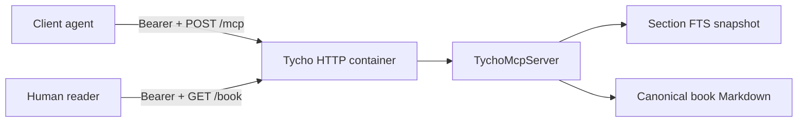

# Local HTTP MCP container and client smoke

> Issue [#367](https://github.com/rouslanbaranov/tycho/issues/367), E09-07,
> and evidence issue [#373](https://github.com/rouslanbaranov/tycho/issues/373),
> M5. **Status:** local container plus an authenticated Vercel test deployment,
> 2026-10-24. Not a production service; not independently reviewed; no OAuth,
> per-client authorization, rate limiting or owner acceptance is claimed.
> Vercel supplies TLS and the domain.

## Purpose

[scripts/mcp_http_server.py](../scripts/mcp_http_server.py) wraps the merged
stdio MCP adapter in a read-only HTTP service so client agents and humans can
reach the book, search and MCP tools over the network. The stdio adapter
remains the canonical protocol implementation.

The service is deliberately bounded; it is tested locally and on Vercel:

- modern MCP 2026-07-28 stateless JSON-RPC over `POST /mcp`;
- bearer-token authentication from the environment;
- `GET /search` and `POST /search` for the same section index;
- `GET /book` and `GET /book/<path>` for raw canonical Markdown;
- `GET /health` and `GET /ready` for container readiness;
- no writes to the book, index or query log during requests.

Legacy `initialize` is rejected over HTTP because this wrapper is stateless.
SSE subscriptions, sessions and the legacy handshake remain outside the local
prototype.

The diagram describes the local prototype, not a deployed production topology.

## Endpoints

| Route | Auth | Purpose |
|---|---|---|
| `GET /health` | no | Liveness only; no book data |
| `GET /ready` | no | Snapshot identity and counts |
| `POST /mcp` | bearer | Modern MCP JSON-RPC |
| `GET /search?q=...` | bearer | Bounded section search |
| `POST /search` | bearer | JSON search arguments |
| `GET /book` | bearer | HTML list of Markdown pages |
| `GET /book/<path>` | bearer | Raw canonical Markdown |

MCP requests may include `MCP-Protocol-Version`, `Mcp-Method` and, for tool
calls, `Mcp-Name`. A mismatch returns HTTP 400 with code `-32020`.

## Security boundary

- `TYCHO_MCP_TOKEN` is required at startup; there is no anonymous MCP,
  search or book access.
- Tokens are compared with `hmac.compare_digest`; they are never logged.
- The container runs as an unprivileged user and the compose profile uses a
  read-only root filesystem plus a small `/tmp` tmpfs.
- Book reads reject absolute paths, `..`, backslashes, symlinks and paths
  outside `book/`.
- The query log is disabled; no request writes the book, index or evidence.
- TLS is not implemented in the process. A terminating proxy or container
  host must provide TLS, request limits, per-client authorization and audit
  retention before any shared deployment.

## Build and run

Set a high-entropy token in the environment; do not commit it:

~~~sh
export TYCHO_MCP_TOKEN='<set-a-long-random-token>'
docker build -f Dockerfile.vercel -t tycho-mcp-local:0.1 .
docker run --rm --read-only --tmpfs /tmp:size=16m \
  -p 8000:8000 -e TYCHO_MCP_TOKEN tycho-mcp-local:0.1
~~~

Or with compose:

~~~sh
TYCHO_MCP_TOKEN='<set-a-long-random-token>' docker compose up --build
~~~

The image builds the section index during `docker build`; the runtime image
contains the book, schema, route index and pattern registry.

## Client smoke

Standard-library client, no SDK required:

~~~sh
TYCHO_MCP_TOKEN="$TYCHO_MCP_TOKEN" .venv/bin/python \
  scripts/mcp_http_client_smoke.py --url http://<container-host>:8000 \
  --query "retry budget"
~~~

Official SDK client, Python 3.11+ and `mcp==2.3.0` in a separate environment:

~~~sh
TYCHO_MCP_TOKEN="$TYCHO_MCP_TOKEN" \
  /tmp/tycho-mcp-sdk-2.3.0/bin/python scripts/mcp_http_sdk_smoke.py \
  --url http://<container-host>:8000
~~~

Both smokes exercise discovery, `tools/list`, `tools/call`, `/search` and
a book page. They are transport checks, not agent answer-quality evaluation.

## Measured local evidence - 2026-10-24

| Observation | Value |
|---|---|
| Host runtime | Docker 28.3.2 on macOS |
| Base image | `python:3.12-slim` |
| Image | `tycho-mcp-local:test`, `sha256:b397fef04fb0...`; 264 MB |
| Book and index | 423 documents, 2,753 sections |
| Section snapshot | `f0a80c286a3f6b5bc6db20898389146ea330ffc9a92168df2a65579935325329` |
| Read-only run | `--read-only --tmpfs /tmp:size=16m` |
| Vercel-ready port run | `PORT=8080`; health, standard client and SDK passed |
| Health | HTTP 200, no auth |
| MCP discovery | HTTP 200, modern 2026-07-28 only |
| Tools | 7 |
| Search call | `ok`, 2 results, citation returned |
| HTTP search | `ok`, 2 results |
| Book page | HTTP 200, 10,181 bytes |
| Standard client | exit 0 |
| Official SDK client | protocol 2026-07-28, 7 tools, search `ok`, 2 results |
| Vercel URL | https://tycho-theta.vercel.app |
| Vercel readiness | 423 documents, 2,753 sections, section snapshot `f0a80...` |
| Vercel no-auth boundary | HTTP 401 for /mcp and /search |
| Vercel clients | standard client and mcp 2.3.0 client both exit 0 |

These are single-machine and remote test observations, not a latency, capacity
or security benchmark.

## Vercel compatibility

Vercel's container runtime can deploy an OCI image as an autoscaling Function.
It detects a project-root `Dockerfile.vercel`, serves HTTP on port 80 by
default and honors the `PORT` environment variable. The image uses that
filename and the server reads `PORT` at startup, so the same image is a
candidate for Vercel Functions.

- Set `TYCHO_MCP_TOKEN` in the Vercel project environment.
- Set `PORT=8080` in the Vercel project environment. The image runs as uid
  10001 and does not bind privileged port 80.
- Vercel supplies TLS and the domain; the process still does not implement
  OAuth, per-client authorization or rate limiting.
- Scale-to-zero and cold starts apply. The section index is built into the
  image; there is no persistent `/tmp` or query log.
- The test deployment is live at https://tycho-theta.vercel.app. It uses
  the project environment variables TYCHO_MCP_TOKEN and PORT=8080; the token
  is not recorded here.
- Remote checks passed: health, readiness, no-auth 401 for MCP/search,
  standard-library client and official mcp==2.3.0 client.

See the public Vercel guide
[Running Docker on Vercel](https://vercel.com/kb/guide/docker).

## Tests

~~~sh
.venv/bin/python -m unittest discover -s tests \
  -p 'test_tycho_mcp_http.py' -v
~~~

The four tests cover authentication, discovery, tools/list, tools/call,
search, book files, traversal refusal, readiness, malformed JSON and header
mismatch. The container build and client smokes remain manual evidence.

## Limits and next gates

- Vercel provides TLS for the test deployment, but there is no OAuth,
  per-client authorization, rate limiting or durable audit sink. The one
  static bearer token is suitable only for a restricted test.
- The Vercel deployment is a test, not production acceptance; scale-to-zero,
  cold starts and the absence of persistent disk apply.
- No legacy HTTP handshake, sessions, SSE subscriptions, cancellation
  processing or progress forwarding.
- The book route returns raw Markdown; it does not render a reading site.
- A stable host beyond the Vercel test needs explicit capacity, auth and
  operations decisions. GitHub Pages cannot run it; GitHub Actions runners
  are ephemeral.
- No independent review, human acceptance, CI result or production claim.
  `sufficient: 0`.

## Related records

- [Read-only stdio MCP record](MCP-READ-ONLY-MVP.md)
- [MCP follow-up questions](https://github.com/rouslanbaranov/tycho/issues/362)
- [Service container issue](https://github.com/rouslanbaranov/tycho/issues/367)
