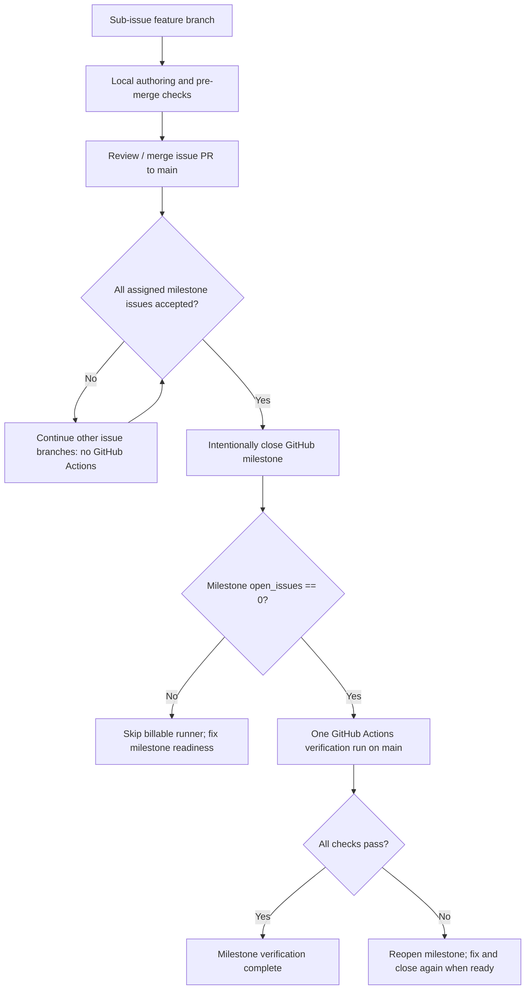

# Milestone-only GitHub Actions policy

Status: repository-wide execution policy from [Issue #104](https://github.com/rouslanbaranov/tycho/issues/104). This deliberately replaces earlier per-PR and per-commit pipelines to reduce CI minutes during high-volume book authoring. **Do not equate a merged issue PR with a successful milestone CI run.**

## When pipelines run

The *only* active GitHub Actions workflow is [Milestone verification](../.github/workflows/boundary.yml).



Text alternative: individual issue changes receive local pre-merge review with no automatic GitHub runner. When a milestone's assigned work is accepted, closing that milestone triggers one consolidated verification run, but only when GitHub reports zero open assigned issues. Failure requires reopening and correcting before attempting a new milestone closure.

GitHub's documented event `milestone: closed` requires the workflow to exist on the repository's **default branch**; it does not automatically fire when the issue count reaches zero. Closing the milestone is an explicit release/acceptance action. The milestone event runs at the latest `main` commit, not against an individual PR head.

## Before each issue merge — no Actions minutes

1. Continue one issue per `feature/TYCHO-<issue-number>-<task-desc-slug>` branch.
2. Verify the issue's title and slug; check independence, cited public sections, Markdown links, source inventory/catalog and any affected examples.
3. When a checkout is available, use:

```bash
python3 scripts/premerge_check.py \
  --branch feature/TYCHO-104-run-ci-only-at-accepted-milestone-boundaries \
  --issue-title '[E15-05] Run CI only at accepted milestone boundaries'
```

Replace the arguments for other issues. The local script checks the exact branch/title match, source boundary, public source validation, catalogue freshness and all `test_tycho*.py` unit checks. It executes on the author's own environment, not a GitHub-hosted Actions runner.

4. Record any unavailable local checks explicitly. Independently review material correctness, document and diagram provenance, unresolved unknowns and targeted acceptance criteria. Merge/close the **issue** only with adequate evidence; the issue is then provisionally complete pending milestone-wide verification.
5. Do not close a milestone while its issues remain open or while known material acceptance gaps exist, even if scripts pass.

## At milestone readiness — one batched CI run

Closing a milestone with `open_issues == 0` runs the single read-only job:

- `scripts/check_boundary.py`
- `scripts/validate_sources.py`
- `scripts/source_catalog.py --check`
- `python3 -m unittest discover -s tests -p 'test_tycho*.py' -v`

This checks accumulated changes together, including cross-page structural regressions. A green run is **mechanical acceptance only** and does not establish that architectural assertions are technically true, that the entire book is complete, or that independent human review took place.

**If the workflow fails:** record failed steps, reopen the milestone, correct under the relevant feature branches, rerun local checks, and reclose only when ready. A milestone remains unverified until a completed successful workflow run exists. Never report a skipped job as passed.

## Deliberately retired automation

The following non-milestone workflow files were removed; their reusable scripts remain for offline maintenance:

- `feature-branch.yml`: no GitHub PR runner. Exact branch naming is checked by `scripts/check_feature_branch.py` via the pre-merge wrapper.
- `book-first-order.yml`: previous one-time work-order migration was completed; it must **not** run on future commits or milestones.
- `reconcile-delivery-hierarchy.yml`: the original issue-graph reconciliation script is no longer compatible with a changed issue inventory and book-first dependency graph; it must **not** be run automatically. A revised migration, if ever needed, requires a separate reviewed maintenance issue and an explicitly verified plan.

This policy does **not** silently remove repository branch-protection rules if they already exist. A required PR status check expecting a deleted workflow may block merges and must be updated administratively; no evidence of such a rule is asserted here. Preserve review requirements despite absence of per-PR Action runs.

## CI cost intent and limitations

The number of automatic GitHub-hosted verification runs changes from commits/PRs to **at most one intended pipeline per milestone-close action**. Failures that require reopening/reclosing a milestone can incur another run. Publishing a PR, editing a branch or closing an individual issue never requests the consolidated pipeline.

There are no scheduled pipelines, manual-dispatch workflows or workflow chaining in the repository after this change. Do not reintroduce these without a reviewed policy change.
