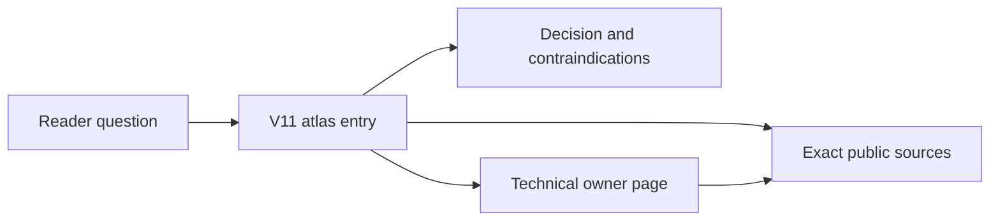

# Pattern atlas authoring contract

> Status: Phase 0 contract, 2026-10-21, issue #228. The owner selected an
> eleventh volume as a navigation and decision layer. This contract fixes the
> volume boundary, ownership, page policy, evidence rules and edition changes.
> It does not claim that source reading, authoring or independent review is done.

## Purpose and reader

The atlas is for a reader who already has a problem and needs to decide whether
a named pattern is relevant. It answers: which conditions must hold, what would
disqualify the option, which alternative competes under the same assumptions,
what fails, and where the canonical explanation and exact sources live.

It is not a glossary, a popularity ranking, a vendor catalogue or a replacement
for the technical chapters.

Text alternative: a reader question leads to one atlas entry; the entry gives
the decision summary, links to the technical owner and cites exact sources. The
technical owner also cites sources; the atlas does not replace it.

## Volume and chapters

- Volume: `book/volumes/v11-pattern-atlas/`.
- Title: `V11 — System Design pattern atlas`.
- Chapters use `cNN-<description>` names and stay inside V11.
- Each chapter has a landing and as many bounded pages as its content requires.
- The 145 catalog entries are sections within chapter pages, not 145 chapters.

- `V11/C01` — `c01-application-boundaries` —
  application architecture and boundaries; 12 entries.
- `V11/C02` — `c02-api-communication` — API and service
  communication; 12 entries.
- `V11/C03` — `c03-messaging-integration` — messaging and
  event-driven integration; 20 entries.
- `V11/C04` — `c04-consistency-events` — data
  consistency, transactions and event sourcing; 14 entries.
- `V11/C05` — `c05-caching-retrieval` — caching and retrieval;
  14 entries.
- `V11/C06` — `c06-database-storage` — database and storage
  architecture; 13 entries.
- `V11/C07` — `c07-resilience` — resilience and fault
  tolerance; 16 entries.
- `V11/C08` — `c08-coordination` — distributed coordination;
  9 entries.
- `V11/C09` — `c09-scalability` — scalability and load
  distribution; 10 entries.
- `V11/C10` — `c10-deployment-modernization` — deployment and
  legacy modernization; 12 entries.
- `V11/C11` — `c11-security-operations` — security,
  isolation and operational architecture; 13 entries.

## Page-count policy

Page count is content-dependent. A chapter may need one page or many. The split
follows coherent questions, subfamilies and ownership, never a fixed two- or
three-page quota. A large family may need several card pages; a small family may
fit on one. There is no upper bound other than editorial coherence, the page-size
safety cap and the reader's ability to follow the route.

Page count is inventory, not acceptance, and an empty page is forbidden even
when the chapter map reserves a slot. Each chapter decides its page split during
Phase 1 and records it in the atlas manifest. A later split or merge is an
editorial change, not a failure of the plan.

## Entry card contract

Every catalog entry has one atlas section containing:

1. Identity: catalog name, aliases, family, provisional kind and priority. The
   priority is a research hint, not a measured usage frequency.
2. Decision question: the bounded choice the entry helps answer.
3. Good-fit conditions: workload, ownership, correctness and operating
   preconditions, with the evidence or unknown status attached.
4. Hard contraindications: a condition that rejects the option even when
   throughput or cost look attractive.
5. One competing alternative under the same assumptions: retain/simplify or a
   distinct mechanism, with the observation that would reverse the choice.
6. Failure and recovery summary: the invariant, the partial-failure path and
   what the reader must verify in the technical owner.
7. Technical owner link at an exact section, or an explicit
   `technical-owner-missing` finding.
8. Exact public sources: URL or edition, version, section and the actual scope
   read. Unread or blocked material is marked, never cited as support.
9. Decision state: `candidate`, `applicable-under-conditions`,
   `contraindicated`, `insufficient-evidence` or `not-required`.
10. Related entries and cross-pattern routes, kept short and link-first.

An entry is not a miniature technical chapter. If the mechanism needs more than
a compact orientation, link to its owner instead of duplicating the explanation.

## Ownership and coverage model

| Layer | Owns | Does not own |
|---|---|---|
| Technical owner | Mechanism, guarantees and deep evidence | Decision summary |
| Atlas section | Decision, applicability and alternatives | Deep mechanism |
| Registry | Membership, owners and coverage | Reader-facing prose |

Each pattern records two independent coverage layers:

- `technical`: whether a canonical technical explanation is sufficient;
- `decision`: whether the atlas entry has the decision content above.

Overall coverage is the weaker layer. An atlas entry cannot make a missing
technical explanation sufficient. The severity order for overall coverage is:

`sufficient` < `partial-reviewed` < `partial-bounded` < `partial` <
`name-only` < `contradictory` < `missing` < `not-yet-assessed`.

## Section-level owner units

Page-level ownership is not evidence that a page explains a pattern. Every carded
entry must therefore name exactly one **owner unit**: one heading section of its
technical owner page whose text owns that pattern's mechanism.

- `dedicated`: the section heading names the pattern or an alias, including a
  bounded note under `## Bounded pattern ownership notes`.
- `embedded`: another section substantively explains the pattern under a
  different title.
- No unit means `name-only`. A carded entry may not remain `name-only`; the
  remedy is a bounded owner note on the owner page, not a new page or ID.

Each unit records verbatim page evidence for mechanism, invariant, failure and
recovery, and alternative. Quotes are validated as exact substrings of the unit
body; a missing dimension is recorded as `partial` or `absent` with a reason,
never invented. The decision layer records the card's decision question,
competing alternative, decision state, ten components and exact source record.

Derived coverage states:

- `partial-bounded`: one unit explains the mechanism and states an invariant;
- `partial`: one unit explains the mechanism but states no invariant;
- `partial-reviewed`: bounded plus a named independent technical review (none
  exists in this corpus);
- `sufficient`: a dedicated deep explanation with independent review; not
  claimed by section-level evidence alone.

Shared owner pages (more than one carded pattern) additionally record a
`keep`, `deepen` or `split` decision. `deepen` means the page needs deeper
per-pattern sections; `split` records a future page-split candidate without
performing the split. The audit artifact, schema and validator are
`edition/patterns/owner-units.v1.json`,
`schemas/pattern-owner-units.v1.schema.json` and
`scripts/validate_pattern_owner_units.py`.

`not-applicable` is used only when both layers are genuinely out of scope for the
catalog entry and the reason is recorded. An unknown is not a contraindication.

## Link rules

- Atlas section -> technical owner at an exact anchor; the anchor must exist.
- Primary technical owner -> atlas section; the link is required before the
  entry can claim `sufficient` decision coverage.
- If no technical owner exists, the atlas section says
  `technical-owner-missing` and links to the remediation issue or records an
  owner decision. A dangling link is forbidden.
- Bidirectional links are validated. Exceptions need an explicit reason, not a
  silent omission.

## Source policy

- Use public, independently admissible sources only. No restricted or
  employer-specific material.
- Read the whole lawfully accessible admitted unit. A versioned documentation
  page is a unit only when it is explicitly admitted as that page; a landing
  page or snippet is not a complete reading.
- Record source ID, edition or revision, access date, exact sections, tables and
  images inspected, licensing and limitations.
- Never cite unread material. Mark paywalled, unavailable or blocked units and
  seek a lawful alternative; do not infer content from a title or snippet.
- Reuse issue #225 readings only at exact scope and revision. Do not modify its
  frozen baseline or claim its research as this issue's delivery.
- Keep original synthetic examples and arithmetic clearly labelled. Never
  present an illustration as a measurement.

## Registry and audit artifacts

Phase 0 artifacts:

- `edition/patterns/registry.v1.json` with all 145 entries and stable IDs;
- `schemas/pattern-registry.v1.schema.json`;
- `scripts/validate_pattern_registry.py` and adversarial tests;
- `edition/patterns/BASELINE.md` with the verified starting tree.

Phase 1 artifacts:

- `edition/atlas-manifest.json` for the live volume and documents;
- `edition/patterns/page-census.v1.json` for every canonical document;
- `edition/patterns/coverage-map.v1.json` and the reverse map;
- atlas volume and chapter landings with real entry inventories.

Later artifacts:

- page audit with the fourteen dimensions per entry;
- reading ledger and source-to-claim mapping;
- gap matrix, duplicate-owner report and exceptions;
- cross-pattern decision routes and retrieval questions.

## Edition mechanics

Adding V11 is a structural edition change, not a book-only edit:

- add V11 to `edition/outline.json` and the current contents table;
- add live volume, chapter and page identities to the atlas manifest;
- register post-migration directories and canonical additions in
  `edition/directory-migration.json` without rewriting the historical map;
- update `validate_edition.py`, `validate_directory_migration.py`,
  `validate_enrichment.py`, affected tests and expected counts;
- rebuild the route index, inventory, identity registry and topic references;
- update current status counts while keeping dated historical statements dated.

The target edition version is `2026.10.2-rc.1`. Phase 0 keeps the current
edition version because it does not change the book. Historical migration,
decomposition and enrichment records remain immutable evidence.

## Definition of done additions

- Every catalog entry has one atlas section and an exact technical owner or an
  explicit missing-owner finding.
- Every atlas card has applicability, contraindications, an alternative,
  failure/recovery, a decision state and exact source support.
- Primary technical owners link back to the atlas.
- The page census and page-disposition audit cover the old corpus and all V11
  pages.
- Independent editorial review is recorded separately from self-checking.

## Phases

1. Phase 0: ADR, contract, baseline, registry schema, 145-entry skeleton,
   validator and adversarial tests.
2. Phase 1: atlas scaffold, edition overlay, page census, coverage map and
   updated validators.
3. Phase 2: source reading by family with a reading ledger.
4. Phase 3: authoring by family, backlinks and applicability cards.
5. Phase 4: full page audit, gap matrix, cross-pattern routes and retrieval
   questions.
6. Phase 5: delivery checks, independent review and final DoD evidence.
7. Phase 6: semantic page audit of the canonical corpus, independent review and owner
   acceptance.

## Review status and limits

This contract is self-checked Phase 0 material. No source reading, technical
experiment, independent review, release or deployed behavior is asserted. The
catalog is a research and authoring backlog, not a measured popularity survey.
