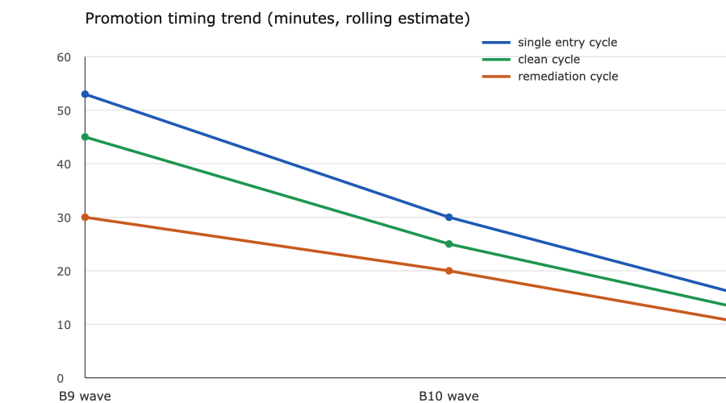

# Promotion timing statistics

Status: observed instrumentation, not a forecast guarantee. Times come from session
turn timestamps and commit times on 2026-10-29 (Europe/Zurich), rounded to the
nearest five minutes. Historical entries 1-20 predate this log and have no
per-entry timestamps.

## Observed batches

| Batch | Window | Entries attempted | Promotions gained | Elapsed | Per promotion |
|---|---|---:|---:|---:|---:|
| B9 wave 1 (TTL, Branch, Clean, Fencing) | 16:20-18:05 | 4 | 2 (TTL, Fencing) | ~105 min | ~53 min |
| B10 wave (Gatekeeper, Health, Multi-Leader) | 17:25-18:25+ | 3 | 0 so far | >60 min | not yet |

B9 wave 1 included two failed entries (Branch, Clean) and one withdrawn TTL
promotion. Counting only the two promoted entries, the observed cycle is
about 50 minutes per promotion. A clean single-entry remediation-review-
promotion cycle has been 30-45 minutes; a first-pass entry needing new source
research has been 60-120 minutes.

## Averages used for estimates

- clean promotion cycle: 35-50 min/entry;
- remediation cycle after a failed review: 20-40 min/entry;
- new-source or 0/4 research cycle: 90-180 min/entry;
- batch overhead (integration, refresh, suite, packets): 45-90 min/batch.

## Remaining estimate

Current: 22 sufficient of 145; 7 owner-accepted of 22.

Remaining to 145: 123 entries. Using a blended 60-90 min/entry plus batch
overhead gives 125-190 focused hours, or **5-8 days of continuous work**.
With review failures and owner acceptance, the planning range remains
**8-11 days**. The dominant cost is the 90 partial entries that still need
new evidence, not the already 4/4 entries.

## Report block

Every work report includes:

- promotions gained this batch;
- elapsed batch time;
- average minutes per promotion;
- remaining entries and estimated continuous days.

This log is updated when a batch closes; it is not evidence of review, CI or
owner acceptance.

## Trend chart

Points, left to right: B9 wave, B10 wave, delta. Values are rolling estimates
in minutes from `authoring/promotion-timing.v1.json`; they are not stopwatch
measurements. The chart is regenerated with `scripts/promotion_timing_chart.py`.
