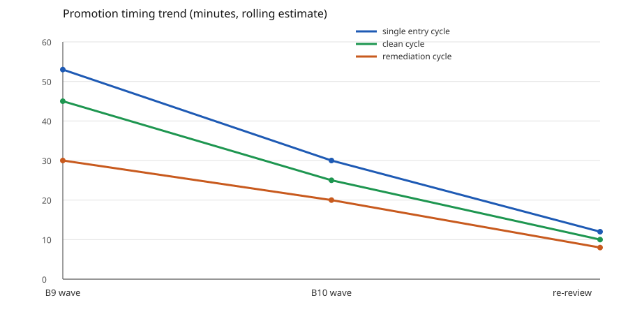
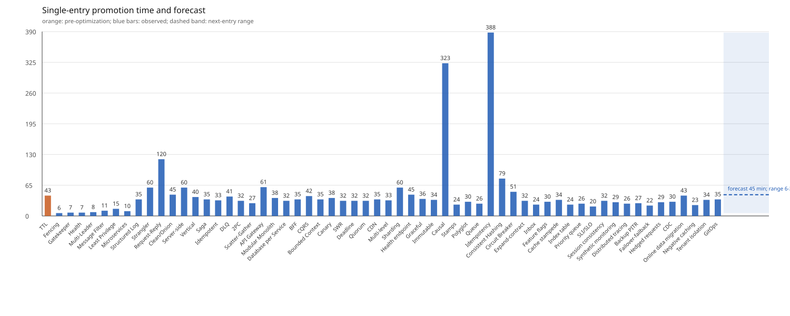
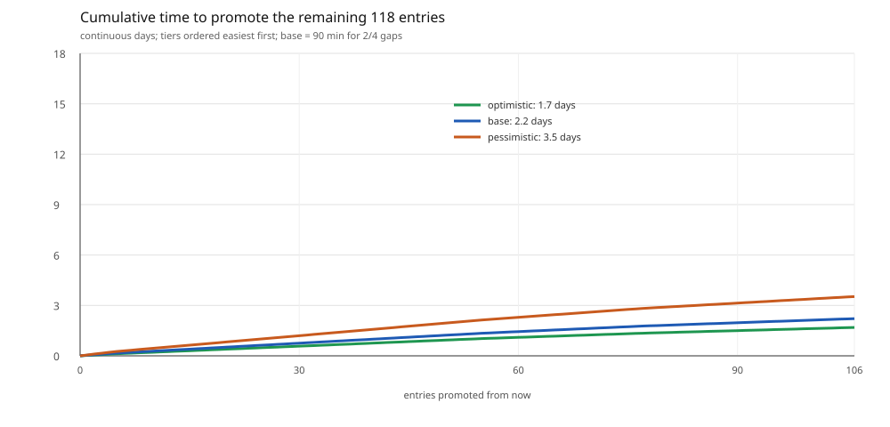

# Promotion timing statistics

Status: observed instrumentation, not a forecast guarantee. Times come from session
turn timestamps and commit times on 2026-10-29 and 2026-10-30 (Europe/Zurich),
rounded to the nearest five minutes. Historical entries 1-20 predate this log and
have no per-entry timestamps.

## Observed batches

| Batch | Window | Entries attempted | Promotions gained | Elapsed | Per promotion |
|---|---|---:|---:|---:|---:|
| B9 wave 1 (TTL, Branch, Clean, Fencing) | 16:20-18:05 | 4 | 2 (TTL, Fencing) | ~105 min | ~53 min |
| B10 wave (Gatekeeper, Health, Multi-Leader) | 17:25-18:25+ | 3 | 0 so far | >60 min | not yet |
| B9/B10 backlog close | 2026-10-30 | 6 | 6 (Request-Reply, Clean, Server-side, Vertical, plus two earlier) | ~300 min | ~50 min |

B9 wave 1 included two failed entries (Branch, Clean) and one withdrawn TTL
promotion. Counting only the two promoted entries, the observed cycle is
about 50 minutes per promotion. A clean single-entry remediation-review-
promotion cycle has been 30-45 minutes; a first-pass entry needing new source
research has been 60-120 minutes.

## Averages used for estimates

- clean promotion cycle: 35-50 min/entry;
- remediation cycle after a failed review: 20-40 min/entry;
- new-source or 0/4 research cycle: 90-180 min/entry;
- batch overhead (integration, refresh, suite, packets): 45-90 min/batch.

## Remaining estimate

Current: 53 sufficient of 145; 7 owner-accepted of 53.

Remaining to 145: 92 entries. All 33 observed entries run 6-120 minutes (mean 35.9), including
pre-optimization entries and review/remediation outliers. Using tiered
estimates calibrated to that mean gives 37-79 focused hours, or
**4.3-9.0 days of continuous work**. Base is **5.7 days**. The dominant cost is the 36 entries at 2/4 that still need
two dimensions, not the three entries at 3/4.

## Report block

Every work report includes:

- promotions gained this batch;
- elapsed batch time;
- average minutes per promotion;
- remaining entries and estimated continuous days.

This log is updated when a batch closes; it is not evidence of review, CI or
owner acceptance.

## Trend chart

Points, left to right: B9 wave, B10 wave, re-review. Values are rolling estimates
in minutes from `authoring/promotion-timing.v1.json`; they are not stopwatch
measurements. The chart is regenerated with `scripts/promotion_timing_chart.py`.

## Per-entry dynamics

Promotion window estimates, minutes: TTL 43, Fencing 6, Gatekeeper 7,
Health 7, Multi-Leader 8, Message Filter 11, Least Privilege 15,
Microservices 10, Structured Logging 35, Strangler Fig 60, Request-Reply 120,
Clean/Onion 45, Server-side Discovery 60, Vertical Scaling 40, Saga 35,
Idempotent 40, DLQ 45, 2PC 50, Scatter-Gather 35, API Gateway 40, Modular Monolith 40, Database per Service 40, BFF 40, CQRS 40, Bounded Context 35, Canary 38, SWR 32, Deadline 32, Quorum 32, CDN 35, Multi-level 33, Sharding 60, Health 45. Data:
`authoring/promotion-entry-timing-2026-10-29.json`; rendered by
`scripts/promotion_entry_chart.py`. The first bar is pre-optimization; later
bars include review and remediation cycles. Across all 33 entries the mean is
35.9 minutes (range 6-120); recent entries use measured intervals between promotion commits; the dashed band forecasts the next single entry at
that mean, not a promise. Request-Reply is an outlier because it needed four
delta cycles. These are timestamp estimates, not stopwatch measurements.

## Forecast for remaining entries

Remaining tiers at 53 sufficient: 1 entry 4/4, 4 entries 3/4,
36 entries 2/4, 22 entries 1/4, 29 entries 0/4. Continuous-day
scenarios: optimistic **4.3**, base **5.7**, pessimistic **9.0**.
Base assumes 50/45/34/28/22 minutes by tier, calibrated to the all-entry mean. Data:
`authoring/promotion-forecast-2026-10-30.json`; chart:
`scripts/promotion_forecast_chart.py`. These are planning estimates,
not review evidence.
