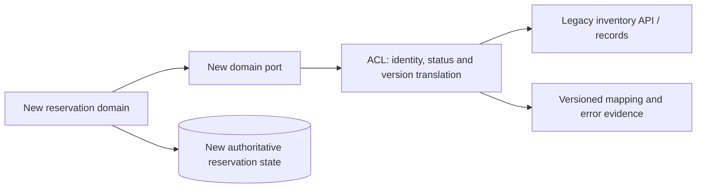
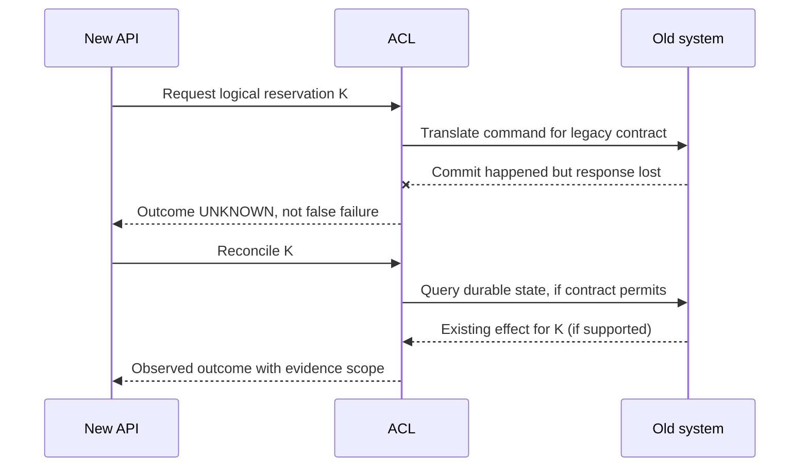

# Anti-corruption adapters: semantic translation and safe coexistence

> **Tycho book manuscript V02/C06, 2026-10-19.** Independently reviewed public pattern guidance, original synthetic examples and diagrams. No actual legacy source, internal architecture, integration test, consumer migration or independent design review was used.

## Purpose and mission

When two systems use different models, simply making their APIs exchangeable can preserve hidden semantic incompatibilities. An old interface may call a request “accepted” before durability is established, while a new domain considers acceptance a durable business promise. Translating the word without translating its meaning is dangerous.

An **anti-corruption layer (ACL)** mediates between a consumer's canonical domain model and another subsystem's model. Its purpose is to prevent foreign assumptions from spreading into core business logic, while preserving externally required behavior. It is not by definition a standalone service, a universal façade, or a message queue.

The [Microsoft Azure Architecture Center ACL pattern](https://learn.microsoft.com/en-us/azure/architecture/patterns/anti-corruption-layer) describes a translation boundary between incompatible models and warns about latency, operational overhead, trust and consistency. [Fowler's bounded-context explanation](https://martinfowler.com/bliki/BoundedContext.html) explains why related concepts can have different valid meanings in different contexts. The [domain ownership chapter](domain-boundaries-data-ownership-and-contracts.md) owns context identity and authority; this chapter owns *actual mediation and failure behavior*.

## 1. An adapter has a semantic contract, not just a schema mapping

| Adapter responsibility | Safe question | Unsafe shortcut |
|---|---|---|
| Identity mapping | Is one new entity equal to one old ID, many old IDs, or only a time-scoped mapping? | Copy a numeric ID and assume global uniqueness |
| Status interpretation | Do states imply committed, pending, failed or unknown effect? | Rename old “queued” to new “completed” |
| Validation and access | Which domain rules and authorization checks are authoritative? | Trust a foreign upstream “validated” flag |
| Temporal behavior | Can old state lag, arrive out of order or be overwritten by retries? | Treat message order as transaction order |
| Value semantics | Can amount, timestamp, unit or locale be converted losslessly? | Round or default without a recorded business decision |
| Error translation | Is this a permanent rejection, temporary unavailability or unknown outcome? | Map every timeout to “not found” |
| Version support | Which old/new combinations are required during transition? | Assume release of new code retires all old clients |
| Recovery | What can be replayed, reconciled, rolled back or forward-repaired? | Assume retry is always safe |

An adapter should either preserve a required invariant or explicitly mark a conversion *partial/unsupported*. Unknown is not success. Input validation and service authorization must remain at enforceable business boundaries.

## 2. Original synthetic case: an equipment catalogue migration

A fictional community equipment catalogue is being rewritten while clients still query a legacy inventory feed.

In the invented legacy feed, a row can have a product-level identity, display status “open”, a last-refresh timestamp and several inventory locations. The new domain distinguishes a physical item's *allocatable identity*, inspection restrictions and committed reservation. A simplistic one-to-one row mapping confuses product visibility with physical-unit availability.

**Text alternative:** the new domain calls its own port, not a foreign inventory DTO. The adapter queries a legacy interface, translates identity and state, and records unresolved mapping or version errors. New reservation state remains under its own authority. The diagram does not assert the old inventory service is safe, fast or permanently required.

Define one explicit contract: **an item may be allocated only if the authoritative eligibility rule is satisfied**. If the legacy feed cannot distinguish a physical item from a model type, no exact mapping is possible without a new source or additional confirmation. An adapter must not manufacture eligibility from an ambiguous “open” flag.

## 3. Synchronous and asynchronous mediation are different choices

A synchronous ACL may be an in-process module or an independent proxy. A request traverses the foreign dependency's latency, availability, transport and authorization boundaries. Its failure can directly delay the caller.

An asynchronous ACL may subscribe to events or consume change-data capture and create a local projection. This reduces direct latency coupling but introduces freshness lag, replay/ordering, duplicate processing and divergent model state. It is inappropriate where the user promise requires authoritative immediate consistency that the projection cannot provide.

| Topology | Can help | Requires explicit proof |
|---|---|---|
| In-process synchronous adapter | Few extra deployments, straightforward local instrumentation | Isolation from untrusted payloads, timeout and circuit behavior |
| Standalone synchronous mediator | Shared translation needs and independent lifecycle | Additional hop, deployment failure, consistent auth enforcement |
| Event-driven translation/projector | High read demand and tolerable stale data | Replay, event identity, ordering scope, lag observability |
| One-time batch migration translator | Finite data movement with snapshot | Cutover completeness, referential integrity and no later old writes |
| Temporary bidirectional adapter | Long coexistence of client semantics | Ownership conflict avoidance and no unguarded dual writer |

An ACL does not solve a distributed transaction. If both old and new systems accept independent writes, a translator alone cannot make those writes atomic. The transition may require a single authoritative writer, controlled command routing, reconciliation and explicit no-return gates. [Outbox and idempotency](../distributed/transactional-outbox-and-idempotency.md) covers publication and duplicate boundaries; [schema evolution](../delivery/progressive-delivery-and-schema-evolution.md) covers staged client/data migration.

## 4. The critical lost-acknowledgment problem

**Original proposed failure:** the new booking API asks the legacy inventory to reserve an item. The old system commits, but its response times out. If the adapter converts timeout to “failed, safe to retry,” a second request may allocate again or trigger another notification.

Correct adapter behavior depends on the foreign protocol:
- If a scoped idempotency identity exists, repeat with the same identity and reconcile to the durable original outcome.
- If only a status read exists, query it using a stable business identity and handle uncertain/inconsistent results explicitly.
- If the foreign system provides neither, the adapter cannot honestly guarantee that blind retries are safe. Surface **unknown outcome**, use bounded manual/automated reconciliation subject to business policy, or redesign the contract before accepting effects.

**Text alternative:** after a legacy commit, an acknowledgment can be lost. The translator preserves an unknown outcome and only reconciles through a verifiable legacy contract. This diagram is a proposed design, **not** a guarantee that such a query exists in a real interface.

## 5. Change and eventual retirement are part of the pattern

If migration is staged, an ACL can remain for a finite coexistence window, then be removed when old dependencies and clients are gone. Alternatively it may become a stable permanent interface to an uncontrollable partner. The choice affects test ownership, observability, contract deprecation and support costs.

A migration protocol should define:
1. Existing identity/status mappings and semantic invariants at a versioned source snapshot.
2. All callers and consumers requiring old fields, errors or ordering.
3. Positive and negative fixture tests, including absent/invalid/old values.
4. Shadow comparisons where permitted, without treating shadow outcomes as authoritative writes.
5. One-writer authority during each transition step; prohibition or explicit coordination of overlapping writes.
6. Fault-injected timeouts, retried commands and lost acknowledgments.
7. Visibility into translation failures, poison events, backlog and reconciliation.
8. A staged cutover gate and removal criterion for foreign semantics.
9. Revert/forward-repair conditions for persisted data that old code cannot interpret.

The independently public [Strangler Fig pattern](https://learn.microsoft.com/en-us/azure/architecture/patterns/strangler-fig) describes gradual replacement of capabilities, with explicit coexistence cost. It does not prove that every small or inaccessible system can be migrated by request interception.

## 6. Security, correctness and performance trade-offs

An ACL crosses different trust levels and may process untrusted or malformed data. Validate IDs, payload sizes, encoding, numeric ranges and authorization at the actual effect boundary. Do not proxy arbitrary paths or credentials to a foreign system. Bound concurrency and caches, distinguish transient from permanent failures, and avoid presenting stale derived state as authoritative.

Extra translation can incur measurable CPU, serialization and network latency; a remote ACL can become a bottleneck or shared failure domain. An asynchronous projection may relieve caller latency at the cost of freshness and replay. There is no universal reason to introduce a separate deployment when an internal adapter can safely preserve the required semantics.

**Negative experiment:** supply a payload whose old status has no new equivalent, lose the old command response after commit, replay the same event twice and simulate conflicting owner changes. The correct result is either a validated translated effect or explicit inability to guarantee it—not silent success. No such tests were run for this chapter.

## 7. Public source-to-claim ledger

| Inspected public source | Narrow supported point | Not established |
|---|---|---|
| [Microsoft ACL pattern](https://learn.microsoft.com/en-us/azure/architecture/patterns/anti-corruption-layer) | Boundary translation, operational/latency/trust/consistency trade-offs | Real inventory protocol guarantees |
| [Fowler — Bounded Context (2014)](https://martinfowler.com/bliki/BoundedContext.html) | Internally consistent but differing domain models | Specific mapping completeness |
| [Microsoft Strangler Fig pattern](https://learn.microsoft.com/en-us/azure/architecture/patterns/strangler-fig) | Controlled coexistence during incremental replacement | Validated cutover of fictional data |
| [Tycho legacy baseline](../decisions/legacy-baseline-and-modernization-evidence.md) | General evidence-first modernization methodology | Executed migration or accepted target architecture |

All system names, mappings, state-machine decisions, examples and figures are invented for teaching. No proprietary DDD book was reproduced. No integration, failure injection, independent reviewer or real-system validation has been performed. The exact final edition chapter/page hierarchy remains pending.

## Navigation

- Proposed **V02/C06**, current [application landing](README.md).
- Prerequisites: [Domain boundaries/data ownership](domain-boundaries-data-ownership-and-contracts.md), [API contract evolution](http-rpc-contracts-and-compatibility.md).
- Related: [Outbox/retries](../distributed/transactional-outbox-and-idempotency.md), [safe rollout](../delivery/safe-rollout-and-recovery.md), [legacy assessment](../decisions/legacy-baseline-and-modernization-evidence.md).
