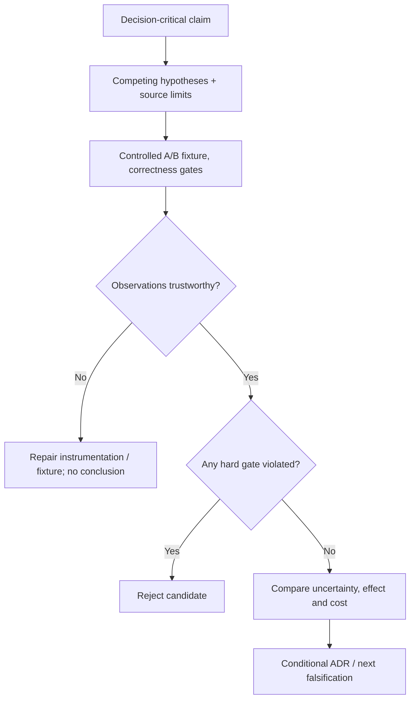

# Architecture evidence, competing hypotheses and decision experiments

> **Tycho manuscript V01/C04 (2026-10-19).** Original experimental method and invented example; bounded public arc42 and SRE materials reviewed. No benchmark, controlled fault, actual source inspection of a target application, statistical acceptance or independent expert review has been executed.

## Purpose and mission

A design opinion is often expressed as an empirical claim: “a cache will reduce latency,” “a queue prevents failure,” or “splitting a service improves availability.” Such claims are incomplete without a workload, a correctness definition, an alternative causal explanation and a way to falsify the benefit.

A **source-backed architectural assertion** can be grounded in a published specification, while a **system-specific architectural benefit** generally requires evidence at its own target boundary. Published PostgreSQL or Kubernetes documentation explains configurable mechanisms; it does not demonstrate that one configuration improves an invented application.

This chapter distinguishes a claim's source and scope from a testable engineering hypothesis, and establishes a small experiment lifecycle. The existing [capacity-experiment page](../performance/workload-profiles-and-capacity-experiments.md) supplies detailed load-test methods; [benchmark validity](../performance/load-testing-and-benchmark-validity.md) owns generator and measurement traps.

## 1. Five evidence classes are not substitutes

| Evidence class | What can be concluded | What remains unknown |
|---|---|---|
| Requirement | Desired outcome and hard gate from an authorized owner | Whether current or proposed implementation achieves it |
| Primary public specification | Documented semantics at version/scope | Actual deployment configuration and compliance |
| Versioned source/config observation | A particular revision expresses an implementation/configuration | Which revision is running and what happens under load |
| Reproducible experiment | Observed behavior within tested fixture, inputs, population and limits | Universal performance/correctness of untested conditions |
| Analytical model | Conditional mathematical relationship given assumptions | Whether the assumptions represent the target system |

A proposed design diagram is a **sixth state: a proposal**, not evidence that the depicted services or fault controls are implemented. Citations must attach to the actual proposition they support, not merely to a file containing related keywords.

For important claims, record: exact question, boundary, statement, evidence type, source revision/section, date, assumptions, conflicting observations, unknowns, and decision significance.

## 2. Competing hypotheses beat single-cause stories

An original fictional public trail directory serves a list of trail descriptions and shows increased p99 after a software release.

Possible explanations:
- H1: a database query plan regressed after data distribution changed;
- H2: an application connection pool waits longer under the same offered rate;
- H3: a new external enrichment request is now on the critical path;
- H4: clients retry more after ambiguous errors, multiplying demand.

“Add caching” is not a diagnosis. It might help repeated reads under H1 but worsen freshness and stampede behavior, and it may have no effect on H3's external timeout.

A hypothesis becomes useful only with a **discriminator**:

| Hypothesis | Observation that supports it | Observation that weakens it |
|---|---|---|
| H1: query plan | Query plan, table stats and DB time differ at same input mix | Plan and measured DB time unchanged |
| H2: pool wait | Queue/pool wait dominates parent critical path | Pool acquisition negligible during affected traces |
| H3: enrichment | Optional span now serially blocks response | Span remains out of required path |
| H4: retries | Attempts per logical operation rise, especially after errors | Logical arrivals and attempt multiplicity unchanged |

None of these observations proves a cause in isolation. A changed index plan can coexist with retry amplification. A valid experiment must compare alternatives and control for correlated variables.

## 3. Define the experiment contract before the result

Write this in advance:

1. **Claim:** under scenario X, change Y improves user-visible metric Z without violating invariants.
2. **Boundary:** where the clock starts, what counts as a logical request, and which system/resources are included.
3. **Alternatives:** unchanged or smallest-safe baseline and a materially distinct candidate.
4. **Workload:** source/version of input trace, arrival schedule, key skew, old/new client mix and dataset.
5. **Hard gates:** permissions, correctness, durable state, compatibility and recovery.
6. **Expected signature:** which metric should change if the hypothesis is true and which independent metric would contradict it.
7. **Repetition and uncertainty:** trials, warm/cold state, random order, noise and acceptable range; disclose limitations.
8. **Abort and rollback:** conditions where proceeding could cause unsafe outcomes.
9. **Evidence record:** exact tool versions/configuration, raw observations, analysis scripts, failed checks and independent review status.

Pre-registering a decision criterion avoids adjusting the threshold until a preferred candidate wins. It does not make a weak benchmark scientifically valid; the fixture still needs representative, accurately observed demand and correctness.

## 4. A worked fictional experiment: cache versus query repair

The trail directory considers two hypothetical changes:

- **Candidate A:** fix a measured missing index or query plan if H1 is supported.
- **Candidate B:** introduce a read-through cache with defined TTL/invalidation if read repetition and acceptable staleness are established.

Control the same dataset, actual offered query schedule, permissions, node/DB resource ceilings and cache warm/cold state. Report success, errors, p95/p99, DB work, cache hit/miss, stale results and cost, not only latency of completed requests.

A valid negative test changes the underlying trail closure and queries immediately after. If a cache serves unsafe outdated closure information while the contract requires current data, candidate B **fails a hard correctness gate** regardless of latency gains. This failure is expected to be observable even without a high-load test.

Text alternative: define the claim and rival explanations before running controlled experiments. Verify denominator and setup first, reject any correctness violation, then compare only candidates that pass. If evidence is inadequate, repair the experiment rather than select the preferred pattern.

## 5. Negative evidence and the stopping condition

The outcomes **MEASURE_FIRST**, **INSUFFICIENT_EVIDENCE**, and **REJECTED_BY_GATE** are legitimate engineering conclusions. They are preferable to asserting “proven architecture” because a diagram, retrieved paragraph or synthetic example looked plausible.

Examples of stopping conditions:
- the load generator fails to emit the intended traffic;
- a critical metric excludes timed-out requests without disclosure;
- the source describes a different runtime major version;
- a test uses different application/data revisions between contenders;
- an authorization/consistency invariant fails;
- a supposedly reversible change wrote a state that the old version cannot read;
- the expected benefit is smaller than documented measurement noise;
- there is no known owner authorized to accept the changed service contract.

A negative test should be designed to challenge the conclusion, not merely satisfy a checklist. When the result is insufficient, record the narrowest next source, measurement or owner decision needed.

## 6. Evidence-first research does not mean evidence-free certainty

[arc42 §10 Quality Requirements](https://docs.arc42.org/section-10/) asks for concrete quality scenarios; [arc42 §9 Architecture Decisions](https://docs.arc42.org/section-9/) stresses options and reasons. These support a decision method but do not specify a universal statistical test. A user-facing latency SLO should count operations at a clear boundary and explain which timeout/rejection populations enter its denominator; [Google SRE SLO Workbook](https://sre.google/workbook/implementing-slos/) offers publicly documented SLI/SLO selection and trade-offs.

A source supporting "service X can enforce a retry limit" does not establish "our app is safe under retries." The second claim needs exact configuration/behavior and effect-identity testing. Source-to-claim provenance prevents this common inference error.

## 7. Public ledger and limitations

| Public source consulted | Supported narrow principle | Unproven |
|---|---|---|
| [arc42 Quality Requirements §10](https://docs.arc42.org/section-10/) | Explicit, measurable quality scenarios | Any workload's achieved SLO |
| [arc42 Architecture Decisions §9](https://docs.arc42.org/section-9/) | Alternatives, rationale and decisions | An accepted option for the fictional trail app |
| [Google SRE Workbook: Implementing SLOs](https://sre.google/workbook/implementing-slos/) | Service-indicator boundaries and SLO methodology | Actual user latency/availability |
| [Tycho benchmark validity](../performance/load-testing-and-benchmark-validity.md) | Generator and observation limitations | A performed controlled test |

The trial, metric hypotheses, workload, figure and failure consequences are original teaching material. There are no run results, third-party architecture approvals or measured improvements. Full source-by-claim audit, book metadata and final volume organization remain outstanding.

## Navigation

Proposed **V01/C04** in [planned outline](../PROPOSED-STRUCTURE.md); current [application landing](README.md). Prerequisite [system context](problem-framing-and-system-boundaries.md), [quality drivers](quality-drivers-and-architecture-views.md). Continue to [architecture alternatives/ADRs](../decisions/architecture-alternatives-experiments-and-adrs.md), [benchmark methods](../performance/load-testing-and-benchmark-validity.md), and [capacity experiments](../performance/workload-profiles-and-capacity-experiments.md).
