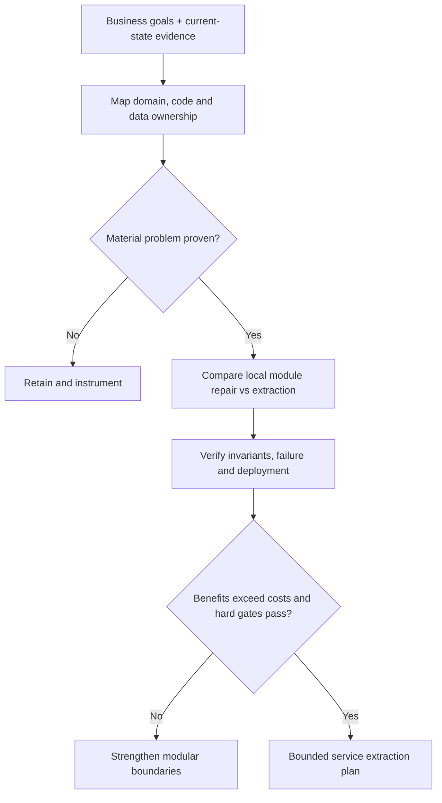
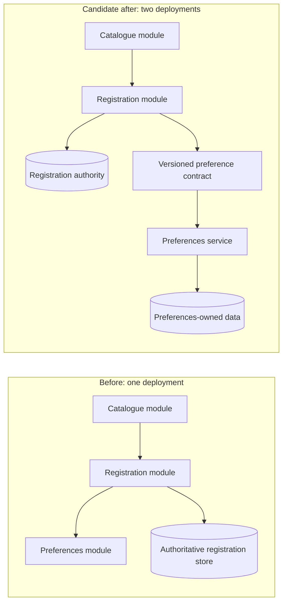
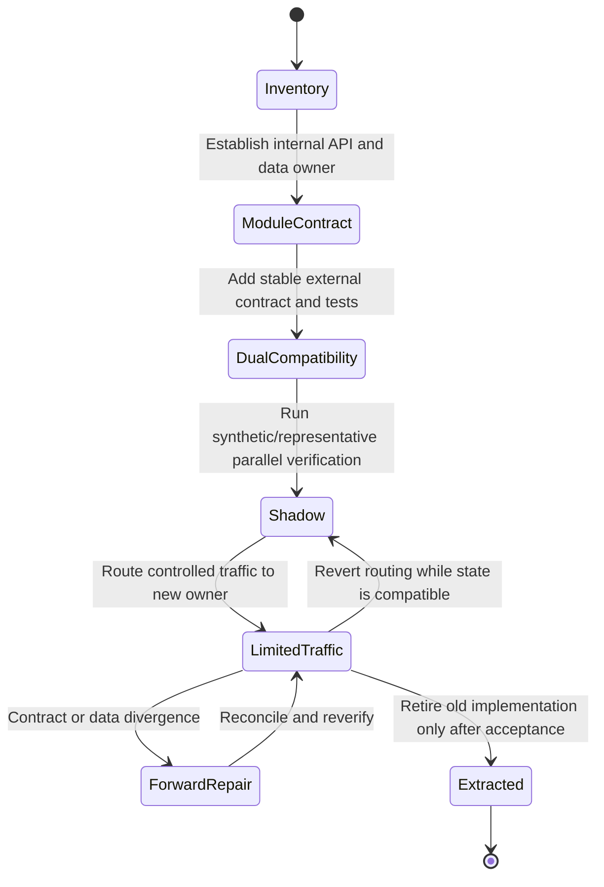
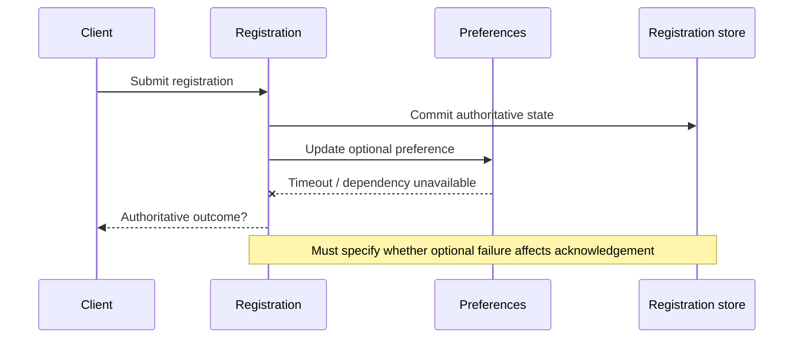

# Architecture evolution: when to keep, modularize or extract a service

> **Tycho research page — Issue #79**, proposed V02/C03–C06. Public source review: **2026-10-18**. Original explanation and wholly synthetic migration case; not a completed architecture assessment or independently verified modernization plan.

## Purpose and mission

A legacy system does not become easier to change simply because a module is moved behind a network API. Modernization succeeds only if the proposed boundary preserves essential invariants, exposes clear contracts, supports a safe migration sequence, and reduces **measured** change or operational friction enough to pay for its new complexity.

This page explains a bounded method for identifying a cohesive extraction candidate and deciding whether to **retain**, **restructure internally**, or **distribute** it. The canonical terminology and trade-offs are in [application architecture styles](architecture-styles-and-module-boundaries.md). Rollout compatibility and data recovery are owned by [the recovery pilot](../delivery/safe-rollout-and-recovery.md); externally delivered events by [the outbox pilot](../distributed/transactional-outbox-and-idempotency.md).

## 1. Start with an observed baseline, not a preferred destination

A useful legacy baseline records facts separately from suspected causes:

| Dimension | Minimum evidence | Example of an invalid leap |
|---|---|---|
| Change coupling | Which files/modules/tests/deployments change together over a representative period | "The codebase is large, therefore it needs microservices" |
| Runtime contention | Operations, offered/completed throughput, queueing, resource service demand and bottlenecks | "High p99 proves we need separate services" |
| Domain cohesion | Language, business rules, ownership, transaction boundaries and ambiguous overlapping concepts | "One database schema equals one bounded context" |
| Operational burden | Build/release lead time, rollback procedure, incident scope, on-call capability and ownership | "More independently deployable units automatically make incidents smaller" |
| Data coupling | Shared tables, writes, update ordering, isolation and referential/cross-domain invariants | "An API wrapper makes shared-table writes safe" |
| External compatibility | Downstream contracts, old clients, event versions, migration/recovery windows | "Rollback of the binary also undoes its data mutations" |

Do not assume that the baseline itself has been measured just because the checklist exists. Unknowns must be linked to concrete inspection or experiment tasks.

Text alternative: obtain a baseline and map responsibility; if no material change pressure exists, keep the simpler design and measure. Otherwise compare local modular improvements with an actual service split and test correctness, failure and delivery before approving it. This is an **original decision process**, not an automated selector.

## 2. Three credible modernization options

### Option A: keep the deployment, improve the architecture

When domain and transaction cohesion are strong, isolate internal modules, publish contracts, enforce dependency direction, protect data ownership and add tests. This preserves an in-process interaction model while reducing accidental coupling. Cockburn's 2005 ports-and-adapters report directly motivates isolation of application logic from presentation and database technology, including the ability to test with alternate adapters. [E01]

Good candidates: poor module encapsulation, slow code reviews caused by accidental dependencies, UI/batch interface churn, data persistence technology leakage into domain logic, or unverified "modular" packaging.

Bad assumption: module separation automatically solves contention in a shared database, independent release constraints or poor failure isolation. It may not.

### Option B: extract a coarse, independently deployable capability

A capability may need independent release cadence, specialized resource budgets or separate operational ownership. Lewis and Fowler's 2014 microservices article describes independently deployed service components and also acknowledges remote-call cost, data decentralization and the difficulty of moving logic across process boundaries. [E02]

Good candidates: cohesive ownership, stable external contract, explicit authority, separate deployment value and a team able to own the service's operation, tracing, security and version migration.

Risk indicators: two capabilities requiring many tiny synchronous calls, a transaction spanning both new stores, highly volatile interface ownership, or no way to replay/reconcile partial failures. Separating the executable without separating business responsibility may worsen coordination.

### Option C: postpone distribution and collect evidence

Fowler's 2015 *Monolith First* essay discusses the costs of premature microservice separation and the difficulty of predicting stable boundaries early. Crucially, the author states these are tentative patterns informed by anecdotes rather than settled universal evidence. [E03] Therefore keeping one executable while evolving domain knowledge can be a **defensible interim choice**—not a requirement for all projects.

The decision can reverse when integration tests and realistic load show a boundary can be operated independently, data ownership is transferable and the gain is worth its cost.

## 3. A wholly synthetic before/after example

Assume a fictional workshop registration application currently has one executable with **catalogue**, **registration**, and **notification preference** modules. The actual business invariant is: a workshop must never have more confirmed registrations than capacity.

The team hypothesizes that extracting notification preferences will allow independent release while preserving the registration invariant.

Text alternative: before extraction, preference handling is an in-process module. After extraction, it becomes a separately deployed owner reached through a defined contract, while registration retains its original authoritative seat-allocation store. Both diagrams are proposed, not observed.

This candidate is **not** equivalent to splitting catalogue and registration, because those capabilities could share time-sensitive capacity and registration invariants. An apparently easy API split might introduce a cross-service concurrency protocol; the correct boundary is contingent on actual business semantics, not the size of a package.

### Decision constraints

- **Hard gate:** registration correctness must not depend on the preferences service being available.
- **Hard gate:** confirmed registration and its client-visible identity stay durable under retry, crash and rollback.
- **Preference:** preferences-only changes should deploy without rebuilding the registration executable.
- **Preference:** on-call staff should not need to coordinate multiple releases for one small preference change.
- **Unknown:** actual frequency and cost of preferences-only changes, failure handling, integration latency, operational budget and data migration effort.

A service extraction is only justified if these constraints can be tested and its added cost is acceptable. Merely making a diagram look more distributed is not evidence.

## 4. Candidate transition states—not just a target diagram

Text alternative: document the baseline, strengthen the internal module contract, build a compatible external boundary, verify behavior before admitting real traffic, promote incrementally, and retire old functionality only when the user outcome and state checks pass. A routing reversal is not valid after an incompatible data mutation; that state requires forward repair or tested recovery.

The state machine illustrates a *possible* sequence. It does not prescribe deploying a shadow service in all organizations or guarantee that equivalence testing is sufficient for writes. For stateful or side-effecting operations, shadowing must be explicitly non-mutating or isolated; otherwise comparison can itself create duplicate business effects.

### Failure surfaces that the new boundary introduces

Text alternative: after the authoritative registration commit, an optional preference update may time out. The protocol must define whether registration succeeds independently, what is retried and how the preference state is reconciled. No external preference failure may silently invalidate an already acknowledged seat assignment unless that is explicitly part of the domain contract.

The [outbox page](../distributed/transactional-outbox-and-idempotency.md) explains local transaction versus event publication and duplicate effects. Do not copy its implementation details into this page.

## 5. How to test whether decomposition helped

An acceptable experiment compares **the same synthetic or independently measured workload and user objectives** before and after the candidate change:

| Hypothesis | Measure or test | Falsifying evidence |
|---|---|---|
| Separate preferences releases reduce change coupling | Count change packages, deployment frequency and coordinated releases | Nearly every change still requires joint deployment |
| Cross-boundary calls will not harm registration outcomes | Offered/completed rate, p95/p99, deadline/failure injection and error budget | New dependency latency or outages affect the hard registration SLO |
| Correctness remains locally enforceable | Repeat concurrent seat allocation and ambiguous-request tests | Duplicate confirmation, over-capacity or lost committed outcome |
| Recovery stays possible | Mixed N/N+1 schema/API test, rollback rehearsal and data reconciliation | Old instances cannot understand new state or event versions |
| Operational overhead is affordable | Team ownership, extra logs/metrics/traces, infra cost and incident staffing | Additional maintenance cost exceeds independent-deploy gains |

No numbers are fabricated for those experiments. A missing baseline should produce **measure first**, not a forced modernization recommendation.

## 6. Evidence, applicability and unresolved research

| ID | Public source and inspected section | Supported narrow statement | What it does not prove |
|---|---|---|---|
| E01 | [Cockburn, Hexagonal Architecture](https://alistair.cockburn.us/hexagonal-architecture), 2005 report, *Intent*, *Nature of the Solution*, *Structure* | Separating application logic from external technology and interchangeable adapters | Tests against fake adapters prove production DB semantics |
| E02 | [Lewis/Fowler, Microservices](https://martinfowler.com/articles/microservices.html), 2014, *Componentization via Services*, *Organized around Business Capabilities*, *Decentralized Data Management* | Independent deployment and contracts change responsibility and communication costs | Distributed services are always cheaper, safer, faster or necessary |
| E03 | [Fowler, Monolith First](https://martinfowler.com/bliki/MonolithFirst.html), 2015, full essay including caveats | Boundary stability, early service overhead and a tentative alternative to immediate distribution | General proof that every team should start monolithic |
| E04 | [Spring Modulith 1.3.12, Verifying Application Module Structure](https://docs.spring.io/spring-modulith/reference/1.3/verification.html) | Illustrative versioned module-cycle, API access and dependency verification rules | Any particular codebase has passed those rules |

**Review status:** researched and mechanically reviewable draft, independent subject/human review not recorded. No existing software, workload benchmark, compatibility experiment or migration was executed. Formal applicability cards and detailed legacy baselines remain separate roadmap tasks; this page is the conceptual basis, not a completed substitute.

**Insufficient-evidence decision:** "A legacy app deploys too slowly; should we split all modules into microservices?" **Not enough information.** Need build/deployment timing breakdown, the dependency and change graph, release risk, module contract violations, team operational constraints and a narrowly scoped comparative test. Fixing a slow pipeline or dependencies within a modular monolith may be less disruptive than distributing every capability.
