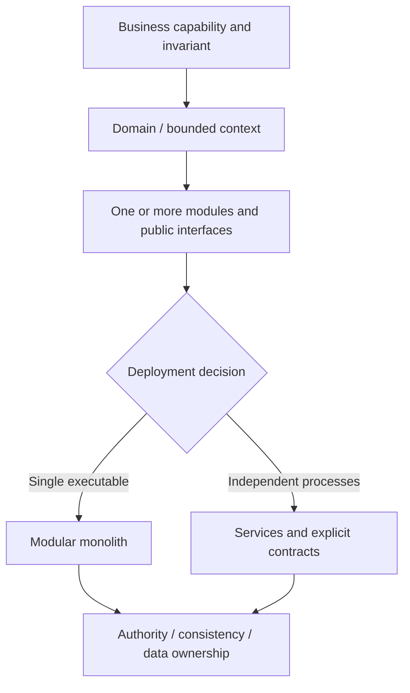
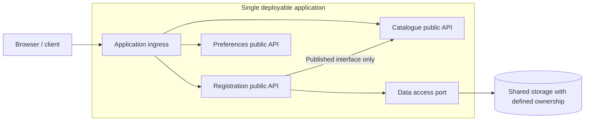
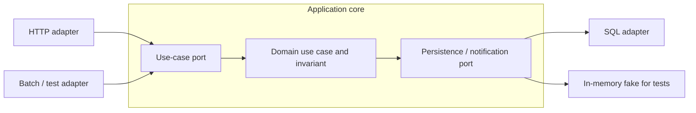
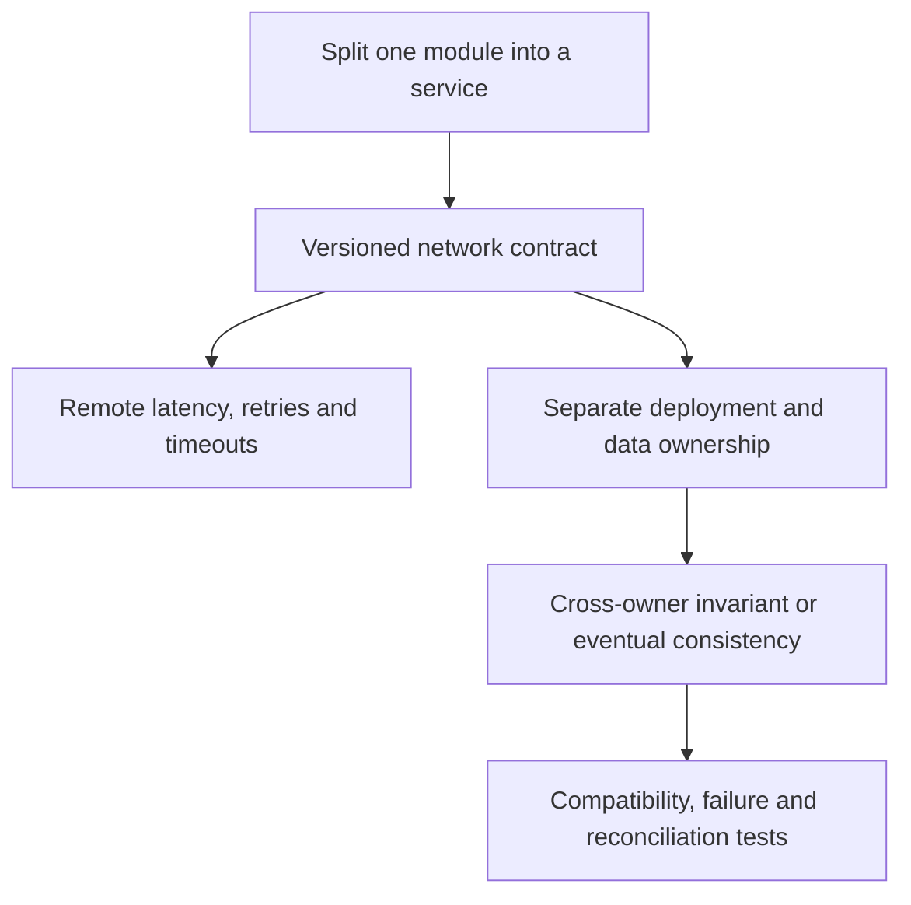
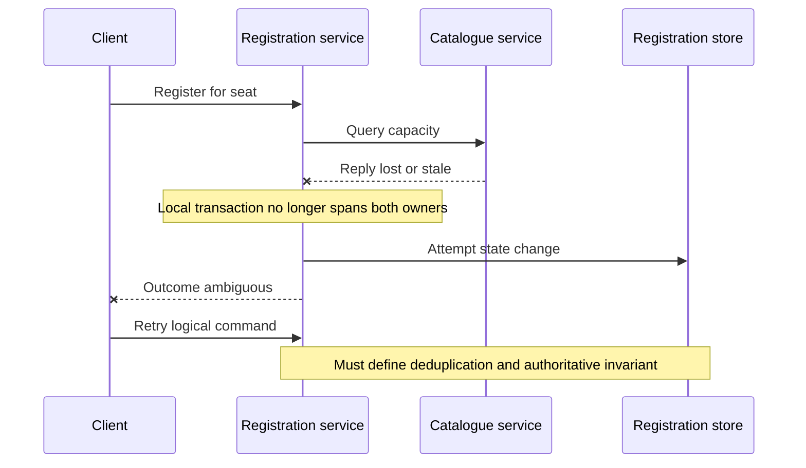

# Application architecture styles: modules, services and ownership boundaries

> **Tycho research page — Issue #79**, proposed V02/C01–C04. Public source reading: **2026-10-18**. Status: independently researched draft, *not* independently reviewed or evaluated on a deployed system. This page is original explanation and synthetic illustration; cited sources are bounded publications, not experimental performance guarantees.

## Purpose and mission

Choosing between a layered application, a modular monolith, service orientation and microservices is not a vote about modernity. The engineering question is **which responsibilities and ownership boundaries must remain coherent, which changes must be independent, and which costs can the system and team support**. A useful architectural description states how functionality is divided, where data and invariants live, how components interact, what deploys independently, and what can fail independently.

This page establishes those distinctions and reviews the conditions that could justify each style. Detailed extraction/modernization belongs to a separate page; detailed distributed transaction semantics are already researched in [the outbox and idempotency chapter](../distributed/transactional-outbox-and-idempotency.md). Load mathematics belongs to [the queueing page](../performance/queueing-littles-law.md).

## 1. Separate four different architectural axes

| Dimension | Core question | Misleading shortcut to avoid |
|---|---|---|
| **Business/domain boundary** | Which concepts, rules and invariants belong together, with one consistent language? | Treat every database table or REST endpoint as a bounded context |
| **Code/module boundary** | Which implementation details are hidden behind an explicit contract? | Call a package tree "modular" without checking its dependency edges |
| **Runtime/deployment boundary** | Which artifacts or processes can be released, scaled and rolled back independently? | Assume a separate process automatically establishes a good domain boundary |
| **Data ownership and coordination** | Where is authoritative state and which consistency/transaction guarantees apply? | Assume a separate database per service makes cross-service invariants atomic |

A **bounded context** in DDD is a boundary within which a domain model and language remain internally consistent; Fowler's *Bounded Context* article explains why distinct contexts may model the same real-world notion differently. It does *not* equate one bounded context with exactly one process, service or database. [E01]

A **module** is an encapsulated responsibility inside a codebase. A **deployment unit** is something released as a unit. A **service** is an externally interactable capability, but its precise boundaries vary by architecture and source. A service may own multiple processes and a process may contain several modules. Do not infer a one-to-one mapping without evidence.

Text alternative: first define the business boundary and cohesive modules, then decide whether they require one executable or independently deployed processes. Both choices still need explicit data ownership and correctness rules. This is an **original decision map**, not a universal transformation sequence.

## 2. Monolith does not mean unstructured code

A monolithic application can be a single deployment unit and still contain **well-separated functional modules**. The defining cost is shared deployment and often shared process/runtime failure exposure, not an inability to implement interfaces, contracts or strong domain separation. Lewis and Fowler's 2014 *Microservices* comparison describes one logical server-side executable and notes that multiple instances of such a monolith can be load-balanced. A monolith is therefore **not inherently restricted to one machine**. [E02]

### Example: fictional workshop application

Imagine a new system with three cohesive functions: catalogue, registration and notification preferences. It begins as one deployed application and isolates its domain modules, rather than allowing all source files to call each other's internals.

Text alternative: the application deploys as one unit, but catalogue, registration and preferences expose deliberate internal module APIs. Data access crosses a named port; using one physical database does not exempt the design from explicit table/data ownership.

**Candidate invariants:** a registration must not exceed workshop capacity; retrying a logical request must not create duplicate confirmed registrations. Their enforcement belongs in the authoritative transaction or other proven coordination mechanism, not in a diagram or naming convention.

The trade-offs of the modular monolith include:

- **Benefits:** in-process calls can reduce network-failure complexity; one atomic transaction boundary may be available for strongly connected features; one pipeline and fewer separately configured runtimes can simplify early delivery.
- **Costs:** releasing a tiny change may require deploying the whole process; one hot subsystem may drive replicas of unrelated modules; broad runtime failure exposure and leaky internals can grow with the application.
- **Failure cases:** circular module dependencies, informal data ownership, the illusion that packages cannot reference internals, and central code that mixes many domain concepts.
- **Measurements needed:** change co-occurrence by capability, build/deploy duration, observed saturation source, dependency coupling, ownership friction, correctness invariants and incident history.

An independent deployment decision must be justified by something more concrete than projected DAU. The [workload profile model](../../authoring/models/requirements-workload-profile.md) explains why user counts cannot determine service capacity or appropriate boundaries.

### Enforcing logical boundaries with code

The public **Spring Modulith** reference (reviewed as 2.1.x; versioned 2.1.0 overview explicitly identifies module-oriented Spring Boot development) documents a module model built from public/required interfaces and internal implementation. Its verification documents rules such as absence of cycles between modules, API-only access to internals and optional allowed-dependency constraints. [E03] That is a specific implementation option, **not** a requirement that all monoliths use Spring or a claim that any instance in this book was checked.

Boundary checks could also be built using language visibility, dependency-test rules or separate build modules. Technical constraints should correspond to the actual module architecture; merely drawing arrows does not enforce them.

## 3. Hexagonal architecture is about dependency direction, not deployment count

In Cockburn's 2005 original *Hexagonal Architecture* report, the application exposes conceptual **ports** for purposeful interactions and technology-specific **adapters** translate external devices, interfaces and data stores to those ports. The primary distinction is **inside vs outside**. The hexagon shape does not prescribe six adapters, one service, or deployment as microservices. Its value is independent application testing and reduced coupling of domain decisions to UI/database technology. [E04]

Text alternative: HTTP and batch/test input adapters drive the same application contract. The domain use case calls an output port implemented by production SQL or a test fake. The domain need not know concrete HTTP or SQL APIs. The diagram illustrates **port substitution**, not a claim that all adapters are equivalent in behavior.

An adapter boundary requires **behavioral compatibility**, not just interface types. A fake database that does not reproduce uniqueness, isolation or transaction failure can produce false-positive tests. Real integration tests are still needed for production adapters.

**When not to overuse it:** if a small bounded feature has no meaningful external variability, creating a port, interface, adapter and factory for every line can impose ceremony without a corresponding dependency benefit. The decision rests on integration volatility, test isolation requirements, business invariants and change cost—not on the number of arrows in the architecture diagram.

## 4. Service orientation versus microservice packaging

The OASIS **SOA Reference Model v1.0** §2 describes service orientation as organizing distributed capabilities, potentially across ownership domains; §§3.2–3.3 emphasize visibility, interaction, effects, service descriptions, information models and contracts. It does not mandate a particular service size, REST framework, ESB topology or deployment product. [E05]

The 2014 Lewis/Fowler microservices account describes a common style organized by business capabilities with **independently deployable services**, explicit network contracts, decentralized management of capabilities/data and infrastructure automation. It also highlights the cost of remote calls and the difficulty of moving behavior across process boundaries. These are characteristics the authors observed, **not a consensus technical standard or performance guarantee**. [E02]

| Property | Modular monolith | Independently deployable services |
|---|---|---|
| Code encapsulation | Possible and should be checked | Possible, but process boundaries alone are not enough |
| Normal call path | Primarily in-process | Network and/or async messaging across some capability boundaries |
| Independently release one capability | Usually no; change triggers whole executable release | Possible if API, data and compatibility contracts allow |
| Atomic state change across capabilities | May share local transaction when appropriately designed | Cannot assume a single local transaction across owners |
| Failure / performance | Shared runtime and potentially shared resources | Network partitions, retries, fan-out and operational coordination appear |
| Operating cost | Fewer separately operated components | More deployable units, dashboards, contracts and incident boundaries |
| Ownership | Team boundaries can be explicit within one codebase | Separate operational/code ownership becomes easier in some organizations |
| Scale | Replicate or vertically scale process; optimize shared bottlenecks | Scale particular services *if* their dependencies permit it |

**Neither style is automatically more resilient or scalable.** A microservice architecture with synchronous, chatty inter-service calls can amplify timeouts; a replicated monolith with strong cache/data design may serve substantial traffic. Actual performance and resilience must be measured under comparable load and failure assumptions.

### Coupling moves rather than disappears

Text alternative: extraction adds a network contract and changes latency/error semantics. It can also change data ownership; cross-owner business invariants then require explicit coordination, reconciliation and compatibility tests.

## 5. What could justify distribution — and what cannot?

Appropriate evidence for **exploring** an independently deployed service boundary includes a cohesive business capability with an externally clear contract, an established team able to operate it, materially independent release/change pressure, and measured or otherwise validated benefits that exceed additional network and operational costs.

Evidence **against immediate distribution** may include unstable domain boundaries, substantial synchronous chatty calls, data invariants that currently depend on one local transaction, scarce on-call/observability capacity, and no proven need for independent deployment.

Fowler's *Monolith First* essay (3 June 2015) argues for learning boundaries before distributing them but explicitly reports that evidence was anecdotal and exceptions exist. It cautions that extracting arbitrary entangled systems can be very difficult and that teams already skilled in microservices may make different choices. Thus **monolith-first is a hypothesis/strategy, not a universal rule**. [E06]

A useful constrained comparison must record:

1. **Business outcomes and hard gates:** target lead time, failure independence, data consistency, budget, security and migration downtime.
2. **Boundaries:** who owns decisions, user operations, state and protocol versions?
3. **Current architecture:** observed module dependency graph, transaction/data coupling and release bottlenecks.
4. **Workload:** offered arrivals, mix, hot keys, downstream resource saturation and degraded traffic.
5. **Options:** retain/improve monolith; strengthen modular boundaries; extract one coarse service; choose a finer-grained service topology.
6. **Experiments:** prove API version compatibility, latency and fan-out, failure isolation, transaction/reconciliation, deployment and support costs.
7. **Reversal trigger:** identify what observable finding would invalidate the preferred option.

The eventual architecture decision-layer work is scoped in Tycho's roadmap. This page explains options but **does not** claim to calculate optimal architecture from a questionnaire.

## 6. Failure and recovery: synthetic counterexample

A team splits registration and catalogue into remote services to deploy them separately. Registration previously read catalogue capacity inside one transaction. After extraction:

- Catalogue reports a seat capacity over a remote API.
- Registration tries to write a confirmation in a separate authoritative store.
- The catalogue reply times out or changes between the check and write.
- A retried request may see different data and a second invocation.

The extraction changed the transactional boundary. The correct answer cannot be "use an API gateway" or "enable retries": the seat-allocation invariant must be re-specified with an enforceable owner and recovery path. Alternatives include keeping one local transaction, moving authority to one service, or an explicitly validated reservation protocol.

Text alternative: a capacity query across a network can time out or become stale before registration commits. The request may be retried after an ambiguous reply. Authority, idempotency and coordination must be designed separately; the diagram **does not** assume an implementation already solved them.

## 7. Bounded public evidence and honest uncertainty

All material explanations above are independently authored; no commercial-book passages or proprietary system data were reused. This ledger identifies the actual public sections checked on **2026-10-18**. It is not evidence of executing Spring or deploying a distributed system.

| ID | Admitted public source, version | Inspected section or claim scope | Limits |
|---|---|---|---|
| **E01** | [Fowler, Bounded Context](https://martinfowler.com/bliki/BoundedContext.html), 15 Jan 2014 | Model boundaries, internally consistent language and relations between contexts | Secondary explanation of DDD, not the complete Evans DDD Reference PDF |
| **E02** | [Lewis & Fowler, Microservices](https://martinfowler.com/articles/microservices.html), 25 Mar 2014 | Intro; Componentization via Services; Organized around Business Capabilities; Decentralized Data Management; Design for failure | A descriptive, historical article; no measured universal superiority or standard service definition |
| **E03** | [Spring Modulith 2.1.0 overview](https://docs.spring.io/spring-modulith/reference/2.1.0/) and [module verification](https://docs.spring.io/spring-modulith/reference/2.1.0/verification.html) | Modules, APIs/required interfaces, verification of cycles and access constraints | Version-scoped tool documentation, no claim of running a verification on Tycho |
| **E04** | [Cockburn, Hexagonal Architecture](https://alistair.cockburn.us/hexagonal-architecture), original 4 Sep 2005 report, *Intent*, *Nature of the Solution*, *Structure* | Inside/outside, ports, adapters, testing and substitution | Does not prescribe a runtime topology or prove fake adapter semantic equivalence |
| **E05** | [OASIS, SOA Reference Model 1.0](https://docs.oasis-open.org/soa-rm/v1.0/soa-rm.html), §§2.1, 3.2–3.3 | Service visibility, interactions, descriptions and effects | Conceptual reference model, not deployment architecture certification |
| **E06** | [Fowler, Monolith First](https://martinfowler.com/bliki/MonolithFirst.html), 3 Jun 2015 | Early modularity, microservice costs, exceptions and explicit anecdotal limits | Design guidance, not a deterministic rule or empirical benchmark |

## Validation and review state

- [x] One canonical engineering question; deployment/module/context/ownership axes distinguished.
- [x] Modular monolith, service orientation, microservices, hexagonal architecture and bounded-context terminology covered without assuming equivalent scopes.
- [x] Original Mermaid architecture, dependency and failure flows with text alternatives.
- [x] Explicit alternatives, disqualifiers, modernization constraints, workload and failure questions.
- [x] Bounded exact public citations with publication versions and known limits.
- [ ] Independently reviewed DDD reference text, exhaustive architecture foundations and nontrivial extracted service case studies.
- [ ] Runtime experiments, verified latency, costs, service failures or actual target-system modernization.

**Insufficient-evidence question:** "We have 150,000 users and want faster releases. Must we use microservices?" **No conclusion follows from those numbers.** Establish active workload, current release pipeline constraints, module/change dependencies, data ownership, team operational capability, reliability budget and measured alternatives before approving distribution.
