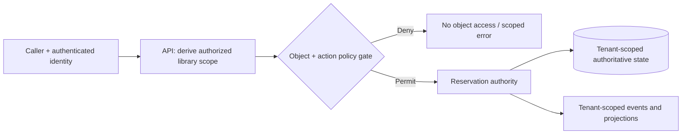

# Authorization boundaries and multitenancy: domain ownership and isolation

> **Tycho book chapter draft V02/C07**, 2026-10-19. Original abstract design and hypothetical fixtures. Public OWASP and independently available multitenancy design guidance consulted. No real tenant data, authorization engine, system credentials, or security assessment was used. [Threat modeling, identity and isolation](../security/identity-authorization-and-isolation.md) owns the security primitives; this chapter owns how tenancy affects *application decomposition and domain authority*.

## Purpose and mission

A deployment can share code and infrastructure while serving users who must never see or mutate each other's state. A logical domain boundary may contain many tenants; a physical database may contain only one. **Tenancy, authorization, domain ownership and runtime isolation are different axes**. Treating tenant ID as a cosmetic query field leads to cross-tenant reads, incorrect caches, unintended background effects and unfair resource consumption.

The architectural question is: **Which isolation guarantees are hard, which may be shared, and at which authoritative boundary are they enforced?** A design should not select one database per tenant or one common database merely because one appears easier to operate.

## 1. Separate four isolation dimensions

| Axis | Requirement to establish | A dangerous assumption |
|---|---|---|
| Identity/authorization | Principal, tenant membership, object ownership, permitted effect | Authenticated automatically means entitled to all objects |
| Data isolation | Which records and indexes may be read, written, exported or restored together | Every query remembers a WHERE tenant_id filter |
| Resource isolation | Which compute, connection, queue, cache and quota capacity may be shared | One tenant's workload cannot delay another's |
| Lifecycle/operations | Who upgrades, backs up, deletes, rekeys and restores a tenant's state | A shared restore can safely rewind one tenant alone |

The [OWASP Authorization Cheat Sheet](https://cheatsheetseries.owasp.org/cheatsheets/Authorization_Cheat_Sheet.html) documents least privilege and deny-by-default. The [OWASP Authorization Patterns guide](https://cheatsheetseries.owasp.org/cheatsheets/Authorization_Patterns_Cheat_Sheet.html) explains that a policy enforcement point must protect the actual resource/action. Applying one filter at a gateway is insufficient when direct job consumers, background work or exported projections can reach the same state.

## 2. Fictional example: community equipment libraries

Imagine one software platform serving several independent neighborhood equipment libraries. A member belongs to a library and reserves one of its physical items. Each library controls its inventory, operating rules and reservation records.

Synthetic domain identities:
- **LibraryId** denotes the tenant context for the invented example.
- **MemberId** may exist in several libraries, but membership/role differs by library.
- **ItemId** may be unique only *within* a library, not globally.
- **ReservationId** identifies a booking with its library and authorizing principal.

Correctness invariant: a caller may read or change a reservation only with a policy decision for its **actual library and specific object**, and a slot cannot be double-allocated within the authoritative reservation state owner.

**Text alternative:** the authenticated caller is checked for permissions on a named object and library; only allowed operations reach the reservation authority, which maintains tenant-scoped state and emits scoped events. The diagram is conceptual and **not** a proof that the actual policy and storage architecture enforce it.

For example, reading a public item description may be permitted across libraries while cancelling a reservation requires tenant-specific membership and object ownership. Do not infer one permission from the other.

## 3. Common storage and placement designs

| Deployment/data model | Potential advantage | Isolation and operational cost |
|---|---|---|
| Shared application + shared tables, tenant key | Efficient resource reuse and simpler global deployment | Every query/join/index/cache/background job needs enforced tenant scope; shared quotas and noisy neighbors |
| Shared application + schema/database per tenant | Easier isolation, restore or migration at data boundary in some engines | Schema/version fan-out, connection pools, orchestration and mapping complexity |
| Dedicated application/runtime and datastore | Stronger physical/resource failure isolation | High per-tenant operating cost, upgrades and observability fragmentation |
| Hybrid by risk/workload | Different tenants receive bounded isolation appropriate to constraints | Routing, placement rules, movement and exceptions become complex |

The [Microsoft multitenancy tenancy-models guide](https://learn.microsoft.com/en-us/azure/architecture/guide/multitenant/considerations/tenancy-models) distinguishes shared versus isolated components as a spectrum, not a universal tier ranking. A model should be chosen against mandatory authorization, data residency, performance, restore and total operating cost requirements rather than aesthetic preference.

## 4. Object authorization and tenant scoping must compose

The following design rules require **tests**, not just declarations:

1. Resolve tenant membership and requested object from authenticated context and authoritative policy, never from an unchecked client-supplied tenant string alone.
2. Enforce object-level authorization at the authority that reads or commits the effect.
3. Check resource ownership during state transitions, not only during initial list/query.
4. Scope every alternate access path: list, search index, caching, pagination, export, archived document and asynchronous worker.
5. Bind stable tenant identity to message/operation IDs, log/audit records and deduplication keys where relevant.
6. Keep tenant-specific encryption/key/retention obligations explicit; deleting a row from the main table may not remove backups, projections and indexes.
7. Enforce per-tenant resource/admission quotas where required for fairness; authorization alone doesn't stop noisy-neighbor overload.

**Synthetic failure:** two fictional libraries both have ItemId 42. A cache keyed only by "item:42" might return library A's private record to a member of library B. The correct key or cache architecture must include an enforced canonical tenant/object context and still validate access at the actual response. Storing a tenant ID in a logging context, by itself, does not enforce that policy.

## 5. Movement between isolation levels is a data migration

A growing tenant might require its own database. That does not make moving it a simple connection-string change:
- establish a consistent snapshot and mutation/change log;
- provision target schema/key/permissions without leaking from neighboring tenants;
- freeze or coordinate the authoritative writer;
- copy and reconcile all tenant-owned records, indexes, events and related exports;
- validate cross-tenant references are actually permitted;
- switch routing with a versioned mapping and tested rollback/forward-repair limits;
- verify old caches/queries and background consumers no longer access the old placement.

A lost mapping, stale tenant-router cache or unguarded dual writer can break both isolation and correctness. [Target versus transition architecture](../decisions/target-and-transition-architecture-states.md) explains migration states; [PostgreSQL/backup recovery](../data/backup-restore-pitr-and-recovery-drills.md) distinguishes restore from logical repair.

## 6. Negative test matrix

| Test | Expected result | Cannot be proven by |
|---|---|---|
| Call authorized for library A on B's reservation | Denied before reading or mutating B object | Valid access token alone |
| Same item ID in two libraries | Strictly separated object/cache identities | Globally non-unique field without scope |
| Bulk export/query for A | No data/metadata from B | Only filtering the first SQL query |
| Async event replay into another tenant | Enforced scope and safe refusal | Valid event schema alone |
| Tenant restore or deletion | No unapproved effects on neighbor tenants | Database instance process health |
| Tenant A floods expensive search | B's declared service quality preserved or explicitly degraded under policy | Global total RPS figure |
| Migrate A between databases | One writer; complete consented state and projection reconciliation | Matching table row count only |

These are *proposed* tests; nothing was executed. An independent security review must validate actual policy, interfaces, stores, caches, external events and operational permissions.

## 7. Source ledger, limitations and navigation

| Independent public source reviewed | Narrowly supports | Unverified |
|---|---|---|
| [OWASP Authorization](https://cheatsheetseries.owasp.org/cheatsheets/Authorization_Cheat_Sheet.html) | Least privilege, deny-by-default and per-object checking | Actual app's correct enforcement |
| [OWASP Authorization Patterns](https://cheatsheetseries.owasp.org/cheatsheets/Authorization_Patterns_Cheat_Sheet.html) | Enforced object/tenant policy decisions near protected resource | End-to-end negative authorization test |
| [Microsoft Multitenant Tenancy Models](https://learn.microsoft.com/en-us/azure/architecture/guide/multitenant/considerations/tenancy-models) | Shared/dedicated/hybrid placement trade-offs | Suitability for invented libraries |

The software, names, diagrams, resources and attack cases are original invented examples. No policy/tenant/restore tests, deployed service, independent audit, actual cost comparison or final edition chapter metadata exists for this page.

**Navigation:** proposed **V02/C07** in [outline](../PROPOSED-STRUCTURE.md), [application landing](README.md). Related [Domain ownership](domain-boundaries-data-ownership-and-contracts.md), [Identity and service isolation](../security/identity-authorization-and-isolation.md), [Safe agent-accessible knowledge](../security/safe-agent-access-and-knowledge-isolation.md), [Connection pool scaling](../scaling/connection-pools-hikaricp-pgbouncer.md).

## Applied M9 evidence: what transfers and what does not

These examples connect the chapter's conditional mechanism to published experiences or synthetic decision exercises. A historical company report is **first-party, time-scoped evidence**, not a controlled Tycho benchmark; an M9 decision playbook is **original synthetic analysis**, not a company decision.

**Case lens — [Netflix — Data Project identity](../cases/netflix-data-project-durable-workload-identity.md)**. **Relevant mechanism or architectural contrast:** Workload identity can outlive departing human owners; entitlement, execution and ownership identities need separate migration. **Not established by this report/playbook:** A first-party deployment account does not prove all Netflix jobs migrated, global least-privilege compliance or an independent audit.

**Transfer test:** before applying the lesson to another legacy system, identify the exact workload, source date, relevant runtime/protocol versions, state authority, failure/recovery gate and the new observation that would reverse the choice. Follow the case's public evidence ledger rather than treating its link as independent proof.
