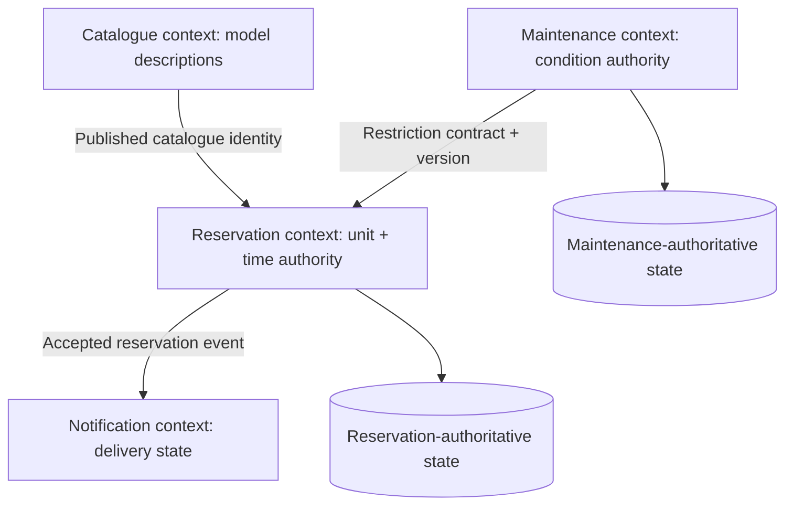

# Domain boundaries, data ownership and contract evolution

> **Tycho manuscript draft — proposed V02/C02**, 2026-10-19. Original explanatory text and fictional examples; independently public context-design references. This chapter is not a model of any real organization or its software. No operational measurement, customer research, migration or independent design review has been performed.

## Purpose and mission

Business concepts are not naturally partitioned into one universal data model. "Available", "reserved" and "delivered" can each mean different things to a catalogue, a reservation capability and a delivery coordinator. Architecture fails when we assume that the same word implies the same invariant, owner or state transition everywhere.

A **domain boundary** defines the meaning and scope of a model. A **module boundary** controls implementation dependencies. A **data ownership boundary** decides who can authoritatively change state. An **API/event contract** communicates chosen facts between boundaries. A **deployment boundary** decides what can be released or fail independently. These distinctions are related but are not the same.

The independent [Fowler bounded-context explanation (2014)](https://martinfowler.com/bliki/BoundedContext.html) describes internally consistent models and explicit relationships across contexts; it does not prescribe one process or database per context. The [arc42 context guidance](https://docs.arc42.org/section-3/) helps document external business exchanges separately from protocols. This chapter owns the *semantics and authority*; [application style choices](architecture-styles-and-module-boundaries.md) own the packaging and deployment trade-offs.

## 1. Model behaviors and invariants before drawing ownership boxes

**Original fictional example:** a community makerspace lends portable projectors. The catalogue describes a projector type and attributes; the reservation capability promises access to a particular physical unit in a time window; the maintenance capability may block damaged units. A user can read the catalogue even if no device is currently available.

| Context | Meaning of “item” | Authoritative responsibility | Relevant invariant |
|---|---|---|---|
| Catalogue | Published projector model/specification | Descriptions, searchability, display attributes | A public description must reference a valid catalogue identity |
| Reservation | Allocatable physical unit + interval | Exclusivity, acceptance, cancellation and expiry | No two overlapping accepted reservations for the same exclusive unit |
| Maintenance | Physical device condition and availability restriction | Inspection, out-of-service state, restoration | An unsafe device cannot be newly allocated |
| Notification | Message to a user | Delivery status and retries | A notification failure does not rewrite a committed reservation |

These meanings are **deliberate inventions**. A shared word "item" should not force a database schema shared by all four contexts. Nor must four contexts become four microservices: a modular application could implement them with explicit in-process interfaces and one deployable.

A boundary is weak if none of its business rules can be stated separately. It is overextended if unrelated decisions must share transactions simply because they live behind one URL.

## 2. Authority and storage are separate concerns

A single physical relational database can house several contexts; it must still define which module owns writes to each logical aggregate or table. Conversely, separate databases do not automatically prove exclusive authority if two services both independently update the same business object.

A state authority contract records:

- **Logical identity:** which key is stable, how versions/aliases map, and which keys may be reassigned.
- **Command ownership:** exactly which operation may create, mutate, cancel or delete authoritative state.
- **Validation boundary:** where consistency, authorization and required preconditions are checked atomically.
- **Concurrency control:** transaction, compare-and-set/version, serialized owner or a proven multi-writer coordination model.
- **Published read models:** who may cache/project state, allowed staleness and reconciliation.
- **Failure/recovery:** how retries identify the same logical operation; how a lost acknowledgment is resolved.
- **Version and retirement:** how new fields and retired contracts coexist with old consumers.

For the fictional makerspace, a maintenance "unsafe" signal may need to prevent *future* reservations immediately. That requires an explicit rule: reservation could synchronously check authoritative maintenance status inside a consistency boundary, or publish restrictions with a modeled freshness gap and a conservative deny-when-unknown rule. If the business requirement is strong, eventually consistent notification cannot be presented as equivalent to atomic exclusion.

**Text alternative:** catalogue identity is referenced by reservations without allowing catalogue to commit allocations. Maintenance owns restrictions, whose consistency with reservations requires an explicit contract. Reservation owns accepted allocations; notification derives message work and does not become an authority for reservation truth. The separate storage symbols depict ownership, not a required number of physical databases.

## 3. Context maps are semantic integration maps, not mandatory graphs

Two contexts can cooperate through a published language, a translation layer, or agreed upstream/downstream conventions. An explicit **context map** tells readers whose meaning is authoritative and how mappings are enforced. Such a map is a human-readable architecture artifact: it **does not imply building a curated knowledge graph** as product infrastructure.

For example, catalogue “product ID” and reservation “physical unit ID” cannot be safely substituted because one model can describe many physical units. The mapping may be one-to-many, time-scoped and incomplete. A contract must document these cases and reject impossible conversions.

| Boundary interaction | Mapping required | Failure/ambiguity to test |
|---|---|---|
| Catalogue → Reservation | Public model ID → eligible physical units | A model exists but no unit is eligible |
| Maintenance → Reservation | Restriction ID/version → allocatable unit | Restriction arrives after allocation was accepted |
| Reservation → Notification | Reservation ID + recipient consent + outcome version | Replayed acceptance causes duplicate message |
| Legacy client → New reservation API | Old field names and enum semantics → new command | Old “pending” maps to new “accepted” incorrectly |

A translation that cannot preserve a required semantic fact must reject or degrade **explicitly**. Treat “unknown” and “not found” as different outcomes where the domain requires it.

## 4. Anti-corruption adapters protect meaning, not just JSON fields

An anti-corruption layer translates between domain models whose semantic rules differ. This need can arise even with the same protocol and database engine; it does not require a microservice. The independently published [Microsoft anti-corruption layer pattern](https://learn.microsoft.com/en-us/azure/architecture/patterns/anti-corruption-layer) explains incremental coexistence and specifically notes latency, extra maintenance and consistency costs. A separate V02/C06 chapter will own the detailed translation topology and adapter failure behavior; this chapter owns the decision of **which meaning is being protected**.

A weak adapter copies strings between differently named fields and silently accepts unrepresentable business states. A strong one states when a mapping is total, partial, version-dependent or lossy; what happens on unsupported values; where identity and ordering originate; and who authorizes a state transition.

**Fictional breaking change:** an old equipment export stores 'available=true' when a unit is advertised in the catalogue. A new reservation model interprets 'available' as immediately allocatable. Blindly copying the Boolean permits booking a maintenance-restricted device. Correct migration either derives the new value from the proper authority or exposes “unknown/requires validation” until a reliable mapping exists.

## 5. Evolving a boundary without an atomic fleet-wide release

Producer and consumer can run different versions during rollout. The interface needs **wire compatibility**, **semantic compatibility** and **state compatibility**, not just a syntactically valid payload.

| Change | Potentially safe | Needs explicit verification |
|---|---|---|
| Add optional display-only field | Old clients may ignore it | Actual parser strictness and data exposure |
| Rename business status | New code can translate old wire names | Old persisted/event meanings and replays |
| Split entity identity into model/unit | May correct previous modeling ambiguity | Migration mapping, unknown identities and old references |
| Introduce new enum value | New consumers can handle it | Older consumer's unknown-value behavior |
| Move writer to a different context | Possible with bounded transition | Single-writer enforcement, reconciliation and rollback/forward repair |
| Relax shared transaction into events | Permits decoupling where eventual consistency fits | Required invariant and failure/recovery after messages are delayed |

In the presence of old clients and replayable events, “we deployed the new producer” is not evidence that the old contract has disappeared. Preserve a compatible period, observe actual consumers and prove cutover with versioned fixtures. [HTTP/RPC contracts](http-rpc-contracts-and-compatibility.md) explains deadlines, retry identity and mixed-version testing; [target/transition patterns](../delivery/progressive-delivery-and-schema-evolution.md) handles staged migration.

## 6. Domain ownership and authorization must agree

A domain owner should decide the business effect, but must validate the caller's **authorized relationship to that effect**. For example, a user with permission to browse the projector catalogue does not automatically have permission to cancel another user's reservation. A notification consumer's ability to see the event must not confer authority to update reservation truth.

Object-level authorization needs server-side enforcement at the resource authority, not only at an API gateway. See [identity and isolation](../security/identity-authorization-and-isolation.md). Cross-context integration should minimize shared secrets and data, and should explicitly document which fields may be published.

## 7. Selecting boundaries and proving they work

For the fictional makerspace, choose among:
1. **Modular monolith:** enforce package/module dependencies and one writer per relevant state owner. Often simplest if teams/releases need not be independent.
2. **Separate reservation process:** appropriate only if measured capacity, operational isolation or release autonomy warrants a remote call and the state authority remains unambiguous.
3. **Shared database with mediated writes:** possibly a bounded transitional state; direct writes by every context are not a safe default.
4. **Asynchronous projections:** useful for notification/search and other derived views, but not a substitute for a strong allocation invariant.

An acceptance suite would test two concurrent booking attempts for the same unit, a simultaneous maintenance restriction, a lost command response, an old client replay and authorization to modify another person's booking. The **expected logical outcome**, not merely the presence of API calls, is the pass condition. No such fixture has been executed here.

## 8. Public evidence ledger and limits

| Independently inspected material | What it supports | What it does not prove |
|---|---|---|
| [Fowler — Bounded Context, 2014](https://martinfowler.com/bliki/BoundedContext.html) | Internally consistent domain languages and explicit relationships | Number of processes/databases for any application |
| [arc42 Context and Scope](https://docs.arc42.org/section-3/) | External business and technical exchanges in architecture descriptions | Tested integration between fictitious contexts |
| [Microsoft — Anti-corruption layer pattern](https://learn.microsoft.com/en-us/azure/architecture/patterns/anti-corruption-layer) | Translation protection and added latency/operations/consistency trade-offs | A validated schema mapping or real migration |
| [Tycho HTTP/RPC chapter](http-rpc-contracts-and-compatibility.md) | Explanation of request/response compatibility and effect identity | Actual contract-test execution |

The makerspace, rules, mappings, diagrams, decision alternatives and failures are original synthetic examples. The chapter does **not** claim complete reading of a proprietary DDD book, domain-expert review, executable contract tests or a measured distributed architecture. Canonical ownership and metadata for final edition are pending.

## Navigation

- Proposed V02/C02, currently [Application architecture landing](README.md).
- Prerequisite: [System boundaries](problem-framing-and-system-boundaries.md), [architecture styles](architecture-styles-and-module-boundaries.md).
- Further reading: [API/RPC compatibility](http-rpc-contracts-and-compatibility.md), [transaction and idempotency limits](../distributed/transactional-outbox-and-idempotency.md), [legacy transition](../decisions/legacy-baseline-and-modernization-evidence.md).

## Applied M9 evidence: what transfers and what does not

These examples connect the chapter's conditional mechanism to published experiences or synthetic decision exercises. A historical company report is **first-party, time-scoped evidence**, not a controlled Tycho benchmark; an M9 decision playbook is **original synthetic analysis**, not a company decision.

**Case lens — [Uber — DOMA](../cases/uber-doma-domains.md)**. **Relevant mechanism or architectural contrast:** Governing dependencies after service proliferation can reduce team coupling without adding indiscriminate services. **Not established by this report/playbook:** Anecdotal high fanout and original adoption data are not a universal optimum domain size or architecture score.

**Transfer test:** before applying the lesson to another legacy system, identify the exact workload, source date, relevant runtime/protocol versions, state authority, failure/recovery gate and the new observation that would reverse the choice. Follow the case's public evidence ledger rather than treating its link as independent proof.
