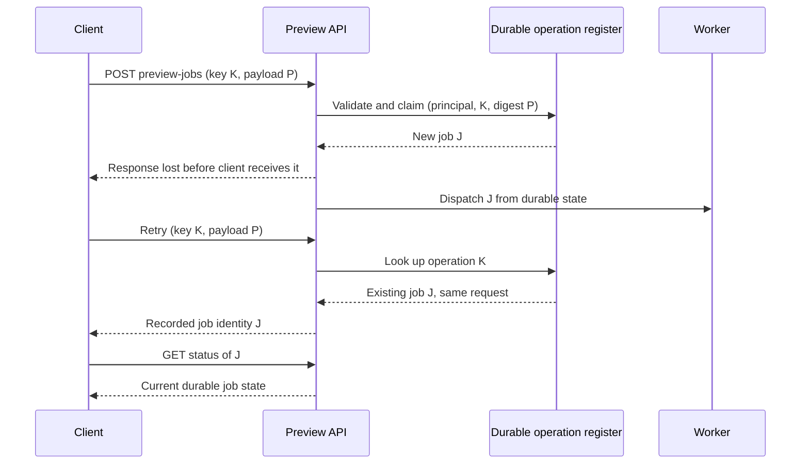

# HTTP and RPC contracts: compatibility, deadlines and retry safety

> **Research status:** independent, source-grounded book draft, 2026-10-19. **Proposed owner:** V02/C05 (public APIs, HTTP/RPC and compatibility). No runtime tests, empirical benchmark, client interoperability test or independent technical acceptance is claimed.

## Purpose and mission

An API is not merely a URL, an interface description or an encoded message. It is a promise about which effects a caller can request, when the caller may assume the effect occurred, how errors are interpreted, and what remains usable when old and new versions coexist. The architectural decision is therefore not initially “HTTP or RPC?” It is “which observable contract can the caller and provider preserve under delay, retries, partial failure and version skew?”

This chapter distinguishes **transport/method semantics**, **domain-effect identity**, **time budgets**, **wire and behavior compatibility**, and **contract evidence**. It uses original synthetic examples and independently published specifications. Service boundaries and transaction coordination are explained further in [module and service boundaries](architecture-styles-and-module-boundaries.md), [outbox and idempotent effects](../distributed/transactional-outbox-and-idempotency.md) and [safe versioned rollout](../delivery/progressive-delivery-and-schema-evolution.md).

## 1. The contract has multiple layers

| Contract layer | The caller needs to know | Typical failure if omitted |
|---|---|---|
| Operation and effect | Read/query, command, creation, update, cancellation; what “success” commits | A timed-out creation is retried and duplicated |
| Identity and authorization | Principal, resource identity, object-level permissions, tenant/isolation boundary | Caller sees success for a resource it should not control |
| Schema | Required/optional fields, defaults, absent vs null, unknown fields, enum behavior | An older consumer misreads a new response |
| Transport and scheduling | Deadline, cancellation, retry budget, maximum message size, streaming | Caller times out while provider continues wasting resources |
| Failure envelope | Distinguishable validation, conflict, transient overload, unavailable, unknown outcome | Client retries a permanent violation or gives up on an applied command |
| Compatibility | Client/server versions coexisting, migration window, deprecation and recovery | A routine canary release breaks a still-active old client |

A code generator or OpenAPI document makes an interface machine-readable; neither proves business idempotency, authorization correctness, or successful mixed-version operation. OpenAPI Specification 3.2.1 describes HTTP API operations, parameters, payloads and responses. Its existence is a **contract artifact**, not measured conformance of runtime code.

## 2. HTTP method semantics are not business-effect deduplication

[RFC 9110, §9.2.1–9.2.2](https://www.rfc-editor.org/rfc/rfc9110.html#section-9.2.2) defines the semantics of safe and idempotent methods. A safe method is intended not to request a state-changing effect. Idempotency describes the intended server-side effect of repeating an identical request; it does not require the responses, timing or logging events to be identical. PUT, DELETE and safe methods are idempotent by their specified semantics. POST has no general automatic-retry guarantee.

Three distinct notions must not be merged:

1. **HTTP method contract:** Is the requested operation safe or idempotent according to its semantics?
2. **Application effect identity:** Does retrying the same logical command create a second resource, charge, export job or side effect?
3. **Outcome discovery:** If an acknowledgment disappears, can the caller obtain a durable record of the original result?

Even when a DELETE request is idempotent, the first response might report an existing resource removed and a later response that it is absent. A POST can be made application-idempotent when a stable operation identity and durable result are owned by the application, but HTTP alone does not supply that property.

The HTTP failure model should distinguish syntactic validation, resource conflicts, missing or stale versions, overload, provider unavailability and unknown command outcome. [RFC 9457, §3–§5](https://www.rfc-editor.org/rfc/rfc9457.html#section-3) specifies a machine-readable problem-detail format, but a producer must define its own problem types, safe information disclosure, and client behaviors. A generic HTTP status alone may not tell the client whether its requested business change committed.

### Original synthetic command: build a preview

A fictional document-preview service accepts `POST /preview-jobs` to create work that may outlive a single HTTP exchange. Clients send a unique operation key scoped to the principal and normalized request arguments. The service validates identity and authorization, atomically claims that key, and records a stable job identity and state before acknowledging. Repeated requests with the **same key and same arguments** return or point to the recorded job outcome; reusing the key with materially different arguments is rejected as a conflict. A status-read operation permits reconciliation after a lost response.

**Text alternative:** a response can be lost after the server records a new operation. A repeat with the same scoped key resolves to that operation rather than creating another job, and a separate status read reveals the durable outcome.

This is a **proposed design**, not behavior guaranteed by HTTP or an experiment that was run. Important implementation decisions remain: retention of operation keys, request canonicalization, concurrent-first-request race protection, transactionally durable dispatch or outbox, and what happens after key expiration. A naive in-memory map fails after restart and can report false deduplication success.

| Synthetic crash window | Possible state | Safe recovery condition |
|---|---|---|
| Before operation key persisted | No accepted durable job | Retry may legitimately create first job |
| After durable record, before response arrives | Job exists; caller uncertain | Retry must resolve same identity, not recreate |
| After record, before work is queued | Job registered but not dispatched | Durable state/outbox enables re-dispatch without losing job |
| During worker effect before completion recorded | External effect may already exist | Worker requires a separate effect idempotency/reconciliation contract |
| After key-retention horizon | Deduplication memory may be gone | Define a bounded retry window and an outcome-lookup/expiry policy |

Read the [transactional outbox chapter](../distributed/transactional-outbox-and-idempotency.md) for the commit/publication boundary; a deduplicating ingress does not automatically make all downstream effects exactly-once.

## 3. End-to-end deadlines, cancellation and retry budgets

A timeout on one socket is not a complete request deadline. The caller has an end-to-end business time budget; proxies, authentication, queueing, internal RPCs and durable state can consume it. An API must define which result is still meaningful after the caller stops waiting, and what resource cleanup follows.

The [gRPC deadlines guide](https://grpc.io/docs/guides/deadlines/) explains that an RPC deadline is the latest point at which the client is willing to wait; propagation between calls can subtract elapsed time and thereby limit an internal call to the remaining budget. Language-specific defaults and propagation configuration differ. The [gRPC cancellation guide](https://grpc.io/docs/guides/cancellation/) makes clear that cancellation of a call should stop initiated work where possible; user code may need to check and propagate the signal. **Cancellation is not proof that a previously committed effect was undone.**

A **hypothetical** 900-ms request budget could be partitioned into 50 ms of edge/auth overhead, 100 ms in queueing, 450 ms downstream work, 100 ms durable write, and 200 ms network/margin. These numbers are invented for illustration, not a target for any product. Per-hop independent 900-ms timeouts would allow the aggregate to vastly exceed the caller's deadline. At each hop the effective budget is at most the remaining time, subject to clock and propagation behavior. Critical cleanup and reconciliation may need to continue after the synchronous response budget expires, using an explicitly durable workflow rather than an unbounded request task.

The [gRPC retry guide](https://grpc.io/docs/guides/retry/) distinguishes transparent retries from configured retry policies; configurable retries are limited by status, attempts, backoff and commitment boundaries. A service configuration can also set per-method timeouts and retry/hedging behavior. These client mechanisms cannot infer application effect identity: an RPC retry is safe only when the underlying operation semantics and downstream effects allow it.

**Retry decision contract:**

- First ask whether the operation is read-only, semantically idempotent, or protected by an application effect key.
- Retry only a documented retryable failure class, with a bounded total deadline and bounded attempt/backoff budget; observe server pushback/backpressure.
- Prefer explicit outcome lookup for an ambiguous durable command, rather than treating every timeout as “nothing happened”.
- Avoid retry amplification across proxy, API and downstream clients; designate where retries are owned and instrument actual attempt counts.
- Reject the assumption that a cancelled response retracts committed state or emitted events.

## 4. Version compatibility is behavioral and asymmetric

A versioned schema is necessary for safe evolution, but not sufficient. A new server reading an old client may behave differently from an old server reading a new client; adding a field can be wire-safe while becoming a required business value that an old caller cannot supply.

| Mixed-version pairing | Representative change | Required experiment |
|---|---|---|
| Old client → new server | New optional response field | Check old decoder and old business interpretation |
| New client → old server | Newly sent request field | Check whether field is ignored, rejected or changes semantics |
| Old client → new server | New mandatory authorization or consistency rule | Confirm whether old requests retain authorized meaning |
| New client → old server | New enum value or error type | Test explicit unknown-value fallback |
| Canary client/server mix | New stream/message ordering or timeout | Exercise mixed-version failure and recovery |
| Rollback after a data change | New persistent schema and job state | Confirm old code can read/write or perform planned forward repair |

Protocol Buffers represent fields on the wire by numbered tags. The [official Protocol Buffers editions guide](https://protobuf.dev/programming-guides/editions/) and [schema best practices](https://protobuf.dev/best-practices/dos-donts/) document why a removed field number should not be reused and why preserving wire parsing can still involve semantic or lossy behavior. Reserve retired numbers, and assess field presence, defaults, enums and JSON mapping in the actual configured language/runtime. Do not call an entire protobuf change compatible solely because it parses.

For HTTP JSON consumers, explicitly test required/unknown fields, removed enum values, null versus absent, changed units, pagination ordering, date interpretation and error-contract evolution. For either protocol, distinguish **wire-parse compatibility**, **semantic compatibility**, and **operational coexistence** over the real deployment and rollback window.

## 5. Which interface approach fits the decision?

| Option | Often justified by | Additional questions / contraindications |
|---|---|---|
| HTTP resource API | Broad client ecosystem, caching or resource-oriented semantics, independently documented HTTP contracts | Does a command have durable identity? Are cache/auth/status semantics correct? |
| gRPC unary RPC | Strongly typed service contracts, generated clients and explicit RPC deadline/cancellation/retry tools | Are all clients/platforms supported? What happens under reconnect or changing proto fields? |
| gRPC streaming | Long-lived ordered message exchanges and flow-control semantics needed by the application | What are cancellation, backpressure, reconnect and replay requirements? |
| Async command + status query | Work exceeds request deadline or needs durable acceptance and recovery | Who owns durable state, deduplication, user status and cleanup? |
| In-process call | Same deployable failure boundary and no justified remote contract | Would network transport add failure modes without useful independent ownership? |

These are **conditions**, not a global ranking. A synchronous RPC is not a replacement for a durable job workflow when work outlives the caller. A document schema does not fix a missing retry invariant. Local module calls remain viable when separate deployment has no measured benefit.

## 6. Testable acceptance and negative evidence

For each interface revision, document a concrete version/behavior matrix and exercise at least:

1. Old/new client against old/new server for intended versions and rollback skew.
2. Acknowledgment loss after effect commit, duplicates with identical and conflicting keys, restart across the deduplication boundary.
3. Deadline expiration before and after durable commit; cancellation propagation and cleanup of spawned work.
4. Retry storm/overload bounds, persistent failure and server pushback; retries must not cause unchecked multiplicative load.
5. Unknown fields/enum values, missing optional fields and newly strict validation.
6. Distinct authorization identities and scoped deduplication keys; never leak another principal's operation outcome.
7. Forward recovery after data/schema evolution, including an irreversible-effect boundary.

A passing OpenAPI checker, protobuf compilation or isolated happy-path unit test **cannot** establish all seven. Use contract-test fixtures, pairwise version tests and deliberately injected failures. Where untested, state the unresolved guarantee.

## 7. Public sources and evidence limits

Inspected independently public reference sections on 2026-10-19, with the following narrow scope:

| Reference | Used for | What it does not establish |
|---|---|---|
| [RFC 9110 — HTTP Semantics, §§9.2.1–9.2.2, 10.2.3, 15](https://www.rfc-editor.org/rfc/rfc9110.html) | Safe/idempotent method properties, retry and Retry-After/status envelope | Application-level deduplication or actual server conformance |
| [RFC 9457 — Problem Details, §§3–5](https://www.rfc-editor.org/rfc/rfc9457.html) | Structured HTTP API problem contracts and information-disclosure cautions | Universal application error taxonomy |
| [OpenAPI 3.2.1, published 2026-09-10](https://spec.openapis.org/oas/v3.2.1.html) | Interface-description contract and versioned document semantics | Runtime semantic compatibility or measured deployment outcome |
| [gRPC deadlines](https://grpc.io/docs/guides/deadlines/) and [cancellation](https://grpc.io/docs/guides/cancellation/) | Deadline concepts, propagation, responsibility to terminate spawned work | Identical defaults in all languages or effect rollback |
| [gRPC retries](https://grpc.io/docs/guides/retry/) and [service configuration](https://grpc.io/docs/guides/service-config/) | Retry scopes, configured attempts/backoff and client policy | Domain idempotency for arbitrary methods |
| [Protocol Buffers editions](https://protobuf.dev/programming-guides/editions/) and [schema best practices](https://protobuf.dev/best-practices/dos-donts/) | Wire tag identity, reserved tags and evolution hazards | Safe behavior of every decoder or deployed schema migration |

**Original modeling and unknowns:** preview-job identities, budget numbers, failure matrices, architecture selection table and tests above are original proposals/synthetic examples; no test, production observation, real latency measurement, independent expert review or citation-snapshot packaging is claimed. Language/runtime compatibility, actual OpenAPI 3.2.1 tooling support and any environment-specific protocol choice must be checked for the actual target deployment. The wider V02 volume and Tycho book remain incomplete.

## Reading and navigation

- Parent: [Application boundaries and architecture styles](README.md); planned future volume owner **V02/C05** in the [69-chapter outline](../PROPOSED-STRUCTURE.md).
- Before: [Architecture styles and module boundaries](architecture-styles-and-module-boundaries.md).
- Related: [Transactional outbox and idempotency](../distributed/transactional-outbox-and-idempotency.md), [Safe schema evolution](../delivery/progressive-delivery-and-schema-evolution.md), [Authorization isolation](../security/identity-authorization-and-isolation.md), [Java reactive execution](../execution/reactor-webflux-r2dbc-and-backpressure.md).
- Next: mixed-version runnable consumer/provider tests and detailed streaming reconnect semantics (unimplemented, future authoring work).
