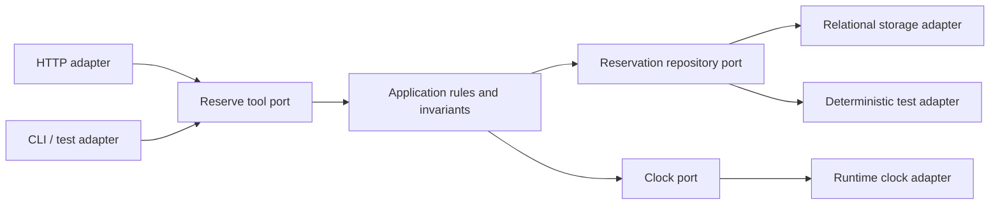

# Layered, hexagonal and ports-and-adapters architecture

> **Tycho book manuscript — proposed V02/C01.** Prepared 2026-10-19 from independent public architecture references. All case studies, diagrams and proposed tests are original. This is not a representation of a deployed system; no module-boundary checker, integration fixture, production trace or editorial peer review was executed. The combined earlier [architecture-styles research](architecture-styles-and-module-boundaries.md) remains available until source/claim reconciliation.

## Purpose and decision question

Application structure determines which source changes can be made without rewriting unrelated business rules, whether storage or interface technologies can be replaced, and which dependencies must be present during a test. **Layering** groups responsibilities by abstraction and allowed call direction. **Hexagonal architecture (ports and adapters)** makes the application's interaction contracts explicit and keeps technological drivers and integrations outside the domain's core.

Neither style determines the number of processes or servers. The question is not “Which architecture sounds cleaner?” but **which change boundaries are supported by enforceable dependencies and correspond to real quality requirements**.

The original [Cockburn Hexagonal Architecture paper, 2005](https://alistair.cockburn.us/hexagonal-architecture) frames an application that can be driven by a user, script or test, without depending on one UI or database. This chapter explains that mechanism; separate chapters own [modular monolith and internal events](modular-monolith-and-internal-events.md), [domain authority](domain-boundaries-data-ownership-and-contracts.md), and [SOA/microservice deployment decisions](service-orientation-microservices-and-distribution.md).

## 1. Layered design states a dependency policy

A conventional layered application might have interface, application orchestration, domain rules and data-access layers. It works if the code controls dependency directions and avoids bypassing required rules. Simply placing files in similarly named directories does not establish architectural layering.

| Concept | What should be stable | Example violation |
|---|---|---|
| User interface boundary | Input/output and interaction details | UI class directly updates an authoritative table |
| Application/use-case layer | Sequencing, authorization hand-off and transaction scope | Business invariant scattered across controller branches |
| Domain model | State transitions, invariants and business language | Rule depends on HTTP request or a specific ORM record shape |
| Technology adapters | Protocol, DB, broker and device details | Domain code imports vendor drivers and creates connections itself |
| Shared cross-cutting policy | Trace, security, lifecycle and failure requirements | One layer silently skips the central authorization rule |

Layers may be strict, or some dependencies may legitimately bypass intermediate layers. That is a design decision requiring explicit documentation, not a universal principle. A system can use a dependency inversion rule so that interfaces required by the domain are *declared inside the application* while adapter implementations live outside it.

## 2. A port is an application contract, not automatically a network port

A **driving port** describes a use case that a client or test invokes. A **driven port** describes a capability the application requires from external resources (storage, clock, delivery gateway). Adapters translate between these stable application contracts and details of HTTP, CLI, SQL, queues or other technologies.

**Text alternative:** distinct clients use one application port. The core defines its required repository and clock contracts. Storage and clock adapters implement the contracts; the application rules do not depend on the SQL or command-line technology. This depicts logical source dependencies, not automatically separate processes.

The geometric term *hexagon* is not a requirement to have exactly six sides or six ports. A port also need not be a REST endpoint: an in-process interface can express the actual invariant boundary more directly.

## 3. Original fictional example: a shared workshop equipment scheduler

An independently invented tool-booking application supports **ReserveUnit**, **CancelReservation**, and **ListPublicEquipment**. Its reservation rule is that a physical unit cannot have overlapping *accepted* allocations in the same time interval. External HTTP and CLI clients should invoke the same authoritative use-case rule.

A poor implementation tests the rule only in an HTTP controller and allows a batch importer to write reservations directly. The code appears layered, yet bypasses the invariant. Better design defines a use-case contract that both adapters must call. This contract identifies caller authorization, logical operation identity, transactional authority and possible errors such as already-reserved or outcome-unknown.

**Important limit:** replacing the SQL adapter with an in-memory object in a unit test cannot prove database locking, transaction isolation or cross-replica behavior. Separate integration tests against the actual data backend and concurrent callers are mandatory if the service promises exclusivity.

## 4. Choose the correct core boundary

An application core must still choose between:
- **pure domain rules** (e.g., interval overlap predicate) that can be evaluated deterministically;
- **application orchestration** (identity/authorization, repository lookup, command sequence);
- **transactional authority** (atomic read-check-write or equivalent conditional state change);
- **external interaction** (notification, storage, payments, queues, which can fail independently).

Ports do not make a multi-resource transaction atomic. If a database commit succeeds but an external message is lost, the core needs a durable event/publication strategy where the contract requires it; adding an interface merely hides the transport. The [outbox/workflow chapter](../distributed/outbox-inbox-sagas-and-durable-workflows.md) owns that coordination, and [retry identity](../distributed/retries-idempotency-and-ambiguous-effects.md) owns the lost acknowledgment question.

A useful design explicitly states which operations can occur synchronously in one transaction and which need asynchronous effect reconciliation. When a business rule requires strong consistency, a port may still be backed by one authoritative transactional resource.

## 5. Scope dependency direction across build, tests and runtime

Ask three distinct questions:
1. **Source dependency:** does a business module import a concrete driver or HTTP framework? A static dependency check can verify much of this policy.
2. **Runtime dependency:** does invoking the use case block on a datastore even if the type dependency is inverted? Hexagonal code still depends on the *availability* of the external capability.
3. **Organizational change dependency:** must two teams coordinate contracts, migrations and deployments? Compile-time inversion alone does not solve ownership or release coupling.

A port can reduce compile-time coupling while introducing indirection and more integration tests. If there is only one stable adapter, interfaces everywhere may add ceremony rather than useful replaceability. A useful port expresses a real boundary whose isolation or substitution matters to business rules or testing.

## 6. Failure and test matrix

| Scenario | Required evidence | Frequent invalid conclusion |
|---|---|---|
| HTTP controller replaced by CLI | Same use-case outcome and authorization policy | UI independence means database independence |
| Real DB loses connectivity | Defined error/degraded read state, no invented success | Mocked repository test proves recovery |
| Two concurrent same-unit bookings | At most one accepted authoritative reservation | A pure overlap predicate guarantees transaction correctness |
| Client response lost after commit | Stable operation identity and read-back/reconciliation | Timeout guarantees no side effect occurred |
| Import job bypasses public use-case port | Dependency or integration test rejects bypass | Class/package names alone enforce invariants |
| Repository implementation changed | Contract + transactional/failure behavior checked | All adapters have identical durability by interface alone |
| Driver has a new latency profile | End-to-end capacity and deadline test | Compiler dependency inversion removes runtime network cost |

These are **proposed tests**, not measurements. A genuine architecture acceptance must include negative authorization and state-recovery tests.

## 7. When not to impose this structure

A tiny fixed-format batch transformation with no alternate drivers and little independent business logic may not need elaborate adapter abstractions. Conversely, code that must support several frontends, isolated rule testing, storage substitutions or staged modernization may benefit strongly from clear ports. Neither observation mandates microservices.

A **modular monolith with well-defined ports** can be a finished target. Splitting each port into a remote service would add network timeout, retry, versioning and operational boundaries that this internal design does not require.

## 8. Source-to-claim ledger and limits

| Public independently inspected source | Narrow support | Not established |
|---|---|---|
| [Cockburn, *Hexagonal Architecture* (2005)](https://alistair.cockburn.us/hexagonal-architecture) | Driving/driven use cases, ports/adapters and isolation from external devices | Correctness of a fictional application's port layout |
| [Fowler/Lewis, *Microservices* (2014)](https://www.martinfowler.com/articles/microservices.html) | Distinction between one deployable and independently deployed collaborators | That a port should become its own service |
| [Existing Tycho application-style research](architecture-styles-and-module-boundaries.md) | Earlier bounded treatment of module/deployment axes | An independently reviewed or compiler-enforced boundary |

The synthetic project, figure, tables and acceptance protocols are original. No executable module architecture, real workload, interface fixture or claim-by-claim human audit was performed. Final volume/chapter/page IDs and frontmatter remain pending.

## Navigation

Proposed **V02/C01** in the [10-volume outline](../PROPOSED-STRUCTURE.md). See [application landing](README.md), then [domain/data ownership](domain-boundaries-data-ownership-and-contracts.md), [modular monoliths](modular-monolith-and-internal-events.md), [SOA/microservice boundaries](service-orientation-microservices-and-distribution.md), [safe extraction](architecture-evolution-and-extraction.md).

## Applied M9 evidence: what transfers and what does not

These examples connect the chapter's conditional mechanism to published experiences or synthetic decision exercises. A historical company report is **first-party, time-scoped evidence**, not a controlled Tycho benchmark; an M9 decision playbook is **original synthetic analysis**, not a company decision.

**Case lens — [Shopify — Packwerk boundaries](../cases/shopify-packwerk-boundary-evolution.md)**. **Relevant mechanism or architectural contrast:** Automated dependency checking and gradually tightened boundaries can make modularity executable. **Not established by this report/playbook:** Reference checks alone do not establish business-domain cohesion, latency isolation or independent deployability.

**Transfer test:** before applying the lesson to another legacy system, identify the exact workload, source date, relevant runtime/protocol versions, state authority, failure/recovery gate and the new observation that would reverse the choice. Follow the case's public evidence ledger rather than treating its link as independent proof.
