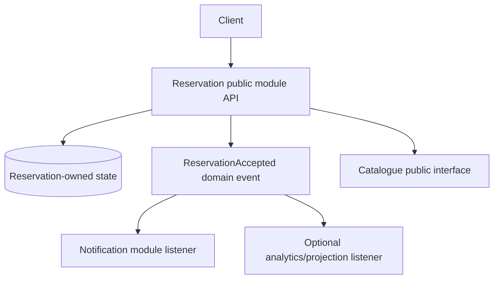

# Modular monolith architecture and internal domain events

> **Original Tycho manuscript V02/C03**, prepared 2026-10-19. Public Spring Framework/Modulith references are technology illustrations, not a requirement to use those frameworks. The fictional application and event flow were invented independently. No build, module verification, event replay or independent review has been performed.

## Purpose and mission

A modular monolith is a single deployable whose functional responsibilities are divided into explicitly enforced modules. Its goal is neither to hide all coupling nor to simulate microservices inside one process. It preserves appropriate local consistency while making *which module owns each rule, data object and contract* visible.

Internal events can reduce direct dependencies between modules, but “event-driven” does not automatically mean asynchronous, durable or exactly-once. An in-memory event observed by a synchronous listener has different failure and transaction semantics from a transactionally recorded event consumed after commit.

The [application style chapter](architecture-styles-and-module-boundaries.md) compares architectural forms. The [domain ownership chapter](domain-boundaries-data-ownership-and-contracts.md) owns bounded-context meaning. This chapter focuses on **module lifecycle and internal event contracts**.

## 1. Stable module boundaries before event buses

An internally modular architecture needs:
- Cohesive public capabilities and documented rules, not merely package naming.
- Hidden implementation classes and controlled compile-time dependencies.
- One authoritative writer for each business aggregate, even with shared physical storage.
- Clear synchronous calls when the caller needs an immediate invariant-preserving result.
- Domain events expressing an established fact, not arbitrary commands with vague ordering.
- Tests that enforce allowed dependencies and business outcomes.
- Rules for when modules may be split and which data/operational costs make a split unsuitable.

The official [Spring Modulith application events documentation](https://docs.spring.io/spring-modulith/reference/events.html) recommends decoupling module interactions through events and describes an event publication registry; that is one versioned implementation option. It does **not** imply that every Java module architecture has such a registry or that an event has a global ordering guarantee.

## 2. Original synthetic example: community workshop reservation

Three modules inside a single application:
- **Catalogue** publishes equipment descriptions and approved configurations.
- **Reservation** owns exclusive allocation, cancellation and durable command identities.
- **Notification** owns opt-in messages; successful delivery must not determine whether a reservation was accepted.

**Text alternative:** the reservation module is the sole authority for accepted reservations. It may synchronously consult the catalogue when eligibility rules require it. After a durable state change it publishes a fact; notification and optional derived views consume the fact without gaining authority over reservation truth. All blocks can remain inside one executable.

The event's name should describe **past successful meaning**, not an intention (e.g. “ReserveSlot” would be a command). Include an event ID, aggregate identity, schema version and relevant source state version if required for replay/deduplication.

## 3. Internal events have multiple execution and durability contracts

| Event style | Execution boundary | Failure question | Appropriate use |
|---|---|---|---|
| Direct synchronous module call | Caller stack/transaction if configured | Can callee failure roll back caller? | Required immediate invariant/decision |
| In-process synchronous event | Same process; dispatch semantics framework-specific | Does listener exception fail publishing operation? | Small local observers when explicit coupling is accepted |
| Post-commit event listener | Triggered in relation to a successful transaction boundary | Is listener work durable or retried after a process crash? | Side effects that must not happen before commit, when loss policy is defined |
| Transactional publication registry | Durable record of interested listeners under implementation-specific conditions | Are incomplete/failed events resent; can duplicate handling occur? | Recoverable asynchronous module integration |
| External broker event | Process/network/broker boundaries | Delivery/redelivery, ordering scope and effect idempotency | Independently deployed consumers or real external contracts |

In Spring Framework, [transaction-bound event listeners](https://docs.spring.io/spring-framework/reference/7.1/data-access/transaction/event.html) support phases such as AFTER_COMMIT by default. This means listener timing can depend on commit success; it does **not** by itself prove an event will survive a crash between commit and listener processing.

Spring Modulith's [publication registry](https://docs.spring.io/spring-modulith/reference/events.html) documents listener-specific publication records and retry/resubmission mechanisms; check its actual version and storage implementation before using these guarantees. Event publication durability is **separate** from downstream external side-effect identity. A listener retried after partial external success can duplicate a notification unless the effect has its own deduplication/reconciliation semantics.

## 4. Transaction boundary determines which outcome is correct

**Synthetic failure:** reservation state commits but the process crashes before an in-memory notification event reaches its listener.

If notification is optional, user booking truth can remain correct; however, the system must disclose whether notification may be lost. If the requirement says delivery must be attempted eventually, an in-memory-only event is insufficient. A transactional event registry or outbox-like persistence with retry handling may be appropriate. [Outbox and idempotency](../distributed/transactional-outbox-and-idempotency.md) owns the detailed commit-publication problem.

**Second failure:** a listener performs an external irreversible effect before the reservation transaction commits, but the transaction later aborts. The external effect may now describe a booking that never existed. Delay the effect until commit and use durable recovery when required; mere annotation-driven dispatch without a durable record is not a full recovery contract.

**Third failure:** duplicate delivery of an accepted event causes two messages or redundant projections. Consumers need stable event/effect identities and bounded retry/reconciliation. Deduplication should be scoped to actual business identity, not to one process lifetime.

## 5. Enforce boundaries rather than only documenting them

Possible enforcement mechanisms include module-level build packages, language visibility restrictions, dependency analysis, ArchUnit-like architecture tests, or Spring Modulith's verification APIs. Check that the source structure represents true public/private module contracts and that tests run on actual build versions.

A useful module acceptance review asks:
- Do dependency checks reject forbidden import paths and cycles?
- Can a public contract change without direct access to another module's internal state?
- Is the authoritative writer for each aggregate clear?
- Can internal events be replayed/delayed/duplicated safely under the declared delivery contract?
- Can one listener fail without losing a committed mandatory operation?
- Are module integration tests independent enough to reveal unintended coupling?
- Can the whole executable still be deployed/restored with its actual database and config?

The benefits must be demonstrated under the relevant change/load profile. One executable may avoid distributed network fault handling, but it retains a shared runtime and deployment cadence. It may still have multiple replicas, so avoid equating a modular monolith with a single machine.

## 6. When not to split the module into a separate service

Potential reasons to keep a module internal:
- transactionally coupled invariants with one consistent authoritative state owner;
- insufficient independent team/deployment needs;
- operational limits on additional endpoints, service identities and monitoring;
- low measured resource isolation benefit;
- still-changing interfaces without a viable old/new client contract.

Potential reasons to extract a module *later*:
- proven independent state and lifecycle;
- need to isolate failures or deploy on different resource budgets;
- specific owner and monitored external contract;
- a tested transition plan that protects old clients and persisted state.

The extraction decision is not the definition of “good modularity”. A well-modularized monolith can be the **target architecture**.

## 7. Source ledger and limits

| Independent source inspected | Narrow support | Not established |
|---|---|---|
| [Spring Modulith events](https://docs.spring.io/spring-modulith/reference/events.html) | Module event publication, listener registry and incomplete-publication recovery concepts | Actual project configuration or guarantee in all library versions |
| [Spring Framework transaction-bound events](https://docs.spring.io/spring-framework/reference/7.1/data-access/transaction/event.html) | Listener phases relative to commit/rollback | Automatically durable after-commit processing |
| [Tycho architecture styles](architecture-styles-and-module-boundaries.md) | Independently researched module and service boundaries | Compiled/enforced module graph for fictional app |
| [Tycho distributed outbox](../distributed/transactional-outbox-and-idempotency.md) | Commit/pub ambiguity, deduplication limits | An implemented event registry or exactly-once external effect |

All modules, diagrams, events and failure cases are original invented teaching materials. No real source code, build output, dependency checker, distributed test or human domain approval was used. The final book volume/chapter/page edition has not been assembled.

## Navigation

Proposed owner **V02/C03** in [planned table of contents](../PROPOSED-STRUCTURE.md), [application landing](README.md). Start with [bounded contexts and ownership](domain-boundaries-data-ownership-and-contracts.md), then [module/service styles](architecture-styles-and-module-boundaries.md), [internal vs external outbox](../distributed/transactional-outbox-and-idempotency.md) and [safe extraction](architecture-evolution-and-extraction.md).

## Applied M9 evidence: what transfers and what does not

These examples connect the chapter's conditional mechanism to published experiences or synthetic decision exercises. A historical company report is **first-party, time-scoped evidence**, not a controlled Tycho benchmark; an M9 decision playbook is **original synthetic analysis**, not a company decision.

**Case lens — [Shopify — Modular monolith](../cases/shopify-modular-monolith.md)**. **Relevant mechanism or architectural contrast:** A modular monolith can be a legitimate target when domain ownership matters more than release separation. **Not established by this report/playbook:** The 2019 report does not imply Shopify achieved perfectly enforced modules everywhere or that service decomposition always fails.

**Transfer test:** before applying the lesson to another legacy system, identify the exact workload, source date, relevant runtime/protocol versions, state authority, failure/recovery gate and the new observation that would reverse the choice. Follow the case's public evidence ledger rather than treating its link as independent proof.
