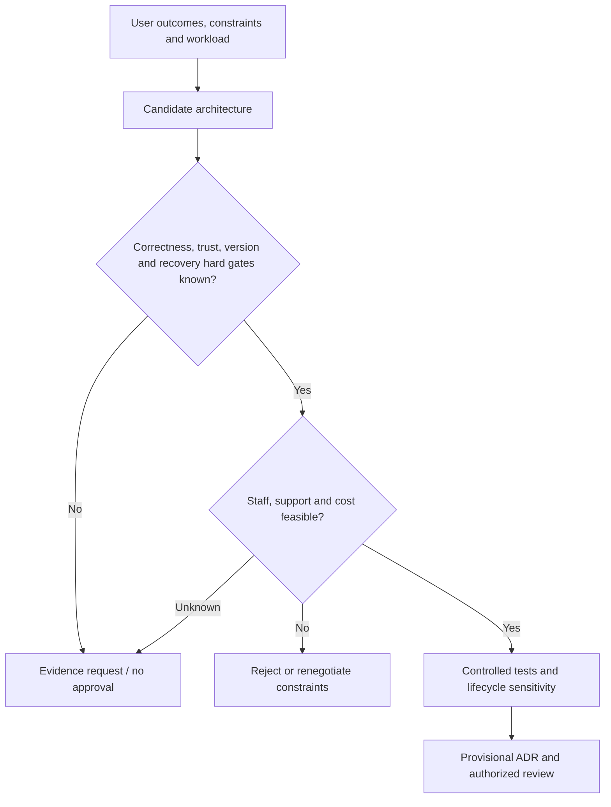

# Capacity, operational constraints and total-cost hard gates

> **Tycho book draft V01/C06, 2026-10-19.** Independent conceptual treatment of constraints that architecture proposals must pass. Public arc42 constraints and AWS cost design guidance consulted; original fictional scenarios only. No operational team, workload, budget, price, or independent approval was examined.

## Purpose and mission

An architecture can satisfy a theoretical throughput target while being **unfit to operate**. It may require expertise unavailable to the owner, untested disaster recovery, dependencies with incompatible support windows, unrealistic permission boundaries, or costs that exceed an explicit ceiling. These are not optional concerns to apply *after* design selection. They can be **hard architectural gates**.

This foundational chapter answers which organizational, lifecycle, cost and recovery constraints must be established before ranking designs. The [capacity planning and cost/performance chapter](../performance/capacity-planning-and-cost-performance.md) owns quantitative resource sensitivity. Here the goal is translating operating constraints into explicit decision eligibility.

[arc42 Constraints §2](https://docs.arc42.org/section-2/) treats technical and organizational limits as real inputs to architectural freedom. [AWS Well-Architected Cost Optimization design principles](https://docs.aws.amazon.com/wellarchitected/latest/framework/cost-dp.html) emphasize attributing costs and measuring outcomes rather than assuming low infrastructure prices imply a lower total burden.

## 1. Constraints must be typed and owned

| Constraint type | What a design must make explicit | What unknown blocks |
|---|---|---|
| Runtime/lifecycle | Supported language, framework, operating system and dependency versions | Unsafe unmaintained component or untested runtime upgrade |
| Deployability | Release window, mixed-version overlap, artifact identity, rollback/forward repair | Big-bang changes with unknown old clients |
| Operations | Monitoring, incident response, on-call skill, maintenance cadence | A design with no sustainable operator |
| Capacity/latency | Defined offered load and business correctness/time SLO | Arbitrary replica, database or queue sizing |
| Recovery | Permitted state loss and restoration time for named failure classes | Selecting stateful topology without recovery evidence |
| Privacy/security | Identity, isolation, retention and authorized effects | Unreviewed shared resource or broad account access |
| Financial/effort | Total operating/transition budget, staffing and acceptable migration risk | Cost scoring unsupported by actual cost scope |
| Environment/quota | Allowed infrastructure, networking, keys, capacity and change-control scope | Design depending on unavailable services or privileges |

Not every preference is mandatory. A hard limit must be **explicitly identified by a valid decision authority**; engineers should not invent permissions or declare an arbitrary cloud price ceiling.

## 2. Separate hard feasibility from preference scoring

The process:
1. Define the user-visible outcome and an actual workload/failure envelope.
2. List non-negotiable correctness, security, data and recovery gates.
3. Identify cost, team/skill, support and change-control constraints with owners.
4. Screen simple baseline and proposed alternatives as **PASS**, **FAIL**, or **UNKNOWN** for each gate.
5. Remove failed candidates unless constraints are renegotiated through appropriate authority.
6. For unknown gates, request the exact source or bounded experiment needed.
7. Only then compare preferences such as flexibility, per-unit cost and convenience.

A weighted selection score cannot override a hard authorization violation, unavailable runtime dependency or an unachievable mandatory RPO. If all contenders fail, report **no feasible design under existing constraints**, not a fabricated winner.

## 3. Original synthetic case: a community plant catalogue

A fictional cataloguing site serves public plant descriptions and permits moderated updates. Engineers propose a distributed event-driven design with several separately deployed services.

The site has a hypothetical small operating team, intermittent update traffic, strict moderation and a requirement to restore approved changes after an instance loss. No real staffing budget or cloud provider has been selected.

Three proposals:
- **A: modular single deployable with one authoritative database.** Fewer deployables; may still need multiple replicas, correct backup/recovery and module boundary tests.
- **B: independent services with an event broker.** Useful if measured release/data autonomy and failure isolation justify remote boundaries; adds broker operations, retries and cross-service invariants.
- **C: managed read-only catalogue with a separate authorized moderation workflow.** May simplify the public access path if moderation and publication semantics can be clearly separated; external service limits/lock-in need evaluation.

| Hard gate | A | B | C |
|---|---|---|---|
| Moderation/authorization cannot be bypassed | Must enforce at write authority | Same, now across more interfaces | Separate publish gate must be verified |
| Durable approved content recoverable | Requires tested backup and restore | Requires multi-store/event recovery | Depends on storage and export guarantee |
| Small available operation skill | Plausibly lower surface; must test | Unknown: broker/runbook staffing | Unknown: managed-service/provider constraints |
| Existing clients compatible during change | Local change may be bounded | More versioned interfaces | Potential contract changes |
| Total cost <= owner-approved budget | Unknown until quantified | Unknown until complete run/incident cost | Unknown until prices and migration effort |

Every cell here is a **candidate research state**, not acceptance or price estimate. Because operational and cost evidence is missing, the appropriate result is **MEASURE_FIRST/INSUFFICIENT_EVIDENCE**, not universal preference for A or rejection of B.

## 4. Operating cost is a lifecycle, not a monthly instance fee

Include:
- recurring compute/storage/network/replication and idle redundancy;
- event, audit and trace retention/transfer;
- CI, dependency update, security scanning and test environment capacity;
- scheduled change/release effort and support of old clients;
- incident detection, restoration drills, credential/key rotation;
- migration double-running, data reformatting and rollback/repair;
- staff training and long-lived maintenance of bespoke control mechanisms;
- decommissioning and data retention after features are retired.

The [AWS cost principles](https://docs.aws.amazon.com/wellarchitected/latest/framework/cost-dp.html) encourage relating expense to business output; a product can pay less for idle resources and still incur more cost from outages or manual maintenance. A credible comparison uses the **same horizon**, workload mix and mandatory service levels. “Managed service” shifts responsibilities but does not remove recovery/access/lifecycle obligations.

## 5. Capacity is not just processing throughput

A candidate may deliver enough steady RPS and still violate:
- latency at the busiest minute;
- user-level correctness under retries or same-key contention;
- scale-up startup time during short bursts;
- storage rebuild/backup window as data grows;
- connection ceilings under many replicas;
- per-tenant fairness and authorization;
- available operator response time during partial failure.

**Synthetic counterexample:** a load test shows eight read workers pass the steady-rate target. A fictional peak lasts 20 seconds while a new worker requires 40 seconds to become useful. The steady result does not prove the design can meet its burst objective. [Autoscaling delay](../performance/autoscaling-lag-and-capacity-limits.md) and [overload policy](../performance/overload-admission-control-and-graceful-degradation.md) own the mechanics.

## 6. Operational readiness belongs in architecture acceptance

Text alternative: an architecture must pass correctness and recovery gates, then staff/support/cost feasibility, before being chosen. Unknown critical evidence blocks unconditional approval. Tests and cost sensitivity inform a provisional record, not an automatic deployment.

An operational acceptance record should name actual owners, runbook/recovery evidence, access restrictions, version support, budget and revisit triggers. If the team has never restored the data under the required time target, the statement “we can restore” is an untested plan.

## 7. Source-to-claim ledger and limitations

| Inspected public reference | Narrow support | Not established |
|---|---|---|
| [arc42 §2 — Architecture Constraints](https://docs.arc42.org/section-2/) | Technical/organizational conventions and limits constrain designs | Real constraints for any production system |
| [AWS Cost Optimization design principles](https://docs.aws.amazon.com/wellarchitected/latest/framework/cost-dp.html) | Attribution, resource consumption and outcome unit economics | Actual provider prices or this example's operating cost |
| [Tycho requirements/workload decisions](../decisions/requirements-and-workload-architecture-profiles.md) | Existing independent hard-gate decision reasoning | Accepted constraints or measured resource ceilings |
| [Tycho capacity/economic analysis](../performance/capacity-planning-and-cost-performance.md) | Original sensitivity analysis methodology | Real cost and capacity measurements |

Every workload, system, candidate, diagram and conclusion is invented for education. No security test, actual budget, backup exercise, execution evidence or independent review occurred. Metadata, exact chapter boundaries and final edition assembly remain pending.

## Engineering walkthrough — Hard constraints before weighted cost scoring

**Original sensitivity calculation, not market prices.** A fictional small team can support one database on-call rotation, 90-day audit retention, and at most one additional operationally critical service. Suppose option A (retain/optimize) uses 60 engineer-days of change and 10 on-call hours per month; B (extract two services) uses 140 engineer-days, 25 on-call hours per month and separate trace/log retention. These are **invented staffing inputs**, not CHF or cloud quotes.

A three-year model should separately carry implementation person-days, recurring operational time, storage/egress/telemetry units, incident/restore drills, migration coexistence, and potential forward repair after incompatible writes. A simplified staffing subtotal might be `A: 60 + 36×10/8 = 105 engineer-days` versus `B: 140 + 36×25/8 = 252.5 engineer-days`, assuming eight-hour days and no escalation overhead. These are lower-bound educational arithmetic, **not total TCO**, which also depends on external cost inputs and availability outcomes.

| Gate | A | B |
|---|---|---|
| Exactly one authoritative booking writer during change | Can preserve | Requires fenced ownership transfer |
| One additional critical service maximum | Pass | Fail if two independently critical services are introduced |
| Audit retention and reproducible restore | Must validate | Must validate in each store/trace domain |
| Expected release autonomy | Lower | Potentially higher, but unmeasured |

**Decision:** exclude B on the stated operational constraint *before* weighted scoring; better potential deployment autonomy cannot erase that gate. If staffing expands or one service replaces a retired critical dependency, re-evaluate with real cost/incident data. Under another requirement set the decision may reverse. No financial estimate, observed labor or vendor offer is claimed.

## Navigation

Proposed owner **V01/C06** in [outline](../PROPOSED-STRUCTURE.md), [application landing](README.md). Prerequisites [system context](problem-framing-and-system-boundaries.md), [quality drivers](quality-drivers-and-architecture-views.md), [workload demand](../performance/workload-demand-and-arrival-models.md). Next [technical capacity cost](../performance/capacity-planning-and-cost-performance.md) and [alternative decision gates](../decisions/architecture-alternatives-experiments-and-adrs.md).
