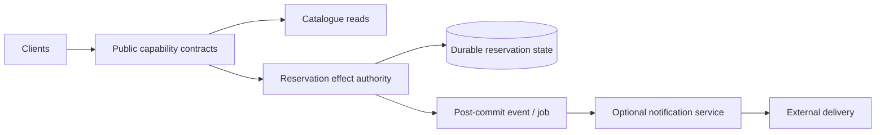

# Service orientation, microservices and distributed boundaries

> **Tycho book manuscript — proposed V02/C04**, 2026-10-19. Source boundary: public OASIS SOA Reference Model v1.0 and Fowler/Lewis' 2014 microservices discussion. Examples and tests are original fictional material. No service topology was deployed, team structure observed or empirical architecture comparison performed. Prior [architecture-style research](architecture-styles-and-module-boundaries.md) is preserved for editorial reconciliation.

## Purpose and mission

A service is a published capability with an interaction contract; a microservice architecture is a particular set of design and operational choices around smaller independently deployable capabilities. **SOA and microservices are not simply opposite network protocols**, and neither should be selected solely because a codebase has many modules.

The primary architecture question is: **which capabilities need independent deployment, failure containment, state ownership and life cycles strongly enough to justify the remote communication and coordination costs?**

The [OASIS SOA Reference Model v1.0](https://docs.oasis-open.org/soa-rm/v1.0/soa-rm.html) defines visibility, interaction and effect as core service ideas; it does not prescribe a mandatory message bus, SOAP transport or service deployment granularity. [Fowler and Lewis, *Microservices* (2014)](https://www.martinfowler.com/articles/microservices.html) describe independently deployable services organized around business capabilities, as a characterized style rather than a universal threshold for how small a service must be.

## 1. Separate concept, deployment and ownership

| Dimension | Service-oriented view | Microservice-style tendency | Design caution |
|---|---|---|---|
| Capability | Exposes work/results to a consumer under a described contract | Decomposes around cohesive business capabilities | An endpoint does not establish ownership |
| Visibility and policy | Consumer can discover/reach/use described capability | Direct service or mediated routing/discovery | Discovery is not authentication or authorization |
| Deployability | Depends on concrete SOA implementation | Separate services are intended to deploy independently | Coordinated DB/schema deployment can defeat independence |
| Information model | Public messages and effects specified | Local representation often private to each service | One global canonical model may hide contextual differences |
| Data authority | Must be explicitly declared | Decentralized state ownership is common | Two writers for one invariant remain unsafe |
| Operations | Versions, policy, monitoring and governance | Per-service pipelines, telemetry, resilience and automation | More moving parts are not free |
| Transaction | Contracts define business effect and failure semantics | Remote calls/events cross resource boundaries | Local ACID cannot cover arbitrary remote effects |

Some service-oriented systems use large-grained capabilities and centrally governed contracts; others use narrower services with distributed ownership. Neither label tells you whether a product has acceptable latency, isolation or release economics.

## 2. Independence is not proved by a separate container

A separately deployed component can still require lockstep releases if it:
- writes tables owned by other components;
- directly imports their internal data structure;
- changes events/enum meanings without consumer compatibility;
- relies on a shared deployment gate or one synchronous downstream critical path;
- lacks its own operational owner, rollback/forward-repair path or documented support window.

Conversely, distinct modules inside one executable may remain the safer target when transactions must remain local and independent release cadence brings little benefit. [Layered/hexagonal design](layered-hexagonal-ports-and-adapters.md) owns source dependency direction, [domain/data authority](domain-boundaries-data-ownership-and-contracts.md) owns semantic boundaries, and [modular monolith](modular-monolith-and-internal-events.md) owns internal lifecycle.

## 3. Original fictional system: reservable equipment

An invented workspace offers a public catalogue, reservable devices, and optional notifications. One current application handles all three capabilities.

Options for a target:
- **A — one modular deployable** with separated interfaces and one transactional allocation authority.
- **B — extract only the notification capability**, whose delivery can fail without changing the committed reservation.
- **C — extract reservation as an independent service** with explicit remote transaction authority.
- **D — several services directly writing the same allocation tables** (usually a dangerous partial separation).

B may support different scaling/failure policies if notification load is a measured independent resource constraint, but a broker and separate process can also increase operating effort without changing user value. C requires moving or mediating writer authority with a validated transition. D does not eliminate shared-state coupling merely because process boundaries changed.

**Text alternative:** capability contracts distinguish catalogue read, reservation's authoritative state effect and optional notification delivery. The drawing is *one proposed allocation*, not a requirement that every box be its own process. Reservation must preserve exactly its admitted business invariants no matter what deployment style is used.

## 4. The costs created by a remote boundary

Moving a call across processes introduces issues that in-process invocation does not have in the same way:

- a request can be delivered and committed while the reply is lost;
- transport reachability changes independently of the callee's data state;
- latency and deadline budgets now include network, service discovery, queue/pool wait and TLS/authentication;
- retries can amplify load and duplicate non-idempotent business effects;
- deployment/schema/event versions overlap during rollouts;
- per-service observability and security identities grow;
- independent scaling may shift pressure to a shared datastore or hot key.

**Synthetic failure:** the reservation service commits an exclusive booking, but a gateway times out. If the caller retries with a new logical identity, two notifications or other effects may be created. A correctly designed application reconciles stable operation identity; it cannot infer “nothing happened” from the missing reply. See [retries/idempotency](../distributed/retries-idempotency-and-ambiguous-effects.md) and [HTTP/RPC contracts](http-rpc-contracts-and-compatibility.md).

These costs must be measured against concrete promised benefits; they cannot be hand-waved away by a circuit breaker.

## 5. Service descriptions are more than interface schemas

The OASIS model characterizes services in terms of *visibility, interaction and effects*. A useful service contract must specify:
- who is eligible to invoke which effect, with trust and tenant context;
- identity and meaning of commands, state and errors;
- protocol and schema versions, supported lifecycle and deprecation;
- operation deadlines, idempotency scope and uncertain outcomes;
- consistency/freshness, published events and replay behavior;
- failure mode when the service is unreachable;
- who owns operation, data protection and consumer compatibility.

An OpenAPI document or protobuf schema can declare message formats. It does not by itself specify all domain semantics or guarantee that consumers tolerate a meaning-changing enum update.

## 6. Candidate evaluation under realistic requirements

| Evidence / requirement | Keep modular | Extract optional notifications | Extract reservation authority |
|---|---|---|---|
| Strong local allocation invariant | Favorable if transaction remains local | Unchanged if notifications are post-commit | Requires authoritative state transfer and race tests |
| Separate release cadence | Shared rollout | May improve one capability's release autonomy | Only if client/data versions independently supported |
| Fault isolation | One process may have shared failure modes | Optional dependency can be bulkheaded | Remote data owner adds availability dependency |
| Uneven load | Scale one executable or isolate internal worker pools | Independent notification workers may help | Must show reservation is separable bottleneck |
| Team/operational capacity | Fewer deployables | Adds one set of operational assets | Adds availability, auth, data and migration responsibility |
| Recovery | One state authority plus derived work | Replays/dedups notifications | Reconcile writer identity, in-flight effects and cutover |

No cell is a measured recommendation. A proven hard correctness violation disqualifies an option. If actual service autonomy or cost evidence is missing, **retain/measure first** is a defensible output.

## 7. Test a distributed boundary before deciding

A bounded experiment should compare:
1. fixed logical workload, key skew and user-success denominator;
2. baseline versus candidate while including equivalent operating resource budgets;
3. old/new client and schema versions under staggered deployment;
4. kill/restart of optional and mandatory dependencies;
5. request timeout just after a durable commit and safe retry/reconciliation;
6. authorization across the new network boundary;
7. loss of one service zone or process and recovery of correctly accepted effects;
8. operational overhead, release coordination, and restore/reconciliation time.

**None of these tests has been performed.** A team could rationally choose a modular application if independent service benefits remain speculative.

## 8. Public source-to-claim ledger and limitations

| Independent public reference | Narrow support | Not verified |
|---|---|---|
| [OASIS SOA Reference Model v1.0, §3.2](https://docs.oasis-open.org/soa-rm/v1.0/soa-rm.html) | Visibility, interaction, service descriptions, capabilities and real-world effects | A mandatory SOA transport, deployment shape or runtime implementation |
| [Lewis/Fowler, *Microservices*, 25 Mar 2014](https://www.martinfowler.com/articles/microservices.html) | Independently deployable capability-aligned service style and operational characteristics | Any particular team's readiness or performance advantage |
| [Original Tycho style comparison](architecture-styles-and-module-boundaries.md) | Earlier researched style dimensions and trade-offs | Approved target design or independently tested system |

The examples, candidate rankings, diagram, failures and experiments are independent synthetic educational material. They do not describe any real organization's stack. Source-level admission and final manuscript editorial acceptance remain pending.

## Navigation

This is proposed **V02/C04** in [Tycho's draft outline](../PROPOSED-STRUCTURE.md). Start at [application architecture](README.md), then read [domain ownership](domain-boundaries-data-ownership-and-contracts.md), [ports and adapters](layered-hexagonal-ports-and-adapters.md), [service extraction](architecture-evolution-and-extraction.md), [target/transition states](../decisions/target-and-transition-architecture-states.md).
