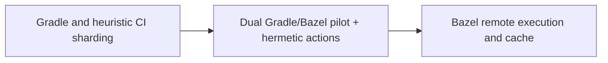

# Airbnb — JVM monorepo Gradle to Bazel: coexistence before mandatory cutover

**Case ID:** `case.airbnb.jvm-bazel` | **Milestone:** M9 E16-05 #118 | **Status:** evidence-grounded draft, pending reviewer.  
**Public primary:** A01 [official engineering account](https://airbnb.tech/infrastructure/migrating-airbnbs-jvm-monorepo-to-bazel/), Airbnb Engineering first-party retrospective; source anchors: Why Bazel?; How did we migrate?; Proof of concept; results and lessons. No private materials or copyrighted graphics reproduced.

## Original pressure and baseline

Large Gradle builds and pre-merge checks became costly. The article identifies 2021-era >20-minute local builds for large services and about 35-minute pre-merge CI p90. Heuristic sharding and vertical scaling of build workers wasted resources, while implicit Gradle environment dependencies made identical source trees behave differently across machines.

## Architecture shift and ownership

Bazel's hermetic action graph, remote cache and remote execution provided an operationally different execution substrate. Crucially, the first proof of concept allowed Gradle and Bazel to coexist on Viaduct, a complex GraphQL JVM platform used by many engineers, so developers could demonstrate voluntary adoption rather than submit to an immediate global switch.

**Text alternative:** Gradle and heuristic CI sharding, through Dual Gradle/Bazel pilot + hermetic actions, evolved toward Bazel remote execution and cache. Diagram is a simplified original architectural transition, not a provider topology inventory.

## Execution stages, validation and reversibility

For a comparable migration, choose an uncomfortably large but engaged pilot, generate hermetic build targets, run identical tests through both build systems, align IDE and CI experiences, record non-hermetic tasks, and gradually require Bazel where parity and local adoption are measured. Airbnb explicitly reports the coexistence PoC. The proposed acceptance/reversion policy is Tycho guidance.

A **synthetic migration readiness checklist** for applying the lesson elsewhere (not a claim that the original authors used this exact checklist):

1. Define the old and new ownership boundaries and which API/data contract must stay invariant throughout coexistence.
2. Capture representative traffic and error distributions, not solely a success-path benchmark. Specify performance baselines with release version, dataset and sample size.
3. Compare old/new result sets and temporal semantics; test retried writes, old clients, skipped batches and partial deployment.
4. Observe canary failure and rollback behavior with exact data-authority ordering. Do not retire the legacy system before provable invariants hold.
5. Retest under realistic resource limits, hot keys and failure injections. A change in infra topology is not a substitute for demand shaping.

## Measured or reported outcome

Airbnb reports **3–5x faster local build/test**, **2–3x IntelliJ sync**, **2–3x development deployment** and build satisfaction rising **38% to 68%** in its own context. The entire migration took **4.5 years**; the initial **2–4x faster** Viaduct pilot alone did not prompt developer adoption until integration issues were fixed. Approximately **100 of 700 services** had startup/integration parity failures during Bazel-built deploy verification; these were not necessarily production incidents. These are company-reported historical observations, not controlled evidence for an unrelated JVM repo. For numbered section anchors and caveats, see [Wave 09](../../authoring/cases/M9_NUMERIC_SOURCE_RECHECK_WAVE09.md).

## Failed assumptions and when not to transfer the design

New build syntax, target ownership, remote cache semantics and dedicated build infrastructure impose substantial initial cost. Hermeticity finds hidden dependencies; a small repository with fast builds is unlikely to recoup the platform overhead. Do not infer universal 3–5x speedup for arbitrary builds.

**Architecture choice:** Pick Bazel when total affected developer count and test/build critical path justify hermetic remote execution; insist on target correctness and adoption telemetry, not only fastest single clean build.

A lesser change (query optimization, archive policy, package boundary, deploy-tuning) is a valid alternative when it meets SLOs and costs less. A counter-architecture for this case requires workload, team skills, and service-level constraints; do not infer that the original company explicitly evaluated every alternative in this paragraph.

## Provenance and acceptance boundary

Evidence is company-authored and scoped to the publication date and sections: [A01](https://airbnb.tech/infrastructure/migrating-airbnbs-jvm-monorepo-to-bazel/), **Why Bazel?; How did we migrate?; Proof of concept; results and lessons**. Numerical results, where stated, are publisher-reported; no Tycho benchmark, source reproduction or copyright permissions inferred. Source status must be reconciled with [the candidate audit](../../sources/REAL_WORLD_CASES_CANDIDATE_AUDIT.md) and E16-01 #114. This case remains a draft until independent #121 correctness and source review.
