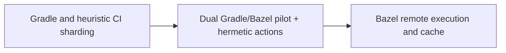

# Airbnb — JVM monorepo Gradle to Bazel: coexistence before mandatory cutover

**Case ID:** `case.airbnb.jvm-bazel` | **Milestone:** M9 E16-05 #118 | **Status:** evidence-grounded draft, pending reviewer.  
**Public primary:** A01 [official engineering account](https://airbnb.tech/infrastructure/migrating-airbnbs-jvm-monorepo-to-bazel/), Airbnb Engineering first-party retrospective; source anchors: Why Bazel?; How did we migrate?; Proof of concept; results and lessons. No private materials or copyrighted graphics reproduced.

## Original pressure and baseline

Large Gradle builds and pre-merge checks became costly. The article identifies 2021-era >20-minute local builds for large services and about 35-minute pre-merge CI p90. Heuristic sharding and vertical scaling of build workers wasted resources, while implicit Gradle environment dependencies made identical source trees behave differently across machines.

## Architecture shift and ownership

Bazel's hermetic action graph, remote cache and remote execution provided an operationally different execution substrate. Crucially, the first proof of concept allowed Gradle and Bazel to coexist on Viaduct, a complex GraphQL JVM platform used by many engineers, so developers could demonstrate voluntary adoption rather than submit to an immediate global switch.

**Text alternative:** Gradle and heuristic CI sharding, through Dual Gradle/Bazel pilot + hermetic actions, evolved toward Bazel remote execution and cache. Diagram is a simplified original architectural transition, not a provider topology inventory.

## Execution stages, validation and reversibility

For a comparable migration, choose an uncomfortably large but engaged pilot, generate hermetic build targets, run identical tests through both build systems, align IDE and CI experiences, record non-hermetic tasks, and gradually require Bazel where parity and local adoption are measured. Airbnb explicitly reports the coexistence PoC. The proposed acceptance/reversion policy is Tycho guidance.

A **synthetic migration readiness checklist** for applying the lesson elsewhere (not a claim that the original authors used this exact checklist):

1. Define the old and new ownership boundaries and which API/data contract must stay invariant throughout coexistence.
2. Capture representative traffic and error distributions, not solely a success-path benchmark. Specify performance baselines with release version, dataset and sample size.
3. Compare old/new result sets and temporal semantics; test retried writes, old clients, skipped batches and partial deployment.
4. Observe canary failure and rollback behavior with exact data-authority ordering. Do not retire the legacy system before provable invariants hold.
5. Retest under realistic resource limits, hot keys and failure injections. A change in infra topology is not a substitute for demand shaping.

## Measured or reported outcome

Airbnb reports **3–5x faster local build/test**, **2–3x IntelliJ sync**, **2–3x development deployment** and build satisfaction rising **38% to 68%** in its own context. The entire migration took **4.5 years**; the initial **2–4x faster** Viaduct pilot alone did not prompt developer adoption until integration issues were fixed. Approximately **100 of 700 services** had startup/integration parity failures during Bazel-built deploy verification; these were not necessarily production incidents. These are company-reported historical observations, not controlled evidence for an unrelated JVM repo. For numbered section anchors and caveats, see [Wave 09](../../authoring/cases/M9_NUMERIC_SOURCE_RECHECK_WAVE09.md).

## Failed assumptions and when not to transfer the design

New build syntax, target ownership, remote cache semantics and dedicated build infrastructure impose substantial initial cost. Hermeticity finds hidden dependencies; a small repository with fast builds is unlikely to recoup the platform overhead. Do not infer universal 3–5x speedup for arbitrary builds.

**Architecture choice:** Pick Bazel when total affected developer count and test/build critical path justify hermetic remote execution; insist on target correctness and adoption telemetry, not only fastest single clean build.

A lesser change (query optimization, archive policy, package boundary, deploy-tuning) is a valid alternative when it meets SLOs and costs less. A counter-architecture for this case requires workload, team skills, and service-level constraints; do not infer that the original company explicitly evaluated every alternative in this paragraph.

## Four-and-a-half-year transition: why coexistence was both safety net and cost

The [first-party retrospective](https://airbnb.tech/infrastructure/migrating-airbnbs-jvm-monorepo-to-bazel/) (A01, **How did we migrate?**) differentiates *build equivalence* from *deployable runtime equivalence*. The pilot used **Viaduct**, Airbnb's complex JVM GraphQL platform, with roughly **300 product engineers editing it monthly**. Gradle and Bazel builds coexisted: local build/test improved **2–4×**, but many developers did not opt in until several months of missing integrations and defects were addressed. Pure benchmark speed did not create acceptable development workflow.

The broader program moved **breadth-first** toward Bazel builds and unit tests in CI while Gradle remained the deployment build. Gradle provided an explicit escape route during remote cache or execution-cluster incidents; the authors say they **actually disabled Bazel** at times to restore productivity. That coexistence cost was real: code changes needed valid configuration in both systems, leading to an automated build-file generator running on each mainline change.

| Phase reported by Airbnb | Output accepted at that phase | Why the next gate was not automatic |
|---|---|---|
| Viaduct opt-in POC | Bazel could build and unit-test one complex service; 2–4× local improvement | Developer adoption still blocked by missing IDE and workflow integrations |
| Breadth-first compilation and testing | Most projects could compile and unit-test with Bazel while retaining Gradle | Matching unit tests does not imply the produced deployable JAR has the same classpath or startup behavior |
| Automated build configuration | Generated rules, incremental source indexing and per-language/codegen plugins reduced manual sync | Generated import dependencies miss reflection and may choose wrong third-party versions |
| Service runtime migration | Startup/integration checks for about 700 service deployables | Around 100 initially failed startup/integration checks, largely reflective classes or version mismatch |
| Pipeline / specialty projects | Around 450 data pipelines and 50 other projects with separate runtimes | Generic CI coverage and specialized runtimes differed; bespoke deployments required review |
| Gradle retirement | Biggest JVM monorepo eventually migrated fully to Bazel after 4.5 years | No independent evidence that every historical production runtime regression was eliminated permanently |

**Evidence:** A01, **Proof of concept**, **Scaling builds and tests with Bazel**, **Automated build file generation**, **Migrating the deploys**. The article is retrospective; its initial 2021 build-time observations must not be interpreted as the end-state baseline.

## Actual failures: static imports are not full runtime dependencies

The generated Bazel targets identified dependencies primarily from Java/Kotlin/Scala source. That approach could not always detect classes loaded by **reflection from configuration**. In publisher-reported startup/integration testing, **roughly 100 of about 700 services** failed. Comparing Gradle and Bazel also exposed incompatible dependency versions: Gradle modules had historically used multiple versions of the same library, while an initial Bazel model assumed one globally selected version. Airbnb added support for multiple Maven versions with per-target resolution and synchronized effective versions to the Gradle baseline. These were **migration blockers**, not proof that Bazel generally cannot represent reflective dependencies.

After those changes, the team reported a **single-digit percentage** of services still exhibiting production runtime issues requiring deeper manual investigation. For roughly **400** pipeline projects using a pre-existing paved-path CI test that runs a small Spark job locally, about **3%** encountered production runtime issues after passing those checks. These distinct service and pipeline denominators must not be collapsed into a universal failure rate. [A01, **Services**, **Data pipelines and other projects**].

Airbnb also warns that optimizing Bazel build granularity *during migration* greatly increased the number of configuration files and made equivalence with Gradle-built deployables more difficult. In hindsight the authors would have prioritized **parity first, granular optimization later**. This is direct negative evidence against combining a build-tool cutover with a full dependency model redesign in one change. [A01, **Dangers of premature optimization**].

## Detailed mechanics and ownership

Airbnb's custom generator (called **sync-configs** in the article) used source imports, declarations and incremental repository state to derive Bazel targets. Its need for caching reflected a concrete organizational constraint: generating configuration after every commit cannot significantly delay normal merges. Compared with about **4,500 manually maintained Gradle files**, the generator also offered ongoing removal of obsolete dependencies. That count is specific to Airbnb's old structure, not a sensible complexity target for another monorepo.

Build tools were only part of the architecture. Running local and CI actions on **remote execution workers in consistent containers** reduced resource-environment differences; Bazel sandboxing narrowed undeclared filesystem dependencies. Earlier Gradle tasks had produced an actual temporary-directory cleanup race in CI. The source therefore supports reproducibility and resource isolation as selection criteria, independently of build speed. [A01, **Why Bazel?**].

The case also demonstrates **organizational ownership**: pilots were chosen for their high benefit *and* willing service owners. As adoption widened, domain teams took responsibility for converting their unusual code-generation rules, contributing plugins and reporting parity failures. A migration centrally declared complete without affected build and deployment owners cannot be inferred to have the same result.

## Outcomes with exact comparison population

| Publisher metric | What the result means | Necessary qualifier |
|---|---|---|
| **3–5×** local build/test speed | Reported post-migration local developer workflow | Neither a universal clean-build benchmark nor audited productivity uplift |
| **2–3×** IntelliJ sync | Editor workflow observation for relevant projects | Environment and warm-cache distribution not fully published |
| **2–3×** development deployment speed | Dev environment deploy, **not** measured production deployment lead time | Does not prove application correctness or production latency improvement |
| Build satisfaction **38% → 68%** | Publisher's developer survey/result | No independent survey sampling method or confidence interval in case source |
| Total **4.5 years** | Reported project duration | Demonstrates migration ownership cost, not repeatable ETA |

These numbers are from A01, **Migration in numbers / Conclusion**. Do not treat percentages as deployment rate, or runtime parity as the correctness of all application behavior.

## Original Tycho migration decision for another JVM platform

**Synthetic constraints:** a JVM monorepo has several hundred deployables, overloaded CI, custom code-generation plugins, mixed libraries, and strict compatibility requirements. Comparing three alternatives clarifies the decision: (a) optimize Gradle with cache/test sharding first, avoiding new infrastructure; (b) migrate gradually to a hermetic remote-execution tool; (c) split ownership into independently built repositories, accepting coordination and dependency-management costs. The Airbnb source reports why it selected the second option, but these are **not** three empirically tested Airbnb cohorts.

Recommended **separate acceptance gates**: prove a high-impact POC with voluntary adoption; achieve full unit-test parity before runtime cutover; use startup/integration tests on representative artifacts; maintain old execution path during infrastructure incidents; verify reflection-derived dependencies and exact library versions; sample actual deployable startup/health and traces; migrate specialty pipelines separately; and only after parity optimize granularity and remove the old tool.

**Stop conditions:** unresolved binary/classpath mismatch, missing generated artifacts, repeatable production-only startup failure, loss of rollback access to the old tool, or developer workflow regression despite a faster synthetic build. A result from Airbnb's 4.5-year effort is evidence of *possible* value under large-scale constraints, not permission to prescribe Bazel to every repository. For a small stable codebase, staying on Gradle and fixing the critical path may produce a better risk-adjusted outcome. Compare the [cross-company build modernization decision](decisions/build-delivery-migration.md).

## Provenance and acceptance boundary

Evidence is company-authored and scoped to the publication date and sections: [A01](https://airbnb.tech/infrastructure/migrating-airbnbs-jvm-monorepo-to-bazel/), **Why Bazel?; How did we migrate?; Proof of concept; results and lessons**. Numerical results, where stated, are publisher-reported; no Tycho benchmark, source reproduction or copyright permissions inferred. Source status must be reconciled with [the candidate audit](../../sources/REAL_WORLD_CASES_CANDIDATE_AUDIT.md) and E16-01 #114. This case remains a draft until independent #121 correctness and source review.
