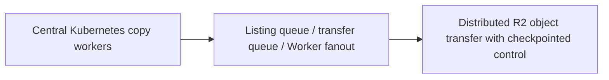

# Cloudflare — Super Slurper: copy objects through queues and distributed workers

**Case ID:** `case.cloudflare.super-slurper-queues` | **M9:** E16-05 #118 | **Status:** original case draft; independent reviewer pending.  
**Public primary:** CF01 [company engineering report](https://blog.cloudflare.com/making-super-slurper-five-times-faster/) (2025-04-10, Connor Maddox, Siddhant Sinha and Prasanna Sai Puvvada); source location: Initial architecture and performance bottlenecks; New architecture: Workers, Queues, and Durable Objects; Results. Attributed public paraphrase, no mirrored graphs or copyrighted assets.

## Pressure, legacy baseline and actual chosen direction

The original R2 object migration tool inherited a Kubernetes-based SourcingKit architecture and concentrated copy workers in a core datacenter, sharing bandwidth and compute with other services. As transferred object count grew, waiting on source/destination I/O was a bottleneck more than available CPU.

The revised design orchestrates object listings and transfers with Cloudflare Workers, durable coordination and separate queues for listing and transfer work. Consumers create batches while backpressure/throttling constrains queue production when dependencies fail. This decomposes an I/O-heavy bulk job into explicit scheduled units.

**Text alternative:** Central Kubernetes copy workers transitions through Listing queue / transfer queue / Worker fanout into Distributed R2 object transfer with checkpointed control. This is an independent, simplified transition schematic, not a trace or full infrastructure diagram.

## Migration mechanics and reliability

The authors tested a proof of concept that was *slower on small transfers* but matched or beat the original at very large object counts; this negative result justified focusing the change on high-concurrency transfer scale. They reworked the POC into robust queue-backed processing; a future team should define idempotency by source object identity/version, checkpoint/resume and verification of object counts and hashes as Tycho gates.

**Synthetic acceptance plan for a different legacy stack:** baseline real workload and maintenance cost; specify the one invariant that cannot change; stage compatible dual routes/data or immutable job inputs; compare source and target results including timestamps and retries; define rate-limit, fallbacks and alerting; establish rollback while the old path remains operational. These steps are analytical transfer, not invented historical facts about cloudflare.

## Outcomes and negative lessons

Cloudflare's published specific test copied **75,000 objects** S3→R2 in **15 min 30 sec** before vs **3 min 25 sec** after. It describes *up to* 5× speedup in the selected comparison; test object sizes/network conditions cannot be assumed universal.

Adding durable objects, queues and workers creates distributed orchestration, retries and state-management costs. For hundreds of small objects the POC was worse; a queue layer is not inherently lower latency than a local worker. The advertised 5× result is not a universal cloud-to-cloud benchmark.

| Architecture alternative | Valid reason to choose | Danger/constraint |
|---|---|---|
| Keep/tune current design | Lowest transition risk if current SLOs hold | May not solve actual scaling or ownership failure |
| Adopt the documented pattern | Same bottleneck and teams capable of operating new abstraction | Workload/version/data semantics may not match original |
| Introduce an intermediate compatibility adapter | Split change into reversible pieces | Additional short-term dual-state complexity |
| Unknown until instrumented | No trustworthy baseline or correctness oracle | Do not present speculation as an endorsed architecture |

## Legacy modernization decision transfer

Use queue fan-out and backpressure when an I/O-bound migration needs sustained parallelism and fault isolation across sources and destinations; do not add it to a tiny one-off copy script without operational justification.

**Metrics required before reuse:** actual p95/p99, throughput versus CPU/storage, error and retry rate, divergence/correctness, rollback time and SRE toil, with historical time window. No new performance measurement or independent replication was performed by Tycho. All source-reported numbers are scoped to this publisher's observations.

**Provenance:** [CF01](https://blog.cloudflare.com/making-super-slurper-five-times-faster/), Initial architecture and performance bottlenecks; New architecture: Workers, Queues, and Durable Objects; Results. Source-admission review [#114](https://github.com/rouslanbaranov/tycho/issues/114); independent technical review [#121](https://github.com/rouslanbaranov/tycho/issues/121). **Status remains draft** pending both gates.
