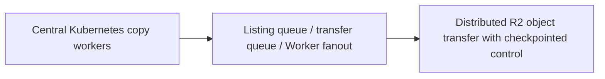

# Cloudflare — Super Slurper: copy objects through queues and distributed workers

**Case ID:** `case.cloudflare.super-slurper-queues` | **M9:** E16-05 #118 | **Status:** original case draft; independent reviewer pending.  
**Public primary:** CF01 [company engineering report](https://blog.cloudflare.com/making-super-slurper-five-times-faster/) (2025-04-10, Connor Maddox, Siddhant Sinha and Prasanna Sai Puvvada); source location: Initial architecture and performance bottlenecks; New architecture: Workers, Queues, and Durable Objects; Results. Attributed public paraphrase, no mirrored graphs or copyrighted assets.

## Pressure, legacy baseline and actual chosen direction

The original R2 object migration tool inherited a Kubernetes-based SourcingKit architecture and concentrated copy workers in a core datacenter, sharing bandwidth and compute with other services. As transferred object count grew, waiting on source/destination I/O was a bottleneck more than available CPU.

The revised design orchestrates object listings and transfers with Cloudflare Workers, durable coordination and separate queues for listing and transfer work. Consumers create batches while backpressure/throttling constrains queue production when dependencies fail. This decomposes an I/O-heavy bulk job into explicit scheduled units.

**Text alternative:** Central Kubernetes copy workers transitions through Listing queue / transfer queue / Worker fanout into Distributed R2 object transfer with checkpointed control. This is an independent, simplified transition schematic, not a trace or full infrastructure diagram.

## Migration mechanics and reliability

The authors tested a proof of concept that was *slower on small transfers* but matched or beat the original at very large object counts; this negative result justified focusing the change on high-concurrency transfer scale. They reworked the POC into robust queue-backed processing; a future team should define idempotency by source object identity/version, checkpoint/resume and verification of object counts and hashes as Tycho gates.

**Synthetic acceptance plan for a different legacy stack:** baseline real workload and maintenance cost; specify the one invariant that cannot change; stage compatible dual routes/data or immutable job inputs; compare source and target results including timestamps and retries; define rate-limit, fallbacks and alerting; establish rollback while the old path remains operational. These steps are analytical transfer, not invented historical facts about cloudflare.

## Outcomes and negative lessons

Cloudflare's published specific test copied **75,000 objects** S3→R2 in **15 min 30 sec** before vs **3 min 25 sec** after. It describes *up to* 5× speedup in the selected comparison; test object sizes/network conditions cannot be assumed universal.

Adding durable objects, queues and workers creates distributed orchestration, retries and state-management costs. For hundreds of small objects the POC was worse; a queue layer is not inherently lower latency than a local worker. The advertised 5× result is not a universal cloud-to-cloud benchmark.

| Architecture alternative | Valid reason to choose | Danger/constraint |
|---|---|---|
| Keep/tune current design | Lowest transition risk if current SLOs hold | May not solve actual scaling or ownership failure |
| Adopt the documented pattern | Same bottleneck and teams capable of operating new abstraction | Workload/version/data semantics may not match original |
| Introduce an intermediate compatibility adapter | Split change into reversible pieces | Additional short-term dual-state complexity |
| Unknown until instrumented | No trustworthy baseline or correctness oracle | Do not present speculation as an endorsed architecture |

## Observed orchestration stages and persistent state boundaries

The [April 10, 2025 engineering post](https://blog.cloudflare.com/making-super-slurper-five-times-faster/) (CF01, **New architecture: Workers, Queues, and Durable Objects**) documents **more than a simple queue inserted in front of workers**. The original source-copy system reused Kubernetes SourcingKit infrastructure in a core data center. A roughly one-week proof of concept using Workers/Queues/Durable Objects **performed worse for a few hundred objects**, then matched or beat the original at very large object counts. That negative pilot result is a workload threshold, not evidence that event-driven copying always has lower overhead.

| Actual processing phase in CF01 | Responsible reported component | Data it must durably preserve | Distinct failure/retry risk |
|---|---|---|---|
| Start a job | API Worker + account Durable Object | Migration options, source/target names and job identity | Duplicate start requests or inaccessible historical state |
| Enumerate source objects | List Queue consumer | Continuation position, object identifiers and listing state | Replayed list page, reordering or overlapping workers |
| Schedule transfers | List producer + Transfer Queue | Per-object key and transfer task | Queue backlog, duplicate delivery, dependence on remote source |
| Copy bytes | Transfer Queue consumers / Workers | In-progress lock and object-transfer state; multipart status for large objects | Timeout after upload, partial multipart object, repeated copy |
| Determine completion | Lifecycle Queue consumer | Pending/failed/completed object counts and job terminal status | Premature completion despite delayed transfer or dead-letter work |
| Retrieve legacy jobs | Hyperdrive to old PostgreSQL records | Historical migration metadata | New runtime must not silently discard prior migration history |

The publisher describes separate **account job Durable Objects**, **batch Durable Objects** for queued object keys and state, and a sharding mechanism to avoid the SQLite Durable Object **10 GB storage limit** when dealing with billions of keys. This is not a claim that each batch DO supports unlimited keys. Historical job data remain reachable through Hyperdrive, while the new path handles active job orchestration. [CF01, **Database layer: durable storage & legacy data retrieval**].

## At-least-once semantics: four actual duplicate defenses

Cloudflare names *two* duplicate causes: the delivery contract of Queues (**at least once**) and failures/late acknowledgments to Durable Objects after an object was already transferred. The source's **Challenges** section names concrete safeguards rather than assuming “exactly-once queue”:

1. **Listing sequence identifiers:** a source listing is sequential through continuation tokens; numbering operations prevents competing duplicate enumerations and allows redundant retries to be short-circuited.
2. **Per-key transfer lock:** consumers lock an object identity while processing; successful completion removes the key from the tracking database. A later redelivery whose key is absent can be recognized as already processed.
3. **Transactional accounting:** inserting/deleting object keys and updating pending counts are coupled so failure to commit does not incorrectly advance the completed-object total.
4. **Destination existence check:** as a last defense, the system can skip an object found at the destination with a publish time after migration start.

These defenses address duplicate **work**, not a magic end-to-end atomic transfer between S3 and R2. For another platform, destination-existence and timestamp checks alone are not sufficient to prove byte equality, metadata correctness, same-version source identity or authorization. The account's published approach is a company-specific idempotency design with particular assumptions; do not silently generalize it to mutating sources or arbitrary overwrite semantics.

**Failure branch:** queue consumers retry transient faults; nonretriable work moves to a **dead-letter queue** for later inspection. The listing producer can throttle enqueueing if dependent systems fail. A job controller must distinguish *all queued*, *all acknowledged*, *all verified* and *all failed/review-needed* before declaring completion. CF01 documents its lifecycle consumer; it does not publish full per-object hash verification or an independently reproduced loss bound.

## Performance result, population and negative case

| Publisher-reported metric | Observation | Validity caveat |
|---|---|---|
| **75,000 objects**, AWS S3 → R2 | Old copy **15m30s** vs new **3m25s** | Selected test of one object mix; roughly 4.5× for this sample, described as **up to 5×** |
| Several hundred objects | First Worker/Queue proof of concept **slower** than old implementation | Queue and orchestration cost dominates small job |
| Millions of objects | Proof of concept met or exceeded old design in larger tests | No full object-size distribution, cost or confidence intervals given |
| Last two months of service history | Publisher says **35% of lifetime objects** had been copied in this interval after the new service was adopted | Adoption-volume observation, not throughput-normalized performance experiment |
| Concurrency at post date | Company notes **3 concurrent migrations per account**; higher concurrency was a future goal | Does not prove arbitrary unbounded parallelism |

The article reports some live transfers were even faster depending on object sizes, but supplies no general latency histogram, operational cost baseline or independent benchmark. The 75,000-object ratio must not be presented as a p99 speedup for every migration. [CF01, **Results**, **What’s next for Super Slurper?**].

## Why the queue architecture is not automatically the best choice

A local batch copier can be safer and cheaper for a limited fixed transfer set. A durable queued architecture adds partitioned coordinator state, asynchronous acknowledgments, poison messages, idempotency rules, recovery operations and versioned historical job data. It is attractive only when its extra operational cost buys useful concurrency and restartability at scale. The Cloudflare source supports distributed high-volume copy throughput, but it does not establish correctness for every schema or metadata translation.

For a **synthetic object migration**, Tycho's acceptance contract would pin source bucket/version and destination settings, identify object-level authority, preserve listing and transfer cursors, inject queue duplicates and lost acknowledgments, verify byte-level content/metadata for representative and boundary cases, confirm the DLQ and resume workflow, and compare completion latency and cost for **small, medium, and large** object populations. Reconciliation must cover failures during copy as well as completion after copy but before acknowledging the work item.

**Rollback boundary:** before destination consumers switch, suspend queue production and keep the old source authoritative; after consumers begin writing the target independently, returning to the source may need separate reverse synchronization. The historical article does not specify a universal two-way rollback protocol or prove a per-object recovery time. When source mutability, object versioning, target overwrite policy or authorization cannot be audited, return **insufficient evidence** rather than claim safe migration.

## Legacy modernization decision transfer

Use queue fan-out and backpressure when an I/O-bound migration needs sustained parallelism and fault isolation across sources and destinations; do not add it to a tiny one-off copy script without operational justification.

**Metrics required before reuse:** actual p95/p99, throughput versus CPU/storage, error and retry rate, divergence/correctness, rollback time and SRE toil, with historical time window. No new performance measurement or independent replication was performed by Tycho. All source-reported numbers are scoped to this publisher's observations.

**Provenance:** [CF01](https://blog.cloudflare.com/making-super-slurper-five-times-faster/), Initial architecture and performance bottlenecks; New architecture: Workers, Queues, and Durable Objects; Results. Source-admission review [#114](https://github.com/rouslanbaranov/tycho/issues/114); independent technical review [#121](https://github.com/rouslanbaranov/tycho/issues/121). **Status remains draft** pending both gates.
