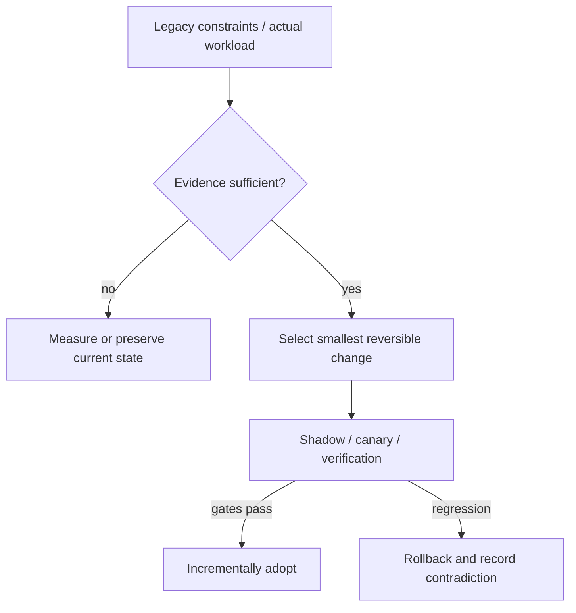

# Decision Playbook — Agent-assisted modernization: evidence and deterministic safety gates

**ID:** `decision.agentic-migration-safety` | **Owner:** M9 E16-06 #119 | **State:** original analytical draft, independent reviewer pending.  
**Method:** compare contrasting historical cases; distinguish each company's *reported past decision* from the **synthetic** decision below. No company is claimed to have assessed the other firm's choices.

## Synthetic legacy system and decision problem

An engineering organization wants an AI coding agent to update a few thousand service repositories and simultaneously change a critical datastore schema. The team lacks enough explicit invariants to determine whether generated changes preserve behavior.

## Contrasting historical evidence

| Actual company case | What its primary source does and does not establish |
|---|---|
| [Spotify long-tail](../spotify-tech-migration-long-tail.md) | SP01 (2020): automation as a fleet-migration tactic, not an AI-agent outcome |
| [Spotify Honk](../spotify-honk-data-consumer-migration.md) | SP02/SP03 (2025–26): >1,500 reported merged PRs overall; 240 rolled-out dataset PRs, Scio exclusion, test gaps and owner review |
| [Shopify Helix](../shopify-helix-checkpoint-gated-native-migration.md) | SH04 (2026): checkpoint-level behavior, visual and two adversarial gates, human sign-off by default |
| [Stripe](../stripe-online-subscriptions-migration.md) | ST01: comparable old/new reads with Scientist and phased write authority |
| [Airbnb](../airbnb-jvm-monorepo-bazel.md) | A01: parallel build/test parity and voluntary adoption |
| [Netflix](../netflix-casspactor-shadow-migration.md) | N11: set-difference proof and fallback selector |

**Why the apparent conflict is useful:** Spotify's 2020 report supports *general automation*; its separate 2025–26 reports describe actual LLM-backed PR workflows and their limits. Shopify's Helix describes gated native-app migration. Neither publisher reports independently audited escaped-defect or universal correctness rates. Stripe supplies correctness checks for mutable data and Netflix supplies set comparisons for batch data; Airbnb shows dual-run build parity. These are separate, evidence-backed guardrails that can be composed into an agentic proposal, not proof that these firms used the same AI harness.

## Decision tree and chosen ADR

**Text alternative:** collect requirements and legacy workload evidence first. When evidence is missing, measure rather than select a fashionable pattern. When evidence suffices, prefer the smallest reversible change, run shadow/canary validation, adopt only after acceptance gates, otherwise roll back.

**ADR — Proposed for the synthetic system, not a historical company ADR.**  
**Status:** proposed, subject to measured baseline and security review.  
**Context:** An engineering organization wants an AI coding agent to update a few thousand service repositories and simultaneously change a critical datastore schema. The team lacks enough explicit invariants to determine whether generated changes preserve behavior.  
**Decision:** Require checkpoint-level behavior and approval gates analogous to Shopify SH04; where automatic tests do not exist, route PRs to qualified owner review as Spotify SP03 did. Limit unattended agent changes to transformations with a machine-checkable contract (API, tests, schema, static analysis), and require human review for semantics or ownership changes. Stage PR cohorts and replay deterministic validation before merge; use online shadow comparisons for data migrations.  
**Rejected for now:** a large irreversible rearchitecture without a verified bottleneck, tests, source/data provenance or fallback.  
**Consequences:** additional migration observability and temporary dual-state complexity are acceptable while the rollout is reversible; these costs must be budgeted explicitly.

## Applicability and counterindications

**Use this evidence when:** a real system has the same dominant constraint, the relevant execution model/data semantics have been measured and its team can operate the new architecture.

**Do not generalize when:** If no reliable test oracle exists or the migration touches hidden business meaning, autopilot is not justified. Diff size, compilation or PR-merge statistics are not correctness; an agent producing 1,500 PRs is not in itself an acceptance metric. SP02/SP03 and Shopify SH04 have now been inspected at their original publishers and admitted for **bounded first-party claims**; none establishes an independent AI-agent escaped-defect rate. Spotify's ~1,800 direct pipelines were scope, not proof of completion; 240 PRs were rolled out, not necessarily merged, and Scio was excluded.

**Independent decision dimensions to measure:** Behavioral regression and invariant failures, source coverage, contract test pass, human review findings, canary rollback, escaped defect rate, PR acceptance/revert ratio measured over observation window.

## Modernization plan

State desired transformation + inventory sources → create spec and reversible per-issue slices → pin code/source revisions → generate PR in sandbox → static checks + legacy/new golden tests + traceable evidence → independent review for risky changes → canary/rollback → log exceptions and source provenance.

**Reversal triggers / insufficient evidence:** If the transformation cannot be expressed as deterministic contracts, pause agents at analysis-only mode until a human defines a valid oracle. Do not silently substitute an AI-generated benchmark for production telemetry.

## Failure analysis and evidence provenance

The company cases are not A/B comparisons of two architectures under one workload. Published outcomes describe different organizations, production periods, release versions, traffic mixes and operating constraints. This playbook compares *mechanisms and constraints*, not raw numerical results across companies.

Before passing a recommendation to Rocinante, an agent should return: legacy facts, requirement/SLO evidence, selected/avoided pattern, evidence rows with company/date/source ID, alternative mechanism, caveats, a reversible transition sequence, what would falsify the choice, and whether human review is needed. Never invent what original engineering teams rejected.

Sources are linked through each original case page above, ultimately referring to [the M9 public source register](../../../sources/REAL_WORLD_ARCHITECTURE_CASES.md). All analytical ADRs are original Tycho examples. **Independent review:** #121, not yet completed.
