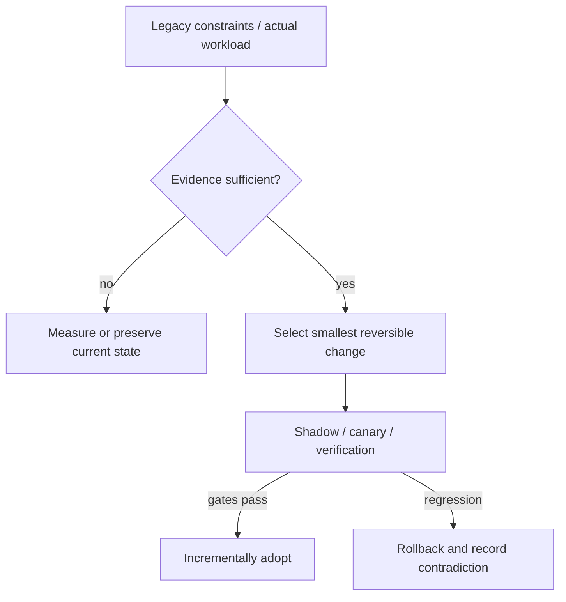

# Decision Playbook — Agent-assisted modernization: evidence and deterministic safety gates

**ID:** `decision.agentic-migration-safety` | **Owner:** M9 E16-06 #119 | **State:** original analytical draft, independent reviewer pending.  
**Method:** compare contrasting historical cases; distinguish each company's *reported past decision* from the **synthetic** decision below. No company is claimed to have assessed the other firm's choices.

## Synthetic legacy system and decision problem

An engineering organization wants an AI coding agent to update a few thousand service repositories and simultaneously change a critical datastore schema. The team lacks enough explicit invariants to determine whether generated changes preserve behavior.

## Contrasting historical evidence

| Actual company case | What its primary source does and does not establish |
|---|---|
| [Spotify long-tail](../spotify-tech-migration-long-tail.md) | SP01 (2020): automation as a fleet-migration tactic, not an AI-agent outcome |
| [Spotify Honk](../spotify-honk-data-consumer-migration.md) | SP02/SP03 (2025–26): >1,500 reported merged PRs overall; 240 rolled-out dataset PRs, Scio exclusion, test gaps and owner review |
| [Shopify Helix](../shopify-helix-checkpoint-gated-native-migration.md) | SH04 (2026): checkpoint-level behavior, visual and two adversarial gates, human sign-off by default |
| [Stripe](../stripe-online-subscriptions-migration.md) | ST01: comparable old/new reads with Scientist and phased write authority |
| [Airbnb](../airbnb-jvm-monorepo-bazel.md) | A01: parallel build/test parity and voluntary adoption |
| [Netflix](../netflix-casspactor-shadow-migration.md) | N11: set-difference proof and fallback selector |

**Why the apparent conflict is useful:** Spotify's 2020 report supports *general automation*; its separate 2025–26 reports describe actual LLM-backed PR workflows and their limits. Shopify's Helix describes gated native-app migration. Neither publisher reports independently audited escaped-defect or universal correctness rates. Stripe supplies correctness checks for mutable data and Netflix supplies set comparisons for batch data; Airbnb shows dual-run build parity. These are separate, evidence-backed guardrails that can be composed into an agentic proposal, not proof that these firms used the same AI harness.

## Decision tree and chosen ADR

**Text alternative:** collect requirements and legacy workload evidence first. When evidence is missing, measure rather than select a fashionable pattern. When evidence suffices, prefer the smallest reversible change, run shadow/canary validation, adopt only after acceptance gates, otherwise roll back.

**ADR — Proposed for the synthetic system, not a historical company ADR.**  
**Status:** proposed, subject to measured baseline and security review.  
**Context:** An engineering organization wants an AI coding agent to update a few thousand service repositories and simultaneously change a critical datastore schema. The team lacks enough explicit invariants to determine whether generated changes preserve behavior.  
**Decision:** Require checkpoint-level behavior and approval gates analogous to Shopify SH04; where automatic tests do not exist, route PRs to qualified owner review as Spotify SP03 did. Limit unattended agent changes to transformations with a machine-checkable contract (API, tests, schema, static analysis), and require human review for semantics or ownership changes. Stage PR cohorts and replay deterministic validation before merge; use online shadow comparisons for data migrations.  
**Rejected for now:** a large irreversible rearchitecture without a verified bottleneck, tests, source/data provenance or fallback.  
**Consequences:** additional migration observability and temporary dual-state complexity are acceptable while the rollout is reversible; these costs must be budgeted explicitly.

## Applicability and counterindications

**Use this evidence when:** a real system has the same dominant constraint, the relevant execution model/data semantics have been measured and its team can operate the new architecture.

**Do not generalize when:** If no reliable test oracle exists or the migration touches hidden business meaning, autopilot is not justified. Diff size, compilation or PR-merge statistics are not correctness; an agent producing 1,500 PRs is not in itself an acceptance metric. SP02/SP03 and Shopify SH04 have now been inspected at their original publishers and admitted for **bounded first-party claims**; none establishes an independent AI-agent escaped-defect rate. Spotify's ~1,800 direct pipelines were scope, not proof of completion; 240 PRs were rolled out, not necessarily merged, and Scio was excluded.

**Independent decision dimensions to measure:** Behavioral regression and invariant failures, source coverage, contract test pass, human review findings, canary rollback, escaped defect rate, PR acceptance/revert ratio measured over observation window.

## Modernization plan

State desired transformation + inventory sources → create spec and reversible per-issue slices → pin code/source revisions → generate PR in sandbox → static checks + legacy/new golden tests + traceable evidence → independent review for risky changes → canary/rollback → log exceptions and source provenance.

**Reversal triggers / insufficient evidence:** If the transformation cannot be expressed as deterministic contracts, pause agents at analysis-only mode until a human defines a valid oracle. Do not silently substitute an AI-generated benchmark for production telemetry.

## Explicit invariants and failure semantics for the synthetic program

The synthetic task contains **two distinct classes of change**: mechanically constrained source-code migrations and stateful data-schema changes. They require different proof obligations. Passing a compiler cannot establish the historical meaning of a field mapping; matching a UI screenshot cannot establish accessible interaction; and a data-set checksum cannot establish legal authority or business-level interpretation. The contrasting source cases illustrate these limitations rather than provide a reusable vendor-independent certification.

| Planned synthetic change | Evidence needed *before* agent write access | Required independent oracle | Refuse or escalate when |
|---|---|---|---|
| Library/dependency upgrade | Locked before/after dependency trees, API signatures, public migration notes, owner and runtime version | Reproducible build + contract/integration tests + traced compatibility scenarios | Binary compatibility, behavioral equivalence or build execution is unknown |
| UI-framework translation | Running reference states, interaction traces, accessibility requirements, native platform contracts | Interaction assertions, snapshot/visual deltas, keyboard/screen-reader paths, owner review | No reference app; appearance passes but navigation/security/state is untested |
| Dataset/SQL consumer rewrite | Field-level source-to-target schema mapping, lineage snapshot, owner, semantic invariants | Representative input/output equivalence and owner-approved transformations | Semantics are ambiguous; an unsupported framework lacks tests; ownership is uncertain |
| Live data/store migration | Source-of-truth rules, ID mapping, duplicate/delay policy, reconciliation tolerance, write-authority transition and rollback | Two-sided read comparison, shadow writes where safe, lag reconciliation and explicit cutover gate | Dual writes conflict, rollback is destructive, or compare only proves sample coverage |
| Security/authorization update | Trust boundaries, identity propagation, permission matrix and evidence of intended policy | Negative access tests, least-privilege and context-propagation checks by authorized reviewers | Generated code claims equivalent access without authenticated negative-path tests |

**Evidence ancestry:** the Shopify Helix case (SH04) supports checkpoint-style behavior/visual/review gates; Spotify's Honk dataset migration (SP03) supports explicit field maps, excluding Scio and manual validation where tests were absent; Netflix's Casspactor case (N11) supports shadow/compare/fallback concepts; Stripe's online-migration case (ST01) informs explicit write authority. The matrix is an **original Tycho synthesis**, not a claim these companies shared a process.

## Human/agent responsibility contract

For a hypothetical regulated or restricted deployment environment, treat an autonomous coding agent as an *untrusted proposer* of bounded diffs. The agent must report modified files, repository revision, transformation specification, source/evidence links, executed checks with exact commands and observable results, skipped checks, uncertain mappings, and a proposed rollback. A separate reviewer validates the dangerous boundaries and records an affirmative decision; no other agent's self-assessment can be silently promoted to independent human acceptance.

A safe stop state is a successful outcome for an automation boundary: when field semantics are ambiguous, generate **a review request rather than replacement code**. Do not score this as throughput failure. Spotify's published Honk case illustrates that refusing Scio automation and handing untested consumer changes to dataset owners was part of its reported approach, not a reason to fabricate a passing validation suite.

## Reversible two-stage experiment and falsification

**Stage 1 — source-code cohort (synthetic):** choose ten noncritical, representative repositories with approved test oracles. The number ten is an *illustrative cohort size*, not a company outcome. Pin source and tool revisions, predefine allowed diffs and invariants, evaluate dry-run patches, compare against independent manual review, and record post-merge reverts over a declared interval. If human correction repeatedly changes the business semantics of an automated mapping, the transformation contract has failed; stop expanding the cohort.

**Stage 2 — persistent state (synthetic):** keep old data authoritative while backfilling a target representation and shadow-comparing a bounded traffic sample. Compare **both directions** of expected records, ordering and duplicate handling; sample checks alone cannot prove total equality. Switch read authority only when lag, completeness and read semantics meet agreed owner thresholds. Switch write authority only when rollback behavior and consistency across old/new clients are documented. An irreversible destructive migration requires additional explicit approval beyond successful code PRs.

**Measures to record, not invent:** tested-repository denominator; semantic defects per evaluated change; unsupported-case refusal rate; manual reviewer minutes; escaped defects/rollbacks within the declared observation window; cost per accepted change; source provenance completeness; business invariant violations; and time to restore the old authority. A 95% build success rate or a thousand generated PRs cannot replace a zero-critical-regression requirement. No real-run measurements for this proposed program exist.

## When not to select autonomous modernization

Do not launch unattended migration when there is no independent oracle, the same code change silently alters access policy, unversioned downstream consumers cannot be traced, the migration is data-destructive without restoration proof, or the legal rights to inspect/transform the relevant material are unresolved. A smaller supervised refactor, domain-owner-written adapter, explicit manual migration, or postponement can be better architecture decisions. Conversely, repeatable dependency changes with strong tests and pinned revisions may justify greater automation after **measured** independent review evidence. The choice is conditional on system evidence, not the coding agent's confidence or the reputation of its vendor.

## Failure analysis and evidence provenance

The company cases are not A/B comparisons of two architectures under one workload. Published outcomes describe different organizations, production periods, release versions, traffic mixes and operating constraints. This playbook compares *mechanisms and constraints*, not raw numerical results across companies.

Before presenting a recommendation to its user, an architecture-analysis agent should return: legacy facts, requirement/SLO evidence, selected/avoided pattern, evidence rows with company/date/source ID, alternative mechanism, caveats, a reversible transition sequence, what would falsify the choice, and whether human review is needed. Never invent what original engineering teams rejected.

Sources are linked through each original case page above, ultimately referring to [the M9 public source register](../../../sources/REAL_WORLD_ARCHITECTURE_CASES.md). All analytical ADRs are original Tycho examples. **Independent review:** #121, not yet completed.
