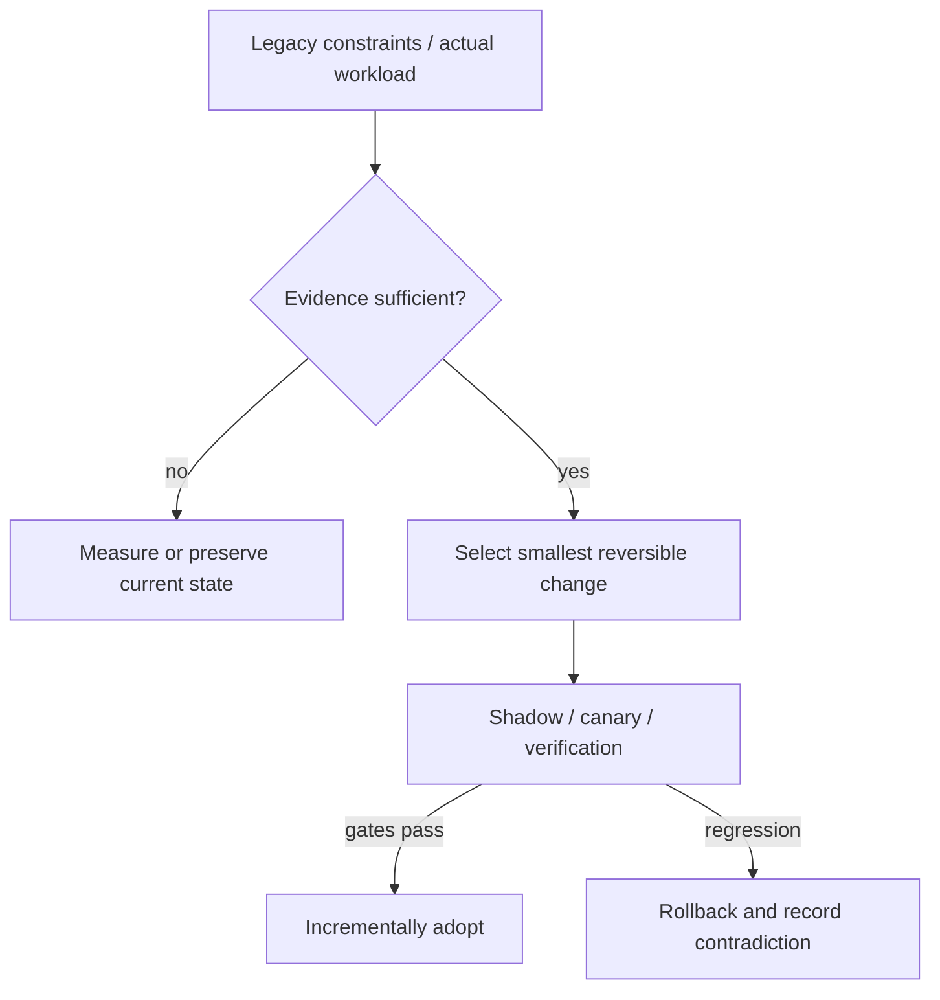

# Decision Playbook — Build and delivery modernization: hermetic execution vs fleet adoption

**ID:** `decision.build-platform-and-adoption` | **Owner:** M9 E16-06 #119 | **State:** original analytical draft, independent reviewer pending.  
**Method:** compare contrasting historical cases; distinguish each company's *reported past decision* from the **synthetic** decision below. No company is claimed to have assessed the other firm's choices.

## Synthetic legacy system and decision problem

A company has a JVM monorepo with 45-minute CI waits but a separate polyrepo fleet where upgrades linger across teams. The first is a computational reproducibility/latency problem; the second is an adoption/ownership problem. They require different controls.

## Contrasting historical evidence

| Actual company case | What its primary source does and does not establish |
|---|---|
| [Airbnb](../airbnb-jvm-monorepo-bazel.md) | A01: Gradle/Bazel coexistence and RBE speed/CSAT report |
| [Spotify](../spotify-tech-migration-long-tail.md) | SP01: Backstage, prioritized migration ownership and long-tail |
| [Uber](../uber-doma-domains.md) | U01: coordination costs when services and teams proliferate |

**Why the apparent conflict is useful:** Airbnb evaluated developers opting into Bazel while Gradle continued; Spotify coordinated a long-tail across autonomous squads. Uber's DOMA points to a third failure: cross-service change spans ownership boundaries no build tool can abolish.

## Decision tree and chosen ADR

**Text alternative:** collect requirements and legacy workload evidence first. When evidence is missing, measure rather than select a fashionable pattern. When evidence suffices, prefer the smallest reversible change, run shadow/canary validation, adopt only after acceptance gates, otherwise roll back.

**ADR — Proposed for the synthetic system, not a historical company ADR.**  
**Status:** proposed, subject to measured baseline and security review.  
**Context:** A company has a JVM monorepo with 45-minute CI waits but a separate polyrepo fleet where upgrades linger across teams. The first is a computational reproducibility/latency problem; the second is an adoption/ownership problem. They require different controls.  
**Decision:** For build reproducibility, trial hermetic build actions, remote execution and cache consistency using dual Gradle/Bazel builds on a representative large service. For migration adoption, create a funded, prioritized ownership map, self-service instructions and automatic PRs with versioned compatibility gates. Do not sell an improved build graph as a solution to unowned services.  
**Rejected for now:** a large irreversible rearchitecture without a verified bottleneck, tests, source/data provenance or fallback.  
**Consequences:** additional migration observability and temporary dual-state complexity are acceptable while the rollout is reversible; these costs must be budgeted explicitly.

## Applicability and counterindications

**Use this evidence when:** a real system has the same dominant constraint, the relevant execution model/data semantics have been measured and its team can operate the new architecture.

**Do not generalize when:** Remote execution is costly for tiny modules or volatile non-cacheable builds. Enforcing a new platform stack without ABI/schema compatibility, training or fleet owner map creates rejection or silent legacy stragglers.

**Independent decision dimensions to measure:** CI p90, local incremental/cold build duration, cache hit rates, flaky test % and hermetic violations, upgrade adoption-by-owner, unsupported version count, successful PR/rollback.

## Modernization plan

Build pilot and parity checks → progressive opt-in with IDE support → migration map and owners → automation on truly mechanical parts → track unresolved tail and retire old execution only after equivalence.

**Reversal triggers / insufficient evidence:** If build time is dominated by integration tests or external services, improving Bazel cache will not fix it; if owners are blocked by API semantics, more auto-created PRs will only create noise.

## The two bottlenecks are different subsystems

[Airbnb's multi-year Bazel migration](../airbnb-jvm-monorepo-bazel.md) (A01) identifies expensive, non-hermetic **build and test execution**. The original company account reports 3–5× faster local build/test, 2–3× faster IDE sync and improvement in build satisfaction—but also about 100 of 700 service deployables initially failing startup parity checks and a **4.5-year** migration. A faster compiled artifact was not automatically a correct production artifact. Gradle/Bazel coexistence was deliberately retained while service owners fixed reflective dependency and packaging issues.

[Spotify's long-tail technology migrations](../spotify-tech-migration-long-tail.md) (SP01, **2020**) instead concern **coordinating version upgrades across owners**. Standardizing workflow, measuring version/dependency inventory and helping engineers perform changes can reduce chronic adoption lag even when every repository already builds quickly. The 2020 Spotify account must not be mislabeled as an LLM-agent migration; the [2025–26 Honk case](../spotify-honk-data-consumer-migration.md) (SP02/SP03) describes a separate, later coding-agent workflow with explicit ambiguous-field refusals, Scio exclusions and incomplete testing.

[Uber's service-domain ownership case](../uber-doma-domains.md) (U01, **2020**) adds a third independent variable: the number of consumer teams and contracts touched by one feature. Making a build faster does not make an unstable multi-team interface easier to coordinate. These published cases are **not** one cross-company controlled experiment.

## Two independent synthetic decision records

| Dimension | Build reproducibility ADR for a JVM monorepo | Fleet-adoption ADR for many repositories |
|---|---|---|
| Defect to measure | Long p90 CI latency, unbounded worker footprint, inconsistent build artifacts | Many repos on unsupported versions or owners unable to adopt published change |
| Smallest first intervention | Profile critical path, remove needless serial tasks, test cache consistency | Enumerate owners, usage, dependency constraints and release blockers |
| Larger selected option | Hermetic actions, remote cache/execution, parity-tested gradual migration | Source-indexed upgrade recipes, approved issue batches, assisted PRs and human exception route |
| Safety oracle | Equivalent compiled/JAR/startup/runtime behavior, dependency versions and full tests | Correct feature semantics, release compatibility, downstream/client tests and post-deploy observations |
| Rejection condition | Low cache reuse or build latency dominated by external service waits | Most remaining upgrades require undocumented domain interpretation |
| Rollback | Old build/deploy path remains while new outputs can fail, and cutover is reversible | Hold affected repository version; retain prior release while owner fixes incompatible consumer |
| Success measure | CI p90, local edit-test loop, cache hit, flaky tests, startup parity, cost per validated build | Coverage of eligible repositories, exceptions by owner/reason, rollout age, escaped defects |

The above criteria are **Tycho synthetic alternatives**. Neither company is claimed to have measured the other column's outcomes or used the same delivery contract.

## Detailed migration experiment for a fictitious mixed estate

**Build execution wave:** select one complex but actively supported JVM service, not a trivial hello-world project. Run Gradle and Bazel against pinned source and dependency snapshots, matching compilation, test discovery, generated resources, runtime classpaths, reflection and startup/health checks. Measure both cold and warm cache, local and remote worker behavior, action queue delays, aggregate CI cost and independent developer experience. If startup or serialization parity fails, do not use a faster unit-test result to justify production rollout. Track why non-hermetic tasks failed, and retain the old artifact generation path until a comparable deployment has succeeded.

**Fleet upgrade wave:** separately identify target dependency versions, repositories impacted, business/test owners, transitive compatibility and runtime support windows. Issue incremental PRs with clear acceptance/refusal semantics and source-supported change descriptions. If a repository lacks valid tests, require a human owner to define the oracle before merge. Record merged vs generated vs rolled-out PRs **as different populations**; Spotify Honk reports illustrate why counting generated pull requests cannot prove actual deployment or migration completion.

**Integration wave:** compare the product's *end-to-end* critical path. A fast build may still wait on manual approval; an automatically generated upgrade may still require cross-team contract negotiation. Fix the current dominating wait using evidence rather than introducing both Bazel and new agentic tooling simultaneously, which would confound a before/after comparison.

## Failure matrix and required counterevidence

- **Hermetic test, non-hermetic runtime:** the same code tests under Bazel but crashes on reflection, generated file discovery or incompatible dependency versions. Airbnb's real rollout surfaced these categories (A01). Require deployment startup and representative integration parity separately.
- **CI faster, releases unchanged:** approvals, environments or unstable service contracts dominate the lead-time distribution. Build speed is a local achievement, not proof of product throughput.
- **Hundreds of generated PRs, many unsupported changes:** missing business-field mappings or untestable code produce superficially passing diffs; [Spotify's dataset migration](../spotify-honk-data-consumer-migration.md) (SP03) documents narrowed framework scope and manual validation.
- **Rollout hidden by source compatibility:** a library compiles but violates data/schema version expectations at the consumer boundary. Track deployed-version inventory, not only repository default-branch versions.
- **Ownership unassigned:** a fleet upgrade is “95% done” while the remaining 5% includes business-critical consumers and no accountable maintainer. Require explicit exception classification and a dated waiver/escalation.

**Reversal criteria:** keep or restore the old build/deploy path for correctness failures; stop agent-assisted PR waves when semantic defect or manual-rework cost exceeds agreed thresholds; prioritize the oldest/highest-risk unsupported consumers rather than optimizing headline adoption percentage. Metrics with unknown denominators should be returned as **insufficient evidence**.

## What the Rocinante agent should answer

Given a legacy system, ask first: Are delayed changes driven by **compile/test time, reproducibility, service interface ownership, or actual deployment adoption**? Which cohort and release revisions were measured? What is the cheapest reversible intervention, and what contrary evidence would invalidate it? Only then recommend a tooling or organization change. Return dated A01/SP01/U01 (and optional later SP03) provenance, the hypothetical assumptions, required parity/fallback checks and a bounded next experiment; never claim a company-reported performance ratio is a universal SLO.

## Failure analysis and evidence provenance

The company cases are not A/B comparisons of two architectures under one workload. Published outcomes describe different organizations, production periods, release versions, traffic mixes and operating constraints. This playbook compares *mechanisms and constraints*, not raw numerical results across companies.

Before passing a recommendation to Rocinante, an agent should return: legacy facts, requirement/SLO evidence, selected/avoided pattern, evidence rows with company/date/source ID, alternative mechanism, caveats, a reversible transition sequence, what would falsify the choice, and whether human review is needed. Never invent what original engineering teams rejected.

Sources are linked through each original case page above, ultimately referring to [the M9 public source register](../../../sources/REAL_WORLD_ARCHITECTURE_CASES.md). All analytical ADRs are original Tycho examples. **Independent review:** #121, not yet completed.
