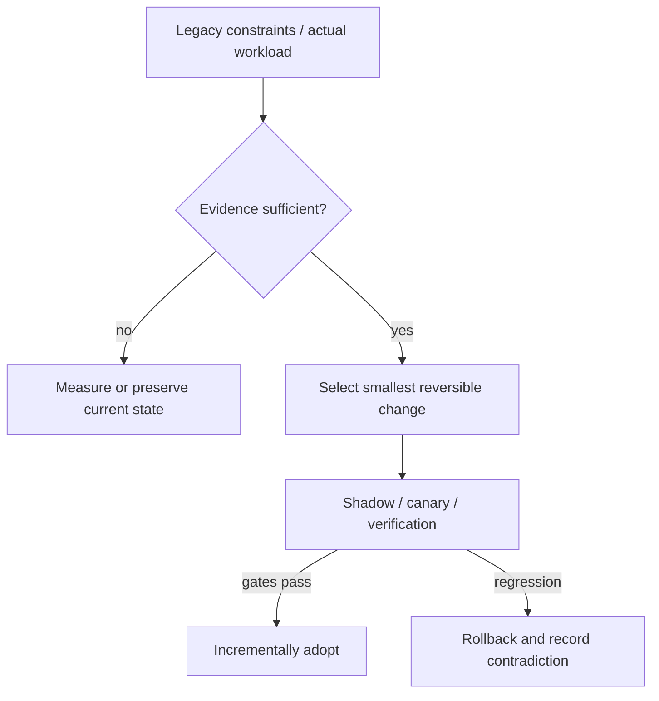

# Decision Playbook — Build and delivery modernization: hermetic execution vs fleet adoption

**ID:** `decision.build-platform-and-adoption` | **Owner:** M9 E16-06 #119 | **State:** original analytical draft, independent reviewer pending.  
**Method:** compare contrasting historical cases; distinguish each company's *reported past decision* from the **synthetic** decision below. No company is claimed to have assessed the other firm's choices.

## Synthetic legacy system and decision problem

A company has a JVM monorepo with 45-minute CI waits but a separate polyrepo fleet where upgrades linger across teams. The first is a computational reproducibility/latency problem; the second is an adoption/ownership problem. They require different controls.

## Contrasting historical evidence

| Actual company case | What its primary source does and does not establish |
|---|---|
| [Airbnb](../airbnb-jvm-monorepo-bazel.md) | A01: Gradle/Bazel coexistence and RBE speed/CSAT report |
| [Spotify](../spotify-tech-migration-long-tail.md) | SP01: Backstage, prioritized migration ownership and long-tail |
| [Uber](../uber-doma-domains.md) | U01: coordination costs when services and teams proliferate |

**Why the apparent conflict is useful:** Airbnb evaluated developers opting into Bazel while Gradle continued; Spotify coordinated a long-tail across autonomous squads. Uber's DOMA points to a third failure: cross-service change spans ownership boundaries no build tool can abolish.

## Decision tree and chosen ADR

**Text alternative:** collect requirements and legacy workload evidence first. When evidence is missing, measure rather than select a fashionable pattern. When evidence suffices, prefer the smallest reversible change, run shadow/canary validation, adopt only after acceptance gates, otherwise roll back.

**ADR — Proposed for the synthetic system, not a historical company ADR.**  
**Status:** proposed, subject to measured baseline and security review.  
**Context:** A company has a JVM monorepo with 45-minute CI waits but a separate polyrepo fleet where upgrades linger across teams. The first is a computational reproducibility/latency problem; the second is an adoption/ownership problem. They require different controls.  
**Decision:** For build reproducibility, trial hermetic build actions, remote execution and cache consistency using dual Gradle/Bazel builds on a representative large service. For migration adoption, create a funded, prioritized ownership map, self-service instructions and automatic PRs with versioned compatibility gates. Do not sell an improved build graph as a solution to unowned services.  
**Rejected for now:** a large irreversible rearchitecture without a verified bottleneck, tests, source/data provenance or fallback.  
**Consequences:** additional migration observability and temporary dual-state complexity are acceptable while the rollout is reversible; these costs must be budgeted explicitly.

## Applicability and counterindications

**Use this evidence when:** a real system has the same dominant constraint, the relevant execution model/data semantics have been measured and its team can operate the new architecture.

**Do not generalize when:** Remote execution is costly for tiny modules or volatile non-cacheable builds. Enforcing a new platform stack without ABI/schema compatibility, training or fleet owner map creates rejection or silent legacy stragglers.

**Independent decision dimensions to measure:** CI p90, local incremental/cold build duration, cache hit rates, flaky test % and hermetic violations, upgrade adoption-by-owner, unsupported version count, successful PR/rollback.

## Modernization plan

Build pilot and parity checks → progressive opt-in with IDE support → migration map and owners → automation on truly mechanical parts → track unresolved tail and retire old execution only after equivalence.

**Reversal triggers / insufficient evidence:** If build time is dominated by integration tests or external services, improving Bazel cache will not fix it; if owners are blocked by API semantics, more auto-created PRs will only create noise.

## Failure analysis and evidence provenance

The company cases are not A/B comparisons of two architectures under one workload. Published outcomes describe different organizations, production periods, release versions, traffic mixes and operating constraints. This playbook compares *mechanisms and constraints*, not raw numerical results across companies.

Before passing a recommendation to Rocinante, an agent should return: legacy facts, requirement/SLO evidence, selected/avoided pattern, evidence rows with company/date/source ID, alternative mechanism, caveats, a reversible transition sequence, what would falsify the choice, and whether human review is needed. Never invent what original engineering teams rejected.

Sources are linked through each original case page above, ultimately referring to [the M9 public source register](../../sources/REAL_WORLD_ARCHITECTURE_CASES.md). All analytical ADRs are original Tycho examples. **Independent review:** #121, not yet completed.
