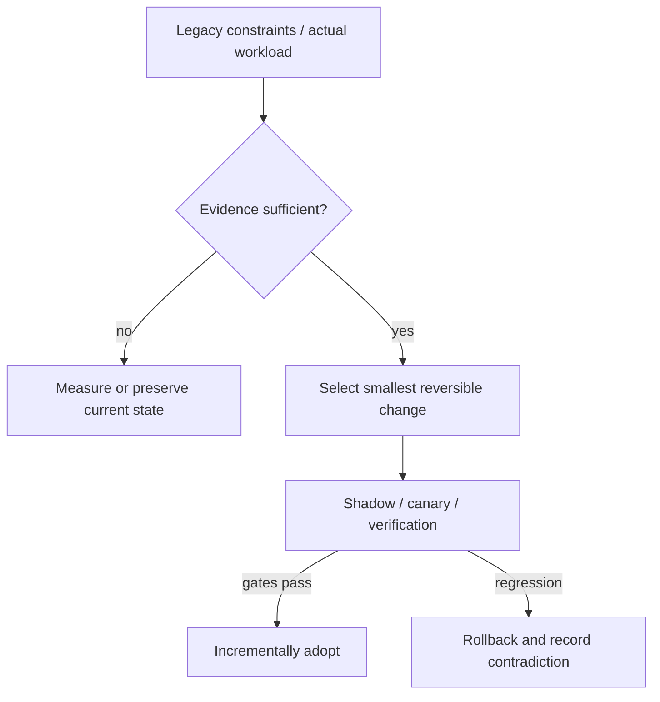

# Decision Playbook — Data migration: compatibility, shadow differences and authoritative cutover

**ID:** `decision.data-migration-shadow-reconcile` | **Owner:** M9 E16-06 #119 | **State:** original analytical draft, independent reviewer pending.  
**Method:** compare contrasting historical cases; distinguish each company's *reported past decision* from the **synthetic** decision below. No company is claimed to have assessed the other firm's choices.

## Synthetic legacy system and decision problem

An online billing platform must move active invoice state out of a shared Customer record without losing updates, while a second analytics workflow may change how immutable Cassandra snapshots are converted to Iceberg. Transactionality and equality are different for these flows.

## Contrasting historical evidence

| Actual company case | What its primary source does and does not establish |
|---|---|
| [Stripe](../cases/stripe-online-subscriptions-migration.md) | ST01: four-phase dual-write/read/write/retire and Scientist comparison |
| [Netflix](../cases/netflix-casspactor-shadow-migration.md) | N11: row-set differences and cohort selector/fallback |
| [Uber](../cases/uber-mezzanine-pg-to-schemaless.md) | U02: query/ID seam, backfill and mirrored writes |
| [Discord](../cases/discord-cassandra-scylladb-messages.md) | DI01: token range checkpoints, tombstone final-range blocker |

**Why the apparent conflict is useful:** Stripe's Scientist compares online read behavior; Netflix compares **C−M and M−C** on materialized output while leaving user job contracts stable; Uber first needed a client API/ID compatibility seam; Discord's last tombstone ranges showed why 99.9999% progress is not 'done'.

## Decision tree and chosen ADR

**Text alternative:** collect requirements and legacy workload evidence first. When evidence is missing, measure rather than select a fashionable pattern. When evidence suffices, prefer the smallest reversible change, run shadow/canary validation, adopt only after acceptance gates, otherwise roll back.

**ADR — Proposed for the synthetic system, not a historical company ADR.**  
**Status:** proposed, subject to measured baseline and security review.  
**Context:** An online billing platform must move active invoice state out of a shared Customer record without losing updates, while a second analytics workflow may change how immutable Cassandra snapshots are converted to Iceberg. Transactionality and equality are different for these flows.  
**Decision:** Use phased expand/dual-write/backfill/shadow-reads/cutover/contract for mutable billing data, and shadow-output set equality plus fallback for immutable batch data. Define one authoritative state at each transition; never assume counts or full-backup metadata alone prove business equivalence.  
**Rejected for now:** a large irreversible rearchitecture without a verified bottleneck, tests, source/data provenance or fallback.  
**Consequences:** additional migration observability and temporary dual-state complexity are acceptable while the rollout is reversible; these costs must be budgeted explicitly.

## Applicability and counterindications

**Use this evidence when:** a real system has the same dominant constraint, the relevant execution model/data semantics have been measured and its team can operate the new architecture.

**Do not generalize when:** Two independently written stores can diverge with retry races or partial failure. Identical outputs can still reflect a shared semantic bug; backfills need live-write ordering. Avoid a big-bang cutover when you cannot reconcile every mutation class.

**Independent decision dimensions to measure:** Missing/extra rows per cohort and snapshot, referential/business invariants, shadow mismatch root causes, dual-write conflict count, backlog age, rollback recovery time.

## Modernization plan

Version contracts → establish old source authority → implement dual-state writes → backfill snapshot IDs/checkpoints → compare old/new values with temporal alignment → switch low-risk reads → invert writes under canary → decommission old only after proven zero callers.

**Reversal triggers / insufficient evidence:** If the new model cannot preserve legacy business semantics, redesign domain/API contract with consumers before cutover rather than forcing opaque equality.

## Failure analysis and evidence provenance

The company cases are not A/B comparisons of two architectures under one workload. Published outcomes describe different organizations, production periods, release versions, traffic mixes and operating constraints. This playbook compares *mechanisms and constraints*, not raw numerical results across companies.

Before passing a recommendation to Rocinante, an agent should return: legacy facts, requirement/SLO evidence, selected/avoided pattern, evidence rows with company/date/source ID, alternative mechanism, caveats, a reversible transition sequence, what would falsify the choice, and whether human review is needed. Never invent what original engineering teams rejected.

Sources are linked through each original case page above, ultimately referring to [the M9 public source register](../../sources/REAL_WORLD_ARCHITECTURE_CASES.md). All analytical ADRs are original Tycho examples. **Independent review:** #121, not yet completed.
