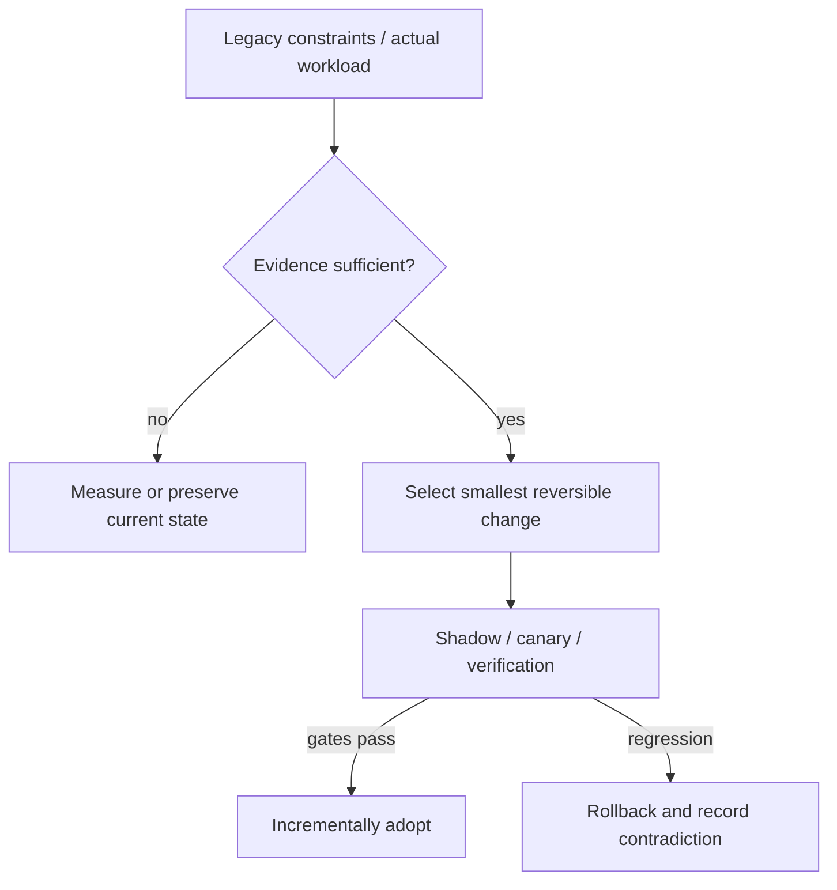

# Decision Playbook — Data migration: compatibility, shadow differences and authoritative cutover

**ID:** `decision.data-migration-shadow-reconcile` | **Owner:** M9 E16-06 #119 | **State:** original analytical draft, independent reviewer pending.  
**Method:** compare contrasting historical cases; distinguish each company's *reported past decision* from the **synthetic** decision below. No company is claimed to have assessed the other firm's choices.

## Synthetic legacy system and decision problem

An online billing platform must move active invoice state out of a shared Customer record without losing updates, while a second analytics workflow may change how immutable Cassandra snapshots are converted to Iceberg. Transactionality and equality are different for these flows.

## Contrasting historical evidence

| Actual company case | What its primary source does and does not establish |
|---|---|
| [Stripe](../stripe-online-subscriptions-migration.md) | ST01: four-phase dual-write/read/write/retire and Scientist comparison |
| [Netflix](../netflix-casspactor-shadow-migration.md) | N11: row-set differences and cohort selector/fallback |
| [Uber](../uber-mezzanine-pg-to-schemaless.md) | U02: query/ID seam, backfill and mirrored writes |
| [Discord](../discord-cassandra-scylladb-messages.md) | DI01: token range checkpoints, tombstone final-range blocker |
| [Meta](../meta-ingestion-shadow-migration-lifecycle.md) | ME03 (May 2026): per-job shadow **→ reverse shadow (new writes production, old writes shadow) → cleanup**, with CDC bad-partition containment and rollback |

**Why the apparent conflict is useful:** Stripe's Scientist compares online read behavior and shifts **all reads before all writes** to a new mutable subscription table. Netflix compares **C−M and M−C** on materialized batch outputs while preserving user-job contracts; Uber created an identifier/client-query seam before trip-store migration. Meta's warehouse ingestion instead preserves the **old job running as shadow *after* the new job starts writing production**, then retires it only after renewed quality/resource checks. Discord demonstrates why migration progress at 99.9999% is not source-independent proof of correctness. **Do not silently apply Stripe's write-path cutover order to Meta's CDC job authority transfer.**

## Decision tree and chosen ADR

**Text alternative:** collect requirements and legacy workload evidence first. When evidence is missing, measure rather than select a fashionable pattern. When evidence suffices, prefer the smallest reversible change, run shadow/canary validation, adopt only after acceptance gates, otherwise roll back.

**ADR — Proposed for the synthetic system, not a historical company ADR.**  
**Status:** proposed, subject to measured baseline and security review.  
**Context:** An online billing platform must move active invoice state out of a shared Customer record without losing updates, while a second analytics workflow may change how immutable Cassandra snapshots are converted to Iceberg. Transactionality and equality are different for these flows.  
**Decision:** Use phased expand/dual-write/backfill/shadow-reads/cutover/contract for mutable billing data, and shadow-output set equality plus fallback for immutable batch data. Define one authoritative state at each transition; never assume counts or full-backup metadata alone prove business equivalence.  
**Rejected for now:** a large irreversible rearchitecture without a verified bottleneck, tests, source/data provenance or fallback.  
**Consequences:** additional migration observability and temporary dual-state complexity are acceptable while the rollout is reversible; these costs must be budgeted explicitly.

## Applicability and counterindications

**Use this evidence when:** a real system has the same dominant constraint, the relevant execution model/data semantics have been measured and its team can operate the new architecture.

**Do not generalize when:** Two independently written stores can diverge with retry races or partial failure. Identical outputs can still reflect a shared semantic bug; backfills need live-write ordering. Avoid a big-bang cutover when you cannot reconcile every mutation class.

**Independent decision dimensions to measure:** Missing/extra rows per cohort and snapshot, referential/business invariants, shadow mismatch root causes, dual-write conflict count, backlog age, rollback recovery time.

## Modernization plan

Version contracts → establish old source authority → implement dual-state writes → backfill snapshot IDs/checkpoints → compare old/new values with temporal alignment → switch low-risk reads → invert writes under canary → decommission old only after proven zero callers.

**Reversal triggers / insufficient evidence:** If the new model cannot preserve legacy business semantics, redesign domain/API contract with consumers before cutover rather than forcing opaque equality.

## Data-authority decision guard: Stripe versus Meta

**Stripe ST01 (2017):** expand/dual-write from old Customer array to new Subscription rows; backfill; use Scientist read comparisons; route **all reads to the new representation before changing write authority**, then remove obsolete writes and data after callers are migrated.

**Meta ME03 (2026):** output-equivalence gates on shadow ingestion; switch the **new ingestion job to the production table while the old job begins producing shadow output**; keep comparing and backfilling; on CDC bad-partition detection stop unsafe delta propagation or reconstruct an affected target snapshot and roll back; only then retire the old job. This is an **ingestion job** lifecycle with full/delta/target partitions, not a two-representation online billing schema cutover.

**Transferred decision test:** ask which representation/job is authoritative *at each phase*, whether former execution remains runnable after authority switches, which exact mismatch triggers rollback, and how CDC errors avoid contaminating later partitions. A row-count equality alone cannot answer those questions. For any other legacy system, choose stages from its own data-write semantics and consumer contracts; the above are historically observed, not a universal migration state machine.

## Four different meanings of migration “complete”

A data modernization gate needs to state **which invariant is under test**:

| System and dated first-party example | Authority and observable contract | What a successful comparison establishes | What remains unproved |
|---|---|---|---|
| [Stripe online subscriptions, 2017](../stripe-online-subscriptions-migration.md), ST01 | Mutable Customer representation → dedicated subscriptions table; old API behavior preserved | Shadow Scientist reads match for inspected requests and cases | Every mutation race, unobserved client, rollback after old data deletion |
| [Netflix Cassandra→Iceberg, 2026](../netflix-casspactor-shadow-migration.md), N11 | Immutable backup snapshot and materialized output per workflow | Both set differences **C−M and M−C** are empty at a comparable snapshot | Business truth if *both* connectors implement the same wrong semantics |
| [Discord Cassandra→Scylla, 2022 reported 2023](../discord-cassandra-scylladb-messages.md), DI01 | One high-volume message store and time/partition query semantics | Migrated ranges, backed by checkpoints and sampled old/new reads | Every historical tombstone, all unique message identities, future hot-partition immunity |
| [Meta ingestion, 2026](../meta-ingestion-shadow-migration-lifecycle.md), ME03 | Production table updated by one job while the other runs shadow | Row/column checksums and partitions agree for observed data windows | Full end-user business interpretation, all CDC failure handling, indefinite equivalence |

These reports represent **different data shapes and observation windows**. It is incorrect to generalize one row-count or sample-match gate across mutable OLTP authority, immutable batch output, historical migration ranges and streaming CDC feeds. For a new design, first identify whether the business invariant is *identity*, *value equality*, *operation order*, *referential consistency*, *side-effect exactly-once*, or *bounded freshness*.

## Synthetic dual-authority failure tests

For a fictitious online billing model migration, stage requests under intentionally adverse timing:

1. **Create then immediate update:** verify the newly authoritative table reflects the same subscription version and defaults as the old model, not merely that both contain one row.
2. **Concurrent cancel and renewal:** determine the winner according to actual domain ordering, deduplicate retry effects and prove the externally observed state is consistent.
3. **Partial dual-write failure:** simulate old-write succeeds/new-write fails, and the reverse. Detect the divergence; define repair ownership, idempotent reconciliation and limits on acknowledgement before both copies converge.
4. **Long-lived old reader:** keep a deliberately outdated consumer active during the read cutover to expose stale aliases, field interpretation or unexpected fallback paths.
5. **Read shadow exception:** force experimental code to throw without impacting the production-served response; alert with a normalized result-identity and temporal window.
6. **Irreversible cleanup:** test recovery after removing the old data only if backups and reverse transformations can restore any newly accepted writes; otherwise **refuse cleanup**.

For an immutable warehouse job, the separate experiment compares identical input snapshots, schemas, transformation revisions, output row identities and both set-difference directions. For CDC, additionally inject a poison partition, delayed duplicates and snapshot/delta overlap; stop propagation of the bad partition and restore a known-good window rather than letting one corrupted batch contaminate future output. **These are Tycho original test designs**, not claims that any named company ran each listed injection.

## Selection matrix: which migration method is justified?

| Dominant constraint | Candidate path | Why an alternative fails | Evidence needed |
|---|---|---|---|
| Millions of mutable records, many independent legacy consumers, no outage window | Dual representation, backfill, shadow reads, phased read/write authority | Single atomic big-bang cutover is impractical without a globally synchronized consumer release | Consumer inventory, mutation parity, reconciliation, rollback horizon |
| Repeatable snapshot-to-table analytics job | Parallel legacy/new runs, two-sided row-set comparison, per-job selector | OLTP dual write adds needless live-state coupling | Reproducible input manifest, deterministic transformations, output-difference inspection |
| Large engine migration with key hotspots | Partition checkpoints, old/new read verification, hot-key tests and staged primary switch | Progress percent and schema compatibility cannot guarantee tail-range correctness | Full partition census, tombstone/compaction behavior, query-direction parity |
| Streaming ingestion with independent job versions | Shadow comparison, reverse-shadow production job, checkpointed CDC repair, resource/quality gates | Old/new readers do not capture delta-partition contamination once new output writes are authoritative | Offset/partition identity, target-write guard, snapshot regeneration, rollback |
| Data identity or semantics still undefined | Stay on current authority, research and instrument | Every automated comparison can give a misleading green result | Named owner and explicit business oracle |

No row in this table establishes a universal choice; alternatives are **analytical**, not unpublished historical ADRs.

## Decision record and rejection criteria for the two synthetic workflows

**Mutable subscription ADR (synthetic):** choose the Stripe-style phased cutover only if the organization can enumerate writers/consumers, keep old semantics representable in the new table, and test old/new under real mutation classes. Require an explicit **authority ledger** with timestamped old-read/new-read and old-write/new-write cutovers. Once a new-only feature is accepted, the ability to toggle readers back to old rows may cease. A rollback declaration must therefore identify the last safe phase, a compatible reverse-write adapter or a forward-repair plan.

**Immutable Cassandra backup ADR (synthetic):** choose the Netflix-style dual-execution/shadow validation where source snapshots are comparable and output-set equality has meaning. Track C−M **and** M−C with the same schema/TTL semantics and include a fallback connector for poor partition skew or malformed backups. Do not mistake equality with a buggy legacy output for proof of independent business correctness.

**Refuse either migration** when identity mapping is undefined, production-authoritative writes are not recoverable after rollback, source snapshots differ in unmeasured ways, audit/authorization context changes, or the comparison oracle covers only happy-path counts. Record unknowns and solicit domain-owner evidence; do not manufacture a p99 result, source revision or independent signoff.

## Failure analysis and evidence provenance

The company cases are not A/B comparisons of two architectures under one workload. Published outcomes describe different organizations, production periods, release versions, traffic mixes and operating constraints. This playbook compares *mechanisms and constraints*, not raw numerical results across companies.

Before presenting a recommendation to its user, an architecture-analysis agent should return: legacy facts, requirement/SLO evidence, selected/avoided pattern, evidence rows with company/date/source ID, alternative mechanism, caveats, a reversible transition sequence, what would falsify the choice, and whether human review is needed. Never invent what original engineering teams rejected.

Sources are linked through each original case page above, ultimately referring to [the M9 public source register](../../../sources/REAL_WORLD_ARCHITECTURE_CASES.md). All analytical ADRs are original Tycho examples. **Independent review:** #121, not yet completed.
