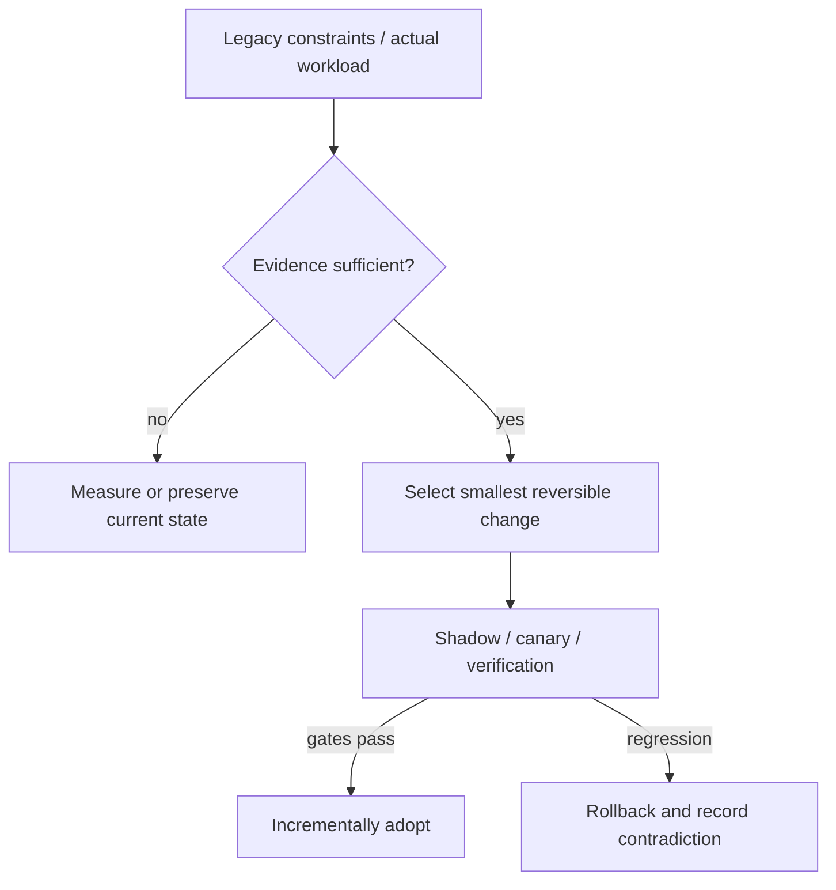

# Decision Playbook — JVM GC choice: pause-sensitive online services vs high-throughput batch

**ID:** `decision.jvm-gc-performance-context` | **Owner:** M9 E16-06 #119 | **State:** original analytical draft, independent reviewer pending.  
**Method:** compare contrasting historical cases; distinguish each company's *reported past decision* from the **synthetic** decision below. No company is claimed to have assessed the other firm's choices.

## Synthetic legacy system and decision problem

Two hypothetical Java services share a platform. Service A answers online gRPC calls whose p99 failures trigger retries. Service B performs a nightly batch precompute and is evaluated on jobs per hour; both must fit a CPU/memory budget.

## Contrasting historical evidence

| Actual company case | What its primary source does and does not establish |
|---|---|
| [Netflix ZGC](../netflix-generational-zgc-workloads.md) | N05: G1, old ZGC, generational ZGC and Parallel contrasts |
| [Netflix HotSpot](../netflix-hotspot-false-true-sharing.md) | N18: throughput constrained by sharing below the Java code |
| [Discord datastore](../discord-cassandra-scylladb-messages.md) | DI01: Java Cassandra GC was one operational factor, but Scylla migration also involved data-service changes |

**Why the apparent conflict is useful:** Netflix reported generational ZGC helping its online service workload, yet described batch counterexamples benefiting Parallel GC; a different Netflix example gained capacity only after HotSpot cache-line fixes. Discord's GC experience motivated a storage-engine migration, which is **not** evidence that Java GC choice alone predicts database success.

## Decision tree and chosen ADR

**Text alternative:** collect requirements and legacy workload evidence first. When evidence is missing, measure rather than select a fashionable pattern. When evidence suffices, prefer the smallest reversible change, run shadow/canary validation, adopt only after acceptance gates, otherwise roll back.

**ADR — Proposed for the synthetic system, not a historical company ADR.**  
**Status:** proposed, subject to measured baseline and security review.  
**Context:** Two hypothetical Java services share a platform. Service A answers online gRPC calls whose p99 failures trigger retries. Service B performs a nightly batch precompute and is evaluated on jobs per hour; both must fit a CPU/memory budget.  
**Decision:** Compare generational ZGC and G1 for A with retry/cancellation feedback and native memory headroom; evaluate G1/Parallel for B with steady-state throughput and batch finish time. Treat JVM microarchitectural hotspots as a separate possible bottleneck after GC graphs improve.  
**Rejected for now:** a large irreversible rearchitecture without a verified bottleneck, tests, source/data provenance or fallback.  
**Consequences:** additional migration observability and temporary dual-state complexity are acceptable while the rollout is reversible; these costs must be budgeted explicitly.

## Applicability and counterindications

**Use this evidence when:** a real system has the same dominant constraint, the relevant execution model/data semantics have been measured and its team can operate the new architecture.

**Do not generalize when:** Do not treat a collector default as universal; never compare G1 to older non-generational ZGC and attribute the result to current generational ZGC; account for 3% heap native overhead reported in N05 and direct-memory needs.

**Independent decision dimensions to measure:** p99 and max pause, gRPC cancellation, retry multiplier, CPU at equal useful throughput, heap/native footprint, batches/hour, collector JDK/revision, THP configuration.

## Modernization plan

Choose normalized workload mixes → pin runtime images and collector flags → run comparable canaries including failure spikes → inspect allocation and retention distributions → record regression/fallback before rollout.

**Reversal triggers / insufficient evidence:** A batch workload with burst allocations and long-lived objects may prefer G1/Parallel; an interactive service with pause-induced retry amplification may justify ZGC even if raw throughput gains are small.

## Workload before collector: what the source can actually tell us

[Netflix's March 2024 GC report](../netflix-generational-zgc-workloads.md) (N05) reports a significant **request-tail and retry-amplification** problem in latency-sensitive Java services. A stop-the-world pause can cause an upstream request timeout, trigger retries/hedging and thus increase work after the original pause ends. The publication distinguishes **G1**, **older non-generational ZGC**, **Generational ZGC**, and **Parallel GC**. Mixing them would produce a false architectural conclusion: older ZGC was about **36% more CPU-intensive** than G1 in one comparison, **generational** ZGC was around **10% better** than G1 on the described workload, and **Parallel** outperformed G1 by **6–8% throughput** in a particular precompute batch. These are **different experiments and denominators**.

The [Netflix HotSpot sharing study](../netflix-hotspot-false-true-sharing.md) (N18) addresses a different cause of CPU waste: microarchitectural contention despite superficially reasonable Java code. The [Discord Cassandra→ScyllaDB migration](../discord-cassandra-scylladb-messages.md) (DI01) exposes GC as only one factor in database-node instability: hot partitions, compaction and request shaping also mattered. This is not an experiment showing that changing a collector would have replaced its storage-engine migration.

## Synthetic workload-specific selection matrix

| Dominant measurable requirement | Collector/optimization candidates | Risk of choosing the wrong metric | Failure test |
|---|---|---|---|
| Interactive service with strict p99 and retry storms | Measure G1 vs Generational ZGC on the **same JDK and request mix** | Better GC pause percentile but worse CPU/native footprint or same end-to-end p99 | Inject allocation spikes, downstream timeout and retry feedback |
| Large nightly batch with deadline but relaxed pause SLO | G1 vs Parallel, possibly other candidates if measured | Lowest max pause wins a meaningless contest while completed batch work falls | Compare completed jobs/hour, end-to-end duration, RSS and CPU at equal inputs |
| Small heap / tight container memory | Quantify compressed refs, native memory and direct buffers per collector | Heap-only comparison misses native memory and container OOM | Test full RSS/cgroup limit and reference/direct-buffer cleanup |
| CPU-heavy service with memory/cache contention | Profile cache line sharing, synchronization, allocation and code paths before collector change | An unrelated hotspot is mislabeled GC and collector tweaks cannot fix it | CPU profiles, hardware counters where available and throughput after isolation |
| Data service with hot partitions and query-level skew | Data access, compaction, backpressure and partitioning can dominate collector policy | Node GC symptoms incorrectly attributed as the sole architectural cause | Reproduce hot-key workloads and compare useful completed operations |

This table is **Tycho synthetic analysis**, not a fleet-wide benchmark at any publisher.

## A reproducible, confounder-resistant decision experiment

1. Preserve one pinned application revision, **JDK patch version**, runtime image, request/record mix and observability contract. Do not simultaneously move to Java 21, switch collector, change compression and tune data access or it becomes impossible to attribute results.
2. For Service A (latency-driven), observe GC pause distribution, per-route p50/p95/p99, timeouts and cancellations, hedging/retry fan-out, useful completed requests, CPU/request, allocation rate, old-generation growth and full heap/native RSS.
3. For Service B (batch-driven), observe time-to-complete, processed records/sec, allocation churn, compaction (if any), full-cycle throughput, CPU and direct/native memory at identical inputs and parallelism.
4. Run enough representative windows to capture allocation seasonality, cache warm-up, memory fragmentation, long-lived buffers and intermittent dependency delays. A single short benchmark without a confidence interval can guide hypotheses but not prove operational superiority.
5. Exercise fault conditions: container memory limit, major allocation spike, stalled downstream inducing retry storms, heap dump/thread dump diagnostics and rollback to previous collector/JDK configuration.
6. Define an explicit winner only for the **tested workload and versions**. Preserve per-class exceptions rather than promote one collector as a mandatory policy for every application.

**Candidate rollback triggers:** worse tail SLO/cancellation despite shorter pauses, sustained extra CPU or SSD/backing-memory demand, native-memory headroom under configured limit, or inability to capture required runtime diagnostics. This test plan is **not Netflix's unpublished benchmark method**.

## Interpret historical metrics without imaginary precision

The N05 publication reports approximately **3% native memory overhead relative to heap size** for ZGC in its stated configuration and discusses Linux transparent huge pages and direct-buffer processing. Those are engineering considerations, not evidence that every service has the same RSS shift. The **one-hour** batch time saving in its Parallel-GC story is a publisher-reported example, not a prediction for Service B.

For the question “Does Generational ZGC reduce p99 for my Java service?”, an agent needs the target JDK, observed pause-to-timeout causality, load, request class, active retry policy and CPU/native budget. Without those, the correct result is **insufficient evidence** with a proposed canary. It should return the version and historical evidence distinction, not a universal yes.

## Failure analysis and evidence provenance

The company cases are not A/B comparisons of two architectures under one workload. Published outcomes describe different organizations, production periods, release versions, traffic mixes and operating constraints. This playbook compares *mechanisms and constraints*, not raw numerical results across companies.

Before passing a recommendation to Rocinante, an agent should return: legacy facts, requirement/SLO evidence, selected/avoided pattern, evidence rows with company/date/source ID, alternative mechanism, caveats, a reversible transition sequence, what would falsify the choice, and whether human review is needed. Never invent what original engineering teams rejected.

Sources are linked through each original case page above, ultimately referring to [the M9 public source register](../../../sources/REAL_WORLD_ARCHITECTURE_CASES.md). All analytical ADRs are original Tycho examples. **Independent review:** #121, not yet completed.
