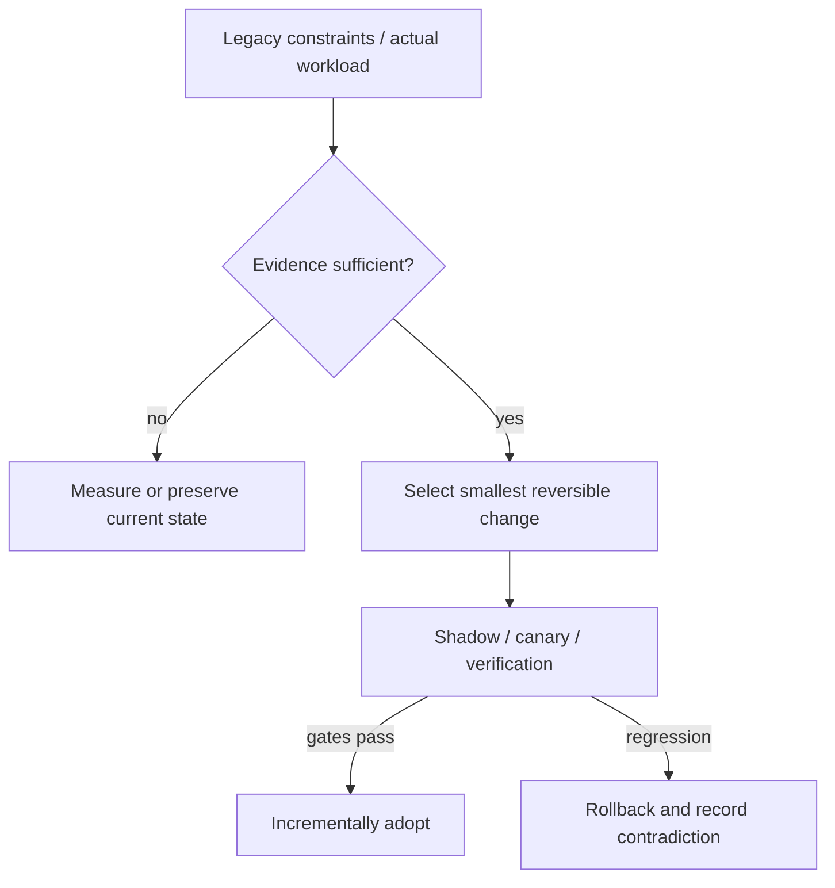

# Decision Playbook — JVM GC choice: pause-sensitive online services vs high-throughput batch

**ID:** `decision.jvm-gc-performance-context` | **Owner:** M9 E16-06 #119 | **State:** original analytical draft, independent reviewer pending.  
**Method:** compare contrasting historical cases; distinguish each company's *reported past decision* from the **synthetic** decision below. No company is claimed to have assessed the other firm's choices.

## Synthetic legacy system and decision problem

Two hypothetical Java services share a platform. Service A answers online gRPC calls whose p99 failures trigger retries. Service B performs a nightly batch precompute and is evaluated on jobs per hour; both must fit a CPU/memory budget.

## Contrasting historical evidence

| Actual company case | What its primary source does and does not establish |
|---|---|
| [Netflix ZGC](../netflix-generational-zgc-workloads.md) | N05: G1, old ZGC, generational ZGC and Parallel contrasts |
| [Netflix HotSpot](../netflix-hotspot-false-true-sharing.md) | N18: throughput constrained by sharing below the Java code |
| [Discord datastore](../discord-cassandra-scylladb-messages.md) | DI01: Java Cassandra GC was one operational factor, but Scylla migration also involved data-service changes |

**Why the apparent conflict is useful:** Netflix reported generational ZGC helping its online service workload, yet described batch counterexamples benefiting Parallel GC; a different Netflix example gained capacity only after HotSpot cache-line fixes. Discord's GC experience motivated a storage-engine migration, which is **not** evidence that Java GC choice alone predicts database success.

## Decision tree and chosen ADR

**Text alternative:** collect requirements and legacy workload evidence first. When evidence is missing, measure rather than select a fashionable pattern. When evidence suffices, prefer the smallest reversible change, run shadow/canary validation, adopt only after acceptance gates, otherwise roll back.

**ADR — Proposed for the synthetic system, not a historical company ADR.**  
**Status:** proposed, subject to measured baseline and security review.  
**Context:** Two hypothetical Java services share a platform. Service A answers online gRPC calls whose p99 failures trigger retries. Service B performs a nightly batch precompute and is evaluated on jobs per hour; both must fit a CPU/memory budget.  
**Decision:** Compare generational ZGC and G1 for A with retry/cancellation feedback and native memory headroom; evaluate G1/Parallel for B with steady-state throughput and batch finish time. Treat JVM microarchitectural hotspots as a separate possible bottleneck after GC graphs improve.  
**Rejected for now:** a large irreversible rearchitecture without a verified bottleneck, tests, source/data provenance or fallback.  
**Consequences:** additional migration observability and temporary dual-state complexity are acceptable while the rollout is reversible; these costs must be budgeted explicitly.

## Applicability and counterindications

**Use this evidence when:** a real system has the same dominant constraint, the relevant execution model/data semantics have been measured and its team can operate the new architecture.

**Do not generalize when:** Do not treat a collector default as universal; never compare G1 to older non-generational ZGC and attribute the result to current generational ZGC; account for 3% heap native overhead reported in N05 and direct-memory needs.

**Independent decision dimensions to measure:** p99 and max pause, gRPC cancellation, retry multiplier, CPU at equal useful throughput, heap/native footprint, batches/hour, collector JDK/revision, THP configuration.

## Modernization plan

Choose normalized workload mixes → pin runtime images and collector flags → run comparable canaries including failure spikes → inspect allocation and retention distributions → record regression/fallback before rollout.

**Reversal triggers / insufficient evidence:** A batch workload with burst allocations and long-lived objects may prefer G1/Parallel; an interactive service with pause-induced retry amplification may justify ZGC even if raw throughput gains are small.

## Failure analysis and evidence provenance

The company cases are not A/B comparisons of two architectures under one workload. Published outcomes describe different organizations, production periods, release versions, traffic mixes and operating constraints. This playbook compares *mechanisms and constraints*, not raw numerical results across companies.

Before passing a recommendation to Rocinante, an agent should return: legacy facts, requirement/SLO evidence, selected/avoided pattern, evidence rows with company/date/source ID, alternative mechanism, caveats, a reversible transition sequence, what would falsify the choice, and whether human review is needed. Never invent what original engineering teams rejected.

Sources are linked through each original case page above, ultimately referring to [the M9 public source register](../../../sources/REAL_WORLD_ARCHITECTURE_CASES.md). All analytical ADRs are original Tycho examples. **Independent review:** #121, not yet completed.
