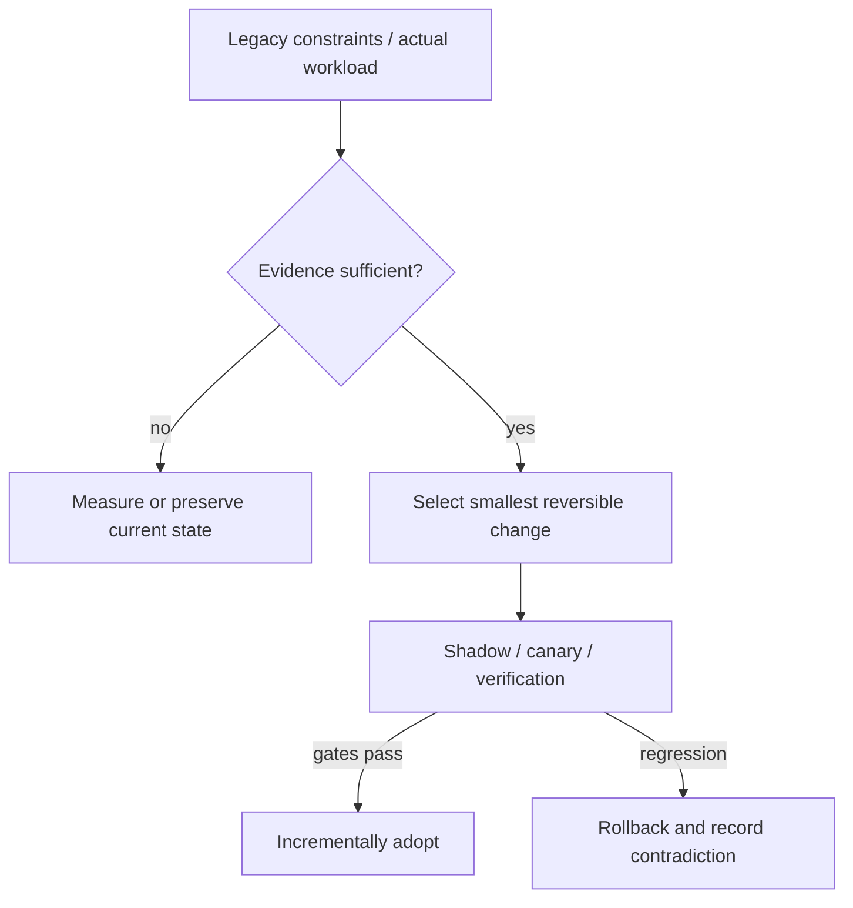

# Decision Playbook — Modular monolith vs domain-oriented services

**ID:** `decision.modular-monolith-vs-microservices` | **Owner:** M9 E16-06 #119 | **State:** original analytical draft, independent reviewer pending.  
**Method:** compare contrasting historical cases; distinguish each company's *reported past decision* from the **synthetic** decision below. No company is claimed to have assessed the other firm's choices.

## Synthetic legacy system and decision problem

A hypothetical legacy commerce platform has one deployment, 25 developers, shared relational transactions, monthly releases and rising coupling. Throughput meets SLOs, but changes require several team approvals. The desire for microservices is a proposed remedy, **not** a demonstrated capacity requirement.

## Contrasting historical evidence

| Actual company case | What its primary source does and does not establish |
|---|---|
| [Netflix](../netflix-seven-year-cloud-rearchitecture.md) | N01: seven-year cloud decomposition after concentrated datacenter failures |
| [Shopify](../shopify-modular-monolith.md) | SH01: one deployable app and explicit component boundaries |
| [Uber](../uber-doma-domains.md) | U01: governance and gateways for an existing many-service fleet |

**Why the apparent conflict is useful:** Netflix's original incident and global replatforming justify a different scale of change; Uber's DOMA starts from the opposite initial state—too many independently deployed services. Neither should be treated as evidence that extracting services solves this hypothetical coupling pain.

## Decision tree and chosen ADR

**Text alternative:** collect requirements and legacy workload evidence first. When evidence is missing, measure rather than select a fashionable pattern. When evidence suffices, prefer the smallest reversible change, run shadow/canary validation, adopt only after acceptance gates, otherwise roll back.

**ADR — Proposed for the synthetic system, not a historical company ADR.**  
**Status:** proposed, subject to measured baseline and security review.  
**Context:** A hypothetical legacy commerce platform has one deployment, 25 developers, shared relational transactions, monthly releases and rising coupling. Throughput meets SLOs, but changes require several team approvals. The desire for microservices is a proposed remedy, **not** a demonstrated capacity requirement.  
**Decision:** Prefer a modular monolith first: define component APIs/data ownership, reject new cross-domain imports, measure coordination and release lead time for three quarters. Extract a service only when it has independently valuable release/failure/scaling needs and transactional boundaries are explicit.  
**Rejected for now:** a large irreversible rearchitecture without a verified bottleneck, tests, source/data provenance or fallback.  
**Consequences:** additional migration observability and temporary dual-state complexity are acceptable while the rollout is reversible; these costs must be budgeted explicitly.

## Applicability and counterindications

**Use this evidence when:** a real system has the same dominant constraint, the relevant execution model/data semantics have been measured and its team can operate the new architecture.

**Do not generalize when:** Split services when teams can operate service discovery, SLOs, identity, distributed tracing, outbox/consistency, independent rollout and on-call. Do not split if your only actual problem is ungoverned package dependencies.

**Independent decision dimensions to measure:** Dependency cycles, cross-team PR touches, number of independently meaningful releases, DB transaction crossings, degraded-user minutes, p99 under failure.

## Modernization plan

Baseline actual dependency graph → map domain models → enforce package/API boundaries → assign owners → carve one stable interface → test deployment independence only for candidate service → introduce compensation/idempotency/observability before extraction.

**Reversal triggers / insufficient evidence:** If an isolated domain needs a distinct runtime or must scale x10 independently and modularity cannot provide sufficient release independence, reconsider service extraction. The 'x10' is a synthetic trigger, not Netflix/Shopify data.

## The actual design variables: code ownership versus deployment autonomy

The three company reports answer **different starting problems**. [Shopify's February 2019 monolith decision](../shopify-modular-monolith.md) (SH01) favored domain boundaries inside a shared Rails application, accepting one broad release unit while reducing accidental cross-domain dependencies. The [2020 component follow-up](../shopify-packwerk-boundary-evolution.md) (SH02) still recorded incomplete enforcement and selective service extraction. [Netflix's 2016 cloud migration](../netflix-seven-year-cloud-rearchitecture.md) (N01) responded to concentrated failure and global growth over seven years, not an isolated package-structure inconvenience. [Uber's DOMA account](../uber-doma-domains.md) (U01) begins *after* service extraction created its own tangled ownership: 2,200 critical services were classified into 70 domains, with only around half implemented when reported.

These sources are not measurements of three alternative architectures applied to the same organization. Their **historical periods, transaction boundaries, operating skills and scaling needs differ**. A transferable method must therefore extract *decision conditions*, not rank vendors or architectures.

| Independent requirement | Modular monolith candidate | Independent services candidate | Domain gateways over existing services |
|---|---|---|---|
| One deploy/ops team and local ACID workflow | Retains one operational and transaction boundary | Adds protocol, consistency and recovery complexity | Extra abstraction may not solve real bottleneck |
| Distinct failure domains or independent compute scaling | Shared resource and process limits remain | Allows isolation *if* clients handle timeout/failure | Organizes an existing distributed fleet, not a way to remove network failures |
| Many owners frequently crossing logical boundaries | Requires discoverable APIs and enforceable package rules | Ownership can improve or deteriorate if seams unstable | Helps hide volatile internals behind stable domain contracts |
| Regulated identity/data isolation | In-process checks may suffice under single trust scope | Can enforce separate execution/data tenancy at higher cost | Gateway still needs explicit authorization and ownership |
| Frequent runtime-specific releases | Shared runtime can block divergent upgrades | Separate lifecycle can justify a service | Useful once services already exist and callers need stable entry contracts |

These are **Tycho analytical assessments**, not experimentally measured outcomes across Shopify/Netflix/Uber. A requirement does not automatically select a physical architecture: identify an explicit critical constraint and show that the cheapest simpler alternative cannot satisfy it.

## Concrete synthetic requirements and decision experiment

**Scenario A — one deployed service, shared transactions:** 25 developers, monthly releases, shared relational state and adequate p99, but a typical feature modifies five unrelated model modules. The preferred first experiment is **componentization without deployment extraction**. Choose one capability with an owner and stable data invariants; define a public interface and deny new direct references to internal models; record change locality and old/new transaction-test parity. Add a narrowly scoped architectural rule that reports existing debt separately from new violations.

**Scenario B — same business semantics, different measured requirement:** one capability experiences a strict throughput plateau under independent scale and has a separate SLO and on-call owner. Only when workload evidence shows a shared runtime cannot economically meet it, design a service boundary. Keep the API contract stable, assign data ownership, replace in-process calls with idempotent/timeout-bounded remote operations, and introduce an outbox or compensating workflow for former cross-domain atomic changes.

**Scenario C — already distributed, too many cross-team touchpoints:** a user operation traverses numerous independently owned services and no one can identify authoritative ownership. Do **not** solve this by splitting still more services. Inventory trace routes, error attribution and mutable data ownership; introduce domain-level published contracts with versioned gateways only where the measured integration complexity is high. Track bypass clients and dependency changes while enabling safe migrations behind the gateway.

These scenarios are entirely **hypothetical**; their numbers are illustrative and not source-reported engineering outcomes.

## Safe transition and rollback for each architecture

| Transition option | Reversible gate | Failure / stop state |
|---|---|---|
| Package/domain modularity in one runtime | No protocol change, equivalent behavior under existing tests; shadow report violations before strict enforcement | Cyclic module initialization, broken dynamic reflection, hidden data ownership or no reduction in cross-team change span |
| Extract one independently operated service | Adapter routes by cohort, old and new compare relevant outputs; retained previous deployable and data recovery plan | Partial transaction, duplicate side effects, authorization context leak, overwhelming fan-out or inability to restore authoritative state |
| Consolidate callers behind a domain gateway | Old direct route works during canary; gateway preserves IDs/errors/versions and audit propagation | Gateway hides an unstable boundary, creates a bottleneck or routes around the wrong source-of-truth |

**Architecture selection is not a diagram quota.** An agent should return a decision with evidence-ranked prerequisites, the smallest reversible next step, one credible opposite architecture, and explicit missing input. If a single shared transaction is the decisive invariant but no distributed transaction/reconciliation plan exists, “extract service” is **not ready** even if teams prefer independent deploys.

## Falsification and acceptance for the proposed modular-first ADR

At the end of the fictional three-quarter observation period, compare per-capability lead time, number of crossed package boundaries per PR, independently meaningful deployments required, production incident blast radius and module-level violation trend. A decrease in compile-time dependency violations alone is not enough if every feature still needs five teams. If one measured hot workload remains throttled by shared scaling or an independent trust/runtime boundary is non-negotiable, revisit extraction with a tested migration contract. If service extraction adds failure minutes without enabling real release or isolation gains, reverse the cohort and keep logical modularity.

The critical **insufficient-evidence** result is “we have no profile of shared transactions, per-capability load or ownership.” Without those, neither Netflix's decomposition nor Shopify's modularity is an automatically correct answer. The sources should be returned as **historical counterexamples that shape questions**, not substitute answers about the reader's runtime.

## Failure analysis and evidence provenance

The company cases are not A/B comparisons of two architectures under one workload. Published outcomes describe different organizations, production periods, release versions, traffic mixes and operating constraints. This playbook compares *mechanisms and constraints*, not raw numerical results across companies.

Before presenting a recommendation to its user, an architecture-analysis agent should return: legacy facts, requirement/SLO evidence, selected/avoided pattern, evidence rows with company/date/source ID, alternative mechanism, caveats, a reversible transition sequence, what would falsify the choice, and whether human review is needed. Never invent what original engineering teams rejected.

Sources are linked through each original case page above, ultimately referring to [the M9 public source register](../../../sources/REAL_WORLD_ARCHITECTURE_CASES.md). All analytical ADRs are original Tycho examples. **Independent review:** #121, not yet completed.
