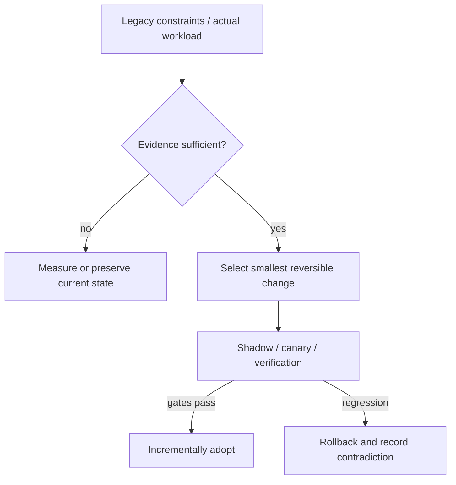

# Decision Playbook — Modular monolith vs domain-oriented services

**ID:** `decision.modular-monolith-vs-microservices` | **Owner:** M9 E16-06 #119 | **State:** original analytical draft, independent reviewer pending.  
**Method:** compare contrasting historical cases; distinguish each company's *reported past decision* from the **synthetic** decision below. No company is claimed to have assessed the other firm's choices.

## Synthetic legacy system and decision problem

A hypothetical legacy commerce platform has one deployment, 25 developers, shared relational transactions, monthly releases and rising coupling. Throughput meets SLOs, but changes require several team approvals. The desire for microservices is a proposed remedy, **not** a demonstrated capacity requirement.

## Contrasting historical evidence

| Actual company case | What its primary source does and does not establish |
|---|---|
| [Netflix](../netflix-seven-year-cloud-rearchitecture.md) | N01: seven-year cloud decomposition after concentrated datacenter failures |
| [Shopify](../shopify-modular-monolith.md) | SH01: one deployable app and explicit component boundaries |
| [Uber](../uber-doma-domains.md) | U01: governance and gateways for an existing many-service fleet |

**Why the apparent conflict is useful:** Netflix's original incident and global replatforming justify a different scale of change; Uber's DOMA starts from the opposite initial state—too many independently deployed services. Neither should be treated as evidence that extracting services solves this hypothetical coupling pain.

## Decision tree and chosen ADR

**Text alternative:** collect requirements and legacy workload evidence first. When evidence is missing, measure rather than select a fashionable pattern. When evidence suffices, prefer the smallest reversible change, run shadow/canary validation, adopt only after acceptance gates, otherwise roll back.

**ADR — Proposed for the synthetic system, not a historical company ADR.**  
**Status:** proposed, subject to measured baseline and security review.  
**Context:** A hypothetical legacy commerce platform has one deployment, 25 developers, shared relational transactions, monthly releases and rising coupling. Throughput meets SLOs, but changes require several team approvals. The desire for microservices is a proposed remedy, **not** a demonstrated capacity requirement.  
**Decision:** Prefer a modular monolith first: define component APIs/data ownership, reject new cross-domain imports, measure coordination and release lead time for three quarters. Extract a service only when it has independently valuable release/failure/scaling needs and transactional boundaries are explicit.  
**Rejected for now:** a large irreversible rearchitecture without a verified bottleneck, tests, source/data provenance or fallback.  
**Consequences:** additional migration observability and temporary dual-state complexity are acceptable while the rollout is reversible; these costs must be budgeted explicitly.

## Applicability and counterindications

**Use this evidence when:** a real system has the same dominant constraint, the relevant execution model/data semantics have been measured and its team can operate the new architecture.

**Do not generalize when:** Split services when teams can operate service discovery, SLOs, identity, distributed tracing, outbox/consistency, independent rollout and on-call. Do not split if your only actual problem is ungoverned package dependencies.

**Independent decision dimensions to measure:** Dependency cycles, cross-team PR touches, number of independently meaningful releases, DB transaction crossings, degraded-user minutes, p99 under failure.

## Modernization plan

Baseline actual dependency graph → map domain models → enforce package/API boundaries → assign owners → carve one stable interface → test deployment independence only for candidate service → introduce compensation/idempotency/observability before extraction.

**Reversal triggers / insufficient evidence:** If an isolated domain needs a distinct runtime or must scale x10 independently and modularity cannot provide sufficient release independence, reconsider service extraction. The 'x10' is a synthetic trigger, not Netflix/Shopify data.

## Failure analysis and evidence provenance

The company cases are not A/B comparisons of two architectures under one workload. Published outcomes describe different organizations, production periods, release versions, traffic mixes and operating constraints. This playbook compares *mechanisms and constraints*, not raw numerical results across companies.

Before passing a recommendation to Rocinante, an agent should return: legacy facts, requirement/SLO evidence, selected/avoided pattern, evidence rows with company/date/source ID, alternative mechanism, caveats, a reversible transition sequence, what would falsify the choice, and whether human review is needed. Never invent what original engineering teams rejected.

Sources are linked through each original case page above, ultimately referring to [the M9 public source register](../../sources/REAL_WORLD_ARCHITECTURE_CASES.md). All analytical ADRs are original Tycho examples. **Independent review:** #121, not yet completed.
