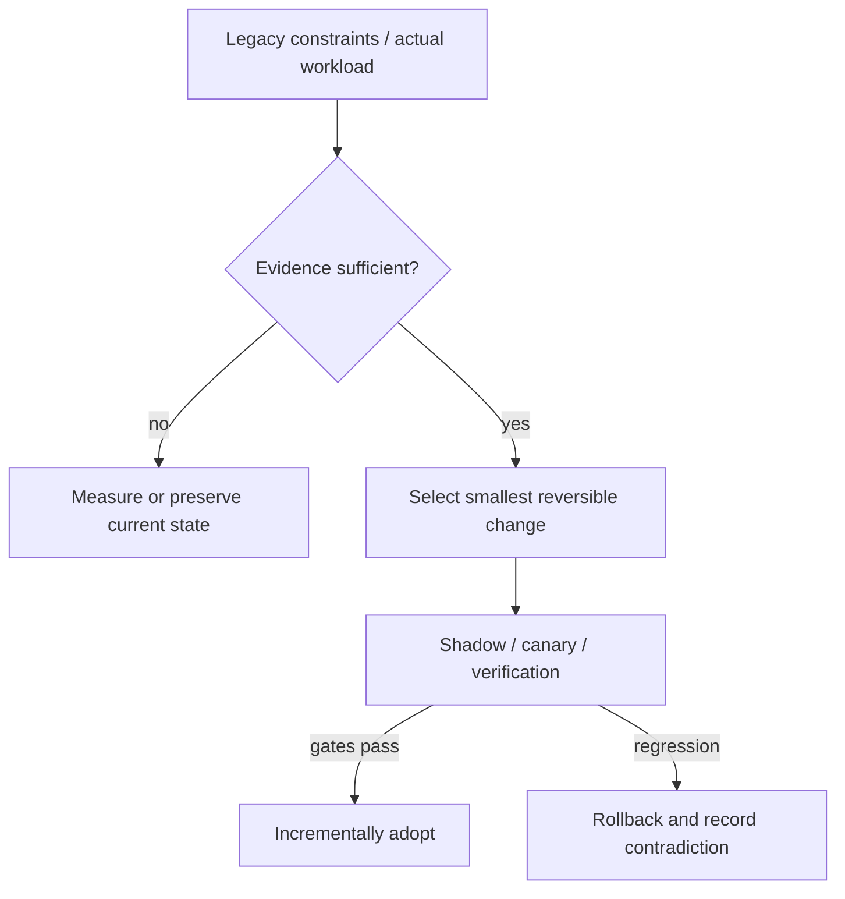

# Decision Playbook — Reactive event loops, virtual threads and queued I/O

**ID:** `decision.async-reactive-vs-virtual-threads` | **Owner:** M9 E16-06 #119 | **State:** original analytical draft, independent reviewer pending.  
**Method:** compare contrasting historical cases; distinguish each company's *reported past decision* from the **synthetic** decision below. No company is claimed to have assessed the other firm's choices.

## Synthetic legacy system and decision problem

A legacy API gateway has 40,000 mostly idle TLS/client connections, occasional CPU-heavy authentication and several blocking JDBC clients. A second workload is a batched object copy with long cloud-storage RTTs. The two workloads must not inherit one universal concurrency pattern.

## Contrasting historical evidence

| Actual company case | What its primary source does and does not establish |
|---|---|
| [Netflix gateway](../cases/netflix-zuul2-nonblocking-gateway.md) | N07: Zuul2 gained connection scale; CPU gain differed by cluster |
| [Netflix Java](../cases/netflix-java21-virtual-thread-pinning.md) | N06: four carrier threads pinned by tracing in Java21 REST stack |
| [Cloudflare](../cases/cloudflare-super-slurper-queues.md) | CF01: I/O copy fan-out via queues/workers, small-test regression |

**Why the apparent conflict is useful:** Zuul2 exposes network connection scaling as a primary win even without universal CPU gains; Netflix's Loom incident exposes hidden synchronization risk; Cloudflare's queue fan-out addresses asynchronous tasks at a different durability granularity.

## Decision tree and chosen ADR

**Text alternative:** collect requirements and legacy workload evidence first. When evidence is missing, measure rather than select a fashionable pattern. When evidence suffices, prefer the smallest reversible change, run shadow/canary validation, adopt only after acceptance gates, otherwise roll back.

**ADR — Proposed for the synthetic system, not a historical company ADR.**  
**Status:** proposed, subject to measured baseline and security review.  
**Context:** A legacy API gateway has 40,000 mostly idle TLS/client connections, occasional CPU-heavy authentication and several blocking JDBC clients. A second workload is a batched object copy with long cloud-storage RTTs. The two workloads must not inherit one universal concurrency pattern.  
**Decision:** For connection-heavy gateway layers, test event-loop multiplexing with strict isolation of blocking components; for blocking Java request handlers, test virtual threads **only after** all instrumentation and synchronization code is known safe on the target JDK. For durable bulk copy, queues/worker backpressure may be more relevant than either thread model.  
**Rejected for now:** a large irreversible rearchitecture without a verified bottleneck, tests, source/data provenance or fallback.  
**Consequences:** additional migration observability and temporary dual-state complexity are acceptable while the rollout is reversible; these costs must be budgeted explicitly.

## Applicability and counterindications

**Use this evidence when:** a real system has the same dominant constraint, the relevant execution model/data semantics have been measured and its team can operate the new architecture.

**Do not generalize when:** Do not put CPU-intensive crypto or JDBC on Netty's event loop. Do not expect Loom to accelerate CPU instructions or automatically eliminate pinning in Java21. Do not use queue fan-out for tiny synchronous requests where enqueue latency dominates.

**Independent decision dimensions to measure:** Active connections/thread, carrier pinning/queue, event-loop stalls, canceled and retried requests, CPU per operation, p99 by class, queue age and dead-letter counts.

## Modernization plan

Categorize I/O waits vs CPU work → trace blocking library calls → pin JDK/runtime and HTTP implementation → introduce reversible canary per endpoint → inject stalled dependencies and trace-context failures → guard downstream concurrency with budgets.

**Reversal triggers / insufficient evidence:** If I/O waiting becomes negligible and CPU-heavy tasks dominate, retain a simpler bounded worker design. If tracing or locks cannot be made carrier-safe, postpone Loom and test later JDKs.

## Failure analysis and evidence provenance

The company cases are not A/B comparisons of two architectures under one workload. Published outcomes describe different organizations, production periods, release versions, traffic mixes and operating constraints. This playbook compares *mechanisms and constraints*, not raw numerical results across companies.

Before passing a recommendation to Rocinante, an agent should return: legacy facts, requirement/SLO evidence, selected/avoided pattern, evidence rows with company/date/source ID, alternative mechanism, caveats, a reversible transition sequence, what would falsify the choice, and whether human review is needed. Never invent what original engineering teams rejected.

Sources are linked through each original case page above, ultimately referring to [the M9 public source register](../../sources/REAL_WORLD_ARCHITECTURE_CASES.md). All analytical ADRs are original Tycho examples. **Independent review:** #121, not yet completed.
