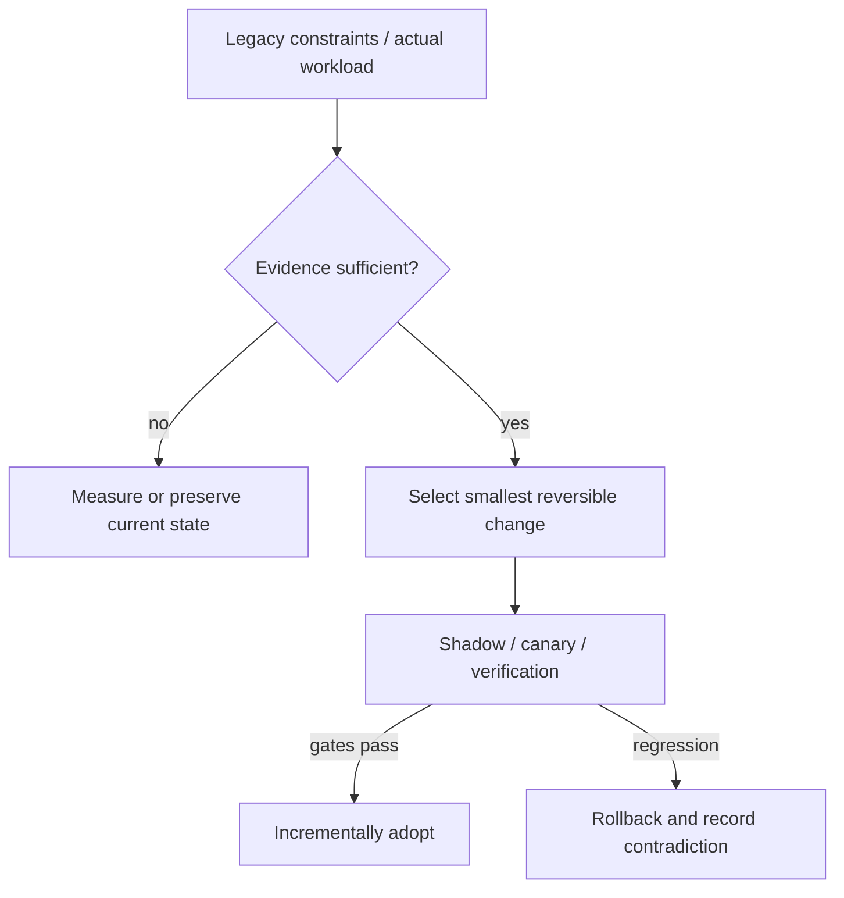

# Decision Playbook — Reactive event loops, virtual threads and queued I/O

**ID:** `decision.async-reactive-vs-virtual-threads` | **Owner:** M9 E16-06 #119 | **State:** original analytical draft, independent reviewer pending.  
**Method:** compare contrasting historical cases; distinguish each company's *reported past decision* from the **synthetic** decision below. No company is claimed to have assessed the other firm's choices.

## Synthetic legacy system and decision problem

A legacy API gateway has 40,000 mostly idle TLS/client connections, occasional CPU-heavy authentication and several blocking JDBC clients. A second workload is a batched object copy with long cloud-storage RTTs. The two workloads must not inherit one universal concurrency pattern.

## Contrasting historical evidence

| Actual company case | What its primary source does and does not establish |
|---|---|
| [Netflix gateway](../netflix-zuul2-nonblocking-gateway.md) | N07: Zuul2 gained connection scale; CPU gain differed by cluster |
| [Netflix Java](../netflix-java21-virtual-thread-pinning.md) | N06: four carrier threads pinned by tracing in Java21 REST stack |
| [Netflix gRPC worker pool](../netflix-grpc-cpu-workerpool-virtual-thread-regression.md) | N02: 2023 practitioner account of a CPU-intensive outgoing gRPC worker pool that became a **few percent slower** after trying virtual threads; no exact benchmark published |
| [Cloudflare](../cloudflare-super-slurper-queues.md) | CF01: I/O copy fan-out via queues/workers, small-test regression |

**Why the apparent conflict is useful:** Zuul2 exposes network connection scaling as a primary win even without universal CPU gains; Netflix's Loom incident exposes hidden synchronization risk, while its separate CPU-intensive gRPC worker-pool experiment became slower without any carrier-pinning incident; Cloudflare's queue fan-out addresses asynchronous tasks at a different durability granularity.

## Decision tree and chosen ADR

**Text alternative:** collect requirements and legacy workload evidence first. When evidence is missing, measure rather than select a fashionable pattern. When evidence suffices, prefer the smallest reversible change, run shadow/canary validation, adopt only after acceptance gates, otherwise roll back.

**ADR — Proposed for the synthetic system, not a historical company ADR.**  
**Status:** proposed, subject to measured baseline and security review.  
**Context:** A legacy API gateway has 40,000 mostly idle TLS/client connections, occasional CPU-heavy authentication and several blocking JDBC clients. A second workload is a batched object copy with long cloud-storage RTTs. The two workloads must not inherit one universal concurrency pattern.  
**Decision:** For connection-heavy gateway layers, test event-loop multiplexing with strict isolation of blocking components; for I/O-bound blocking Java request handlers, test virtual threads **only after** all instrumentation and synchronization code is known safe on the target JDK; keep **CPU-intensive gRPC worker execution** on a bounded platform-thread pool unless workload-specific measurements justify another model. For durable bulk copy, queues/worker backpressure may be more relevant than either thread model.  
**Rejected for now:** a large irreversible rearchitecture without a verified bottleneck, tests, source/data provenance or fallback.  
**Consequences:** additional migration observability and temporary dual-state complexity are acceptable while the rollout is reversible; these costs must be budgeted explicitly.

## Applicability and counterindications

**Use this evidence when:** a real system has the same dominant constraint, the relevant execution model/data semantics have been measured and its team can operate the new architecture.

**Do not generalize when:** Do not put CPU-intensive crypto or JDBC on Netty's event loop. Netflix reported a *few-percent regression* in an outgoing CPU-intensive gRPC pool (N02); do not treat it as a numeric benchmark or the later 2024 tracing-lock incident. Do not expect Loom to accelerate CPU instructions or automatically eliminate pinning in Java21. Do not use queue fan-out for tiny synchronous requests where enqueue latency dominates.

**Independent decision dimensions to measure:** Active connections/thread, carrier pinning/queue, event-loop stalls, canceled and retried requests, CPU per operation, p99 by class, queue age and dead-letter counts.

## Modernization plan

Categorize I/O waits vs CPU work *separately for outgoing gRPC worker pools, inbound REST handlers and event-loop callbacks* → trace blocking library calls → pin JDK/runtime and HTTP implementation → introduce reversible canary per endpoint → inject stalled dependencies and trace-context failures → guard downstream concurrency with budgets.

**Reversal triggers / insufficient evidence:** If I/O waiting becomes negligible and CPU-heavy tasks dominate, retain a simpler bounded worker design. If tracing or locks cannot be made carrier-safe, postpone Loom and test later JDKs.

## Four independent concurrency bottlenecks

| Source-bounded precedent | Resource under pressure | Reported gain or failure | What it does **not** establish |
|---|---|---|---|
| [Netflix Zuul 2, 2016](../netflix-zuul2-nonblocking-gateway.md) (N07) | Many concurrent network connections; blocking waiting cost | Connection scale benefit; logging gateway ~25% throughput gain, API gateway no clear CPU efficiency improvement | Netty event loops increase CPU throughput for every workload |
| [Netflix outgoing gRPC pool, QCon 2023](../netflix-grpc-cpu-workerpool-virtual-thread-regression.md) (N02) | CPU-intensive worker execution rather than blocked network threads | Virtual-thread experiment was **a few percent slower** | An exact quantified benchmark or global prohibition of virtual threads |
| [Netflix REST tracing failure, 2024](../netflix-java21-virtual-thread-pinning.md) (N06) | Four JDK21 carrier threads pinned inside synchronized reporter wait | Request starvation despite live JVM and a lock with no running owner | A universal, current-JDK limitation independent of dependency versions |
| [Cloudflare object copying, 2025](../cloudflare-super-slurper-queues.md) (CF01) | Long remote-object transfer waits and centralized job coordination | Large-object-count queue migration sped up; small-object proof of concept regressed | Queues and worker orchestration reduce tiny request latency or provide exactly-once delivery |

The underlying categories are **network wait**, **CPU cycles**, **monitor/carrier scheduling**, and **durable asynchronous batch work**. They have different latency, scaling and rollback goals. The examples come from different organizations and years and are not one A/B experiment.

## A capacity-and-correctness decision matrix

For the **synthetic gateway with 40,000 mostly idle TLS connections**, track active/waiting time per connection, server-side response latency, event-loop runnable delay, native/socket memory and cross-route interference. Netty can multiplex I/O, but CPU-heavy authentication and blocking JDBC must be routed to **separate bounded executors** with explicit queue/admission limits. A nonblocking network stack does not make blocking JDBC operations nonblocking.

For an independent **I/O-bound Java request service** that uses simple sequential code, a virtual-thread-per-request model may improve maintainability and concurrency **only if** the chosen JDK and dependency libraries unmount cleanly and maintain identity/tracing semantics. Underlying downstream connection pools, semaphores, transaction limits and database capacity still need explicit bounds. A virtual thread is *not* a concurrency contract for a database.

For a **CPU-heavy gRPC worker pool**, retaining bounded platform threads is a defensible initial decision when useful CPU work saturates cores. The 2023 Netflix counterexample warns that replacing such a pool with many virtual threads can add scheduling overhead without increasing compute capacity. Test CPU-per-completed-work, queueing delay and p99 rather than process thread count.

For **hours-long high-volume copy tasks**, a queue system solves durable work identity, checkpointing, fan-out and recovery, not in-process coroutine scheduling. Queue retries need deduplication, dead-letter inspection and idempotent external writes. Cloudflare CF01's 75,000-object test is a bounded transfer observation and not a universal speed gain.

## Synthetic migration sequence and fault-injection oracles

1. **Classify execution:** profile runnable CPU, blocking calls, network waits, timed-out downstreams, event-loop tasks, queue ages and hidden monitor wait for one representative workload window.
2. **Keep workload lanes separate:** route CPU-intensive transformations to a capacity-bounded pool; isolate JDBC on a compatible executor; reserve event-loop threads for nonblocking callbacks; preserve identity and timeout budgets across handoffs.
3. **Pin versions:** JDK minor/collector, tracing libraries, Tomcat/Netty, HTTP/gRPC dependencies and transport contracts must remain fixed during the first scheduling comparison.
4. **Prove failure behavior:** inject a stalled downstream, saturated tracing reporter, slow queue consumer, duplicate messages, cancelled requests and forced client disconnects; assert no unbounded queue, orphaned work or lost audit context.
5. **Canary by class:** compare CPU/operation, completed goodput, p95/p99, failed/cancelled requests, carrier/thread starvation and memory at matched traffic, not a single aggregate throughput number.
6. **Preserve rollback:** old event-loop or platform-thread execution remains selectable until equivalence of security, context, error semantics and recovery can be demonstrated under the same load.

This is **Tycho's synthetic verification process**. It is not Netflix's or Cloudflare's reported deployment checklist.

## Contradictions, stop conditions and what to refuse

- **"Virtual threads are nonblocking."** Not in every relevant sense: synchronized monitor regions or native library behavior can pin carriers on some JDKs, and CPU-bound work still consumes CPU.
- **"Reactive always wins CPU."** Zuul's logging cluster and API cluster had different efficiency profiles; nonblocking I/O reduces *waiting overhead*, not arbitrary computation.
- **"Queues guarantee exactly once."** The Cloudflare case explicitly includes at-least-once delivery and requires object-level deduplication.
- **"One architecture applies to every service."** The four case outcomes are compatible once workload type and resource pressure are separated.

Reject the redesign if the dominant bottleneck has not been measured, the target library stack is not verified under blocking conditions, security/tracing context cannot cross execution boundaries, or error cleanup/rollback has not been tested. Return **insufficient evidence** instead of guessing a universal scheduler ranking.

## Failure analysis and evidence provenance

The company cases are not A/B comparisons of two architectures under one workload. Published outcomes describe different organizations, production periods, release versions, traffic mixes and operating constraints. This playbook compares *mechanisms and constraints*, not raw numerical results across companies.

Before presenting a recommendation to its user, an architecture-analysis agent should return: legacy facts, requirement/SLO evidence, selected/avoided pattern, evidence rows with company/date/source ID, alternative mechanism, caveats, a reversible transition sequence, what would falsify the choice, and whether human review is needed. Never invent what original engineering teams rejected.

Sources are linked through each original case page above, ultimately referring to [the M9 public source register](../../../sources/REAL_WORLD_ARCHITECTURE_CASES.md). All analytical ADRs are original Tycho examples. **Independent review:** #121, not yet completed.
