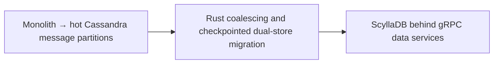

# Discord — trillions of messages: ScyllaDB plus Rust request coalescing

**Case ID:** `case.discord.cassandra-scylladb-messages` | **Milestone:** M9 E16-05 #118 | **Status:** evidence-grounded draft, pending reviewer.  
**Public primary:** DI01 [official engineering account](https://discord.com/blog/how-discord-stores-trillions-of-messages), 2023-03-06, Bo Ingram / Discord; source anchors: Data Services Serving Data; A Very Big Migration; Several Months Later. No private materials or copyrighted graphics reproduced.

## Original pressure and baseline

The Cassandra messages fleet experienced GC latency and hot partitions. One hot partition could accumulate concurrent requests and induce latency feedback, while a very large database made an untested live cutover risky. Merely changing storage engines would not remove unbounded demand.

## Architecture shift and ownership

Discord introduced Rust/Tokio gRPC data services with consistent hash routing by channel and coalescing of concurrent identical row reads, reducing demand to the database; it migrated the message store to ScyllaDB. The two changes play different roles: request-shaping versus storage engine operational behavior.

**Text alternative:** Monolith → hot Cassandra message partitions, through Rust coalescing and checkpointed dual-store migration, evolved toward ScyllaDB behind gRPC data services. Diagram is a simplified original architectural transition, not a provider topology inventory.

## Execution stages, validation and reversibility

The article describes an initial dual-write plus time-based migration idea but revises it after building a fast Rust migrator. It partition-scanned and checkpointed token ranges in SQLite, processed up to 3.2 million messages/s, encountered an un-compacted tombstone hotspot at the very end, validated a sample of reads against both databases, and switched primary traffic in May 2022. Those are date- and workload-bound source claims.

A **synthetic migration readiness checklist** for applying the lesson elsewhere (not a claim that the original authors used this exact checklist):

1. Define the old and new ownership boundaries and which API/data contract must stay invariant throughout coexistence.
2. Capture representative traffic and error distributions, not solely a success-path benchmark. Specify performance baselines with release version, dataset and sample size.
3. Compare old/new result sets and temporal semantics; test retried writes, old clients, skipped batches and partial deployment.
4. Observe canary failure and rollback behavior with exact data-authority ordering. Do not retire the legacy system before provable invariants hold.
5. Retest under realistic resource limits, hot keys and failure injections. A change in infra topology is not a substitute for demand shaping.

## Measured or reported outcome

Discord reports changing from 177 Cassandra nodes to 72 ScyllaDB nodes. **These node counts are not like-for-like units:** the original article specifies approximately **4 TB of disk per Cassandra node** versus **9 TB per ScyllaDB node**. Its historical message-read p99 shifted from **40–125 ms** to around **15 ms**, and insert p99 from **5–70 ms** to around **5 ms** in described workloads. These are company comparisons, not reproducible universal savings. The first-party numeric and capacity caveats were [rechecked separately](../../authoring/cases/M9_NUMERIC_SOURCE_RECHECK_WAVE09.md).

## Failed assumptions and when not to transfer the design

ScyllaDB does not eliminate hot partitioning or guarantee every reverse-query pattern works; Discord says reverse-query performance had been a blocker. A 99.9999% migrated progress indicator can hide a correctness issue in the final ranges. Sampled read comparison cannot logically prove all historical messages agree.

**Architecture choice:** Treat storage migration and admission control independently; compare hot-key management, read semantics, tombstone recovery, repair behavior and cutover completeness before committing to a new engine.

A lesser change (query optimization, archive policy, package boundary, deploy-tuning) is a valid alternative when it meets SLOs and costs less. A counter-architecture for this case requires workload, team skills, and service-level constraints; do not infer that the original company explicitly evaluated every alternative in this paragraph.

## Partition hot spots and why a database replacement alone was insufficient

The [March 6, 2023 Discord report](https://discord.com/blog/how-discord-stores-trillions-of-messages) (DI01, **Our Cassandra Troubles**) describes a specific read-amplification mechanism. Messages were partitioned by **channel ID plus fixed time bucket** and replicated across nodes. A busy channel/bucket caused high concurrent reads on the same storage replicas. Cassandra read operations had to reconcile memtables and SSTables; accumulated compaction debt and JVM pauses made service time unpredictable. The company describes its maintenance workaround of temporarily draining individual nodes, compacting, then reintegrating them through hinted handoff. That is an on-call cost and availability warning, not simply a high benchmark latency.

By **early 2022**, the message database had **177 Cassandra nodes**, versus 12 in the company's 2017 account. Discord had moved its other Cassandra clusters to ScyllaDB by **2020**, but delayed the largest message cluster while gaining experience and waiting for **reverse-order query performance** to improve. This is a documented rejected-early-cutover reason: a database may be compatible at a basic query/API level yet unacceptable for a critical sorting direction. [DI01, **Changing Our Architecture**].

## Request shaping: the extra architecture boundary

The Rust/Tokio gRPC **data services** are not simply another generic microservice tier. The original describes one endpoint per underlying query, deliberately **without domain logic**. Upstream requests are routed using **channel ID** so that requests for the same hot channel tend to reach the same service instance. The first in-flight request for a row starts a database operation; simultaneous requests subscribe to its result. The goal is to collapse redundant reads *before* they reach an already overloaded partition. [DI01, **Data Services Serving Data**].

A single-flight cache of in-progress work must still be bounded by request identity and semantics. Different authorization contexts, mutable reads or different consistency levels may disqualify coalescing. Those are **Tycho's transfer risks**, not a claim that Discord exposed customer data across authorization boundaries. The report explicitly says hot partitions still occurred on Cassandra after coalescing, merely less frequently: request shaping bought migration time but did not remove the storage bottleneck.

## What changed in the migration plan

The first company proposal would have **dual-written** new messages, sent newer reads to ScyllaDB using a time cutoff, and migrated old data in the background. The publisher says a conventional Spark migrator estimated roughly **three months**. Instead the team reused its Rust database client to build a token-range migrator with **SQLite checkpoints**; the new estimate was **nine days**, making a simpler whole-database cutover feasible. An observed peak transfer rate was **up to 3.2 million messages/second**—a peak *migration* throughput, not production request capacity. [DI01, **A Very Big Migration**].

| Phase | Source-reported action | Correctness boundary |
|---|---|---|
| ScyllaDB readiness | Provisioned a storage layout with local SSD speed and persistent-disk durability | Physical topology matters; node-count comparison alone is not cost comparison |
| Proposed timed split | Newer writes to both stores, historic copy later | Added long-lived dual-read/dual-write complexity and time-based routing |
| Revised fast migrator | Enumerate token ranges; checkpoint progress in SQLite; copy into ScyllaDB | Checkpoints prove attempted progress, not necessarily full semantic equality |
| Final-range problem | Stalled near **99.9999%** on ranges full of uncompacted tombstones | “Nearly done” did not identify a safe handoff until ranges were repaired |
| Sample validation and read cutover | Compared a small percentage of reads across both stores; made Scylla primary in **May 2022** | Sampling was positive operational evidence, **not a mathematical proof** every historical record matched |

The tombstone stall is especially instructive. Percent complete can conceal pathological data distributions at the tail: a fraction of *token ranges* can contain disproportionate scan work, deletion markers and operational risk. Treating a dashboard's 99.9999% as a data-completeness certificate would have produced a false acceptance. The engineers compacted the problematic ranges, then finished the migration. The source does not publish a complete per-message checksum audit or exact rollback drill.

## Outcomes and unlike-for-like resources

DI01 reports **177 Cassandra nodes versus 72 ScyllaDB nodes** after the migration, but the node configurations were not equal: approximately **4 TB disk/node** in Cassandra versus **9 TB/node** in ScyllaDB. Historical message-read p99 changed from **40–125 ms to ~15 ms**, and insert p99 from **5–70 ms to ~5 ms** in the publisher's workloads. These are dated vendor-operator measurements, not a controlled cross-database benchmark over identical hardware. Other capabilities (maintenance/repair burden, hot-key tolerance, team expertise) may determine actual total cost of ownership.

This **message-store** latency must not be conflated with the much later [Discord message-search index modernization](discord-search-index-cells.md), whose reported median/p99 concern Elasticsearch query response, not ScyllaDB message retrieval.

## Architecture transfer, rollback and stop criteria

A hypothetical high-volume message service should first profile read/write amplification, hot-key skew, compaction queues, quorum availability and GC pauses. A safer staged plan uses a request-coalescing pilot (with per-identity security gates and bounded waiters), engine-specific reverse-query tests, migration snapshots/replayable token-range checkpoints, exhaustive enumeration plus sampled **value** comparisons, and long-running read/write cutover canaries. Define a source-of-truth owner and monitor dual-store drift before cleanup.

**Refuse immediate cutover** when new engine support for required query directions is missing; the final token ranges remain stuck; migration rows are counted without verifying unique IDs; the old system cannot safely continue serving while the target is checked; or rollback would silently discard writes accepted only by the new store. These are original Tycho stop conditions. The company account supports a completed 2022 primary-store migration, not a published universal recipe for irreversible zero-downtime swaps.

## Provenance and acceptance boundary

Evidence is company-authored and scoped to the publication date and sections: [DI01](https://discord.com/blog/how-discord-stores-trillions-of-messages), **Data Services Serving Data; A Very Big Migration; Several Months Later**. Numerical results, where stated, are publisher-reported; no Tycho benchmark, source reproduction or copyright permissions inferred. Source status must be reconciled with [the candidate audit](../../sources/REAL_WORLD_CASES_CANDIDATE_AUDIT.md) and E16-01 #114. This case remains a draft until independent #121 correctness and source review.
