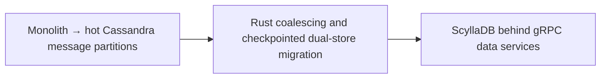

# Discord — trillions of messages: ScyllaDB plus Rust request coalescing

**Case ID:** `case.discord.cassandra-scylladb-messages` | **Milestone:** M9 E16-05 #118 | **Status:** evidence-grounded draft, pending reviewer.  
**Public primary:** DI01 [official engineering account](https://discord.com/blog/how-discord-stores-trillions-of-messages), 2023-03-06, Bo Ingram / Discord; source anchors: Data Services Serving Data; A Very Big Migration; Several Months Later. No private materials or copyrighted graphics reproduced.

## Original pressure and baseline

The Cassandra messages fleet experienced GC latency and hot partitions. One hot partition could accumulate concurrent requests and induce latency feedback, while a very large database made an untested live cutover risky. Merely changing storage engines would not remove unbounded demand.

## Architecture shift and ownership

Discord introduced Rust/Tokio gRPC data services with consistent hash routing by channel and coalescing of concurrent identical row reads, reducing demand to the database; it migrated the message store to ScyllaDB. The two changes play different roles: request-shaping versus storage engine operational behavior.

**Text alternative:** Monolith → hot Cassandra message partitions, through Rust coalescing and checkpointed dual-store migration, evolved toward ScyllaDB behind gRPC data services. Diagram is a simplified original architectural transition, not a provider topology inventory.

## Execution stages, validation and reversibility

The article describes an initial dual-write plus time-based migration idea but revises it after building a fast Rust migrator. It partition-scanned and checkpointed token ranges in SQLite, processed up to 3.2 million messages/s, encountered an un-compacted tombstone hotspot at the very end, validated a sample of reads against both databases, and switched primary traffic in May 2022. Those are date- and workload-bound source claims.

A **synthetic migration readiness checklist** for applying the lesson elsewhere (not a claim that the original authors used this exact checklist):

1. Define the old and new ownership boundaries and which API/data contract must stay invariant throughout coexistence.
2. Capture representative traffic and error distributions, not solely a success-path benchmark. Specify performance baselines with release version, dataset and sample size.
3. Compare old/new result sets and temporal semantics; test retried writes, old clients, skipped batches and partial deployment.
4. Observe canary failure and rollback behavior with exact data-authority ordering. Do not retire the legacy system before provable invariants hold.
5. Retest under realistic resource limits, hot keys and failure injections. A change in infra topology is not a substitute for demand shaping.

## Measured or reported outcome

Discord reports changing from 177 Cassandra nodes to 72 ScyllaDB nodes. **These node counts are not like-for-like units:** the original article specifies approximately **4 TB of disk per Cassandra node** versus **9 TB per ScyllaDB node**. Its historical message-read p99 shifted from **40–125 ms** to around **15 ms**, and insert p99 from **5–70 ms** to around **5 ms** in described workloads. These are company comparisons, not reproducible universal savings. The first-party numeric and capacity caveats were [rechecked separately](../../authoring/cases/M9_NUMERIC_SOURCE_RECHECK_WAVE09.md).

## Failed assumptions and when not to transfer the design

ScyllaDB does not eliminate hot partitioning or guarantee every reverse-query pattern works; Discord says reverse-query performance had been a blocker. A 99.9999% migrated progress indicator can hide a correctness issue in the final ranges. Sampled read comparison cannot logically prove all historical messages agree.

**Architecture choice:** Treat storage migration and admission control independently; compare hot-key management, read semantics, tombstone recovery, repair behavior and cutover completeness before committing to a new engine.

A lesser change (query optimization, archive policy, package boundary, deploy-tuning) is a valid alternative when it meets SLOs and costs less. A counter-architecture for this case requires workload, team skills, and service-level constraints; do not infer that the original company explicitly evaluated every alternative in this paragraph.

## Provenance and acceptance boundary

Evidence is company-authored and scoped to the publication date and sections: [DI01](https://discord.com/blog/how-discord-stores-trillions-of-messages), **Data Services Serving Data; A Very Big Migration; Several Months Later**. Numerical results, where stated, are publisher-reported; no Tycho benchmark, source reproduction or copyright permissions inferred. Source status must be reconciled with [the candidate audit](../../sources/REAL_WORLD_CASES_CANDIDATE_AUDIT.md) and E16-01 #114. This case remains a draft until independent #121 correctness and source review.
