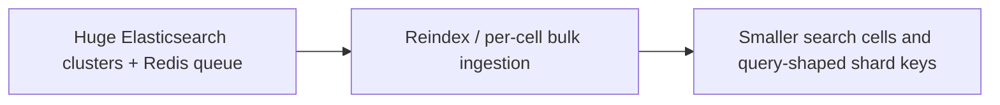

# Discord — search cells: splitting Elasticsearch clusters and changing shard keys

**Case ID:** `case.discord.search-index-cells` | **Milestone:** M9 E16-05 #118 | **Status:** evidence-grounded draft, pending reviewer.  
**Public primary:** src.m9-di02 [official engineering account](https://discord.com/blog/how-discord-indexes-trillions-of-messages), Discord Engineering report, 2025; source anchors: The Problems; The Solutions; Multi-cluster cell architecture; Supporting new search use cases. No private materials or copyrighted graphics reproduced.

## Original pressure and baseline

The legacy message-search system used large Elasticsearch clusters, an overburdened Redis-backed realtime indexing queue, and bulk indexing batches that fanned out across many nodes. A single unavailable shard in a large batch could cause broad retries. Cluster master OOM, oversized Lucene indices and brittle rolling restarts became operational and security liabilities.

## Architecture shift and ownership

Discord introduced smaller Elasticsearch clusters grouped into logical cells and managed through Kubernetes/ECK, separating ingest, master and data roles. Search indices are organized for different query shapes: guild messages still grouped by guild, while direct messages are additionally indexed by user in another cell to support cross-DM search.

**Text alternative:** Huge Elasticsearch clusters + Redis queue, through Reindex / per-cell bulk ingestion, evolved toward Smaller search cells and query-shaped shard keys. Diagram is a simplified original architectural transition, not a provider topology inventory.

## Execution stages, validation and reversibility

A new search platform should backfill index data, retain source message store as source-of-truth, compare search-result completeness and freshness, test rolling-restarter behavior and node outage fan-out, and gate shard routing. These are Tycho's suggested tests. The source documents cell architecture and reindexing, but its exact every-index migration order must not be invented.

A **synthetic migration readiness checklist** for applying the lesson elsewhere (not a claim that the original authors used this exact checklist):

1. Define the old and new ownership boundaries and which API/data contract must stay invariant throughout coexistence.
2. Capture representative traffic and error distributions, not solely a success-path benchmark. Specify performance baselines with release version, dataset and sample size.
3. Compare old/new result sets and temporal semantics; test retried writes, old clients, skipped batches and partial deployment.
4. Observe canary failure and rollback behavior with exact data-authority ordering. Do not retire the legacy system before provable invariants hold.
5. Retest under realistic resource limits, hot keys and failure injections. A change in infra topology is not a substitute for demand shaping.

## Measured or reported outcome

The first-party account describes new mobile cross-DM search powered by user-level indices, rather than claiming one universal performance multiplier. Historic 200+ node cluster and Lucene MAX_DOC incidents are setting-specific.

## Failed assumptions and when not to transfer the design

Duplicate DM indexing increases index storage for messages shared by two users, and more small clusters increase coordination/operational inventory. Availability goals must be balanced against search product semantics and shard locality. A new shard key cannot be chosen just to optimize ingestion.

**Architecture choice:** Use cells when cluster-wide blast radius and master state overhead dominate. Choose shard keys based on dominant queries; a strategy optimal for guild searches does not necessarily serve per-user DMs.

A lesser change (query optimization, archive policy, package boundary, deploy-tuning) is a valid alternative when it meets SLOs and costs less. A counter-architecture for this case requires workload, team skills, and service-level constraints; do not infer that the original company explicitly evaluated every alternative in this paragraph.

## Three separate failure mechanisms in the legacy search fleet

The [Discord Engineering account](https://discord.com/blog/how-discord-indexes-trillions-of-messages) (src.m9-di02, **The Problems**) describes a linked set of bottlenecks. They should not be reduced to the claim that “Elasticsearch was slow”:

1. **Lossy ingest buffer:** when the Redis-backed realtime indexing queue accumulated a backlog during search-node failures, Redis could become CPU-saturated and begin **dropping messages**. Querying a healthy shard later could not recover documents that never made it to the index pipeline.
2. **Failure-amplifying bulk ingestion:** a batch of 50 message writes could target 50 different Elasticsearch nodes. A single node outage could fail the entire bulk operation, causing **all records** to be retried. The article illustrates a 100-node cluster with one unavailable node where a 50-message random fan-out batch has roughly **40%** probability of touching the failed node. This is an illustrative probability conditioned on the example distribution, not a measured fleet-wide incident rate.
3. **Cluster-state and Lucene limits:** clusters above **200 nodes** made master coordination and upgrades difficult; master OOM could raise indexing backlog and search timeouts. Oversized guild indices approached Lucene's approximately **2-billion-document** MAX_DOC ceiling, after which indexing failed. A past configuration restart needed to mitigate a dependency vulnerability forced a complete search outage; the exact duration is not reported.

These are distinct fault surfaces: **transport durability**, **batch destination coupling**, and **index/cluster organization**. Fixing only one leaves the other two able to produce search incompleteness or degraded availability. The document does not establish a fully reliable source-message store for independently regenerating every lost queue item; never invent such replay guarantees.

## Source-reported new topology and recovery limits

src.m9-di02, **The Solutions**, reports a move to Kubernetes using Elastic Cloud on Kubernetes (ECK) and a greater number of smaller Elasticsearch clusters. Each logical **cell** groups multiple clusters. Dedicated master-eligible, ingest and data nodes separate coordination, ingestion and storage/queries; the source says **three master-eligible nodes across zones**, at least three ingest nodes and awareness-aware primary/replica placement. This addresses availability and maintenance windows, but it does not make a whole-cell outage impossible.

The team moved realtime indexing from Redis to a **PubSub queue** able to retain backlogs when Elasticsearch was unavailable. Then a Rust/Tokio router grouped incoming messages by **destination cluster and index**, issuing bulk writes whose members target the same index rather than potentially many unrelated nodes. A single failed destination therefore no longer forces all other destinations in one batch to retry. Those destination keys are **ingest grouping keys**, not necessarily the shard ID used to satisfy each user search. The implementation discussed here belongs to Discord; Tycho is not building an ingest-graph service.

| Original issue | Design response described in src.m9-di02 | Still requires separate validation |
|---|---|---|
| Redis backlog dropped messages | PubSub retention and retry during search outages | Queue redelivery/idempotency, prolonged outage retention and consistent index checkpoint |
| Batch fan-out coupled failures | Destination-specific router and bulk operations | Ordering, retry storms, queue age by cell/index, backpressure |
| Giant cluster master state and rolling restart risk | ECK-managed smaller clusters inside logical cells | Operator failure, zonal replica placement and version upgrade procedure |
| Guild-specific document/index limit | Standard small indices plus **dedicated multi-primary-shard indices** for exceptionally large guilds | High-fan-out query cost versus document cap, reindex parity and dual-ingest backlog |

**Unknown:** the source does not publish full query cardinalities, continuous per-shard CPU distributions, storage cost changes or a universally optimal number of cells. None should be invented for 2026.

## Query patterns determine when data duplication is justified

The design keeps ordinary guild messages indexed by **guild ID**, enabling localized guild queries. Search across all of a user's direct-message conversations could not efficiently be implemented by fanning out one query to every DM. Discord therefore introduced a separate **user-ID-sharded direct-message cell** so one user's messages could be retrieved in one logical search path. A two-person direct message then has **two indexed copies**, one per recipient, a deliberately accepted storage amplification for the new user-facing cross-DM search. [src.m9-di02, **Supporting new search use cases**].

A different corner case required the opposite optimization: most guilds benefit from **one primary shard** to avoid scattering each query, while exceptionally large guilds approaching Lucene MAX_DOC require **multiple primary shards** and higher query fan-out to fit the document set. One universal shard key and shard count cannot serve both workloads optimally.

The article gives a bounded **live reindex sequence** for such large guilds: detect the approaching cap; create a new, more-sharded index in a dedicated cell; start **dual-indexing new messages**; backfill history while old search still serves queries; switch new queries after historical work completes; then stop the old write path and clean up the old index after confidence is gained. This is source-reported behavior, not merely a Tycho proposal. Missing from the report are precise switchback thresholds and loss-recovery RTO; state them as unknown.

## Quantified reported outcome, with non-transferable denominators

As published, Discord reports **twice the legacy indexing throughput**, **median search latency from 500 ms to below 100 ms**, **p99 from about 1 second to below 500 ms**, and **40 Elasticsearch clusters with thousands of indices**, while indexing **trillions** of messages. It also reports automated cluster upgrades/rolling restarts with no service impact during its observation. [src.m9-di02, **How are things going?**]. The blog does not give enough reproducible benchmark method, traffic composition, hardware mix, sample duration or independent replication to generalize the multipliers.

**Critical disambiguation:** these numbers are for the **message search index**. They are not p99 measurements from Discord's separate [Cassandra-to-Scylla message-storage case](discord-cassandra-scylladb-messages.md). A system-design agent must refuse to transfer one subsystem's latency gains to the other.

## Synthetic correctness-first rollout and contraindications

For another large searchable event corpus, Tycho recommends: snapshot the authoritative record count and identity, model query shapes (tenant vs user), select index routing and ownership, establish durable ingest queues with retry-age alarms, introduce destination-specific bulk operations, test loss/replay/duplicate scenarios, migrate live cohorts through dual indexing and compare search-result identity/freshness, then move readers only after observable coverage converges. Validate partial zonal outages, failed shard allocation, index growth to cap and operator rolling upgrades.

**Refuse cell proliferation when** the index is small, query/load skew is low, operators cannot maintain many clusters, or there is no reason to duplicate user/tenant records. Start with queue durability and smaller indices if those alone meet the SLO. The right decision depends on the cost of query fan-out, data duplication, cluster-state growth, operational maturity and the ability to reconcile partial index failures—not the provider's name. This is an original Tycho recommendation, not a claim that Discord followed this exact evaluation script.

## Provenance and acceptance boundary

Evidence is company-authored and scoped to the publication date and sections: [src.m9-di02](https://discord.com/blog/how-discord-indexes-trillions-of-messages), **The Problems; The Solutions; Multi-cluster cell architecture; Supporting new search use cases**. Numerical results, where stated, are publisher-reported; no Tycho benchmark, source reproduction or copyright permissions inferred. Source status must be reconciled with [the candidate audit](../../sources/REAL_WORLD_CASES_CANDIDATE_AUDIT.md) and E16-01 #114. This case remains a draft until independent #121 correctness and source review.
