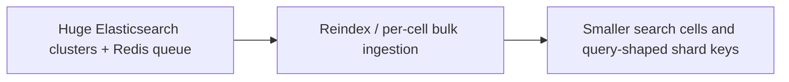

# Discord — search cells: splitting Elasticsearch clusters and changing shard keys

**Case ID:** `case.discord.search-index-cells` | **Milestone:** M9 E16-05 #118 | **Status:** evidence-grounded draft, pending reviewer.  
**Public primary:** DI02 [official engineering account](https://discord.com/blog/how-discord-indexes-trillions-of-messages), Discord Engineering report, 2025; source anchors: The Problems; The Solutions; Multi-cluster cell architecture; Supporting new search use cases. No private materials or copyrighted graphics reproduced.

## Original pressure and baseline

The legacy message-search system used large Elasticsearch clusters, an overburdened Redis-backed realtime indexing queue, and bulk indexing batches that fanned out across many nodes. A single unavailable shard in a large batch could cause broad retries. Cluster master OOM, oversized Lucene indices and brittle rolling restarts became operational and security liabilities.

## Architecture shift and ownership

Discord introduced smaller Elasticsearch clusters grouped into logical cells and managed through Kubernetes/ECK, separating ingest, master and data roles. Search indices are organized for different query shapes: guild messages still grouped by guild, while direct messages are additionally indexed by user in another cell to support cross-DM search.

**Text alternative:** Huge Elasticsearch clusters + Redis queue, through Reindex / per-cell bulk ingestion, evolved toward Smaller search cells and query-shaped shard keys. Diagram is a simplified original architectural transition, not a provider topology inventory.

## Execution stages, validation and reversibility

A new search platform should backfill index data, retain source message store as source-of-truth, compare search-result completeness and freshness, test rolling-restarter behavior and node outage fan-out, and gate shard routing. These are Tycho's suggested tests. The source documents cell architecture and reindexing, but its exact every-index migration order must not be invented.

A **synthetic migration readiness checklist** for applying the lesson elsewhere (not a claim that the original authors used this exact checklist):

1. Define the old and new ownership boundaries and which API/data contract must stay invariant throughout coexistence.
2. Capture representative traffic and error distributions, not solely a success-path benchmark. Specify performance baselines with release version, dataset and sample size.
3. Compare old/new result sets and temporal semantics; test retried writes, old clients, skipped batches and partial deployment.
4. Observe canary failure and rollback behavior with exact data-authority ordering. Do not retire the legacy system before provable invariants hold.
5. Retest under realistic resource limits, hot keys and failure injections. A change in infra topology is not a substitute for demand shaping.

## Measured or reported outcome

The first-party account describes new mobile cross-DM search powered by user-level indices, rather than claiming one universal performance multiplier. Historic 200+ node cluster and Lucene MAX_DOC incidents are setting-specific.

## Failed assumptions and when not to transfer the design

Duplicate DM indexing increases index storage for messages shared by two users, and more small clusters increase coordination/operational inventory. Availability goals must be balanced against search product semantics and shard locality. A new shard key cannot be chosen just to optimize ingestion.

**Architecture choice:** Use cells when cluster-wide blast radius and master state overhead dominate. Choose shard keys based on dominant queries; a strategy optimal for guild searches does not necessarily serve per-user DMs.

A lesser change (query optimization, archive policy, package boundary, deploy-tuning) is a valid alternative when it meets SLOs and costs less. A counter-architecture for this case requires workload, team skills, and service-level constraints; do not infer that the original company explicitly evaluated every alternative in this paragraph.

## Provenance and acceptance boundary

Evidence is company-authored and scoped to the publication date and sections: [DI02](https://discord.com/blog/how-discord-indexes-trillions-of-messages), **The Problems; The Solutions; Multi-cluster cell architecture; Supporting new search use cases**. Numerical results, where stated, are publisher-reported; no Tycho benchmark, source reproduction or copyright permissions inferred. Source status must be reconciled with [the candidate audit](../../sources/REAL_WORLD_CASES_CANDIDATE_AUDIT.md) and E16-01 #114. This case remains a draft until independent #121 correctness and source review.
