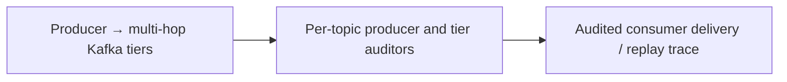

# LinkedIn — tiered Kafka transport needs end-to-end completeness audits

**Case ID:** `case.linkedin.kafka-tier-audit` | **M9:** E16-05 #118 | **Status:** original case draft; independent reviewer pending.  
**Public primary:** LI01 [company engineering report](https://engineering.linkedin.com/kafka/running-kafka-scale) (2015-03-20, Todd Palino); source location: How Big is Big?; multi-datacenter tiers; Auditing Completeness; Bringing It All Together. Attributed public paraphrase, no mirrored graphs or copyrighted assets.

## Pressure, legacy baseline and actual chosen direction

LinkedIn handled varied data categories over large Kafka fleets. A single healthy broker cluster did not guarantee that every producer event traversed local clusters, MirrorMaker copies, aggregate clusters and critical downstream consumers; a new transport tier introduced another loss and duplication surface.

The company used local/aggregate cluster tiers by message category and built Kafka Audit, where producers and per-tier auditors report counts for comparable time/topic intervals. Critical consumers such as Hadoop sinks also contributed audit information. Platform libraries added headers/schema/producer count bookkeeping, reducing the burden on service teams.

**Text alternative:** Producer → multi-hop Kafka tiers transitions through Per-topic producer and tier auditors into Audited consumer delivery / replay trace. This is an independent, simplified transition schematic, not a trace or full infrastructure diagram.

## Migration mechanics and reliability

The source describes partitioned Kafka clusters, local→aggregate mirroring and end-to-end count comparisons. For a comparable architecture, include message identity and partition offsets in validation so matching counts cannot mask one dropped and one duplicate message. The identity-level check is an additional Tycho analytical recommendation, not something the article necessarily implemented.

**Synthetic acceptance plan for a different legacy stack:** baseline real workload and maintenance cost; specify the one invariant that cannot change; stage compatible dual routes/data or immutable job inputs; compare source and target results including timestamps and retries; define rate-limit, fallbacks and alerting; establish rollback while the old path remains operational. These steps are analytical transfer, not invented historical facts about linkedin.

## Outcomes and negative lessons

LinkedIn reported **over 800 billion messages/day**, over **1,100 brokers**, more than **60 clusters** in March 2015 and an auditing system for completeness across tiers. They are historic self-reported numbers and not a contemporary or generic Kafka capacity benchmark.

Counts alone can be equal despite one lost and one duplicated message. Clock skew and late producers can create audit windows that disagree transiently. More tiers improve locality and separation but introduce more routes for lost data and need dedicated platform/SRE ownership.

| Architecture alternative | Valid reason to choose | Danger/constraint |
|---|---|---|
| Keep/tune current design | Lowest transition risk if current SLOs hold | May not solve actual scaling or ownership failure |
| Adopt the documented pattern | Same bottleneck and teams capable of operating new abstraction | Workload/version/data semantics may not match original |
| Introduce an intermediate compatibility adapter | Split change into reversible pieces | Additional short-term dual-state complexity |
| Unknown until instrumented | No trustworthy baseline or correctness oracle | Do not present speculation as an endorsed architecture |

## Legacy modernization decision transfer

Implement auditable event transport when replay correctness and cross-region fan-out matter; evaluate simpler single-region queues when streaming topology complexity adds no business value.

**Metrics required before reuse:** actual p95/p99, throughput versus CPU/storage, error and retry rate, divergence/correctness, rollback time and SRE toil, with historical time window. No new performance measurement or independent replication was performed by Tycho. All source-reported numbers are scoped to this publisher's observations.

**Provenance:** [LI01](https://engineering.linkedin.com/kafka/running-kafka-scale), How Big is Big?; multi-datacenter tiers; Auditing Completeness; Bringing It All Together. Source-admission review [#114](https://github.com/rouslanbaranov/tycho/issues/114); independent technical review [#121](https://github.com/rouslanbaranov/tycho/issues/121). **Status remains draft** pending both gates.
