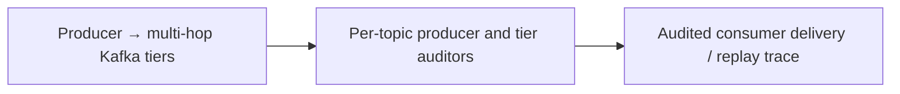

# LinkedIn — tiered Kafka transport needs end-to-end completeness audits

**Case ID:** `case.linkedin.kafka-tier-audit` | **M9:** E16-05 #118 | **Status:** original case draft; independent reviewer pending.  
**Public primary:** LI01 [company engineering report](https://engineering.linkedin.com/kafka/running-kafka-scale) (2015-03-20, Todd Palino); source location: How Big is Big?; multi-datacenter tiers; Auditing Completeness; Bringing It All Together. Attributed public paraphrase, no mirrored graphs or copyrighted assets.

## Pressure, legacy baseline and actual chosen direction

LinkedIn handled varied data categories over large Kafka fleets. A single healthy broker cluster did not guarantee that every producer event traversed local clusters, MirrorMaker copies, aggregate clusters and critical downstream consumers; a new transport tier introduced another loss and duplication surface.

The company used local/aggregate cluster tiers by message category and built Kafka Audit, where producers and per-tier auditors report counts for comparable time/topic intervals. Critical consumers such as Hadoop sinks also contributed audit information. Platform libraries added headers/schema/producer count bookkeeping, reducing the burden on service teams.

**Text alternative:** Producer → multi-hop Kafka tiers transitions through Per-topic producer and tier auditors into Audited consumer delivery / replay trace. This is an independent, simplified transition schematic, not a trace or full infrastructure diagram.

## Migration mechanics and reliability

The source describes partitioned Kafka clusters, local→aggregate mirroring and end-to-end count comparisons. For a comparable architecture, include message identity and partition offsets in validation so matching counts cannot mask one dropped and one duplicate message. The identity-level check is an additional Tycho analytical recommendation, not something the article necessarily implemented.

**Synthetic acceptance plan for a different legacy stack:** baseline real workload and maintenance cost; specify the one invariant that cannot change; stage compatible dual routes/data or immutable job inputs; compare source and target results including timestamps and retries; define rate-limit, fallbacks and alerting; establish rollback while the old path remains operational. These steps are analytical transfer, not invented historical facts about linkedin.

## Outcomes and negative lessons

LinkedIn reported **over 800 billion messages/day**, over **1,100 brokers**, more than **60 clusters** in March 2015 and an auditing system for completeness across tiers. They are historic self-reported numbers and not a contemporary or generic Kafka capacity benchmark.

Counts alone can be equal despite one lost and one duplicated message. Clock skew and late producers can create audit windows that disagree transiently. More tiers improve locality and separation but introduce more routes for lost data and need dedicated platform/SRE ownership.

| Architecture alternative | Valid reason to choose | Danger/constraint |
|---|---|---|
| Keep/tune current design | Lowest transition risk if current SLOs hold | May not solve actual scaling or ownership failure |
| Adopt the documented pattern | Same bottleneck and teams capable of operating new abstraction | Workload/version/data semantics may not match original |
| Introduce an intermediate compatibility adapter | Split change into reversible pieces | Additional short-term dual-state complexity |
| Unknown until instrumented | No trustworthy baseline or correctness oracle | Do not present speculation as an endorsed architecture |

## Exact historical topology and tier contracts

Todd Palino's [March 20, 2015 first-party report](https://engineering.linkedin.com/kafka/running-kafka-scale) (LI01, **How Big is Big?**, **Tiers and Aggregation**) differentiates four message **categories** rather than one homogeneous log: *queuing*, *metrics*, *logging* and *tracking*. Categories were placed in separate Kafka clusters. The report notes that logging and metrics had previously shared a cluster but were separated as their volume diverged. This is historical evidence of a **workload-isolation decision**, not a requirement to build four clusters in every deployment.

Every data center had local clusters for categories; aggregate clusters combined those local feeds with **MirrorMaker**, copying from local to aggregate instead of between pairs of local clusters. That routing choice reduced the need for repeated cross-data-center transfers and avoided copy loops. A local consumer could remain unaware of more remote topology; a globally scoped consumer could read aggregation. The architecture created additional consistency/failure boundaries, however, so the health of any one cluster was not proof of complete end-to-end delivery.

The publisher describes a conceptual tier chain: **producer → local cluster → aggregate cluster(s) → critical consumer**. Each tier is an independent point at which counting, failure alerts and recovery procedures must be attached. This account does not document a universally consistent cross-cluster transaction, a single end-to-end ordered log across every topic, or exactly-once delivery through all consumers.

## Kafka Audit: who measures what

The original **Auditing Completeness** section describes common message headers carrying timestamps and producer service/host identity. Each producer tallied messages sent for a topic and reporting interval and periodically published those counts into a dedicated audit topic. Each cluster's **Kafka Console Auditor** separately consumed topics, accumulated observed counts and sent audit results. Critical downstream systems such as Hadoop could also publish their own tier counts.

| Published producer or service boundary | Count / identity observation | What it can reveal | What it cannot prove by itself |
|---|---|---|---|
| Producer client | Attempted sends by topic/time interval and identifying service/host | Where a count discrepancy originated | Broker persistence, consumer processing or duplicate payload identity |
| Local-cluster console auditor | Messages visible at the local cluster for a matching interval | Ingress loss relative to producer view | Whether a remote aggregate or external sink eventually received the same records |
| Aggregate-cluster auditor | Messages present after MirrorMaker copy for the same interval | Inter-tier transfer loss/duplication symptom | Cross-topic transactional ordering or matching individual record IDs |
| Critical consumer auditor | Records the downstream application reports as received | Last-hop incomplete transfer, if recorded with the same comparison rules | Whether the application's side effects committed exactly once |

The **comparison approach and attribution to each tier** are publisher-reported. The “cannot prove” column is **Tycho's analytical limitation**: equal counts alone can hide one lost record balanced by a duplicate, different keys that happen to have the same cardinality, time-window skew or a replay already reflected in one tier but not another. LinkedIn described count-based auditing as assurance against loss/duplication in the source's operating context, but the post does not establish independent per-message equality or universal end-to-end exactly-once semantics.

The final section credits a dedicated platform team and client libraries. For example, a common producer wrapper provided header fields, schema-registration integration and auditing bookkeeping so that ordinary application teams did not each have to implement bespoke audit counters. This **centralized correctness interface** is as significant as deploying an audit service: otherwise mixed client implementations may count different events (attempted sends versus acknowledged durable writes).

## Workload numbers: preserve their units and date

The March 2015 report states **over 800 billion messages produced per day**, **over 175 TB input per day**, **over 650 TB consumed per day**, a busy-period intake of **over 13 million messages/sec** or **2.75 GB/sec**, and **more than 1,100 brokers across more than 60 clusters**. These have *different denominators and observation windows*: consumer volume can exceed input because Kafka supports many readers of one event. Daily averages cannot be used as peak throughput, and 2015 figures cannot be interpreted as the organization's 2026 topology or Kafka's vendor-independent capacity specification. [LI01: How Big is Big?]

Do not calculate a per-broker “safe throughput” by naively dividing these totals: category mix, replicas, replication links, disk retention, number of reads per event, regional skew and hardware are not published at the granularity such a capacity recommendation would require.

## Synthetic staged migration with completeness and recovery gates

For a new multi-region event platform, Tycho would keep producers and consumers on the existing route while introducing one mirrored category as a shadow path. Define producer acknowledgment semantics, event identity, schema compatibility and valid reporting windows first. Before routing critical consumers to the new aggregate cluster, compare **tier counts and sampled identities**, include delayed and retry traffic, and test temporary network separation between data centers. Define alerts for mismatch *age* as well as mismatch size so eventual arrivals are not mistaken for permanent loss; keep source retention sufficient for replay.

Move consumer authority only after per-tier audit convergence, time-window/clock alignment, replay safety and downstream idempotency checks meet predeclared limits. A rollback should restore the known source tier without creating an unbounded duplicate-delivery storm. These are **Tycho recommendations**, not claims that the 2015 article records LinkedIn's exact sequence or thresholds.

**Contraindications:** low event volume with no cross-region requirements, insufficient platform ownership for auditing, no stable event identity where correctness depends on it, or inability to define consumer-side commit semantics. A simpler single-cluster deployment may be more reliable than an unoperated tiering system. Conversely, when multiple regions and consumers require distinct local/global visibility and losses must be localized quickly, explicit per-hop audit evidence is a concrete design driver.

## Legacy modernization decision transfer

Implement auditable event transport when replay correctness and cross-region fan-out matter; evaluate simpler single-region queues when streaming topology complexity adds no business value.

**Metrics required before reuse:** actual p95/p99, throughput versus CPU/storage, error and retry rate, divergence/correctness, rollback time and SRE toil, with historical time window. No new performance measurement or independent replication was performed by Tycho. All source-reported numbers are scoped to this publisher's observations.

**Provenance:** [LI01](https://engineering.linkedin.com/kafka/running-kafka-scale), How Big is Big?; multi-datacenter tiers; Auditing Completeness; Bringing It All Together. Source-admission review [#114](https://github.com/rouslanbaranov/tycho/issues/114); independent technical review [#121](https://github.com/rouslanbaranov/tycho/issues/121). **Status remains draft** pending both gates.
