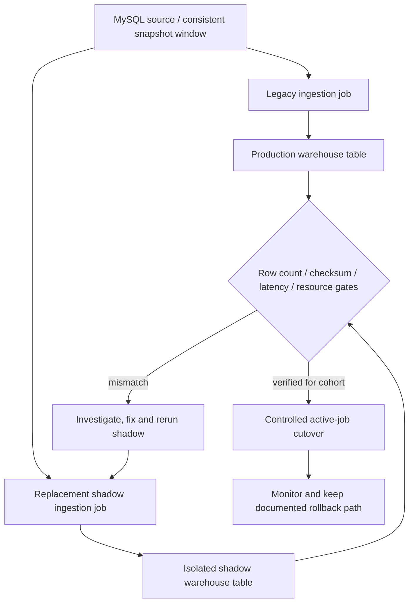

# Meta — Dataset Ingestion Cutover Across Thousands of Jobs with Shadow Validation

**Case ID:** `case.meta.ingestion-shadow-lifecycle` · **M9:** E16-05 #118 · **Status:** evidence-backed draft; independent review pending.  
**Public first-party ME03:** Zihao Tao, Mohan Perumal Swamy, Grace Gong, Ailyn Tong, Peishan Wang, Nilay Kapadia, Md Mustafijur Rahman Faysal, Saurav Sen and Jameel Mohamed. [Meta Engineering, 2026-05-12: Migrating Data Ingestion Systems at Meta Scale](https://engineering.fb.com/2026/05/12/data-infrastructure/migrating-data-ingestion-systems-at-meta-scale/). Relevant original sections: **The Migration Challenge**, **Ensuring a Seamless Transition**, **The Migration Lifecycle**, **Phase 1: The Shadow Phase**, and subsequent migration/rollout sections. No internal job manifests, query results or screenshots were copied.

## Legacy architecture, tension and reported outcome

Meta's data-warehouse ingestion moved daily changes of multiple petabytes of MySQL-backed social-graph data. The former architecture relied on **customer-owned ingestion pipelines** that worked at smaller scale, but ownership, reliability and increasingly strict *data-landing-time* requirements became unsustainable as the workload grew. The replacement is described as a self-managed warehouse ingestion service. The article reports **100% workload transition** and retirement of the original ingest system at the May 2026 publication date. This is a publisher-reported achieved outcome, not evidence of universal data-loss freedom or an externally reproduced migration.

## Concrete migration safety mechanism

The company established a per-job migration lifecycle, not one global cutover switch. Its acceptance criteria required **matching row counts and data checksums**, **no landing latency regression**, and resource usage at least comparable to the legacy job. Critical tables had extra criteria negotiated with their owners. The initial shadow phase ran the new ingestion job against production-realistic source inputs while writing to an **isolated shadow table** in pre-production. Teams compared that output with the live production table and investigated mismatches before advancing the job. [ME03, 'The Migration Lifecycle', 'Phase 1: The Shadow Phase'].

**Text alternative:** both old and candidate ingestion jobs see comparable source data, but only old publishes to consumers initially. Differences between production and shadow output and performance/cost regressions must be investigated; verified jobs graduate through a controlled rollout. Diagram is a **simplified analysis**, not a copy of Meta's original lifecycle drawing. Comparable snapshot windows and rollback triggers for an unrelated system must be explicitly designed.

## Preconditions and what the published gates cannot prove by themselves

| Gate | What Meta says it checked | Known epistemic limit |
|---|---|---|
| Record set size | Row count comparison | Two unequal sets can have identical counts |
| Content fingerprint | Checksum comparison | Collisions/omitted columns/versioned canonicalization require own policy; matching checksum does not prove all data semantics |
| Freshness | New landing latency no worse | Needs production-like source update patterns, measurement window and downstream consumers |
| Resources | New compute/storage use comparable or improved | Capital cost, engineering time and operational ownership beyond reported utilization need separate analysis |
| Critical data | Extra criteria agreed with dependent teams | Requirements vary by domain; no universal numerical thresholds given |

Shadow jobs do not eliminate rollback design, change-data-capture ordering or mutable-source race conditions by magic. **Do not claim** the company adopted every Tycho suggestion below; the article defines its concrete lifecycle and we derive reusable precautions.

## Decision transfer, negative cases and synthetic ADR

**Synthetic requirement:** migrate a transactional reporting feed while thousands of dashboards must remain available. Choose a job-level lifecycle with explicit old/new side-by-side materialization, consistent snapshot cuts, row identity as well as checksums for critical entities, fresh-data lag p95/p99, and an owner-approved change of production authority. Use canary batches and fall back before retiring the old implementation.

**Alternative A — big bang:** may be viable only for a tiny noncritical batch that can be re-run deterministically without consumer SLA, but wrong for thousands of continuously consumed tables. **Alternative B — indefinitely mirror both systems:** appears safer but incurs duplication and increases ambiguity about data authority. **Selected proposed approach:** successive independently validated job cohorts with explicit cutover and legacy retirement criteria.

A control failure should be recorded as a counterexample: an equal number of rows plus equal coarse checksum can still miss business-significant schema semantics if the fingerprint omits a column; a green shadow table can be stale if the source snapshot window differed. Those are **hypothetical** risks, not reported Meta incidents.

## Quantitative status and provenance

Meta reports 100% transition/deprecation of the ingestion workloads but does not give public access to its full comparator queries, private storage topology, total failed attempts, customer-specific SLOs or independently reproducible audit logs. Numerical performance improvements must be quoted only if pinned to a specific relevant source section. The design is a correctness-first migration precedent, contrasting Stripe's *mutable subscription read/write authority* and Netflix's *Cassandra backup-to-Iceberg set comparisons*. All three address equivalence with different sources, authority changes and failure conditions.

**Reviewer checklist:** original Meta source date, author group, row count/checksum semantics, shadow isolation, no-regression guards, and accepted 100%-completed statement; do not imply formal proof of no corruption. Source: [ME03](https://engineering.fb.com/2026/05/12/data-infrastructure/migrating-data-ingestion-systems-at-meta-scale/). **Review pending #121.**
