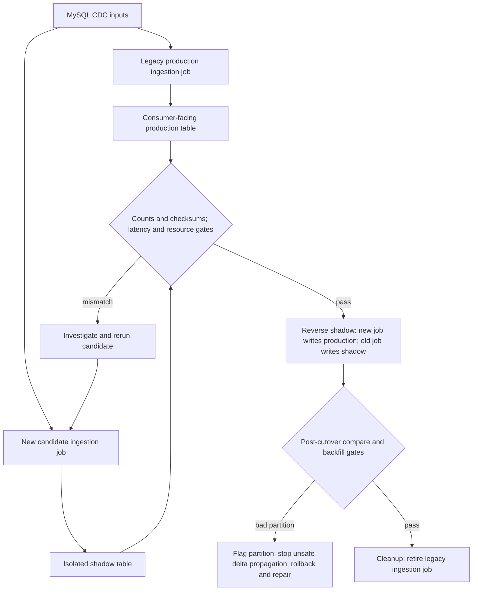

# Meta — Dataset Ingestion Cutover Across Thousands of Jobs with Shadow Validation

**Case ID:** `case.meta.ingestion-shadow-lifecycle` · **M9:** E16-05 #118 · **Status:** evidence-backed draft; independent review pending.  
**Public first-party src.m9-me03:** Zihao Tao, Mohan Perumal Swamy, Grace Gong, Ailyn Tong, Peishan Wang, Nilay Kapadia, Md Mustafijur Rahman Faysal, Saurav Sen and Jameel Mohamed. [Meta Engineering, 2026-05-12: Migrating Data Ingestion Systems at Meta Scale](https://engineering.fb.com/2026/05/12/data-infrastructure/migrating-data-ingestion-systems-at-meta-scale/). Relevant original sections: **The Migration Challenge**, **Ensuring a Seamless Transition**, **The Migration Lifecycle**, **Phase 1: The Shadow Phase**, and subsequent migration/rollout sections. No internal job manifests, query results or screenshots were copied.

## Legacy architecture, tension and reported outcome

Meta's data-warehouse ingestion moved daily changes of multiple petabytes of MySQL-backed social-graph data. The former architecture relied on **customer-owned ingestion pipelines** that worked at smaller scale, but ownership, reliability and increasingly strict *data-landing-time* requirements became unsustainable as the workload grew. The replacement is described as a self-managed warehouse ingestion service. The article reports **100% workload transition** and retirement of the original ingest system at the May 2026 publication date. This is a publisher-reported achieved outcome, not evidence of universal data-loss freedom or an externally reproduced migration.

## Concrete migration safety mechanism

The company established a per-job migration lifecycle, not one global cutover switch. Its acceptance criteria required **matching row counts and data checksums**, **no landing latency regression**, and resource usage at least comparable to the legacy job. Critical tables had extra criteria negotiated with their owners. The initial shadow phase ran the new ingestion job against production-realistic source inputs while writing to an **isolated shadow table** in pre-production. Teams compared that output with the live production table and investigated mismatches before advancing the job. [src.m9-me03, 'The Migration Lifecycle', 'Phase 1: The Shadow Phase'].

**Text alternative:** first, the legacy job writes the consumer-facing warehouse table while the new job writes an isolated shadow table; compare row counts, checksums, landing time and resource usage. After verification, **reverse shadow** switches the new job to the real production table and redirects the old job to shadow, retaining a runnable rollback path and continuing comparisons. A mismatched CDC partition triggers bad-data quarantine, rollback and repair; only after stable observation is the old job removed. This is an original simplification of the three phases documented in the Meta publication, not a reproduction of its private dataflow drawing.

## Preconditions and what the published gates cannot prove by themselves

| Gate | What Meta says it checked | Known epistemic limit |
|---|---|---|
| Record set size | Row count comparison | Two unequal sets can have identical counts |
| Content fingerprint | Checksum comparison | Collisions/omitted columns/versioned canonicalization require own policy; matching checksum does not prove all data semantics |
| Freshness | New landing latency no worse | Needs production-like source update patterns, measurement window and downstream consumers |
| Resources | New compute/storage use comparable or improved | Capital cost, engineering time and operational ownership beyond reported utilization need separate analysis |
| Critical data | Extra criteria agreed with dependent teams | Requirements vary by domain; no universal numerical thresholds given |

### Meta's reported three-phase authority transition (src.m9-me03)

1. **Shadow phase:** initial shadow ingestion runs in pre-production on production-like source inputs, writes to isolated shadow tables and compares partitions with production via **row counts and checksums** while also checking landing latency and resource utilization. After validation the candidate can run in production and progress.
2. **Reverse shadow phase:** the **new** ingestion job writes to the consumer-facing production table, while the **old** job begins writing to a shadow table. Both still run and comparisons continue; a rollback can restore the previous path without rebuilding it. The first live switch is **not** the end of verification.
3. **Cleanup:** only after ongoing output and operational gates pass does the team stop the legacy job. Meta reports completed workload cutover in its May 2026 article, but that is a company statement, not a reproduction of all data-quality checks.

### Failure containment that changes the architecture decision

The source describes **CDC full-dump, delta and target partitions** with a risk of propagating faulty prior data into subsequent partitions. During reverse shadow, partition-level bad-data metadata triggers early containment: a bad **delta partition** stops subsequent landing and alerts the operator; for a bad **target partition**, an earlier snapshot can be merged with later deltas. Rollback and corrective backfill use the recorded suspect partitions. These are **reported Meta mechanisms**, not generic suggestions.

At scale Meta could not run all candidate shadow jobs simultaneously: migration batches were prioritized by throughput, business criticality, resource capacity and known issues; known-bad jobs were held to avoid repeating costly full dumps. This admission/rollout budget is part of the reported architecture, not merely project management. Source locations: **Phase 2: The Reverse Shadow Phase**, **Phase 3: Migration Cleanup**, **Early Signals After Rollout**, **Stopping the Bad Data Propagation Quickly During Rollback**, **Planning With Limited Capacity**. See the scoped [claim recheck](../../authoring/cases/M9_META_STRIPE_CUTOVER_SOURCE_CHECK.md).

Shadow jobs do not eliminate rollback design, change-data-capture ordering or mutable-source race conditions by magic. **Do not claim** the company adopted every Tycho suggestion below; the article defines its concrete lifecycle and we derive reusable precautions.

## Decision transfer, negative cases and synthetic ADR

**Synthetic requirement:** migrate a transactional reporting feed while thousands of dashboards must remain available. Choose a job-level lifecycle with explicit old/new side-by-side materialization, consistent snapshot cuts, row identity as well as checksums for critical entities, fresh-data lag p95/p99, and an owner-approved change of production authority. Use canary batches and fall back before retiring the old implementation.

**Alternative A — big bang:** may be viable only for a tiny noncritical batch that can be re-run deterministically without consumer SLA, but wrong for thousands of continuously consumed tables. **Alternative B — indefinitely mirror both systems:** appears safer but incurs duplication and increases ambiguity about data authority. **Selected proposed approach:** successive independently validated job cohorts with explicit cutover and legacy retirement criteria.

A control failure should be recorded as a counterexample: an equal number of rows plus equal coarse checksum can still miss business-significant schema semantics if the fingerprint omits a column; a green shadow table can be stale if the source snapshot window differed. Those are **hypothetical** risks, not reported Meta incidents.

## What a green shadow comparison cannot guarantee

src.m9-me03 documents **job-level authority transitions**: legacy production/new shadow, followed by new production/legacy reverse shadow, then cleanup. This choreography solves a different problem from changing all reads before writes in Stripe's mutable subscription migration. There is no safe universal “dual-write” shortcut that represents both histories.

For a different warehouse, materialized output can match row count and checksum while *still* diverging semantically when time windows differ, null/value canonicalization is lossy or the fingerprint excludes business-critical fields. Model each comparison as a tuple of `source snapshot + schema version + partition identity + job revision + equality rule + freshness window`. An audit should reject comparisons whose tuple differs in a way the domain owner has not explicitly normalized.

| Candidate failure during synthetic migration | Observation needed before continuing | Recovery boundary |
|---|---|---|
| Full snapshot finishes after CDC deltas began | Snapshot high-watermark and ordered delta offset | Replay/rebuild from consistent checkpoint |
| Shadow row counts match but checksum differs | Per-column/value-level diff with source revision | Hold job, investigate semantics before cutover |
| Reverse-shadow new production job emits a bad delta partition | Affected partition, downstream dependents, first corrupted offset | Stop further propagation; quarantine/repair from accepted snapshot |
| New job is correct but exceeds landing-time SLO | End-to-end watermark lag and critical consumer deadlines | Return production authority or throttle cohort |
| Legacy shadow job is retired too early | No independently runnable old path and no accepted recovery plan | Block cleanup, preserve reverse operation until post-cutover evidence |
| Resource demand spikes when many jobs shadow together | Capacity budget and priority-aware migration scheduler | Reduce or pause migration cohorts rather than overload production |

These are **Tycho synthetic error-injection tests** based on the categories of output authority, CDC/partition corruption and capacity limits described in src.m9-me03, not a company incident log. The report says the migration was complete as of its May 2026 publication; it does not expose full private comparison queries or independently audited zero-loss statistics.

## Explicit completion and rollback contract

A page-ready migration case should answer four questions for **every** job: who currently writes the consumer-facing production table; what isolated shadow output is compared; which exact result/event flips authority; and which preserved state permits rollback after the flip. Resource usage and landing latency are first-class gates, not a footnote after value equality.

A synthetic accepted job can be `SHADOW_VERIFIED` only after representative sources, partition counts and field values converge within a defined window. It can be `REVERSE_SHADOW` only when the new production writer's authorization and checkpoint/retention semantics are proven and the old writer still runs as shadow. It can be `RETIRED` only when late partitions, critical consumers and recovery conditions have been reviewed. These names are **Tycho model states**, not official Meta API identifiers.

**Counterexample:** for a tiny, immutable offline table with deterministic reprocessing and no live consumer SLO, a one-shot recompute and direct compare may be simpler than maintaining two production job generations. But for thousands of mutable feeds with independent CDC lag, job-scoped authority and recoverability may justify this operational complexity. Without named snapshot/offset identity and a repair path, a migration status of “100%” remains **insufficient evidence** for completeness of a new platform's own implementation.

## Quantitative status and provenance

Meta reports 100% transition/deprecation of the ingestion workloads but does not give public access to its full comparator queries, private storage topology, total failed attempts, customer-specific SLOs or independently reproducible audit logs. Numerical performance improvements must be quoted only if pinned to a specific relevant source section. The design is a correctness-first migration precedent, contrasting Stripe's *mutable subscription read/write authority* and Netflix's *Cassandra backup-to-Iceberg set comparisons*. All three address equivalence with different sources, authority changes and failure conditions.

**Reviewer checklist:** original Meta source date, author group, row count/checksum semantics, shadow isolation, no-regression guards, and accepted 100%-completed statement; do not imply formal proof of no corruption. Source: [src.m9-me03](https://engineering.fb.com/2026/05/12/data-infrastructure/migrating-data-ingestion-systems-at-meta-scale/). **Review pending #121.**
