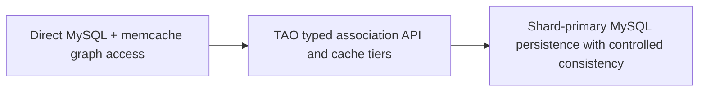

# Meta/Facebook — TAO: specialized graph APIs over MySQL and tiered caches

**Case ID:** `case.meta.tao-social-graph-serving` | **M9:** E16-05 #118 | **Status:** original case draft; independent reviewer pending.  
**Public primary:** ME01 [company engineering report](https://engineering.fb.com/2013/06/25/core-infra/tao-the-power-of-the-graph/) (2013-06-25 first-party Facebook/Meta engineering account); source location: TAO data model and API; Implementation; Consistency. Attributed public paraphrase, no mirrored graphs or copyrighted assets.

## Pressure, legacy baseline and actual chosen direction

Social data objects and associations were served through MySQL plus client-accessed memcache. Application teams faced graph-specific access, hot objects, distributed cache inconsistency and thundering-herd complexity, while general relational queries were not shaped for very frequent object/association reads.

TAO supplied a narrow object/association API and geodistributed cache service in front of sharded MySQL persistence. The service offers association point/range/count reads, ordered association lists and typed inverse edges. Cache follower/leader tiers handle reads and write-through coherency while shard primaries define persistence authority.

**Text alternative:** Direct MySQL + memcache graph access transitions through TAO typed association API and cache tiers into Shard-primary MySQL persistence with controlled consistency. This is an independent, simplified transition schematic, not a trace or full infrastructure diagram.

## Migration mechanics and reliability

The published article describes the architecture, not a complete original cutover chronology. A comparable design must define cache fill concurrency and hot-key suppression, shard ownership and replication; validate read-your-writes where required, make consistency mode explicit and plan primary-region switching. Those extra transition gates are Tycho synthesis.

**Synthetic acceptance plan for a different legacy stack:** baseline real workload and maintenance cost; specify the one invariant that cannot change; stage compatible dual routes/data or immutable job inputs; compare source and target results including timestamps and retries; define rate-limit, fallbacks and alerting; establish rollback while the old path remains operational. These steps are analytical transfer, not invented historical facts about meta.

## Outcomes and negative lessons

The 2013 article reports serving >1 billion reads and millions of writes per second at that historic point. These figures refer to Facebook's deployment and must not be treated as a reusable guarantee or 2026 fleet inventory.

TAO deliberately avoids general graph traversal and pattern matching; it is not a general-purpose graph analytics replacement. Its default eventual consistency may be unacceptable for money movement or regulatory records. A specialized cache-service fleet requires deep SRE ownership.

| Architecture alternative | Valid reason to choose | Danger/constraint |
|---|---|---|
| Keep/tune current design | Lowest transition risk if current SLOs hold | May not solve actual scaling or ownership failure |
| Adopt the documented pattern | Same bottleneck and teams capable of operating new abstraction | Workload/version/data semantics may not match original |
| Introduce an intermediate compatibility adapter | Split change into reversible pieces | Additional short-term dual-state complexity |
| Unknown until instrumented | No trustworthy baseline or correctness oracle | Do not present speculation as an endorsed architecture |

## Legacy modernization decision transfer

Choose a workload-specific data access API and cache hierarchy when a few predictable association queries dominate and hot-key fan-out is prohibitive; retain general DB queries when data access is heterogeneous and strong transactional invariants dominate.

**Metrics required before reuse:** actual p95/p99, throughput versus CPU/storage, error and retry rate, divergence/correctness, rollback time and SRE toil, with historical time window. No new performance measurement or independent replication was performed by Tycho. All source-reported numbers are scoped to this publisher's observations.

**Provenance:** [ME01](https://engineering.fb.com/2013/06/25/core-infra/tao-the-power-of-the-graph/), TAO data model and API; Implementation; Consistency. Source-admission review [#114](https://github.com/rouslanbaranov/tycho/issues/114); independent technical review [#121](https://github.com/rouslanbaranov/tycho/issues/121). **Status remains draft** pending both gates.
