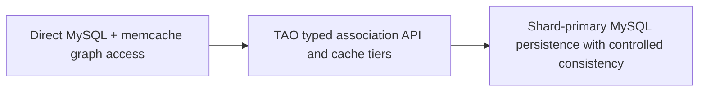

# Meta/Facebook — TAO: specialized graph APIs over MySQL and tiered caches

**Case ID:** `case.meta.tao-social-graph-serving` | **M9:** E16-05 #118 | **Status:** original case draft; independent reviewer pending.  
**Public primary:** src.m9-me01 [company engineering report](https://engineering.fb.com/2013/06/25/core-infra/tao-the-power-of-the-graph/) (2013-06-25 first-party Facebook/Meta engineering account); source location: TAO data model and API; Implementation; Consistency. Attributed public paraphrase, no mirrored graphs or copyrighted assets.

## Pressure, legacy baseline and actual chosen direction

Social data objects and associations were served through MySQL plus client-accessed memcache. Application teams faced graph-specific access, hot objects, distributed cache inconsistency and thundering-herd complexity, while general relational queries were not shaped for very frequent object/association reads.

TAO supplied a narrow object/association API and geodistributed cache service in front of sharded MySQL persistence. The service offers association point/range/count reads, ordered association lists and typed inverse edges. Cache follower/leader tiers handle reads and write-through coherency while shard primaries define persistence authority.

**Text alternative:** Direct MySQL + memcache graph access transitions through TAO typed association API and cache tiers into Shard-primary MySQL persistence with controlled consistency. This is an independent, simplified transition schematic, not a trace or full infrastructure diagram.

## Migration mechanics and reliability

The published article describes the architecture, not a complete original cutover chronology. A comparable design must define cache fill concurrency and hot-key suppression, shard ownership and replication; validate read-your-writes where required, make consistency mode explicit and plan primary-region switching. Those extra transition gates are Tycho synthesis.

**Synthetic acceptance plan for a different legacy stack:** baseline real workload and maintenance cost; specify the one invariant that cannot change; stage compatible dual routes/data or immutable job inputs; compare source and target results including timestamps and retries; define rate-limit, fallbacks and alerting; establish rollback while the old path remains operational. These steps are analytical transfer, not invented historical facts about meta.

## Outcomes and negative lessons

The 2013 article reports serving >1 billion reads and millions of writes per second at that historic point. These figures refer to Facebook's deployment and must not be treated as a reusable guarantee or 2026 fleet inventory.

TAO deliberately avoids general graph traversal and pattern matching; it is not a general-purpose graph analytics replacement. Its default eventual consistency may be unacceptable for money movement or regulatory records. A specialized cache-service fleet requires deep SRE ownership.

| Architecture alternative | Valid reason to choose | Danger/constraint |
|---|---|---|
| Keep/tune current design | Lowest transition risk if current SLOs hold | May not solve actual scaling or ownership failure |
| Adopt the documented pattern | Same bottleneck and teams capable of operating new abstraction | Workload/version/data semantics may not match original |
| Introduce an intermediate compatibility adapter | Split change into reversible pieces | Additional short-term dual-state complexity |
| Unknown until instrumented | No trustworthy baseline or correctness oracle | Do not present speculation as an endorsed architecture |

## Evolution of the API and the real failure being solved

The [June 25, 2013 Facebook engineering report](https://engineering.fb.com/2013/06/25/core-infra/tao-the-power-of-the-graph/) (src.m9-me01, **Memcache and MySQL**, **Objects and associations**) distinguishes **three historical stages**. First, applications accessed relational MySQL tables and independently managed Memcache keys. Second, an **Objects and Associations API** introduced in **2007** let application engineers work with typed object/relationship operations without direct store calls, but it was still hosted in PHP application servers. Finally, TAO development began in **early 2009** as a dedicated distributed service to offload coordination.

The client-side API had subtle failure costs: changing one item in an association list often invalidated the **entire cached list**, and fetching a few relevant associations required transferring a potentially much larger cached value to the web server. Independent application-side cache invalidation caused stale results, hot-object thundering herds and inconsistent reads. The TAO migration was therefore chiefly **a read-dominated cache and API ownership decision**, not a demand to run general-purpose graph query algorithms.

## Bounded data and query semantics

| TAO construct / operation in src.m9-me01 | Supported meaning | Deliberate limitation |
|---|---|---|
| Object | Unique ID, type and named fields | A generic SQL join API is not exposed |
| Association | Typed, directed link between objects; multiple types allowed between same pair | Rich arbitrary graph pattern matching is **not** offered |
| Inverse association type | Optionally created/deleted automatically for related directed link | Must preserve intended relationship semantics, not every association is necessarily bidirectional |
| Association point read | Find `(id1, type, id2)` | Not a complete arbitrary multi-hop reachability query |
| Association range read | Recent associations of `(id1,type)` by creation time, with cursor | Optimized for time-ordered activity, not spatial locality |
| Association count | Optional maintained total for one association list | Count maintenance and consistency require their own operational contract |

The first-party article intentionally does **not** expose general pattern matching, multi-hop traversal or server-side set intersection as the primary API. That is a scope and workload decision: the majority of the reported feed workload could use cheap, predictable point/range/count calls. The fact that the social domain is modeled as a directed multigraph does **not** imply that Tycho should build a curated knowledge graph; Tycho's own graph product infrastructure is explicitly retired.

## Persistent authority, cache hierarchy and region semantics

src.m9-me01, **Implementation**, describes **hundreds of thousands of shards**, with persistent object/association data in sharded MySQL. In each region, client requests reach **follower caching clusters**. A follower cache miss is served by a **leader cache tier** which can fetch from MySQL. The leader also handles local cache consistency; a write travels through follower to leader, and successful write responses update caches down the path. Data and cache servers are separately scaled, and hotspots can be redistributed by moving/copying shards.

One **primary region per shard** owns its durable updates; secondary regions receive changes through MySQL replication. Writes originated in a secondary are forwarded to the shard's primary region. A primary region can be changed for recovery. That primary ownership model is a central availability/consistency boundary, not proof of globally synchronous multi-region writes.

| Consistency choice | Source-described behavior | Operational consequence |
|---|---|---|
| Eventual consistency by default | Prioritizes availability when replicas/regions lag | Clients can observe stale associations during propagation |
| Read-your-writes emphasis | Source aims for this with **high probability**, aided by write-through caching | This is not a mathematically unconditional global guarantee |
| Stronger per-client option | Certain clients can override default at extra processing/availability cost | Must measure the cost and region-failure behavior for required invariants |
| Primary-region switch | Operational mechanism to restore availability | Fencing of old primary and stale follower reads must be verified in another design |

The source does not publish a 2026 server inventory, all data center replication lags, or a universal read-after-write error probability. Its **>1 billion reads/second and millions of writes/second** characterize the **2013 deployment**, not portable capacity per shard. [src.m9-me01, **Implementation**, **Consistency**].

## Adopt only for matching access patterns (Tycho original)

An unrelated application should first count **positive and negative relationship lookups**, the number of association elements actually returned, cache churn, hot-item skew, required ordering, write freshness and multi-region semantics. A service-specific association facade plus multi-tier cache may be attractive when reads are dominated by *creation-time locality* and fixed-point/range/count access. Ordinary SQL plus a managed cache may be simpler when datasets are small, association queries are variable or strong multi-record transactions dominate. A general graph database is another option **for applications that genuinely need arbitrary traversal**, but the TAO source does not claim it evaluated every such database.

**Safe pilot:** keep the existing authoritative MySQL store; expose one typed association API with explicit shard/region ownership and a secondary cache; compare user-visible object results and cache invalidation under hot-key bursts; test negative lookup and deleted/inverse-association cases; inject follower-cache loss, stale replica, network partition and primary failover. Revert if cache coherence, application permissions, write acceptance or cross-region freshness diverge from the defined contract. This is a **synthetic design proposal**, not a reconstruction of Facebook's 2009 rollout.

## Legacy modernization decision transfer

Choose a workload-specific data access API and cache hierarchy when a few predictable association queries dominate and hot-key fan-out is prohibitive; retain general DB queries when data access is heterogeneous and strong transactional invariants dominate.

**Metrics required before reuse:** actual p95/p99, throughput versus CPU/storage, error and retry rate, divergence/correctness, rollback time and SRE toil, with historical time window. No new performance measurement or independent replication was performed by Tycho. All source-reported numbers are scoped to this publisher's observations.

**Provenance:** [src.m9-me01](https://engineering.fb.com/2013/06/25/core-infra/tao-the-power-of-the-graph/), TAO data model and API; Implementation; Consistency. Source-admission review [#114](https://github.com/rouslanbaranov/tycho/issues/114); independent technical review [#121](https://github.com/rouslanbaranov/tycho/issues/121). **Status remains draft** pending both gates.
## Related reading

- [Casebook index](README.md) — scope, evaluation method and sibling cases.
- [Decision playbooks](../decisions/README.md) — decision guides that consume this case.
- [Pattern atlas](../volumes/v11-pattern-atlas/README.md) — applicability and contraindications.
