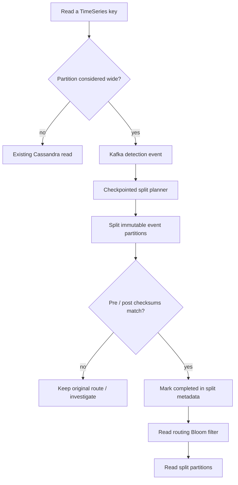

# Netflix — evolving Cassandra partition keys without destabilizing Time Series readers

**Case ID:** `case.netflix.dynamic-timeseries-partition-splits` | **M9:** E16-04 #117 | **Period:** Netflix first-party article **2026-06-03** | **Status:** evidence-backed draft  
**Primary:** N12, Rajiv Shringi, Kaidan Fullerton, Oleksii Tkachuk and Kartik Sathyanarayanan, [Dynamic Repartitioning for Time Series Workloads](https://medium.com/netflix-techblog/dynamically-splitting-wide-partitions-in-cassandra-for-time-series-workloads-0eded064f456), sections "Impact of Wide Partitions", "Solution 1: Time Slice Re-Partitioning", "Solution 2: Dynamic Partitioning per ID", "Detection" through "Fallbacks".

## From a correct provisioning estimate to an incorrect future

The Netflix TimeSeries abstraction operated over Cassandra 4.x with time slices, time buckets and event buckets. Its initial provisioning pipeline used workload estimates and simulations to derive partitioning. This is sensible until traffic distribution, retention or individual high-volume IDs deviate from the estimate. **Wide partitions** then magnify read cost, garbage collection, queues and worst-case query latency; splitting every table aggressively also causes read amplification. In some datasets the article reports average queries in single-digit milliseconds yet outlier partitions taking seconds. These measurements are source-reported and dataset-specific. [N12: "Impact of Wide Partitions", "Picking the Partitioning Strategy"].

## Two different levers for different skew shapes

1. **Future-slice reconfiguration:** a background worker inspects Cassandra partition histograms, estimates density and adjusts the *next time slices'* bucketing. This avoids expensive rewriting of already written historical data and works when many IDs share the same excessive or insufficient partition size. The Netflix example describes a configurable density often around **2–10 MiB**, not a universal Cassandra target.
2. **Per-ID asynchronous split:** for a few anomalously wide IDs, detect high read byte counts and emit events. Plan/split in the background, focusing initially on **immutable partitions** to simplify ordering and correctness. Persist checkpoints and metadata state. Verify pre- and post-split checksums, mark completion only after matching, and update read routing (including Bloom-filter lookup) to split physical partitions. [N12: "Detection", "Immutability", "Checkpointing", "Validating Splits", "Serving Reads"].

**Text alternative:** hot-key reads emit asynchronous split detections. A checkpointed planner splits immutable partitions and validates checksums before updating metadata; readers switch only after a completed, valid split. The original remains the safety path while a split is not proven correct.

## Safety and trade-off analysis

A split must preserve original event ordering, sort semantics and query completeness. Checksum equality is necessary but not a complete proof if the checksum definition omits user-visible metadata. The article describes checkpointing to restart partial planning, caps on the number of event buckets to control read amplification, routing with Bloom filters, and fallback options. A new system should additionally define data-retention races, schema evolution and observability, marking these as Tycho's recommended tests rather than attributed Netflix features.

| Alternative | When it fits | Failure boundary |
|---|---|---|
| Scale all Cassandra nodes | Broad, sustained demand increase | Costly if only a handful of hot IDs |
| Change future time-slice width | Most IDs under/over partitioned | Cannot repair already immutable huge partitions |
| Per-ID split with shadow validation | Few extreme hot IDs, stable older data | Metadata/routing complexity, checksum and ordering correctness |
| Partial results | Latency prioritized over full result set | Product contract must permit missing events |
| Block abusive IDs | Invalid/test/spam hot keys | Unacceptable for valid critical customer IDs |

## Operational checks and unknowns

Compare p99 by partition-size percentile, read queue depth, retries/timeouts, metadata cache hit behavior, storage read amplification and cost, all by dataset, not only fleet means. Guard cutover by consistent checksum and an explicit routing-state transition. The primary source does not provide source code SHA for every stage or a controlled experiment against an equivalent non-Cassandra store; do not present it as proof that Cassandra 4.x always beats alternatives.

**Transfer:** partitioning is a continuously revisited architecture decision, not a one-time key design exercise. Maintain a topology/data correctness contract while allowing physical repartitioning. **Review:** pending #121 and E16-01 claim admission.
