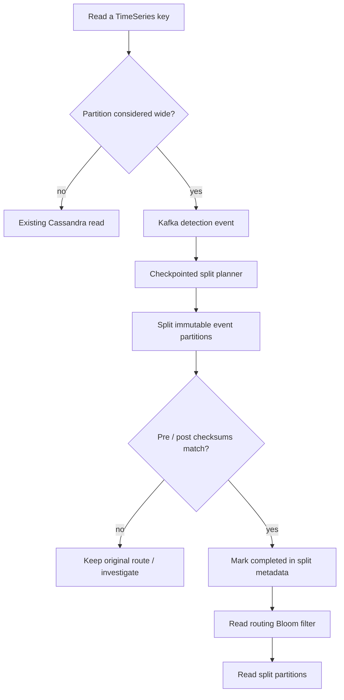

# Netflix — evolving Cassandra partition keys without destabilizing Time Series readers

**Case ID:** `case.netflix.dynamic-timeseries-partition-splits` | **M9:** E16-04 #117 | **Period:** Netflix first-party article **2026-06-03** | **Status:** evidence-backed draft  
**Primary:** src.m9-n12, Rajiv Shringi, Kaidan Fullerton, Oleksii Tkachuk and Kartik Sathyanarayanan, [Dynamic Repartitioning for Time Series Workloads](https://medium.com/netflix-techblog/dynamically-splitting-wide-partitions-in-cassandra-for-time-series-workloads-0eded064f456), sections "Impact of Wide Partitions", "Solution 1: Time Slice Re-Partitioning", "Solution 2: Dynamic Partitioning per ID", "Detection" through "Fallbacks".

## From a correct provisioning estimate to an incorrect future

The Netflix TimeSeries abstraction operated over Cassandra 4.x with time slices, time buckets and event buckets. Its initial provisioning pipeline used workload estimates and simulations to derive partitioning. This is sensible until traffic distribution, retention or individual high-volume IDs deviate from the estimate. **Wide partitions** then magnify read cost, garbage collection, queues and worst-case query latency; splitting every table aggressively also causes read amplification. In some datasets the article reports average queries in single-digit milliseconds yet outlier partitions taking seconds. These measurements are source-reported and dataset-specific. [src.m9-n12: "Impact of Wide Partitions", "Picking the Partitioning Strategy"].

## Two different levers for different skew shapes

1. **Future-slice reconfiguration:** a background worker inspects Cassandra partition histograms, estimates density and adjusts the *next time slices'* bucketing. This avoids expensive rewriting of already written historical data and works when many IDs share the same excessive or insufficient partition size. The Netflix example describes a configurable density often around **2–10 MiB**, not a universal Cassandra target.
2. **Per-ID asynchronous split:** for a few anomalously wide IDs, detect high read byte counts and emit events. Plan/split in the background, focusing initially on **immutable partitions** to simplify ordering and correctness. Persist checkpoints and metadata state. Verify pre- and post-split checksums, mark completion only after matching, and update read routing (including Bloom-filter lookup) to split physical partitions. [src.m9-n12: "Detection", "Immutability", "Checkpointing", "Validating Splits", "Serving Reads"].

**Text alternative:** hot-key reads emit asynchronous split detections. A checkpointed planner splits immutable partitions and validates checksums before updating metadata; readers switch only after a completed, valid split. The original remains the safety path while a split is not proven correct.

## Safety and trade-off analysis

A split must preserve original event ordering, sort semantics and query completeness. Checksum equality is necessary but not a complete proof if the checksum definition omits user-visible metadata. The article describes checkpointing to restart partial planning, caps on the number of event buckets to control read amplification, routing with Bloom filters, and fallback options. A new system should additionally define data-retention races, schema evolution and observability, marking these as Tycho's recommended tests rather than attributed Netflix features.

| Alternative | When it fits | Failure boundary |
|---|---|---|
| Scale all Cassandra nodes | Broad, sustained demand increase | Costly if only a handful of hot IDs |
| Change future time-slice width | Most IDs under/over partitioned | Cannot repair already immutable huge partitions |
| Per-ID split with shadow validation | Few extreme hot IDs, stable older data | Metadata/routing complexity, checksum and ordering correctness |
| Partial results | Latency prioritized over full result set | Product contract must permit missing events |
| Block abusive IDs | Invalid/test/spam hot keys | Unacceptable for valid critical customer IDs |

## Why over-partitioning and wide partitions can both harm the same system

The [June 3, 2026 first-party report](https://medium.com/netflix-techblog/dynamically-splitting-wide-partitions-in-cassandra-for-time-series-workloads-0eded064f456) (src.m9-n12, **Picking the Partitioning Strategy**, **The Problem with the Current Approach**) says TimeSeries provisioning used workload inputs plus **Monte Carlo simulations** to choose time slices and buckets. That approach assumes the future distribution resembles the input estimates. Actual datasets can be very different months later, or a small number of valid IDs can receive disproportionate traffic.

Both extremes matter. An oversized partition may take **seconds** to read, creating retries and queueing. An **over-partitioned** dataset whose generated time buckets contain **under 10 KB** forces a read to fan out across many small partitions: the report describes an illustrative change from **60-second to 604,800-second** time buckets for future time slices after observing histogram percentiles. Neither “always smaller partitions” nor “always bigger partitions” is a rational policy. The article mentions an often-configured target density around **2–10 MiB**, explicitly dependent on workload.

## Distinct runtime algorithms, not one global rewrite

| Mechanism observed in src.m9-n12 | When it acts | What it changes | What it cannot fix |
|---|---|---|---|
| Dataset-level Time Slice worker | Background inspection of histogram percentiles | Partition strategy for **future** time slices | Historical wide partitions already written |
| Per-ID hot-partition detector | **Read path** bytes exceed configured threshold | Emits Kafka event with time slice, ID, existing buckets, immutability and version | Current request may already be slow; per-read detection does not prevent first spike |
| Async planner + split strategy | Full read of source partition, checkpoints in `wide_row` metadata | Adds event buckets while preserving total sort order; caps split fan-out | Mutable partitions remain a harder future scope |
| Validation gate | Before and after split | Pre/post checksums must match before state becomes completed | Wrong checksum scope or identical old/new semantic error |
| Read-path router | After completed split metadata published | Bloom-filter candidate test and metadata read-through cache select parallel partition reads | Filter false positives, stale metadata or consistency bugs still need fallback |
| Original-data fallback | Source physical partition retained | Re-read original when split routing/data unavailable | Costs extra storage; cannot erase errors already exposed by an unsafe cutover |

**Source anchors:** src.m9-n12, **Solution 1**, **Detection**, **Immutability**, **Checkpointing**, **Splitting**, **Validating Splits**, **Serving Reads**, **Fallbacks**. The high-level policy is reported; the table is a Tycho synthesis and not a copy of provider diagrams.

## Shadow read parity and additional safeguards

Netflix deliberately restricted the first implementation to **immutable old partitions**, reducing the likelihood that concurrent writes would invalidate the split. The retained original acts as the safe fallback. Beyond simple pre/post checksums, the company used an **offline Data Bridge/Spark comparison** and a **phased shadow read comparison of bytes served** by old and new paths before switching. These are complementary oracles: a checksum captures a chosen projection while byte-for-byte shadow reads can expose differences in the actual query encoding, ordering or pagination.

The article reports Bloom-filter lookup usually taking **single-digit microseconds or less**, but that cost depends on the selected namespace, partition-key population and server memory. A positive Bloom result merely triggers a metadata lookup; it must not be equated with proof that a split exists. Query consistency and fallback require authoritative completed state, not a probabilistic filter as source of truth.

**Read correctness matters even if new metadata is momentarily stale:** with old partitions retained, the system can use the original route while a split is incomplete or absent. Tycho would require checks for filter false positives, delayed cache refresh, split-state replay, TTL/reten­tion race and source/target data expiry; these are **synthetic test proposals**, not a claim that Netflix executed every failure test.

## Reported gains, and one extreme exception

The company reports that the **average latency for affected wide-partition reads** fell from **seconds** to **low double-digit milliseconds**, while their tail latency fell from several seconds to approximately **200 ms or less**, with fewer timeouts. This is **a scoped before/after for selected wide partitions**, not the full TimeSeries read-p99 or an independent A/B study. The published charts are not reproduced and do not supply enough population/time-window metadata here to build universal confidence intervals.

Crucially, the same article includes an extreme **500 MB+** partition read returning paginated data while still taking roughly **41 seconds** in its example. That is a correct and useful negative boundary: partitioning improved availability and common tails but did **not** guarantee a millisecond SLO for every pathological dataset. The reported future work includes **splitting mutable partitions** and reprocessing previously failed splits; neither should be marked completed as of June 2026. [src.m9-n12, **Results**, **Conclusion**].

## Architectural selection and migration falsification

For another temporal datastore, profile partition-byte percentiles **and** read fan-out before choosing a fix. If most IDs share a density problem, adjust new time slices and avoid rewriting old data. If only a small set of legitimate keys are extremely wide, use a checkpointed per-ID split with immutable-source safeguards and explicit query-equivalence checks. If partial results are acceptable under the external API, a bounded-latency partial-return strategy is another option; it is unacceptable when completeness is mandatory. Blocking spam/test IDs must never silently become blocking valid high-volume customers.

**Tycho rollback/stop gates:** do not activate new routing while checksum/byte-shadow parity fails; refuse partial results for complete-history contracts; fall back if metadata is stale, filter memory exceeds budget, split introduces excessive query fan-out, or retention makes old/new incomparable. Retain the original until recovery and expiry are explicitly resolved. These criteria are analytical, not a disclosed Netflix full runbook.

## Repartitioning is two different problems, not one universal background rewrite

The [June 2026 first-party report](https://netflixtechblog.com/dynamically-splitting-wide-partitions-in-cassandra-for-time-series-workloads-0eded064f456) (src.m9-n12) identifies one failure mode from **bad initial forecasts** and another from a **few exceptional event IDs**. A table-wide future time-slice adjustment addresses the first; rewriting all historical data to solve it would introduce unnecessary risk. The per-ID asynchronous pipeline addresses the second while leaving ordinary IDs untouched. The article explicitly discusses a third choice, a **partial return** after an SLO threshold, but only where the client contract accepts incomplete results. That is not equivalent to a complete read with lower latency.

### Source-reported split lifecycle and exact read ownership

| Phase and source anchor | Publisher-supported behavior | Guard condition for consumers |
|---|---|---|
| **Detection** | Bytes-read threshold emits a Kafka event for one ID/time bucket | One expensive read may precede detection; it is not a preventive write-side limiter |
| **Planning** | Read full original partition, compute a strategy and checkpoint progress | Restart does not imply the first partial plan was complete |
| **Split** | Use additional event buckets, cap bucket count for ultra-wide rows and preserve sort order | Faster per-partition reads can increase read fan-out |
| **Validate** | Compare old/new partition checksums before marking the split completed | The checksum definition and reference snapshot must match |
| **Route** | Cache completed split identities in Bloom filters; on a hit consult the split metadata then merge parallel reads | Bloom positives need metadata resolution; a Bloom lookup is not proof the split exists |
| **Fallback** | Retain the original wide partition to support old-path reads | Extra storage is intentional; old data cannot be deleted prematurely |
| **Additional confidence** | Offline Data Bridge comparison and staged shadow byte comparisons | A transition to live reads requires more than the checksum predicate |

**Primary locations:** src.m9-n12, **Detection** through **Results**. Split-reader correctness must address old/new keys, ordered pagination, TTL and source value representation. The source explicitly calls **mutable-partition splitting** and retries of failed splits further work; neither is accepted as already deployed at June 2026.

## Outcome and what the published examples cannot show

src.m9-n12 reports wide-partition average reads moving from **seconds to low double-digit milliseconds**, tails declining from **several seconds to about 200 ms or better**, and fewer timeouts. It also shows an exceptional **500 MB-plus** paginated partition still requiring roughly **41 seconds** for one request in the published example. These can coexist: reducing most affected request latency is not proof that the worst giant partition becomes cheap, nor a guarantee for every data distribution. Numerical figures are **first-party observational**, not independently replayed traffic or published confidence intervals.

## Separate physical state from logical query identity

For an unrelated time-series application, Tycho recommends that a logical query use stable `dataset + entity + interval + ordering + page token` semantics. A routing sidecar may resolve that identity to one ordinary partition or multiple completed split partitions, but physical routing must remain an implementation detail. A page token produced before split completion must either remain interpretable or cause an explicit resumable result; silently continuing in a changed ordering could duplicate or skip events.

A safe synthetic transition uses these controls: first record pre-split source manifest and row identity; second create a unique split plan version with idempotent event handling; third execute a checkpointed copy using immutable intervals; fourth reconcile **content, order and metadata**, not only byte counts; fifth shadow serve both paths to compare answers under real predicates; sixth enable the new route for selected cohorts; seventh preserve a fallback until the old representation may be retired safely. This is **Tycho analysis**, not Netflix's undisclosed end-to-end runbook.

**Adversarial tests:** duplicate Kafka detection; planner crash before checkpoint; partial write after checkpoint; checksum collision or excluded metadata; Bloom false positive; missing split metadata; stale read-cache state; a retention job dropping source data; changing consistency levels; pagination across a split; and a previously immutable partition receiving a late write. If any case cannot produce a consistent fallback, return **insufficient evidence** and do not switch the read path.

## Architecture selection and reversal

A **future time-slice strategy** is cheaper when a broad dataset is systematically under- or over-partitioned. **Per-ID splitting** is defensible when rare hot IDs dominate the tail and the platform can maintain split metadata and old-path fallbacks. **Scale-out or throttling** can be simpler if performance pressure is short-lived or source semantics allow partial results. Neither branch justifies a new Tycho product knowledge graph: the metadata here is the historical datastore's routing data, not architecture-document relationship infrastructure.

## Operational checks and unknowns

Compare p99 by partition-size percentile, read queue depth, retries/timeouts, metadata cache hit behavior, storage read amplification and cost, all by dataset, not only fleet means. Guard cutover by consistent checksum and an explicit routing-state transition. The primary source does not provide source code SHA for every stage or a controlled experiment against an equivalent non-Cassandra store; do not present it as proof that Cassandra 4.x always beats alternatives.

**Transfer:** partitioning is a continuously revisited architecture decision, not a one-time key design exercise. Maintain a topology/data correctness contract while allowing physical repartitioning. **Review:** pending #121 and E16-01 claim admission.
