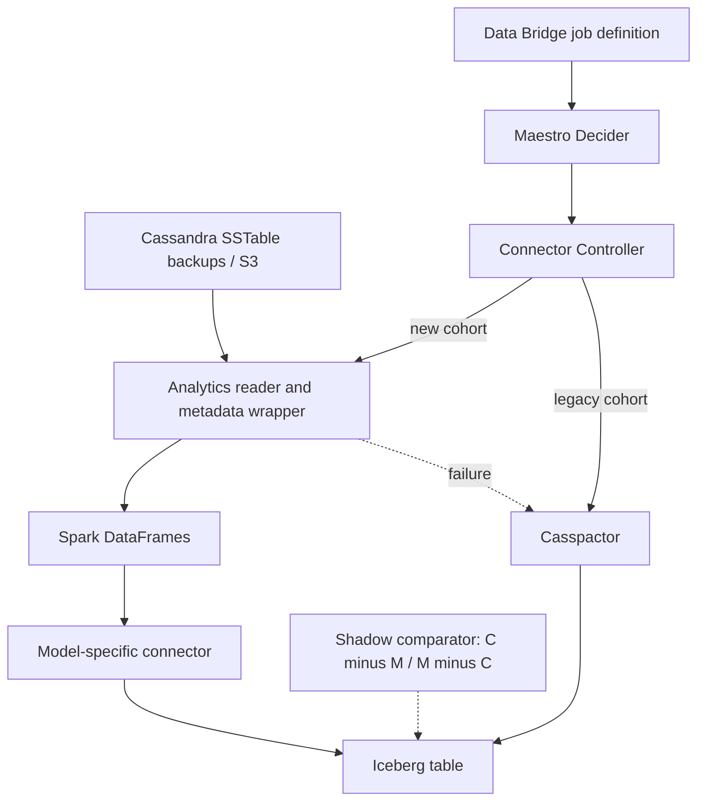

# Netflix — Casspactor to Cassandra Analytics: migrate data pipelines with proof and fallback

**Case ID:** `case.netflix.casspactor-to-analytics` | **M9:** E16-04 #117 | **Status:** technically detailed evidence-backed draft, reviewer pending  
**Period:** [Netflix TechBlog, 2026-05-18](https://netflixtechblog.com/the-evolution-of-cassandra-data-movement-at-netflix-6e13329c80a1), src.m9-n11, Guil Pires, Jennifer Prince, Jose Camacho, Ken Kurzweil, Phanindra Chunduru. **Source sections:** "Fragile Metadata Dependencies", "The New Stack", "Journey Towards a Safe Migration", "Pillar 1: Validation", "Pillar 2: Visibility", "Pillar 3: Safety", "Leveraging Abstraction: The Decider Pattern".

## Legacy fault model

Netflix's Casspactor connector read Cassandra backups and moved them to Iceberg, but constructed backup identity from several metadata systems. Those independent views could diverge from actual S3 backups. A regional cluster node replacement and snapshot coordination could invalidate a job. The connector was also an overly rigid engine for multiple higher-level Cassandra abstractions: wide/skewed partitions caused OOM, extra intermediate Iceberg tables consumed storage, and abstraction-specific data reconstruction was an afterthought. This was a combination of **data correctness risk, skew resilience and leaky platform abstraction**, not simply 'Spark is faster'. [src.m9-n11: "Fragile Metadata Dependencies", "Every Connector Inherited Casspactor's Limitations"].

## New stack and where correctness lives

The replacement built a common reading foundation using Cassandra Analytics and S3 backup metadata as the authoritative representation of source schema/topology/data at a point in time. Spark DataFrames supply a reusable intermediate *execution interface* to specialized transformations for Key Value, Time Series and other Cassandra data models. No claim that all data was transacted atomically across Cassandra and Iceberg is made here. [src.m9-n11: "The New Stack: A Layered Architecture"].

**Text alternative:** user jobs retain their stable definition; a control plane decides which connector executes. A new, model-aware path reads backup data directly; an old connector remains available for fallback. Independently executed shadow jobs compare output sets and expose disagreement before cutover. Diagram is a simplified original explanation, not a copy of Netflix's figure.

## Evidence-based migration choreography

1. **Contract hold:** downstream consumers keep the same Data Bridge parameters and Iceberg table/schema/output semantics; only platform implementation changes.
2. **Shadow mode:** run legacy and replacement connectors on comparable production backup inputs without redirecting customer reads. Treat the legacy table as C and the candidate table as M.
3. **Two-sided set difference:** check both C−M (missing rows) and M−C (extra rows); both counts must be zero for equivalence under the comparison rule. The team investigated differences in timestamps, TTL, consistency levels, backup choice and business logic rather than counting matching row totals as sufficient.
4. **Visibility:** dashboards cover migrated/unmigrated cohorts, runtime, cost, failed dependencies and fallback alerts.
5. **Decider:** Maestro workflow calls Connector Controller to choose legacy vs new by cohort and job attributes; if the replacement fails, a conditional path executes Casspactor, preserving workflow interface. This is the article's reported mechanism, not a generic recommendation invented here.
6. **Retirement gate:** source reports the completed replacement and new connector factory; no exact cutover threshold, SQL reconciliation query or release commit is provided by this article.

## Quantitative / negative assertions

| Claim | Type | Limit |
|---|---|---|
| Both set differences must be empty | Source-described validation invariant | Identical semantics must include schema/metadata, not only row count |
| Savings described as 'order of USD millions' | Netflix article qualitative order-of-magnitude self-report | No independently audited net-present-value or per-job breakdown |
| Backups as S3 source-of-truth | Source architecture decision | Revisit manifest completeness, consistency and retention for another system |
| Wide partitions caused old connector OOM | Reported negative condition | Requires reproducing workload skew for any new migration |
| Fallback after new connector failure | Source-described Maestro/Decider behavior | Degradation may be longer runtime; quantify before declaring zero-impact in a new organization |

## What made legacy backup identification brittle

The [May 18, 2026 first-party account](https://netflixtechblog.com/the-evolution-of-cassandra-data-movement-at-netflix-6e13329c80a1) (src.m9-n11, **Casspactor: The Engine We Outgrew**, **Fragile Metadata Dependencies**) reports approximately **1,200 data movements/day** and **3 PB transferred** in the stated legacy operating scale. The post does not provide an independently reproducible distribution of object sizes, exact comparison duration for the 3 PB figure or per-job cost. These numbers are scale context, **not** benchmark targets for another company.

The old Casspactor path combined multiple metadata services to decide which Cassandra backup existed and how to construct it. Because individual services had different update schedules and failure modes, its assembled picture could lag the actual S3 SSTables. A node replacement during scheduled snapshots could make a region's data-movement workflow unavailable because the connector assumed all nodes took snapshots in a region at the same clock second. For a schema/topology change, the composite metadata also made **historical point-in-time reconstruction** impossible. These are concrete correctness and availability defects in the *source snapshot identification*, not just slow Spark execution.

The new Cassandra Analytics Wrapper directly reads the **S3 backup representation plus its associated schema/topology metadata** as one source of truth. Spark DataFrames then expose a normalized execution interface; a connector factory applies model-specific Key Value / Time Series transformations through Java UDFs without unnecessary intermediate Iceberg staging tables. The report describes handling wide partitions by moving mutation compaction to Spark executors to avoid excessive shuffle/driver OOM; it also describes **automatic job sizing**. This does not prove that every possible Cassandra data model is automatically supported or that a backup is transactionally atomic across independent clusters. [src.m9-n11, **The New Stack**].

## Three separate gates on the production data-movement workflow

| Gate | Observed source control | Evidence the gate supplies | Negative test for a different implementation |
|---|---|---|---|
| **Validation** | Shadow legacy Casspactor and candidate Move Data runs on comparable inputs; inspect both row-set differences | Missing rows C−M **and** added rows M−C are surfaced; discrepancies investigated by timestamp, TTL, consistency and backup choice | Same total row count but different IDs, values or TTL; old and new snapshots not aligned |
| **Visibility** | Central progress/runtime/cost dashboards, dependency metrics, fallback and mismatch alerts | Cohort-level view of which jobs migrated and what failed | Quiet failure in backup-metadata APIs or an old connector silently taking over |
| **Safety** | Maestro **Decider** + Connector Controller selects connector per job/cohort/parameters; conditional fallback to Casspactor on candidate failure | Stable user job configuration and recoverable execution when a new connector fails | Candidate fails after partial materialization; old connector retries without cleaning unsafe intermediate output |

The gate names and control-plane components come from src.m9-n11, **Pillar 1**, **Pillar 2**, **Pillar 3**, **Leveraging Abstraction**. The negative-test column is **Tycho's original proposal**; neither the article nor this page claims those injected failures were all run at Netflix.

## Equality is an observable contract, not automatically domain truth

The publisher's goal was exact equality of final Iceberg row content, schema and metadata between the two connector outcomes for a comparable job. That is stronger than counting rows. It is still a **relative parity guarantee**, not independent verification that historical Casspactor semantics were always right. The first-party account specifically records investigations into TTL reference timestamps, consistency levels, backup choice and internal data-model interpretation: an extra row can be caused by a legitimate snapshot/interpretation difference rather than only a defective new connector.

A different implementation needs a **comparison key, snapshot identity, temporal window, schema version and conflict adjudicator**. A user may prefer correcting an old bug over faithfully replicating it, but that is a product decision requiring separately approved output changes, not a hidden migration side effect. Fallback can protect job completion yet may increase execution duration; the report claims downstream users were shielded, but does not publish a fleet-wide fallback rate, true failure probability or canary rollback thresholds.

## Falsifiable adoption conditions

Adopt a layered backup-reader + model-specific transformation approach when metadata from multiple services demonstrably diverge, source snapshots can be consistently identified, and the same processing engine serves materially different data abstractions. Prefer smaller targeted repairs when one existing connector meets all backup, skew and domain-correctness requirements.

**Stop or reverse** when SSTable manifests cannot establish a stable snapshot, old/new comparisons use different TTL/consistency windows, wide-partition execution still OOMs, fallback produces stale customer tables, or the controller cannot guarantee one authoritative publication of a job's final artifact. Track both functional parity and operational fallback, not only new connector runtime. A [related data-authority decision guide](decisions/data-migration-correctness.md) contrasts this immutable/batch style with mutable Stripe subscriptions and streaming Meta ingestion.

## Migration scale, ownership and unmeasured effects

The May 2026 source (src.m9-n11, **Casspactor: The Engine We Outgrew**) reports roughly **1,200 movement jobs a day** and approximately **3 PB transferred** by the old connector. These are the publisher's workload observations, not the volume of one job, the size of the Cassandra fleet or a proven speedup. Existing consumers used Data Bridge job definitions and Iceberg table outputs. Maintaining both interfaces was therefore an explicit compatibility requirement: replacing a connector without changing the way consumers request data and interpret results.

The new read layer combines Cassandra Analytics with backup metadata from object storage. This is a change in the **source of backup truth**, not proof of transactionality across all Cassandra writes and destination Iceberg commits. Abstraction-specific transformations operate over Spark DataFrames; the reported benefits include handling skewed partitions, avoiding repeated intermediate output and supporting historical schema/topology snapshots. The article's **dollar-millions** savings description lacks cost breakdown and is not an independent cost benchmark.

## Four distinct consistency proofs for another platform

A comparable migration must specify more than the set-equality formula, because different data paths can agree on the wrong result:

| Verification dimension | What to compare | Adversarial case |
|---|---|---|
| **Backup input identity** | Manifest revision, SSTable coverage, schema/topology and reference time | Connector A reads a later backup after topology change |
| **Logical row identity** | Both old-minus-new and new-minus-old rows, including schema-normalized keys | Equal row counts hide duplicates and omissions |
| **Meaning over time** | TTL reference instant, tombstones, expiring rows, ordering and consistency rule | Same physical input interpreted at different expiration times |
| **Consumer contract** | Iceberg table schema, data types, partition layout and downstream query outputs | Row equality passes while nullability or type mapping breaks clients |

src.m9-n11 specifically reports investigating differences involving TTL reference times, consistency levels, backup choice and logic. The table's adversarial tests and normalization procedure are **original Tycho guidance**, not an assertion that the authors ran every test listed.

## Fallback is not the same as zero failure

The reported Maestro Decider selects the connector by cohort and execution parameters, with a fallback to Casspactor after a new-connector failure. This makes a connector change locally reversible while the old path remains deployable. It **does not** prove bounded total job runtime, successful completion during an object-storage outage affecting both paths, or safe retirement without a replacement fallback.

For a hypothetical platform, track: primary attempt count, fallback count and cause, job completion by cohort, artifact-quality diffs, p95/p99 job duration, processing cost and the last safe rollback date. Inject malformed backup metadata, a wide partition, partial Spark executor failure, stale snapshot and the case where both connectors produce different but nonempty outputs. Escalate unresolved mismatches; do not automatically choose legacy merely because the old implementation is familiar.

## Legacy removal gate and oppositional decision

A **smaller alternative** is to strengthen Casspactor's backup manifest selection, add a dedicated skew handler and retain existing interfaces when the connector family is narrow. A **layered replacement** becomes compelling only when multiple data models need different transforms and the shared old engine repeatedly fails correctness/scale boundaries. The choice should follow observable source manifest failures, intermediate-storage cost and repeatable comparison results rather than the company label.

Retire the old connector only after every active job cohort has a supported replacement and the recovery path is tested *without* that old connector. In src.m9-n11, current and future capability statements are distinct: new Key Value and Time Series connectors are reported; a bulk Cassandra-ingest direction is **future work**. Independent reviewer #121 still must verify the dated claims; neither this page nor its original analytical tests certify the migration's universal correctness.

## Decision transfer and contraindications

The crucial design is **stable customer contract + shadow evidence + configurable fallback**, not a compulsory adoption of Spark. If legacy output is demonstrably incorrect, equality with old output can replicate bugs; discrepancies must be adjudicated against independent semantics and business invariants before accepting either side. If data is mutable during snapshot capture, prove comparable transaction/snapshot boundaries; otherwise C−M is noisy rather than diagnostic.

**Tycho's synthetic acceptance proposal** is to require consistency under chosen schema/version/time window, partition-skew representative tests, idempotent reruns, restart checkpoints, backup-manifest integrity, and per-cohort canaries. These are external recommendations, not claims about Netflix's exact control dashboard.

**Unknowns:** independently measured migration cost, complete job-level throughput distribution, company-private code revisions and detailed access-control rules. [Original src.m9-n11](https://netflixtechblog.com/the-evolution-of-cassandra-data-movement-at-netflix-6e13329c80a1). **Review:** pending #121.
