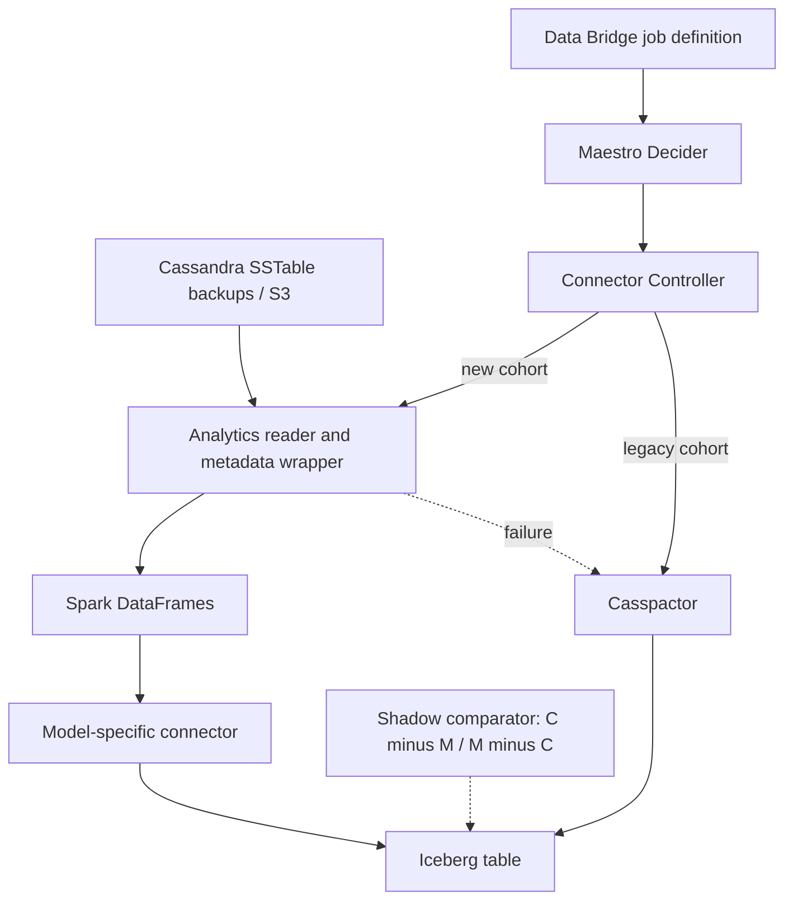

# Netflix — Casspactor to Cassandra Analytics: migrate data pipelines with proof and fallback

**Case ID:** `case.netflix.casspactor-to-analytics` | **M9:** E16-04 #117 | **Status:** technically detailed evidence-backed draft, reviewer pending  
**Period:** [Netflix TechBlog, 2026-05-18](https://netflixtechblog.com/the-evolution-of-cassandra-data-movement-at-netflix-6e13329c80a1), N11, Guil Pires, Jennifer Prince, Jose Camacho, Ken Kurzweil, Phanindra Chunduru. **Source sections:** "Fragile Metadata Dependencies", "The New Stack", "Journey Towards a Safe Migration", "Pillar 1: Validation", "Pillar 2: Visibility", "Pillar 3: Safety", "Leveraging Abstraction: The Decider Pattern".

## Legacy fault model

Netflix's Casspactor connector read Cassandra backups and moved them to Iceberg, but constructed backup identity from several metadata systems. Those independent views could diverge from actual S3 backups. A regional cluster node replacement and snapshot coordination could invalidate a job. The connector was also an overly rigid engine for multiple higher-level Cassandra abstractions: wide/skewed partitions caused OOM, extra intermediate Iceberg tables consumed storage, and abstraction-specific data reconstruction was an afterthought. This was a combination of **data correctness risk, skew resilience and leaky platform abstraction**, not simply 'Spark is faster'. [N11: "Fragile Metadata Dependencies", "Every Connector Inherited Casspactor's Limitations"].

## New stack and where correctness lives

The replacement built a common reading foundation using Cassandra Analytics and S3 backup metadata as the authoritative representation of source schema/topology/data at a point in time. Spark DataFrames supply a reusable intermediate *execution interface* to specialized transformations for Key Value, Time Series and other Cassandra data models. No claim that all data was transacted atomically across Cassandra and Iceberg is made here. [N11: "The New Stack: A Layered Architecture"].

**Text alternative:** user jobs retain their stable definition; a control plane decides which connector executes. A new, model-aware path reads backup data directly; an old connector remains available for fallback. Independently executed shadow jobs compare output sets and expose disagreement before cutover. Diagram is a simplified original explanation, not a copy of Netflix's figure.

## Evidence-based migration choreography

1. **Contract hold:** downstream consumers keep the same Data Bridge parameters and Iceberg table/schema/output semantics; only platform implementation changes.
2. **Shadow mode:** run legacy and replacement connectors on comparable production backup inputs without redirecting customer reads. Treat the legacy table as C and the candidate table as M.
3. **Two-sided set difference:** check both C−M (missing rows) and M−C (extra rows); both counts must be zero for equivalence under the comparison rule. The team investigated differences in timestamps, TTL, consistency levels, backup choice and business logic rather than counting matching row totals as sufficient.
4. **Visibility:** dashboards cover migrated/unmigrated cohorts, runtime, cost, failed dependencies and fallback alerts.
5. **Decider:** Maestro workflow calls Connector Controller to choose legacy vs new by cohort and job attributes; if the replacement fails, a conditional path executes Casspactor, preserving workflow interface. This is the article's reported mechanism, not a generic recommendation invented here.
6. **Retirement gate:** source reports the completed replacement and new connector factory; no exact cutover threshold, SQL reconciliation query or release commit is provided by this article.

## Quantitative / negative assertions

| Claim | Type | Limit |
|---|---|---|
| Both set differences must be empty | Source-described validation invariant | Identical semantics must include schema/metadata, not only row count |
| Savings described as 'order of USD millions' | Netflix article qualitative order-of-magnitude self-report | No independently audited net-present-value or per-job breakdown |
| Backups as S3 source-of-truth | Source architecture decision | Revisit manifest completeness, consistency and retention for another system |
| Wide partitions caused old connector OOM | Reported negative condition | Requires reproducing workload skew for any new migration |
| Fallback after new connector failure | Source-described Maestro/Decider behavior | Degradation may be longer runtime; quantify before declaring zero-impact in a new organization |

## Decision transfer and contraindications

The crucial design is **stable customer contract + shadow evidence + configurable fallback**, not a compulsory adoption of Spark. If legacy output is demonstrably incorrect, equality with old output can replicate bugs; discrepancies must be adjudicated against independent semantics and business invariants before accepting either side. If data is mutable during snapshot capture, prove comparable transaction/snapshot boundaries; otherwise C−M is noisy rather than diagnostic.

**Tycho's synthetic acceptance proposal** is to require consistency under chosen schema/version/time window, partition-skew representative tests, idempotent reruns, restart checkpoints, backup-manifest integrity, and per-cohort canaries. These are external recommendations, not claims about Netflix's exact control dashboard.

**Unknowns:** independently measured migration cost, complete job-level throughput distribution, company-private code revisions and detailed access-control rules. [Original N11](https://netflixtechblog.com/the-evolution-of-cassandra-data-movement-at-netflix-6e13329c80a1). **Review:** pending #121.
