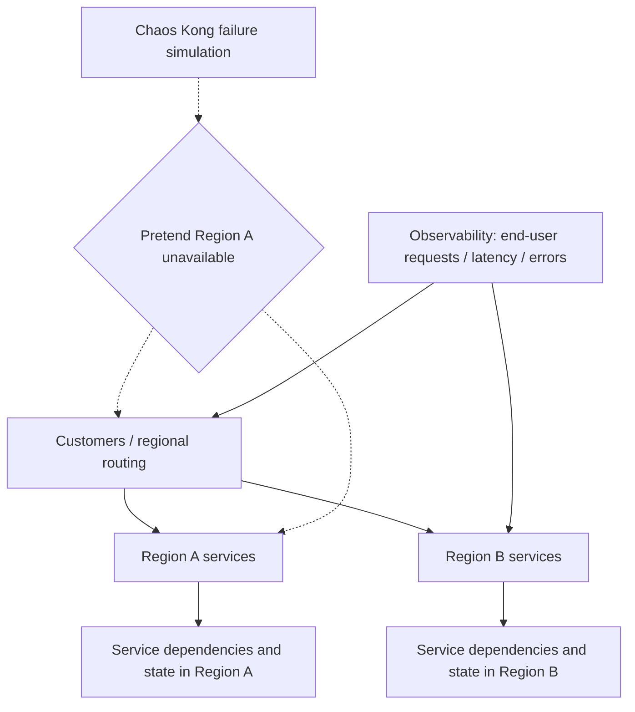

# Netflix — Chaos Kong: testing application-level regional failure, not shutting down AWS

**Case ID:** `case.netflix.chaos-kong-regional-failover` | **M9:** E16-04 #117 | **Status:** historical first-party evidence draft; independent review pending.  
**Source:** N15, Ali Basiri, Lorin Hochstein, Abhijit Thosar, Casey Rosenthal (Netflix Chaos Team), [Chaos Engineering Upgraded](https://medium.com/netflix-techblog/chaos-engineering-upgraded-878d341f15fa), **2015-09-25**, sections "Chaos Kong", incident context and original footnote. Secondary provenance checkpoint: [Wave 06 Netflix historical platform source ledger](../../sources/REAL_WORLD_CASES_NETFLIX_PLATFORM_HISTORY_LEDGER.md). Original publisher URL may intermittently time out; this case does not mirror its content or pictures.

## Pressure: a green single-service test can miss regional dependencies

Netflix's multi-zone and multi-region architecture created a real question: whether customer playback and the supporting control plane would continue when infrastructure serving a whole AWS region became unavailable. Terminating one EC2 instance or availability-zone component exercises a different dependency graph from losing an entire region: DNS, discovery, external managed services, authentication, control-plane writes, caching and replay behavior may fail together.

The company distinguished **Chaos Monkey**, historically terminating an instance, from **Chaos Kong**, exercising a *regional outage simulation* at the application/traffic control level. **Crucial negative fact:** the Netflix article's footnote makes clear that Chaos Kong does **not actually switch off a region or all AWS infrastructure**. The resulting observation applies to the simulated failure envelope, not every infrastructure failure mode.

## Architecture states and test boundary

**Text alternative:** the experiment makes one region behave as though it were unavailable for the chosen service/routing test while observers monitor whether requests move to another region and users remain served. This is an original conceptual sketch, **not** a copy of Netflix's diagram or claim that Netflix had only two regions.

## Historical result versus experiment design

The first-party 2015 discussion describes a regional disruption on **2015-09-20**, when AWS DynamoDB in US-EAST-1 had service issues. Netflix reports it had practiced with regional failure simulations and consequently avoided a major sustained customer-visible outage apart from a brief availability dip. The existence of the simulation and company incident narrative is independently readable historical evidence, **not a scientifically controlled before/after reliability study**. The article does not demonstrate that the same failover would succeed for all later Netflix systems or different AWS failure modes.

| Decision or observation | Evidence boundary | What must not be inferred |
|---|---|---|
| A single-instance failure game and a region simulation test different scopes | N15, "Chaos Kong" | That every Netflix service participated in identical tests |
| Chaos Kong simulates region loss rather than physically destroying AWS region resources | N15, explanatory footnote | That real provider-side metadata/storage/control-plane failures were necessarily reproduced |
| Engineers linked the preparation to handling the 2015-09-20 DynamoDB disruption | N15 incident section | Causal attribution of all improvements or guaranteed future availability |
| End-user resilience rather than only green EC2 status is the metric | N15 test intent | Quantified worldwide SLO or independent uptime audit |

## Bounded legacy-to-target migration design for another organization

Suppose a legacy platform runs primarily in Region A and maintains secondary replicated read state in Region B. Begin by mapping consistency and session guarantees, read/write regional authority and system services that cannot survive Region A loss. Adopt multi-region topology *only when* business recovery objectives, data loss tolerance and staffing justify it; otherwise improved backups and single-region multi-AZ failover may be superior.

A safe, independently designed adoption sequence is:

1. Define RTO/RPO targets, read-after-write semantics and failure dependencies. Decide which data may legitimately be stale.
2. Observe a synthetic region-unavailable event in staging, beginning with read-only traffic routing while protecting write authority.
3. Verify identity/signing, DNS/cache TTL, load balancer target changes, cross-region service discovery and data-source availability.
4. Add chaos tests in production only with isolation bounds, a kill switch, preplanned rollback and incident commander; never assume a test cannot itself cause outage.
5. Measure *user outcomes* (successful playable sessions/orders, p99, retry storms), not just resource counts.
6. Test failures outside the original simulation envelope—cross-region networking, correlated credential outage, dependency API quota, data corruption and replay races.

These six steps are **Tycho's synthetic transfer controls**, not a report of Netflix's exact operational runbook.

## Alternatives, counterexamples, and failure criteria

| Choice | Correct when | Risk |
|---|---|---|
| Multi-AZ inside one region | RTO/RPO are modest and whole-region event is tolerable | Still subject to region-wide services |
| Multi-region active/passive | Regional recovery required, moderate operational complexity | Cold failover, promotion correctness and staleness |
| Multi-region active/active | Need regional continuity and workloads permit split ownership | Cross-region consistency, split brain, billing/storage expense |
| Chaos Kong-like simulation | Want to verify selected failover routing/dependencies | Does **not** reproduce physically all provider failure modes |

**Decision reversal:** When failover shows dependent services retaining stale primary endpoints or a secondary database lacking current writes, do not declare production multi-region readiness; restore normal routing and close the gap first.

**Unknowns:** exact fault-injection API, full run manifest, source-code revision, all regions participating, per-service latency/recovery distributions and independent incident analysis. Case remains **draft** until #121 technical review; N15 source is admitted only as a dated narrative, not a universal availability benchmark.