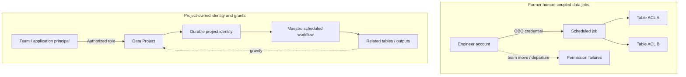

# Netflix Data Projects — From Human-Tied Credentials to Durable Data-Workload Identity

**Case ID:** `case.netflix.durable-data-project-identity` · **Issue:** E16-05 #118 · **Status:** evidence-bounded draft; independent acceptance pending.  
**Primary:** src.m9-n17, Amer Hesson, Marcelo Mayworm, James Mulcahy and Brittany Truong, [Netflix TechBlog, 2026-05-11](https://netflixtechblog.com/data-projects-managing-data-assets-at-netflix-scale-7ca25888591e). Exact source sections: **Problem 1**, **Problem 2**, **Enter Data Projects**, **Grants and Roles**, **The Identity Umbrella**, **Securing Data Workflows**, **Data Projects: Durable Identity**, **Success Stories**, **Using Data Projects**, **What's Next**. Public article and original paraphrase only; no private Netflix IAM implementation or screenshots imported.

## Legacy security and reliability failure

Netflix's data warehouse had **millions of tables** and **tens of thousands of scheduled workloads**, according to the May 2026 report. Access management was primarily per-asset, and many asynchronous jobs ran under their human creator's identity. An organization reallocation required rewriting many ACLs, leading either to support backlogs or overly broad grants. A scheduled job could also fail when the person whose delegated identity it used changed teams or left; replacing that person with another operator frequently revealed missing permissions in a chain of failures. This was simultaneously a **least-privilege, ownership and service-continuity** defect, not just inconvenient login. [src.m9-n17, 'The Problem', 'Problem 1', 'Problem 2'].

## A different security principal, not a longer-lived human token

Netflix introduced *Data Projects*: logical containers grouping related assets (tables, jobs, secrets) and a project-owned, durable identity which workloads may assume. Grants to people, groups, applications and CI jobs are assigned project-level roles; an optional IAM role may be exchanged using the platform identity for AWS tasks. The workflow manager can mint identity for authorized scheduled work rather than borrowing a departed engineer's credentials. Under the feature called **gravity**, new assets created by a project workload are attached automatically to the project. [src.m9-n17, 'Enter Data Projects', 'Grants and Roles', 'The Identity Umbrella', 'Securing Data Workflows'].

**Text alternative:** before, scheduled work borrowed a particular human's identity and needed per-table grants; staff changes could break the job. After, the executing identity belongs to a project, while membership and privileges are managed separately. Newly generated assets are associated with project ownership. The diagram is original and conceptual, not a replica of Netflix's access-control diagrams.

## Actual security and rollout boundaries

| Part | Company-reported design | What remains uncertain |
|---|---|---|
| Container/roles | Project grants cover users, teams, applications and CI | Precise implementation of policy inheritance, revocation timing and emergency breaks not in the article |
| Durable execution | Maestro is an authorized Trusted Workload Manager that mints workload identities | Specific cryptographic token lifetime, issuer keys and service-to-service authorization internals not disclosed |
| AWS use | Optional IAM role for Spark/EMR can be exchanged through Netflix identity | Cannot infer all cloud permissions are minimized automatically |
| Asset grouping | Generated tables are attached to project through 'gravity' | Asset discovery/version-race and access to preexisting assets require explicit rollout design |
| Adoption | Reported production projects contain tens of thousands of assets; named QoE and Member Analytics examples | No independently audited total migrated workflow fraction or cross-service defect-rate |

In the section **Using Data Projects**, the authors acknowledge that moving existing jobs requires ensuring the destination project has correct permissions *before* changing the execution identity. Tooling to recommend precise grants from observed access patterns is described as work under way, **not a fully available or secure auto-grant system**. Similarly, cross-platform projects, policy rightsizing and activity timelines in **What's Next** are plans, not completed features.

## Hypothetical migration/ADR

**Context:** 2,000 scheduled ETL jobs across 70 teams currently use human tokens; reorgs lead to intermittent outages. Those numbers are Tycho's synthetic requirements, **not Netflix metrics**.

**Decision:** inventory workloads and asset ownership, create a stable project identity with smallest practical authorization scope, shadow permission checks, then canary run identity switching per job. Preserve a reversible credential execution path until successful runs and token validity are proven. Require a security reviewer before bulk grant changes.

**Alternatives:** (a) service accounts per job are simpler when workloads are few but can create identity sprawl; (b) centrally managed team-level identities reduce human fragility but risk very broad grants; (c) project-owned scoped identity balances administration and authority if the platform can operate delegated tokens and meaningful project boundaries.

**Counterexample:** A project identity with uncontrolled group-level write grants can increase blast radius relative to carefully managed table ACLs. Better continuity alone is not proof of least privilege. A synthetic 'every project gets admin' grant is a dangerous anti-pattern.

**Validation:** identity lifetime, role revocation, delegated execution audit, effective grant diff, permission errors by owner transfer, orphaned assets, data retention obligations and ability to restore execution after temporary identity-provider errors. Confirm that no user can assume a privileged project merely by creating a new CI job.

## Separate ownership, entitlement and execution identities

The [May 2026 first-party report](https://netflixtechblog.com/data-projects-managing-data-assets-at-netflix-scale-7ca25888591e) (src.m9-n17) identifies **two different defects**: an asset-by-asset ACL model makes reorganization costly, while long-running workloads inherit the lifecycle of a particular human creator. A project container addresses the management unit; its assumable identity addresses execution continuity. One does not logically guarantee the other.

For a new platform, distinguish four principals: **asset owner** (accountability), **project administrators** (who can delegate roles), **workload identity** (runtime authentication), and **caller** (who initiated or authorized a job). Project grouping makes access policy easier to operate, but it can also spread an excessive permission grant across more resources. Durable credentials are not automatically least-privilege credentials. These distinctions are Tycho security reasoning, not a claim about Netflix's unpublished IAM internals.

| Trust boundary | Allowed operation to prove | Essential negative test |
|---|---|---|
| User or CI → Project | Assume a role only through an authorized grant | An unrelated user creates a similarly named project/job and cannot inherit privileges |
| Project → Workflow manager | Issue a workload-bound identity only for approved execution | A copied job definition cannot mint a credential for a different project |
| Workflow → Asset | Read/write only explicitly authorized dataset or derived asset | Auto-attached output does not expose sensitive inherited source permissions |
| Project → External IAM role | Exchange project identity for a constrained cloud role | Role assumption cannot escape intended resource, region or environment |
| Membership change → Existing jobs | Preserve authorized durable operation while revoking departing human access | Revoked personnel do not retain inherited long-term tokens |

The Netflix article describes platform roles, Maestro-issued identities, optional AWS role integration and automatic grouping of created assets (“gravity”). Exact token lifetimes, denial precedence, revocation propagation and every grant inheritance rule are **not** published; the matrix proposes tests rather than reproducing a hidden design.

## Migration of a human-owned job requires two separate cutovers

A safe migration cannot simply replace the username in a scheduler. The project first needs a **business asset ownership** decision: which tables, workflows and target outputs belong together? Then it needs an **effective permission comparison**: is the project's eventual read/write set sufficient for authorized work but no broader than intended? Finally, the identity provider and workflow manager have to bind the runtime token to that project without borrowing a human's personal entitlement.

**Tycho synthetic release sequence:** inventory jobs and owners; map table/secret/resource access; create a project with bounded role grants; run *shadow authorization decisions* against real planned operations; execute a canary job with project identity; compare outputs, audit trail, retries and failure handling; migrate remaining jobs by cohort; stop the dependency on departed human credentials only after successful token revocation and disaster-recovery tests. Do not reuse the old human token indefinitely as a “fallback,” because that recreates the original security failure.

A good test deliberately changes a project administrator's team membership while a scheduled workload runs. Durable operation may continue if policy permits, but the removed human must lose administrative influence, and the audit must identify both the actual job principal and originating approval. These are normative security requirements, **not** independently established outcomes of src.m9-n17.

## Failure cases and alternative choices

A **per-job service account** may be preferable for a small fleet with strict isolation and simple rotation. A **team-wide identity** may ease migration but amplifies cross-project blast radius. A **project-owned identity** is defensible when project data boundaries remain stable across staffing changes and the platform can prove delegation/revocation semantics. None is universally safest without grants, job count, owner churn and blast-radius evidence.

**Stop conditions:** project grants collapse incompatible confidentiality boundaries, orphaned assets receive unexpected access, token revocation is not testable, emergency recovery depends on a departed user, or asset ownership is unresolved. The source reports that guidance for automatically right-sizing permissions and some cross-platform integrations remained future work. It does not publish independent fleet-wide least-privilege percentages or an authorization proof; retain **insufficient evidence** where that outcome is requested.

## Evidence and reviewer gaps

Company self-report from a May 2026 production description; not an independently reproduced audit. **Do not infer** a complete fleet migration or verified platform-wide policy reduction. This draft closes a *security/identity subject-matter gap in the case set*, while acceptance and rights remain with #121. The original source remains [src.m9-n17](https://netflixtechblog.com/data-projects-managing-data-assets-at-netflix-scale-7ca25888591e).
