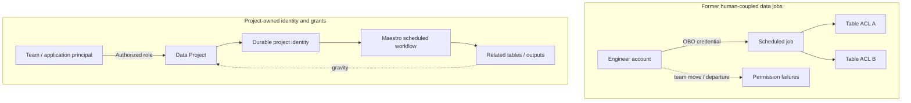

# Netflix Data Projects — From Human-Tied Credentials to Durable Data-Workload Identity

**Case ID:** `case.netflix.durable-data-project-identity` · **Issue:** E16-05 #118 · **Status:** evidence-bounded draft; independent acceptance pending.  
**Primary:** N17, Amer Hesson, Marcelo Mayworm, James Mulcahy and Brittany Truong, [Netflix TechBlog, 2026-05-11](https://netflixtechblog.com/data-projects-managing-data-assets-at-netflix-scale-7ca25888591e). Exact source sections: **Problem 1**, **Problem 2**, **Enter Data Projects**, **Grants and Roles**, **The Identity Umbrella**, **Securing Data Workflows**, **Data Projects: Durable Identity**, **Success Stories**, **Using Data Projects**, **What's Next**. Public article and original paraphrase only; no private Netflix IAM implementation or screenshots imported.

## Legacy security and reliability failure

Netflix's data warehouse had **millions of tables** and **tens of thousands of scheduled workloads**, according to the May 2026 report. Access management was primarily per-asset, and many asynchronous jobs ran under their human creator's identity. An organization reallocation required rewriting many ACLs, leading either to support backlogs or overly broad grants. A scheduled job could also fail when the person whose delegated identity it used changed teams or left; replacing that person with another operator frequently revealed missing permissions in a chain of failures. This was simultaneously a **least-privilege, ownership and service-continuity** defect, not just inconvenient login. [N17, 'The Problem', 'Problem 1', 'Problem 2'].

## A different security principal, not a longer-lived human token

Netflix introduced *Data Projects*: logical containers grouping related assets (tables, jobs, secrets) and a project-owned, durable identity which workloads may assume. Grants to people, groups, applications and CI jobs are assigned project-level roles; an optional IAM role may be exchanged using the platform identity for AWS tasks. The workflow manager can mint identity for authorized scheduled work rather than borrowing a departed engineer's credentials. Under the feature called **gravity**, new assets created by a project workload are attached automatically to the project. [N17, 'Enter Data Projects', 'Grants and Roles', 'The Identity Umbrella', 'Securing Data Workflows'].

**Text alternative:** before, scheduled work borrowed a particular human's identity and needed per-table grants; staff changes could break the job. After, the executing identity belongs to a project, while membership and privileges are managed separately. Newly generated assets are associated with project ownership. The diagram is original and conceptual, not a replica of Netflix's access-control diagrams.

## Actual security and rollout boundaries

| Part | Company-reported design | What remains uncertain |
|---|---|---|
| Container/roles | Project grants cover users, teams, applications and CI | Precise implementation of policy inheritance, revocation timing and emergency breaks not in the article |
| Durable execution | Maestro is an authorized Trusted Workload Manager that mints workload identities | Specific cryptographic token lifetime, issuer keys and service-to-service authorization internals not disclosed |
| AWS use | Optional IAM role for Spark/EMR can be exchanged through Netflix identity | Cannot infer all cloud permissions are minimized automatically |
| Asset grouping | Generated tables are attached to project through 'gravity' | Asset discovery/version-race and access to preexisting assets require explicit rollout design |
| Adoption | Reported production projects contain tens of thousands of assets; named QoE and Member Analytics examples | No independently audited total migrated workflow fraction or cross-service defect-rate |

In the section **Using Data Projects**, the authors acknowledge that moving existing jobs requires ensuring the destination project has correct permissions *before* changing the execution identity. Tooling to recommend precise grants from observed access patterns is described as work under way, **not a fully available or secure auto-grant system**. Similarly, cross-platform projects, policy rightsizing and activity timelines in **What's Next** are plans, not completed features.

## Hypothetical migration/ADR

**Context:** 2,000 scheduled ETL jobs across 70 teams currently use human tokens; reorgs lead to intermittent outages. Those numbers are Tycho's synthetic requirements, **not Netflix metrics**.

**Decision:** inventory workloads and asset ownership, create a stable project identity with smallest practical authorization scope, shadow permission checks, then canary run identity switching per job. Preserve a reversible credential execution path until successful runs and token validity are proven. Require a security reviewer before bulk grant changes.

**Alternatives:** (a) service accounts per job are simpler when workloads are few but can create identity sprawl; (b) centrally managed team-level identities reduce human fragility but risk very broad grants; (c) project-owned scoped identity balances administration and authority if the platform can operate delegated tokens and meaningful project boundaries.

**Counterexample:** A project identity with uncontrolled group-level write grants can increase blast radius relative to carefully managed table ACLs. Better continuity alone is not proof of least privilege. A synthetic 'every project gets admin' grant is a dangerous anti-pattern.

**Validation:** identity lifetime, role revocation, delegated execution audit, effective grant diff, permission errors by owner transfer, orphaned assets, data retention obligations and ability to restore execution after temporary identity-provider errors. Confirm that no user can assume a privileged project merely by creating a new CI job.

## Evidence and reviewer gaps

Company self-report from a May 2026 production description; not an independently reproduced audit. **Do not infer** a complete fleet migration or verified platform-wide policy reduction. This draft closes a *security/identity subject-matter gap in the case set*, while acceptance and rights remain with #121. The original source remains [N17](https://netflixtechblog.com/data-projects-managing-data-assets-at-netflix-scale-7ca25888591e).
