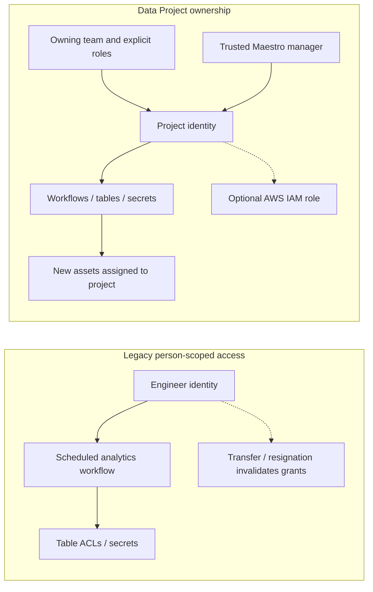

# Netflix — Data Projects: durable workload identity over individual engineer credentials

**Case ID:** `case.netflix.data-projects-durable-identity` | **M9:** E16-04 #117 | **Status:** source-backed draft; independent review pending  
**Primary:** N17, Amer Hesson, Marcelo Mayworm, James Mulcahy and Brittany Truong, [Netflix TechBlog, 2026-05-11](https://netflixtechblog.com/data-projects-managing-data-assets-at-netflix-scale-7ca25888591e). Exact sections: "The Problem: Managing Assets at Netflix Scale", "Problem 1: Permissions", "Problem 2: Workloads tied to human identities", "Enter Data Projects", "Grants and Roles", "The Identity Umbrella", "Gravity", "Data Projects: Durable Identity", "What's Next". Original text, diagrams and company code are not reproduced.

## Why the historical arrangement failed

Millions of warehouse tables and tens of thousands of scheduled workloads had accumulated fine-grained access control lists. Each table had an ACL. Scheduled Maestro/data movement/Spark work ran as the human engineer who authored it. Organizational changes became a security and reliability problem: team reorganizations required tedious per-table permission rewrites, encouraging overly broad access, and a person's departure or role change invalidated the identity used by unattended production jobs. Assigning another person's identity merely moved the failure to another employment lifecycle. These failure modes are explicitly reported in the Netflix source; no independent outage frequency was published.

## New ownership and authorization boundary

Netflix's **Data Projects** raise management from individual assets to logical project ownership. Each project groups tables, workflows and created assets; project grants specify users/groups/applications/CI identities and roles. A durable synthetic project identity is distinct from the human users who manage the project. Maestro's trusted-workload-manager authority allows it to mint task identity tokens on behalf of authorized project workloads; downstream data and resource policies evaluate that identity. An optional AWS IAM role can be associated for specialized execution. The company also describes automatically associating assets created under project identity with the project ('gravity').

**Text alternative:** in the old design scheduled jobs depended on an individual's permissions, which could disappear. In the newer design project grants and identity are owned by a durable team/project boundary, while a trusted orchestrator validates execution and new assets join the same project. The simplified schematic is Tycho-original, not Netflix's deployment topology.

## Adopting the change without privilege escalation

The published onboarding sequence is project creation/selection, granting appropriate membership roles, and configuring each workflow to run under the project identity. Netflix notes migration is not trivial because effective permissions must be understood **before** flipping the identity; its tools for recommending precise grants based on observed legacy access were still **in progress** at publication. A legitimate migration cannot blindly copy every engineer permission into an always-on project principal.

For a hypothetical legacy platform, use the following *Tycho-designed* rollout gates:

1. Inventory unattended workflows, their true data dependencies and currently effective identity permissions from audit logs; isolate emergency/break-glass access.
2. Assign each job a durable project owner, separate administrator, and narrowly scoped service principal. Prefer deny-by-default grants and periodic review.
3. Shadow authorization: run staged jobs with project identity against representative data, inspect missing grants and unauthorized excess privileges without changing production authority yet.
4. Bind secrets and cloud roles to the project boundary, preserve tenant/data-policy boundaries, and implement token expiry, revocation and rotation.
5. Roll out by workflow cohort; alert on unauthorized access, output divergence and orphaned objects. Make emergency rollback and auditability explicit.
6. Retire human 'on-behalf-of' workload identity only after completeness tests and ownership approval.

These are **external recommendations**, not Netflix's internally documented entire procedure.

## Realized versus planned features as of May 2026

| Feature | Source description | Acceptance limit |
|---|---|---|
| Project-level asset grouping, grants and roles | Reported implemented | Specific granularity and policy intersections need the original source |
| Durable Netflix application identity, optional IAM role | Reported implemented | Cross-cloud permission correctness not independently audited |
| Automatic project association of created assets ('gravity') | Reported implemented for described workloads | Does not prove every legacy table already migrated |
| Existing production use in Streaming QoE and Member Analytics | Source-reported example | No exact completeness percentage, escaped security defects or independent availability measurement |
| Automatic permission right-sizing from usage | Described in **"What's Next"** | **Planned**, not a delivered security guarantee |
| Project abstraction expanded to repos, Docker images, studio assets | Long-term possibility | **Future direction**, not part of implemented data identity scope |
| Unified project activity/audit timeline | Future investment | Must not claim already generally available |

## Alternatives, counterexamples and applicability

A small service with a stable per-application service principal may not need an extra project resource hierarchy; additional abstraction and IAM federation can create complexity. Conversely, an analytics platform with thousands of scheduled jobs across reorganizing teams benefits from decoupling workload identity from employees. But a shared single project principal across all teams may violate least-privilege principles or obscure individual audit trails. Authorization should account for **both** project and acting user when required; durable identity does not authorize granting everyone all project resources.

The distinctive architecture lesson is that **identity lifetime should match the workload lifetime and ownership boundary**, not employee tenure. For a legacy modernization agent, reject migrations that cannot explain effective permissions after the cutover.

## Bounded claim matrix and provenance

| Claim | Original section | Evidence class |
|---|---|---|
| Individual ACLs plus human-owned scheduled workload identities caused operational permission churn | N17 "Problem 1", "Problem 2" | First-party experience |
| Project identity + grants + optional IAM role, Maestro authorized minting | N17 "Identity Umbrella", "Securing Data Workflows" | First-party design |
| New assets inherit project organization/grant boundary | N17 "Gravity" / "Durable Identity" | First-party behavior |
| Broad automatic rightsizing and asset-generalization roadmap | N17 "What's Next" | **Not yet implemented** according to article |

The article's qualitative 'success stories' are anecdotal company reports, not externally audited security posture. Source read date: 2026-10-19; diagram original; no private publisher material copied. **Review:** pending M9 #121 and full authoring provenance check.
